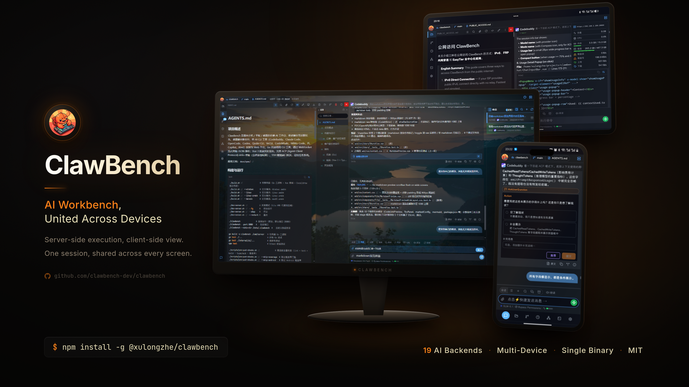
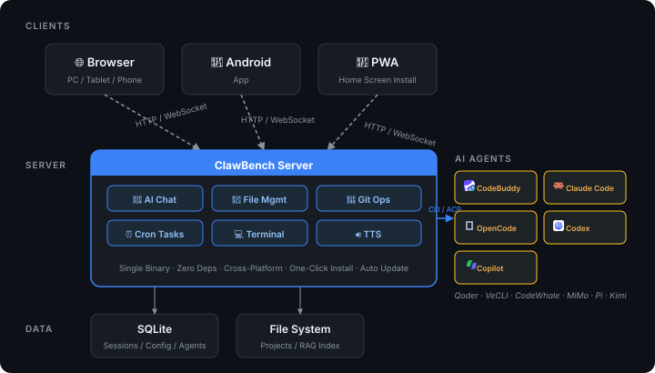

[English](README.en.md) | [中文](README.md)

# ClawBench — AI Workbench, United Across Devices

<p align="center">
  
</p>

**From Palm to Desktop** — An AI workbench for every screen.

Brings the full power of AI coding agents to every screen — phone, tablet, and desktop. File browsing, code editing, AI conversation, Git operations, tasks, one app does it all, whether you're on the go or at your desk.

Core Advantage: Native passthrough of AI capabilities (tool calls, extended thinking, Skills, MCP) with zero adaptation cost, fully preserving the power of coding agents. ClawBench is a complete workbench on every platform — files, code, Git, AI, tasks, TTS — with mobile interactions carefully crafted for one-handed use and full desktop support for serious work.

- **Supported Platforms**: Browser (PC / Tablet / Phone), Android App, PWA
- **AI Backends**: CodeBuddy, Claude Code, OpenCode, Codex, Qoder CLI, VeCLI, CodeWhale, DeepSeek Harness, MiMo-Code, Pi, Copilot, Kimi, Antigravity, Grok Build, ZCode, Cursor, Hermes Agent, Command Code, OpenClaw

📖 **User Guide** (Chinese): [ClawBench User Guide](docs/user-guide/README.md)

<p align="center">
  
</p>

---

## Quick Start

### Prerequisites

- **A PC (Linux / macOS / Windows) or an Android phone with [Termux](docs/user-guide/TERMUX.md)**: To run the ClawBench server, with at least one AI coding agent CLI installed (CodeBuddy, Claude Code, OpenCode, Codex, Qoder CLI, VeCLI, CodeWhale, MiMo-Code, Pi, Copilot, or Kimi)
- **Any device**: Install the [ClawBench Android App](https://github.com/xulongzhe/clawbench/releases), or open the server address in any browser — desktop, tablet, or phone

### npm Install

Install via npm in one command:

```bash
npm install -g @xulongzhe/clawbench
# Start
clawbench
```

Supports Linux (x64/arm64), macOS (Intel/Apple Silicon), and Windows (x64). npm automatically selects the correct platform-specific binary package.

### Download & Start

Download the latest ZIP package from [GitHub Releases](https://github.com/xulongzhe/clawbench/releases), extract and you're ready:

```bash
# Asset names carry the version, so resolve the latest tag before building the URL
TAG=$(curl -sI https://github.com/xulongzhe/clawbench/releases/latest \
  | grep -i '^location:' | sed 's|.*/tag/||' | tr -d '\r\n')
wget "https://github.com/xulongzhe/clawbench/releases/download/${TAG}/clawbench-linux-amd64-${TAG}.zip"
unzip "clawbench-linux-amd64-${TAG}.zip"
cd clawbench
./clawbench
```

### Docker Deployment

```bash
docker pull ghcr.io/clawbench-dev/clawbench:latest
docker run -d --restart unless-stopped -p 20000:20000 -v clawbench-data:/data ghcr.io/clawbench-dev/clawbench:latest
```

Customize the host port with `-p` (e.g., `-p 20300:20000`). The `clawbench-data` volume persists all data.

> `--restart unless-stopped` (or `always`) is required for in-app upgrades: the container replaces its own binary and exits with code 0, and Docker's restart policy brings the new version back up. Do **not** use `--restart on-failure` — a graceful shutdown exits 0, so it never triggers and the container stays stopped. The recommended upgrade path is still `docker pull` + recreate the container, since rebuilding from an unchanged image reverts the in-place replacement.

To view the auto-generated password:

```bash
docker exec $(docker ps -qf ancestor=ghcr.io/clawbench-dev/clawbench) cat /data/.clawbench/auto-password
```

> A random 32-character hex password (128-bit entropy) is auto-generated on first startup and printed to the console in a bordered box. Save it securely.

Once deployed, access `http://server-ip:20000` from your phone app or any browser:

- **Android App**: Native integration, auto-connect, full feature support
- **Mobile / Desktop Browser**: **Chrome** recommended on mobile — supports installing as a PWA app (Add to Home Screen) for a near-native experience

### 📱 Run Completely on an Android Phone (Termux)

> See the full guide in **[Termux (Android)](docs/user-guide/TERMUX.md)**.

ClawBench runs completely on your Android phone inside [Termux](https://f-droid.org/repo/com.termux.app.apk). The pure-Go `linux-arm64` backend, the built-in web frontend, and your AI coding agents all run locally on the phone — no separate PC or server required:

```bash
pkg install -y nodejs-lts git
npm install -g @xulongzhe/clawbench
clawbench
```

> 📡 **Public Access**: To access ClawBench from the public internet (commuting, traveling, etc.), see the **[Public Access Guide](docs/user-guide/PUBLIC_ACCESS.md)**  — supports IPv6 direct connection and EasyTier decentralized networking (no VPS required).

---

## Core Features

> The table below is a feature overview. **Per-feature instructions, screenshots, and edge cases live in the [ClawBench User Guide](docs/user-guide/README.md) (Chinese).**

| Module | Highlights |
|---|---|
| 📁 **File Management** | Recursive browsing (120+ extensions), search & sort, list/grid views, multi-select batch ops, upload & directory-tree download, drag-and-drop move, paste upload, **untitled-buffer new file** (named on first save), `.gitignore`-aware dimming, **file share links** (revocable capability tokens; in-page relative-link navigation in the share page), **interactive OpenAPI/Swagger preview** |
| 🎨 **Code Preview & Editing** | CodeMirror browse/edit dual mode, **syntax highlighting for 170+ languages** (across the editor and the preview renderer; long-tail grammars lazy-load, so the first screen does not pay for them), autocompletion (11 languages), **Sticky Scroll**, VS Code-style search bar, diff flash highlighting, **Excalidraw canvas** (`.xdraw` / `.excalidraw`), **HTML render preview** (sandboxed iframe, shared by the quick-preview pane and the viewer; find-in-page and quote-on-selection work inside it), path jumps with line ranges |
| 📝 **Markdown** | Render/source toggle, TOC drawer, LaTeX, Mermaid, **inline zoom** (click a diagram on desktop to zoom in place — cursor-anchored wheel zoom and drag-to-pan, no fullscreen detour), image lightbox, **code-link preview overlay**, **self-contained HTML export** (KaTeX fonts inlined) |
| 📄 **Documents & Media** | Native Word / Excel / PowerPoint rendering, paged PDF with zoom, inline image/audio/video players, lightbox |
| 🤖 **AI Agents** | **19 backends** (CodeBuddy, Claude Code, OpenCode, Codex, Qoder, VeCLI, CodeWhale, DeepSeek Harness, MiMo, Pi, Copilot, Kimi, Antigravity, Grok Build, ZCode, Cursor, Hermes Agent, Command Code, OpenClaw), **custom ACP agents** (any tool that speaks ACP over stdio — give it a spawn command, no backend adapter needed), streaming responses, visible reasoning, **sub-agent content grouping**, **multi-agent team panel** (CodeBuddy Agent Teams: member roster with status icons, tool counts and token usage; member output auto-grouped and grouped by member name when the parent card is missing; member badge on permission cards), **custom avatars** (40 DiceBear styles; changing the seed re-renders every tile), **drag-to-reorder** (order applies globally), thinking-depth levels (**remembered per agent + model**, so switching models does not carry the previous level over), persisted model choice, **tap-to-switch model** (Hermes goes through `session/set_model`), persisted ACP context state, **session/task counts + disable toggle + delete guard** (a disabled agent is hidden from every creation entry; existing sessions are unaffected), **"current project only" scope** (an agent visible in just one project), **cross-agent skill discovery** (a Skill installed by any agent is visible to all agents, including **project-local `.agents/skills`**, with git-source sync and deduplication; auto-injection is opt-in, off by default), **MCP servers** (configure once globally and every ACP agent can use them; per agent you choose all / none / a subset, each entry has a **Test** button that performs a real handshake, and `/cb-mcp` lets the AI do the setup in conversation) |
| 💬 **AI Conversation** | Tool-call visualization, **interactive question cards**, suggested replies, slash commands (ACP + built-in merged, including **`/btw` side questions** — answered by the summary model from a session snapshot without occupying the current agent), **unified quote cards** (selection / file / issue / pipeline / message share one form; notes editable, jump back to source; commenting on what you are reading **delivers straight to the active session**, cross-session quoting moved to a **long-press** on the quote bar, and the expanded bar shows a persistent "send to <session>" row to retarget), **external links rendered as selectable text** (long-press to copy; a tap shows the full URL and asks before leaving the app), message queue, **mid-turn interjection** (fold a message into the reply being generated; merge-only backends like Claude/Codex mark it "merged into previous reply"), disconnect protection, **auto-continue on abnormal termination**, **auto-cruise** (a per-session orthogonal switch: the AI keeps pushing the task forward until it confirms completion, instead of handing the floor back after one reply), rewind & fork, auto-summary, RAG result cards, draft restore, completion popup |
| 👥 **AI Group Chat** | **Multi-agent collaboration/debate**: bring several agents (across backends) into one group. **Host mode** — a host decides who speaks next and gives the instruction; members speak in turn sharing context and a summary is produced at the end; **Free mode** — no host, members relay via **@-mentions**, and can @ you to hand the floor back. **Auto-cruise** (an orthogonal switch) — when on, the loop no longer hands the floor back; members keep working until they confirm the task is done (host decides alone / free mode confirms by majority), with an "Auto-cruise" chip in the session info bar. **The same agent can be added multiple times (instances)** — each instance gets its own nickname (name-pool) and avatar, and discloses the **real agent name**; members have **independent persistent connections** (reusing resume/idle reclamation), **incremental injection** (only what's new since a member last spoke), **@-mention cards** (the card itself is the public call-out, its note is the BCC), **user nickname** (how members address you; kept distinct from agent names both ways), **BCC** (visible to one member only), **parallel speaking** (simultaneously, without seeing each other), **per-member context usage & single-member compaction** (see each member's own window in the roster, compact one member without disturbing the group timeline), member add/remove system events, in-group attachments & quotes, **tap a speaker's avatar to open that agent's config**, human interruption anytime (queued as "interject"), `/cb-*` commands run by the host |
| 📂 **Session Management** | Create / switch / archive / **remove** sessions, **session tags** (project-scoped, hash-colored), **AI auto-naming** (title generated by the summary model after the first message; shares one implementation with manual "generate title"), unread counted **per item**, per-project session restore, swipe-to-switch toggle, **session sharing** (a public read-only link to the selected messages; the body is assembled live, so the link never grows with the conversation while summaries, renames and avatars stay current; in-page TOC, gap markers, machine-readable discovery metadata, managed per project) |
| 🗂️ **Project Management** | Project registry (**Settings → Project** lists every project: session count, last-active, directory status, repo kind), one-tap switch, **delete project data** (clears all of that project's sessions / messages / tasks / tags / shares / RAG index without touching the directory on disk; a project whose directory is gone only needs a second confirmation), project identity as an integer id (renaming/moving a directory is a single UPDATE) |
| ⏰ **Task Scheduling** | Cron schedules (presets + custom) and **event triggers** (`issue.opened` / `pr.merged` / `pipeline_done`), optional **pre-AI script** (cron only; a silent exit 0 skips the AI run and sends no notification), in-chat `/cb-task` creation entry, 3-level breadcrumb navigation, **"Stop" button while running** (halts every running execution of the task in one tap), continue-chat from run details, completion push |
| 🔗 **Git & Forge** | Commit history, **branch graph**, diff view, working-tree changes, three-tab management (worktree/branches/tags), swipe-to-delete; **GitHub / GitLab integration** (Activity/Issues/Merges/Pipelines tabs, "mine" filters, event-driven tasks, quote to chat, per-host credential isolation) |
| 💻 **Web Terminal** | PTY + xterm.js, multi-session multi-tab, **three-mode gesture system**, virtual key toolbar, key/symbol config, quick commands, **open current directory** (tracks live `cd`), **drag-and-drop upload into the shell's cwd**, 157 terminal themes, mobile input drawer |
| 📊 **Statistics** | Usage overview (donut with cache-hit drilldown, including **AI working time** — total wall-clock time across model calls and tool execution, auto-scaled from milliseconds to days), dimension filters and chart switching, **code inventory** (gocloc per-language snapshot), **code churn** (per-author time trend); the header also carries a **usage capsule** (cycle budget vs a linear baseline, on a **fixed-day or calendar-month** cycle; one alert when you run ahead and one when it is exhausted — advisory only, never blocking) |
| 🔊 **Speech** | **TTS**: 5 engines (Edge / OpenAI-compatible / Piper / Kokoro / MOSS-Nano), summary backend simple / api / **auto (content-based routing)**, group chat read aloud per speaker in turn; **STT**: streaming and non-streaming modes, vLLM Whisper |
| 🔀 **SSH Tunnel** | Transparent for all protocols (HTTP/HTTPS/WS/SSE/gRPC), **bidirectional port mapping** (forward ssh -L + reverse ssh -R), arbitrary target hosts, automatic port allocation, health check & reconnect, one-tap localhost URL |
| 🎨 **Themes** | **36 named themes**, live system-follow, **circular-reveal theme-switch animation** (expands from the top-right button to fill the screen), **custom wallpaper** (local gallery / Bing daily / **animated styles**; opacity/blur, per-device selection), custom fonts, **stepless UI scaling** (50%–200% in 1% steps; the whole UI — icons and terminal font included — scales off the root font size), quick theme picker |
| 📱 **Multi-Device** | Android App (native bridge, **floating status window**, **Live Updates / Dynamic Island**, self-update, version-mismatch detection, full i18n), installable PWA, full local run on a phone via Termux |
| 🖥️ **Desktop Client** | Electron shell hosting the same Web UI; **frameless window on Windows / Linux** (minimize/maximize/close drawn in the header; macOS keeps its native traffic lights); native system notifications (click to open session/task/repo, **still delivered while minimized**), native context menu, external links to default browser, **SSH port mapping** (keepalive + auto-reconnect), multi-server management (safeStorage-encrypted credentials, **per-server passwords**), **resolution-based auto UI scaling** (Ctrl+wheel / Ctrl+=/-/0 native zoom), **self-update** (side-by-side install + pointer switch, rollback-capable; **incremental payload** swaps only `resources/` and reuses the Electron runtime; GitHub/npm mirrors in CN), `Ctrl+Shift+R` hard refresh / `F12` DevTools |
| 🔔 **Notifications** | **Notification center** (a left-dock tab that gathers session/task/repo events into a traceable log, filtered by project/type/time; deliberately separate from the badges), sound + haptics, desktop system notifications, task-completion push, **DingTalk / Feishu bot push** (browse sessions and send messages from IM) |
| 🔒 **Security** | Salted SHA-256 password, path-traversal protection, Git argument-injection guards, XSS sanitization (DOMPurify), **short-lived HMAC tokens** (local requests no longer trusted by address alone), TLS auto-discovery, per-instance cookie isolation |

---

## FAQ

See **[FAQ](docs/user-guide/FAQ.md)** (Chinese).

---

## License

Copyright (c) 2026 xulongzhe

Licensed under the MIT License
