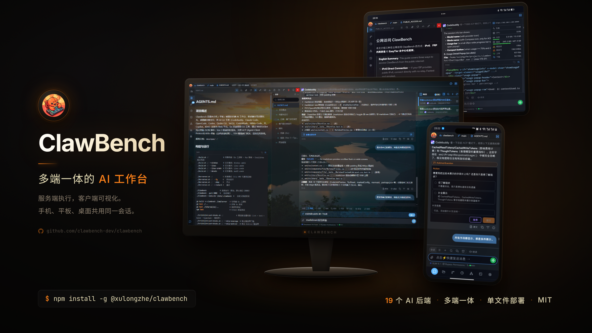
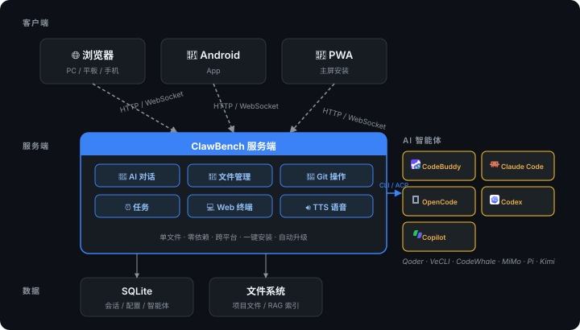

[中文](README.md) | [English](README.en.md)

# ClawBench —— 多端一体的 AI 工作台

<p align="center">
  
</p>

> 🏠 **项目主页**：[https://clawbench.pages.dev/](https://clawbench.pages.dev/)
>
> 🎬 **演示视频**：[OpenClaw 和 Hermes 就是玩具，于是我写了一个能干活的](https://b23.tv/ewACF0h) — Bilibili

**从掌心到桌面，多端一体的 AI 工作台。**

将强大的 AI 编程智能体能力带到每一块屏幕——手机、平板与桌面。文件浏览、代码编辑、AI 对话、Git 操作、定时调度、命令行终端 —— 一个应用，全部搞定，无论你在通勤路上还是坐在桌前。

**单文件部署，无任何依赖**

<p align="center">
  
</p>

- **支持平台**：浏览器（PC / 平板 / 手机）、Android App、PWA、HarmonyOS（实验性）；AI 智能体可在 PC 上运行，也可通过 [Termux](docs/user-guide/TERMUX.md) 在安卓手机上完全运行
- **AI 后端**：CodeBuddy、Claude Code、OpenCode、Codex、Qoder CLI（国际版 / 国内版）、VeCLI、CodeWhale、DeepSeek Harness、MiMo-Code、Pi、Copilot、Kimi、Antigravity、Grok Build、ZCode、Cursor、Hermes Agent、Command Code、OpenClaw

📖 **使用手册**：[ClawBench 使用手册](docs/user-guide/README.md) · [在线版（带侧栏目录）](https://clawbench.pages.dev/docs/)

---

## 快速开始

HarmonyOS 原生客户端正在实验性移植中，开发构建、已支持能力及尚未完成的范围见 [HarmonyOS 客户端说明](harmony/README.md)。当前尚未作为正式发行平台。

### 前置准备

- **一台 PC（Linux / macOS / Windows）或装有 Termux 的安卓手机**：用于运行 ClawBench 服务端，并安装至少一个 AI 编程智能体 CLI（CodeBuddy、Claude Code、OpenCode、Codex、Qoder CLI、VeCLI、CodeWhale、MiMo-Code、Pi、Copilot、Kimi）
- **任意设备**：安装 [ClawBench Android App](https://github.com/xulongzhe/clawbench/releases)，或用任意浏览器（桌面 / 平板 / 手机）访问服务端地址

### npm 安装

通过 npm 一键安装，国内用户走淘宝源秒下：

```bash
# 配置淘宝镜像（仅需一次）
npm config set registry https://registry.npmmirror.com/
# 全局安装
npm install -g @xulongzhe/clawbench
# 启动
clawbench
```

### 安装包部署

从 [GitHub Releases](https://github.com/xulongzhe/clawbench/releases) 下载最新版 ZIP 包，解压即可运行，无需安装：

```bash
# 资产文件名带版本号，所以先解析最新 tag 再拼下载地址
TAG=$(curl -sI https://github.com/xulongzhe/clawbench/releases/latest \
  | grep -i '^location:' | sed 's|.*/tag/||' | tr -d '\r\n')
wget "https://github.com/xulongzhe/clawbench/releases/download/${TAG}/clawbench-linux-amd64-${TAG}.zip"
unzip "clawbench-linux-amd64-${TAG}.zip"
cd clawbench
./clawbench
```


### Docker 部署

```bash
docker pull ghcr.io/clawbench-dev/clawbench:latest
docker run -d --restart unless-stopped -p 20000:20000 -v clawbench-data:/data ghcr.io/clawbench-dev/clawbench:latest
```

修改 `-p` 可自定义端口（如 `-p 20300:20000`），`clawbench-data` 卷持久化数据。

> `--restart unless-stopped`（或 `always`）是应用内升级的必要条件：容器会替换自身二进制并以退出码 0 退出，依赖 Docker 重启策略把新版本拉起来。请勿使用 `--restart on-failure`——优雅退出的退出码为 0，不会触发重启，容器会停在停止状态。推荐的升级方式仍是 `docker pull` 后重建容器——用未更新的镜像重建会回退就地替换的结果。

> 首次启动会自动生成32位随机密码，以字符框突出打印到控制台，请妥善保存。

部署完成后，使用手机 App 或任意浏览器访问 `http://服务器IP:20000` 即可开始使用。

### 📱 在安卓手机上完全运行（Termux）

> 完整指南见 **[Termux（安卓）](docs/user-guide/TERMUX.md)** 。

ClawBench 可在安卓手机的 [Termux](https://f-droid.org/repo/com.termux.app.apk) 终端模拟器中**完全运行**：纯 Go 的 `linux-arm64` 后端、内置 Web 前端、AI 编程智能体全部在手机本地执行，无需额外 PC 或服务器：

```bash
pkg install -y nodejs-lts git
npm install -g @xulongzhe/clawbench
clawbench
```

> 📡 **公网访问**：如需从外网访问 ClawBench（通勤途中、出差等场景），请参阅 **[公网访问指南](docs/user-guide/PUBLIC_ACCESS.md)** ，支持 IPv6 直连、EasyTier 去中心化组网（无需 VPS）等方式。

---

## 核心功能

> 下表是功能概览。**逐项操作说明、截图与边界情况见 [ClawBench 使用手册](docs/user-guide/README.md)。**

| 模块 | 能力概要 |
|---|---|
| 📁 **文件管理** | 递归浏览（120+ 扩展名）、搜索排序、列表/网格视图、多选批量操作、上传与目录树下载、**同名文件冲突可选覆盖 / 保留两者**、**弱网自动重试**（上传退避重试，下载按 Range 断点续传）、拖放移动、粘贴上传、**未命名缓冲新建文件**（保存时才命名）、按 `.gitignore` 灰显、**文件分享链接**（capability token，可撤销；分享页内 Markdown 相对链接可原地跳转）、**OpenAPI/Swagger 交互式预览** |
| 🎨 **代码预览与编辑** | CodeMirror 浏览/编辑双模式、**语法高亮覆盖 170+ 种语言**（编辑器与预览两条渲染路径合计，长尾语法包按需懒加载，首屏不为此付费）、自动补全（11 种语言）、**Sticky Scroll**、VS Code 风格搜索条、文件改动闪烁高亮、**Excalidraw 画布**（`.xdraw` / `.excalidraw`）、**HTML 渲染预览**（沙箱 iframe，快捷预览窗格与查看器共用，预览内可查找与划词引用）、路径跳转与行范围导航 |
| 📝 **Markdown** | 渲染/源码切换、TOC 抽屉、LaTeX 公式、Mermaid 图表、**内联缩放**（桌面端点图就地放大：滚轮围绕光标缩放、拖拽平移，不必开全屏灯箱）、图片灯箱、**代码链接预览浮层**、**自包含 HTML 导出**（KaTeX 字体内联） |
| 📄 **文档与媒体** | Word / Excel / PowerPoint 原生渲染、PDF 分页缩放、**CSV / TSV 表格视图**（全局与按列搜索、点表头排序、分页、按值筛选 / 隐藏 / 冻结 / 列统计 / 数据条等列菜单，源文件仍可编辑）、图片/音频/视频内联播放、灯箱放大 |
| 🤖 **AI 智能体** | **20 个后端**（CodeBuddy、Claude Code、OpenCode、Codex、Qoder / Qoder CN、VeCLI、CodeWhale、DeepSeek Harness、MiMo、Pi、Copilot、Kimi、Antigravity、Grok Build、ZCode、Cursor、Hermes Agent、Command Code、OpenClaw）、**自定义 ACP 智能体**（任何以 stdio 说 ACP 的工具，填启动命令即可接入，无需后端适配）、流式响应、思维过程可见、**子智能体内容分组**、**多智能体团队面板**（CodeBuddy Agent Teams：成员名册 + 状态图标 + 工具计数 + token 用量，成员内容自动归组、父卡片缺失时按成员名兜底，权限卡带成员徽标）、**自定义头像**（40 款 DiceBear 风格，改种子整体刷新）、**拖拽排序**（顺序全局生效）、深度思考档位（**按「智能体 + 模型」分别记忆**，换模型不会把上一档位硬套过去）、模型选择持久化、**点选即切换模型**（Hermes 走 `session/set_model`）、**模型单价**（选择器里显示每百万 token 的输入/输出报价，按公开目录估算、约数标 `~`）、ACP 上下文状态持久化、**会话/任务计数 + 禁用开关 + 删除守卫**（禁用即从所有新建入口隐藏、已有会话不受影响）、**「仅当前项目」作用域**（智能体只在某个项目可见）、**跨智能体技能发现**（任意智能体安装的 Skill 对所有智能体可见，含**项目自带 `.agents/skills`**、git 源同步与去重；自动注入为 opt-in，默认关）、**MCP 服务**（全局配一次，所有 ACP 智能体默认可用；按智能体可设为全部/禁用/只选几个，配完带「测试」按钮真实握手验证，也可用 `/cb-mcp` 让 AI 代配） |
| 💬 **AI 对话** | 工具调用可视化、**交互式提问卡**、推荐回复、斜杠命令（合并 ACP 与内置，含 **`/btw` 旁路问答**——由摘要模型基于会话快照作答，不占用当前 agent）、**统一引用卡片**（划词/文件/议题/流水线/消息同一形态，批注可改、可跳回来源；批注眼前内容时**默认直投当前会话**，跨会话引用改为**长按**浮条按钮，展开态顶部常驻「发送到 <会话名>」一行可随时换目标）、**外链统一为可选中文本**（长按可复制、点击先确认完整 URL 再打开）、消息队列、**运行中插话**（把消息并入正在生成的回复，Claude/Codex 合并式插入会标注「回复已并入上一轮」）、断连保护、**异常终止自动继续**、**后台任务跑完后自动回来汇报**（CodeBuddy 在后台命令结束时自己开一轮，结果照常落库与推送）、**自动巡航**（会话级正交开关，AI 持续自我推进到确认任务完成，而非回复一轮就交回）、消息回溯（Rewind）与分叉、自动摘要、RAG 结果卡片、输入草稿恢复、完成弹窗 |
| 👥 **AI 群聊** | **多智能体协作/辩论**：把多个智能体（可跨后端）拉进一个群。**主持人模式**——主持人决定下一个谁发言并下达指令，成员轮流发言、共享上下文，结束时产出汇总；**自由模式**——无主持人，成员用 **@ 提及**接力，可 @ 你交回人类。**自动巡航**（正交开关）——打开后循环不再交回你，而是持续讨论到成员确认任务已完成（主持人一人拍板 / 自由模式过半确认），会话信息栏显示「自动巡航」chip。**同一智能体可加多次（多实例）**——每个实例有独立称谓（名池名）与头像，并披露**真实智能体名**；成员**独立持久连接**（复用 resume/空闲回收）、**增量注入**（只补上次发言后的新内容）、**@ 成员卡**（卡片即公开点名、批注即密送）、**用户称谓**（成员怎么称呼你，与智能体名双向不重名）、**密送**（只给指定成员看）、**并发发言**（同时发言、互不参考）、**按成员的上下文用量与单成员压缩**（花名册里看每个人自己的窗口占用、单独压缩某个成员的记忆且不打断群时间线）、成员增删系统事件、群内附件与引用、**点发言人头像直达该智能体配置页**、人类随时插话（排队「插话」）、`/cb-*` 命令由主持人执行 |
| 📂 **会话管理** | 多会话创建/切换/归档/**移除**、**默认按创建时间排序**（列表不会边读边跳位，可在 设置 → 聊天 切成「最近活动优先」，手动拖动顺序始终优先）、**其他项目会话**（默认接在本项目列表下方成组卡片，可切成列表底部页签；点卡片原地展开该项目的全部会话，点会话直接切项目）、**会话标签**（按项目隔离、哈希配色）、**AI 自动命名**（首条消息后由摘要模型生成标题，与手动「生成标题」同实现）、未读按**条目**计数、按项目恢复上次会话、滑动切换开关、**会话分享**（选中消息的公开只读链接，正文实时装配：链接不会随对话增长，但摘要/改名/头像会跟上；含目录导航、缺口标注与机器可读的发现信息，按项目隔离管理） |
| 🗂️ **项目管理** | 项目注册表（**设置 → 项目**列出全部项目：会话数 + 最后活跃 + 目录状态 + 仓库类型）、一键切换、**修改路径**（目录移动/改名后指到新位置即可，历史数据全部跟随、不动磁盘）、**删除项目数据**（清空该项目全部会话/消息/任务/标签/分享/RAG 索引，不触碰磁盘目录；目录已删除的项目免输名二次确认）、项目路径以整数 id 为身份（改名/移动目录只需一条 UPDATE） |
| ⏰ **任务调度** | 定时（Cron 预设 + 自定义）、**事件触发**（`issue.opened` / `pr.merged` / `pipeline_done`）与**邮件触发**（指定邮箱 + 发件人 / 主题 / 正文 / 带附件等门控条件）、可选**前置自定义脚本**（仅定时；静默成功则跳过本次 AI 且不发通知）、对话内 `/cb-task` 创建入口、3 级面包屑导航、**运行中显示「终止」按钮**（一键停掉该任务全部运行中的执行）、执行详情续接对话、完成推送 |
| 🔗 **Git 与 Forge** | 提交历史、**分支图**、Diff 视图、工作树变更、三标签页管理（工作树/分支/标签）、滑动删除；**获取远端**（只更新远端引用，不动分支与工作区）与**领先/落后、未推送提交、远程新提交**标记；**GitHub / GitLab 集成**（动态/议题/合并/流水线四页签、跟我相关筛选、事件驱动任务、引用到对话、按 host 隔离凭据） |
| 💻 **Web 终端** | PTY + xterm.js、多会话多标签、**三模式手势系统**、虚拟按键栏、按键/符号配置、快捷命令、**打开当前目录**（实时跟随 `cd`）、**拖入文件上传到 shell 当前目录**、**16 套终端主题**（精选，带实时配色预览，切换项目 / 刷新页面后恢复终端标签）、移动端输入抽屉 |
| 📊 **数据统计** | 用量总览（环形图下钻缓存命中，含 **AI 工作时长**——模型调用与工具执行的墙钟时间合计，按毫秒/秒/分钟/小时/天自动换挡）、按维度筛选与图表切换、**代码存量**（gocloc 按语言快照）、**代码增量**（按作者的时间趋势）；header 另有**用量胶囊**（周期额度 vs 匀速基准线，周期可选**固定天数或自然月**，超出/用尽各提醒一次，只提醒不拦截） |
| 🔊 **语音** | **TTS**：2 种引擎（Edge / OpenAI 兼容），总结后端 simple / api / **auto（按内容自动分流）**，长回复**按段合成、边合成边播**且总结失败时改读全文（不再只念后半截），群聊按发言人轮流朗读；**STT**：流式与非流式双模式，OpenAI 兼容接口（如 vLLM Whisper）与豆包 Seed-ASR；**连续对话**（一直开麦，说到触发词或停顿就发送、答完自动再听，回答期间可开口打断）；**嵌入式一体化语音接口**（一条 WS 里完成「识别 → 生成 → 朗读」或「生成 → 朗读」，直接推 PCM，且一条连接可连续跑多轮） |
| 📹 **视频会议** | 左栏 Dock 页签，一场会留一条**永久记录**：桌面客户端 / Android App / 桌面浏览器都能发起，**token 链接**给匿名观众在浏览器观看，无需登录；**默认纯 P2P WebRTC**（服务端只转发 SDP/ICE、零新增端口、8 人、无 TURN），人数多时一键切**中继服务**（独立部署的 LiveKit，主播只上传一份，房间不设人数上限、可跨网段）；**没有会议类型**——屏幕（整屏 / 窗口）、摄像头、麦克风都是设备卡片，会中随时换且不重协商；发言两层授权、成员反向共享屏幕（需 HTTPS）、Windows 可被观众远程控制（指针 + 键盘）；**AI 听记**按信道分离（说话人标签就是各自称谓）→ 结合项目文档的**校对版转写** → 纪要，三个产物都能**单独重新生成**（转写支持重跑语音识别）；**关键画面**自动截图并按时间线插进转写；产物永久落 `.clawbench/notes/`（整场录音合并成单文件、转写存 WebVTT，会议期间打开的文件、屏幕共享人与画面各成一条时间轴）；记录可改名、会议事件进通知中心 |
| 📧 **邮件** | 内置收发信客户端（左栏 Dock 页签）：多账号 IMAP + SMTP，邮件列表与阅读（HTML 沙箱渲染、远程图片默认拦截、附件下载）、写 / 回复 / 转发、本地草稿、未读角标、**全部已读**；**按宽度自适应**——窄屏逐层下钻，宽屏列表与正文左右分栏；后台每 3 分钟增量收信，**邮件也能作为任务触发条件**（发件人 / 主题 / 正文 / 带附件）；服务端总开关可整体关闭 |
| 🔌 **模型提供商** | 把自建 / 第三方端点登记成一条可复用的「端点 + 凭据」，智能体与摘要模型直接引用；**权威模型目录快照**（models.dev）+ 提供商自带模型清单 + 品牌图标，可对**单个模型**做真实连通性测试；密钥只写不回显、可随时查看 |
| 🔀 **SSH 隧道** | 全协议透明（HTTP/HTTPS/WS/SSE/gRPC）、**双向端口映射**（正向 ssh -L + 反向 ssh -R）、指定目标地址、自动端口分配、健康检测与重连、Localhost URL 一键打开 |
| 🎨 **主题外观** | **36 个命名主题**、跟随系统实时切换、**切换主题圆形扩散动效**（从右上角按钮扩散铺满全屏）、**自定义壁纸**（本地图库 / Bing 每日 / **动态风格**三种来源，不透明度/模糊、选择按设备独立）、自定义字体、**无级界面缩放**（50%–200%、步长 1%，整套 UI 由根字号统一放大，含图标与终端字号）、快捷主题选择器 |
| 📱 **多端** | Android App（原生桥接、**桌面悬浮状态窗**、**灵动岛 Live Updates**、应用自升级、**按协议号判定兼容性**、全量国际化）、**桌面客户端**（Electron，Windows / macOS / Linux）、PWA 可安装、Termux 手机本地运行 |
| 🖥️ **桌面客户端** | Electron 壳承载同一套 Web UI；**Windows / Linux 无边框窗口**（顶栏自绘最小化/最大化/关闭，macOS 保留原生交通灯）；原生系统通知（点击跳转会话/任务/仓库）、原生右键菜单、外链走默认浏览器、**自签名证书按「地址 + 指纹」记住信任**（可在设置里一键清除）、**SSH 端口映射**（保活 + 断线自动重连）、多服务器管理（safeStorage 加密凭据，**每个服务端各存各的密码**）、**界面按分辨率自动缩放**（Ctrl+滚轮 / Ctrl+=/-/0 原生缩放）、**应用自升级**（侧装多版本 + 指针切换，可回滚；**增量载荷包**只换 `resources/`、复用 Electron 运行时；国内自动走 GitHub/npm 镜像）、`Ctrl+Shift+R` 强制刷新 / `F12` 开发者工具 |
| 🔔 **通知** | **通知中心**（左栏页签，把会话/任务/仓库/用量/**会议**事件汇聚成可回溯日志，按项目/类型/时间筛选，与角标刻意分离）、音效 + 触觉反馈、桌面端系统通知、任务完成推送、**钉钉 / 飞书 / 微信机器人推送**（IM 内查看会话与发消息） |
| 🔒 **安全** | SHA-256 加盐密码、路径穿越防护、Git 参数注入防护、XSS 净化（DOMPurify）、**HMAC 短时令牌**（本机请求不再凭地址免密）、TLS 自动发现、**自签名证书按指纹记忆**（指纹变了重新询问）、多实例 Cookie 隔离 |

---

## 常见问题

详见 **[FAQ](docs/user-guide/FAQ.md)** 。

---

## 许可证

Copyright (c) 2026 xulongzhe

Licensed under the MIT License
