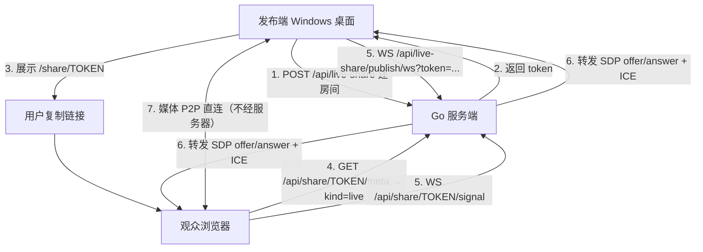

# 桌面屏幕 + 声音共享（纯 P2P WebRTC）设计

日期：2026-10-28
状态：设计待评审

## 1. 目标与非目标

### 1.1 目标

Windows 桌面客户端点一个按钮，把**屏幕画面 + 系统声音 + 麦克风**共享出去，生成一个链接；任何拿到链接的人用浏览器打开就能看画面、听声音，**无需登录**。

- 分享模型与现有文件/会话分享一致：**token 即凭证**（`/share/{token}`）。
- **纯 P2P WebRTC**（`RTCPeerConnection`）：媒体点对点直传，**不经服务器**。
- **支持多人语音**（可选、逐人授权）：发布端默认只听，开启后观众可"按住说话"回传麦克风，**其他观众也能听到**（经发布端混音，见 §8.3）。
- 观众端不能控制键鼠、不能看发布端的其它内容。

### 1.2 非目标

| 不做 | 原因 |
|---|---|
| **TURN 中继 / 公网穿透** | **本轮明确不做**（见 §1.3）。纯 P2P 只在同局域网内可用 |
| macOS / Linux 发布 | 系统声音 loopback 只有 Windows 支持（`electron.d.ts:23981` 原文）。macOS 只能采本应用音频，Linux 需枚举 PulseAudio monitor 设备，均留待后续 |
| 公网可用 | 本轮定位「仅同一局域网」，且无中继兜底 |
| 远程控制（键鼠回传） | 需求是"看"，不是"操作" |
| 录制 / 回放 | 与直播是两套生命周期，本轮不做 |
| 多人同时发布 | 一个 token 对应一个发布端，第二个发布者直接拒绝 |
| 聊天/弹幕 | 观众只读 |
| SFU | 8 人上限靠发布端混音即可，无需 SFU（见 §8.3.1） |

### 1.3 为什么本轮不做 TURN

移除 TURN 带来三个直接收益：

| | 有 TURN | 纯 P2P |
|---|---|---|
| Go 新增依赖 | `pion/turn` + 约 10 个传递依赖 | **0** |
| 额外端口 | UDP 3478 + UDP 49152–49200 | **0**（仍只有 TCP 20000） |
| Docker 配置 | 需额外映射两段 UDP | **零改动** |
| 服务端代码 | 房间 + 信令 + TURN 启动/凭据/端口守卫 | 房间 + 信令 |

代价是**两种场景不可用**（§9.1、§9.2）：AP 禁组播导致 mDNS 候选解析失败、以及 AP 开了客户端隔离。这两类在企业网里并不罕见，但都可以先通过实测确认是否存在，再决定是否补 TURN。

**预留**：协议里 `joined` 帧保留 `iceServers` 字段（本轮恒为 `[]`），后续接 TURN 时不需要改前端协议。

## 2. 决策汇总

| 维度 | 决策 |
|---|---|
| 传输 | **纯 P2P WebRTC**（`RTCPeerConnection`），**无 TURN、无中继** |
| 信令 | 复用现有 HTTP + 短轮询？**否** — 用独立 WS `/api/share/{token}/signal` |
| 编码 | 浏览器自协商（VP8/VP9/AV1 + Opus），**应用层不碰 WebCodecs** |
| 服务端依赖 | **零新增**（无 `pion/turn`、无 SFU、无媒体转发） |
| 端口 | **仍只有 TCP 20000**，无额外放行、Docker 零改动 |
| 发布端入口 | AppHeader 新增「共享屏幕」按钮（仅 Windows 桌面壳可见） |
| 观众端入口 | `/share/{token}` 复用现有 share SPA，`kind: 'live'` |
| 房间存储 | **内存**，不落库。进程重启即失效（语义正确：直播是瞬时的） |
| 观众上限 | 8 |
| 声音来源 | 系统声音（`audio: 'loopback'`）+ 麦克风，`AudioContext` 混音 |
| **多人语音** | **支持，但默认关闭**。发布端显式开启 + 逐人授权 + 按住说话；**观众之间可互相听到**（发布端为每个观众建独立混音，排除自己） |
| **观众上行** | 复用同一条 `sendrecv` 音频 m-line，靠 `replaceTrack` 开关，**不重新协商**（见 §8.3.4） |
| **多人语音拓扑** | **发布端混音**（0 条额外连接、0 服务端媒体工作、+256kbps@8人、多一跳 100–200ms），**不上 SFU**（见 §8.3.1） |
| 安全上下文 | 主进程 `unsafely-treat-insecure-origin-as-secure`（见 §5） |

## 3. 现状核实

### 3.1 安全上下文（实测）

用 Electron 44.4.3 在局域网 HTTP 地址上实测：

| 探针 | 不加 switch | 加 switch |
|---|---|---|
| `isSecureContext` | false | **true** |
| `navigator.mediaDevices` | undefined | object |
| `getUserMedia` / `getDisplayMedia` | undefined | function |
| `VideoEncoder` / `AudioEncoder` | undefined | function |
| `MediaSource` / `RTCPeerConnection` | function | function |

结论：**一行 switch 即可**，且该 switch 在 Electron 44 二进制里确实存在（`strings` 可搜到 `unsafely-treat-insecure-origin-as-secure`）。

### 3.2 编码器支持（实测，Linux + Xvfb）

| 编码器 | 结果 |
|---|---|
| VP8 / VP9 / AV1 | ✅ |
| **H.264** | ❌ |
| Opus | ✅ |
| **AAC** | ❌ |

**这条数据直接决定了「不在应用层碰编码器」**：H.264 不可用意味着 `mp4-muxer` 方案（fMP4 + H.264）在本机根本跑不起来，而 AAC 不可用意味着 MP4 容器里没有合规音轨。走 WebRTC 则由浏览器内部协商，VP8/VP9/Opus 全平台可用，**完全绕过这个问题**。

> ⚠️ H.264 不可用是 **Linux 侧**结论（Linux 靠 openh264/VAAPI）。Windows 有 Media Foundation，大概率支持硬编。**但本设计不依赖这个结论**——无论 Windows 支不支持 H.264，WebRTC 都能工作。

### 3.3 `getDisplayMedia` 在 Electron 里的行为（实测）

- 必须由主进程 `setDisplayMediaRequestHandler` 指定源，否则直接拒绝。
- 实测成功：`1280×1024@30fps`，`displaySurface: "monitor"`，`deviceId: "screen:402:0"`。
- 主进程需先 `desktopCapturer.getSources({ types: ['screen','window'], thumbnailSize: {width:0,height:0} })` 拿源，再在 handler 里回调。

### 3.4 现有可复用资产

| 资产 | 位置 | 复用方式 |
|---|---|---|
| token 生成与校验 | `internal/service/file_share.go`（`UpsertFileShare`）、`validShareToken` | **不复用 DB 表**，但复用 token 形态（32 位 hex）与校验函数 |
| 分享 SPA 分派 | `web/src/share/ShareRoot.vue:68` | `kind` 联合类型扩一档 `'live'` |
| share meta 端点 | `internal/handler/session_share.go:465` `serveShareMeta` | 增加内存房间查询分支 |
| WS accept + Origin 白名单 | `internal/handler/file_watch.go:242-252` | 照抄（六个 OriginPatterns） |
| WS 连接计数上限 | `internal/handler/file_watch.go:59` `watchClientCount atomic.Int64` | 照抄 |
| WS 写序列化 | `internal/handler/file_watch.go:266` `var writeMu sync.Mutex` | 照抄（coder/websocket 允许一读一写并发） |
| 分享链接 UI | `web/src/components/file/ShareLinkDialog.vue` | 复制「生成/复制/关闭」三段式 |
| 主进程权限 | `desktop/src/main/index.ts:88` | 扩白名单 + 补 check handler |

## 4. 架构

### 4.1 纯 P2P 的边界

服务端只做**一件事**：转发 SDP / ICE candidate（纯 JSON，约 100 行 Go）。媒体完全不经过服务器。



`iceServers` 本轮恒为空数组 `[]`。ICE 只会有 **host** 候选（本机 IP），浏览器直接尝试直连。

### 4.2 端口

**没有任何新增端口。** 仍然只有 TCP 20000（HTTP + WS），Docker / 防火墙配置零改动。

这是移除 TURN 最大的收益——`docs/spec/infra/ssh-tunnel.md:356` 记载的「单端口是核心收益」在本轮得以保持。

### 4.3 房间模型

```go
// 内存房间注册表，进程重启即清空。
type liveRoom struct {
    Token       string
    CreatedAt   time.Time
    PublisherID string            // 发布端连接 id，唯一
    Title       string            // 分享页标题（"XXX 的屏幕"）
    Viewers     map[string]*viewer // 观众连接 id → 状态
    initSDP     string            // 最近一次 offer，供迟到观众复用
}

type viewer struct {
    conn     *websocket.Conn
    writeMu  *sync.Mutex
    pcState  string // "connecting" | "connected" | "failed"
}
```

**为什么发布端不主动 offer**：观众可能在任何时刻加入，且 WebRTC 一对一，每个观众都需要独立的 `RTCPeerConnection`。所以由**观众发 offer**（观众是 `RTCPeerConnection` 的 offerer），发布端对每个观众生成一个 answer。发布端因此持有 N 个 `RTCPeerConnection` 实例（N = 观众数）。

> 备选：发布端对每个观众新建一条 `MediaStream` 轨道副本。Chromium 允许同一个 `MediaStreamTrack` 被多个 `RTCPeerConnection` 引用，编码器会按需复用/复制，这是标准做法，不需要手工复制轨道。

## 5. 安全上下文（规避方式）

### 5.1 做法

```ts
// desktop/src/main/index.ts —— 必须在 app.whenReady() 之前
// initStore() 目前排在 whenReady 之后（index.ts:72），需要提到模块顶层。
initStore()
const serverUrl = getStore().get('serverUrl')
if (serverUrl) {
  try {
    const origin = new URL(serverUrl).origin
    if (origin.startsWith('http://')) {
      app.commandLine.appendSwitch('unsafely-treat-insecure-origin-as-secure', origin)
    }
  } catch { /* 非法 URL 交给后续连接流程报错 */ }
}
```

### 5.2 三个必须知道的约束

1. **是进程级开关**。切换服务器后必须重启才生效。`native:connect-to-server`（`bridge.ts:89`）要在切到**不同 origin** 时提示「需要重启才能使用屏幕共享」。
2. **只对单一 origin 生效**，不是全局关闭安全上下文。多个服务器需要逗号分隔的 origin 列表——但 `serverUrl` 只有一个，所以单值足够。
3. **这是有意的安全降级**。它让该 origin 获得 secure context 待遇（麦克风、摄像头、屏幕捕获、WebCodecs）。攻击面仅限于「用户自己配置的服务器地址」，且这些能力本来就在用户机器上。**必须在设计文档与代码注释里写明这是权衡，不是疏忽。**

### 5.3 备选方案（未采用）

| 方案 | 为什么不用 |
|---|---|
| 强制 HTTPS | 用户需自备证书；虽然 `internal/model/tls.go:46` 已支持自动发现，但自签证书在浏览器端仍需逐次信任，体验更差 |
| 内置自签 CA 并注入系统信任库 | 需要管理员权限写系统证书库，且每个平台一套实现 |
| `webContents.session.protocol.handle` 代理到 `http://clawbench.local` | 需要自签证书 + 系统信任，回到上一条 |
| 用 `file://` 加载前端 | 页面与服务器不同源，所有 Cookie 鉴权失效，等于重写整个鉴权层 |

**结论：switch 是成本最低、语义最直白的方案。** 它只影响用户自己配置的那一个服务器 origin。

## 6. 协议

### 6.1 发布端管理接口（鉴权）

```
POST   /api/live-share          → { token, url }
GET    /api/live-share?token=   → { active: true, viewers: 3 } | { active: false }
DELETE /api/live-share?token=   → 结束共享，踢掉全部观众
```

`POST` 语义：若当前项目已有活跃房间则复用（幂等），否则新建。这与文件分享的 `UpsertFileShare` 语义一致（`file_share.go:167`）。

### 6.2 发布端媒体信令（鉴权）

```
WS /api/live-share/publish/ws?token={token}
```

首帧必须是文本控制帧：

```json
{"type":"publish","title":"张三的屏幕"}
```

之后收发（全部文本帧，JSON）：

```json
// 服务端 → 发布端：有观众加入，请求建立一条 PeerConnection
{"type":"viewer-join","viewerId":"a1b2"}
// 发布端 → 服务端：针对该观众的回答
{"type":"answer","viewerId":"a1b2","sdp":"v=0..."}
{"type":"ice","viewerId":"a1b2","candidate":{...}}
// 服务端 → 发布端：观众侧的 ICE
{"type":"ice","viewerId":"a1b2","candidate":{...}}
// 服务端 → 发布端：观众离开
{"type":"viewer-leave","viewerId":"a1b2"}
// 发布端 → 服务端：共享结束
{"type":"end"}
```

### 6.3 观众信令（公开，token 即凭证）

```
WS /api/share/{token}/signal
```

```json
// 观众 → 服务端：加入并发出 offer
{"type":"join"}
// 服务端 → 观众
{"type":"joined","viewerId":"c3d4","iceServers":[],"title":"张三的屏幕","talkEnabled":true}
{"type":"publisher-gone"}          // 发布端断开，共享结束
{"type":"full"}                    // 观众数已满
// 观众 → 服务端：offer
{"type":"offer","sdp":"v=0..."}
{"type":"ice","candidate":{...}}
// 服务端 → 观众
{"type":"answer","sdp":"v=0..."}
{"type":"ice","candidate":{...}}
```

`talkEnabled` 告诉观众端是否渲染「请求发言」入口。**它只是 UI 提示，不是授权**——真正的门在服务端（未开启时 `talk-request` 直接被拒）。

观众侧的音频 transceiver 必须建为 `sendrecv`（见 §8.3.1）：

```ts
// 关键：即使当前不许发言，也要先占住 m-line
const tx = pc.addTransceiver('audio', { direction: 'sendrecv' })
// 之后开麦/闭麦只 replaceTrack，不重新协商
await tx.sender.replaceTrack(micTrack)   // 说
await tx.sender.replaceTrack(null)       // 停
```


**服务端对信令只做字段级转发**，不解析 SDP。这既是省事，也是安全边界：SDP 里塞不进可执行内容。

### 6.4 meta 扩展

`serveShareMeta`（`session_share.go:465`）增加最前面的内存查询：

```go
if room, ok := liveshare.Get(token); ok {
    writeJSON(w, http.StatusOK, shareMetaResponse{
        Kind:  shareKindLive,   // "live"
        Title: room.Title,
    })
    return
}
```

**顺序很重要**：内存查在 DB 查之前。房间是临时的，token 由独立随机源生成，理论上不会与文件/会话 token 撞车，但先查内存能让"直播已结束但 token 曾被复用"这类边界更可预测。

### 6.5 错误码

| 场景 | 响应 |
|---|---|
| 房间不存在 / 已结束 | meta 404（与现有分享一致） |
| 已有发布端 | `POST` 返回 409 `LiveShareAlreadyPublishing` |
| 观众数满 | WS 帧 `{"type":"full"}` 后关闭 |
| 非 Windows 桌面端调用 `POST` | 403 `LiveShareUnsupportedHost` |
| 发布端 token 不匹配 | WS accept 前 403 |

## 7. 服务端改动清单

### 7.1 新增包 `internal/liveshare/`

叶子包，只依赖 `sync` / `time` / `crypto/rand`：

| 文件 | 职责 |
|---|---|
| `room.go` | 房间注册表（`Create` / `Get` / `Delete` / `AddViewer` / `RemoveViewer` / `Count`）+ token 生成 |
| `room_test.go` | 并发安全、上限、幂等创建、发布端独占、**发言授权状态机** |
| `talk.go` | 多人语音授权状态机（`RequestTalk` / `GrantTalk` / `RevokeTalk` / `MuteAll` / `SetTalking`） |
| `signal.go` | 信令消息结构体（与前端镜像） |

**不依赖 `internal/model` 以外的任何 internal 包**，避免成环。

`talk.go` 的状态转移（合法路径只有这些）：

```
none --request--> pending --grant--> granted --start--> talking
                       ↘deny→ none      ↘revoke→ none     ↘end→ granted
granted --muteAll--> none
talking --muteAll--> none
```

任何其它转移（如未授权直接 `talk-start`）必须**拒绝并记 WARN**，不能静默忽略——静默忽略会让"按了没反应"变成不可诊断的问题。


### 7.2 `internal/handler/live_share.go`

| 函数 | 说明 |
|---|---|
| `ServeLiveShareManage` | `POST`/`GET`/`DELETE`，复用 `middleware.Auth` |
| `LiveSharePublishWS` | 发布端 WS，鉴权 + token 校验 |
| `LiveShareSignalWS` | 观众 WS，**公开**（`registerPublic`） |

三个必须照抄的既有模式：

1. **Origin 白名单**：六个 `OriginPatterns`（`file_watch.go:242-252`）。
2. **连接计数上限**：`atomic.Int64`，观众 8 + 发布端 1。
3. **写序列化**：每个连接一个 `sync.Mutex`，因为读循环（发错误帧）和主循环（转发信令）都会写。

### 7.3 启动接线

- `cmd/server/main.go`：无新增监听、无新增 goroutine——房间注册表是纯内存结构，随 handler 首次访问惰性初始化。
- 配置：`model.Config` **无需新增字段**（本轮没有可配置项）。
- **无需改动 `ProxyRegistry.SetReservedPorts`**（`internal/service/proxy.go:172`）——没有新端口要保护。

### 7.4 OpenAPI

`internal/api/openapi.yaml` 必须加三个 `/api/live-share*` 路径，否则 `openapi_drift_test.go` 直接失败。

## 8. 前端改动清单

### 8.1 发布端（应用内）

| 文件 | 改动 |
|---|---|
| `web/src/composables/useLiveShare.ts` | **新增**。状态机 `idle → capturing → publishing → idle`；管理 N 个 `RTCPeerConnection`；**为每个观众维护独立混音 `dest`**（系统声音 + 麦克风 + 其他人的音轨，排除自己，见 §8.3.3）；管理 `Map<viewerId, MediaStreamAudioSourceNode>` 并在观众离开时 `disconnect` |
| `web/src/composables/useLiveMixer.ts` | **新增**。纯混音图逻辑（可单测）：`addViewer` / `removeViewer` / `destFor(viewerId)`；不碰 DOM，便于 `OfflineAudioContext` 测试 |
| `web/src/components/live/LiveShareDialog.vue` | **新增**。源选择（屏幕/窗口）+ 音频开关（系统声音/麦克风）+ 生成的链接 + 观众数 + **「允许观众发言」开关** + **发言授权列表**（待批准/已批准/正在说话）+ 「全部静音」 |
| `web/src/components/common/AppHeader.vue` | 新增按钮，门控 `isDesktopApp && isWindows` |
| `web/src/utils/clawbenchNative.ts` | 新增 `listCaptureSources()` / `getAudioCaptureSupport()` |
| `desktop/src/main/bridge.ts` | 新增两个 IPC |
| `desktop/src/preload/index.ts` | 透传 |
| `desktop/src/main/index.ts` | `setDisplayMediaRequestHandler` + 权限白名单 + `setPermissionCheckHandler` + 安全上下文 switch |
| `desktop/src/main/window.ts` | 共享期间 `setBackgroundThrottling(false)` |

采集流程：

```ts
// 1. 主进程列源，渲染层渲染选择器
const sources = await native.listCaptureSources()

// 2. 选定后告诉主进程"下一次 getDisplayMedia 用这个源"
await native.setPendingCaptureSource(source.id, { systemAudio: true })

// 3. 取流
const display = await navigator.mediaDevices.getDisplayMedia({ video: true, audio: true })
const mic = await navigator.mediaDevices.getUserMedia({
  audio: { echoCancellation: true, noiseSuppression: true, autoGainControl: true },
})

// 4. 混音
const ctx = new AudioContext({ sampleRate: 48000 })
await ctx.resume()                                    // 默认 suspended，必须在手势内
const dest = ctx.createMediaStreamDestination()
if (display.getAudioTracks().length) ctx.createMediaStreamSource(display).connect(dest)
if (mic.getAudioTracks().length)     ctx.createMediaStreamSource(mic).connect(dest)
const mixed = new MediaStream([display.getVideoTracks()[0], ...dest.stream.getAudioTracks()])

// 5. 每个观众一条独立 RTCPeerConnection，复用同一条 track
```

**`setPendingCaptureSource` 必须是一次性的**：主进程在 `setDisplayMediaRequestHandler` 里消费后立即清空。否则任何页面后续调用 `getDisplayMedia` 都能静默抓屏。

### 8.2 观众端（share SPA）

| 文件 | 改动 |
|---|---|
| `web/src/share/ShareRoot.vue:68` | `kind` 联合类型加 `'live'`；渲染 `<LiveShareView>` |
| `web/src/share/LiveShareView.vue` | **新增**。`<video autoplay playsinline>` + 连接状态提示 + **「按住说话」按钮（仅 `talkEnabled` 时）** |
| `web/src/share/liveViewer.ts` | **新增**。信令 WS + `RTCPeerConnection` + 重连 + **`sendrecv` 音频 transceiver 与 `replaceTrack` 开关** |
| `web/src/i18n/locales/{zh,en}.ts` | `share.live.*` 新增一组键 |

观众端状态机：

```
connecting → waiting（已连信令，等发布端 answer）→ playing
                                                 ↘ failed（ICE 全失败）
publisher-gone → ended
```

**观众端必须处理的三件事**：

1. **自动播放策略**：`<video>` 带音轨时，无用户手势的 `autoplay` 会被浏览器拦截。处理：先 `muted` 自动播放画面，页面顶部显示一个「点击开启声音」按钮（用户点一下 `video.muted = false`）。**不要**直接报错让用户重试。
2. **发布端断开**：收到 `publisher-gone` 或 `pc.connectionState === 'failed'` 时，显示「共享已结束」并提供「刷新重试」（发布端可能重开同一 token？不会——每次 `POST` 都是新 token，所以只能提示重新索要链接）。
3. **移动端横竖屏**：`<video>` 用 `object-fit: contain` + 全屏按钮。

### 8.3 多人语音（观众 ↔ 观众，经发布端混音）

#### 8.3.1 为什么不需要 SFU

**上一版本文档在这里犯了一个错**：把视频的扩展逻辑套到了音频上。两者成本差两个数量级：

| | 8 人所需连接 | 带宽 |
|---|---|---|
| 视频 mesh | 8×7/2 = 28 条额外连接 | 28 × 2Mbps ≈ 56Mbps 上行 → **必须 SFU** |
| 音频 mesh | 28 条额外连接 | 28 × 32kbps ≈ 900kbps → 可行但连接数多 |
| **发布端混音** | **0 条额外连接** | 发布端上行 +8×32kbps ≈ **256kbps** |

发布端本来就和每个观众各有一条连接，也本来就收到所有人的音频。多做的事只有一件：**为每个观众建一个独立混音，内容是「系统声音 + 发布端麦克风 + 其他人的音轨」，唯独排除该观众自己**。

视频本身 8 人就要 16Mbps 上行，音频这 256kbps 只占 1.6%。**结论：不需要 SFU，也不需要额外中继。**

#### 8.3.2 实测验证

**混音图逻辑**（`OfflineAudioContext` + DFT，确定性判据，每路源用不同频率正弦）：

```
给 A 的混音: {SYS: 0.10, MIC: 0.10, A: 0.00, B: 0.10}   ← A 听不到自己
给 B 的混音: {SYS: 0.10, MIC: 0.10, A: 0.10, B: 0.00}   ← B 听不到自己
```

**动态增删不需要重建混音图**：断开 B 的音源后，给 A 的混音里 B 的分量从 `-81dB` 掉到 `-175dB`（底噪），而 A 的 dest track id 前后完全一致——**不需要重新 `replaceTrack`**。

**RTP 双向对称**：`outbound` 13967 bytes / 175 packets，`inbound` 13967 / 175。

> ⚠️ **未验证项**：端到端解码出的音频波形。headless 环境 `totalSamplesReceived: 0`（机器无音频输出设备，Chromium 不解码）。RTP 确实在流，但「观众真的听到声音」必须在真实 Windows 机器上补验（见 §10.5）。

#### 8.3.3 混音图结构

```
发布端采集
├── systemTrack  (getDisplayMedia 的 audio)
├── micTrack     (getUserMedia 的 audio)
└── 每个观众的远端音轨 viewerTrack[A], viewerTrack[B], ...

为每个观众建一个 dest：
  dest[A] = systemTrack + micTrack + viewerTrack[B] + viewerTrack[C] + ...   ← 排除 A
  dest[B] = systemTrack + micTrack + viewerTrack[A] + viewerTrack[C] + ...   ← 排除 B

dest[A] → A 那条 PC 的 audio sender (replaceTrack)
dest[B] → B 那条 PC 的 audio sender (replaceTrack)
```

关键实现点：

1. **每个 dest 的 track 只创建一次**。观众进出时只 `connect`/`disconnect` 音源节点，**不重建 dest、不换 track**——实测证明 track id 稳定，所以 `replaceTrack` 只需在观众首次加入时调一次。
2. **`MediaStreamAudioDestinationNode` 必须被"拉取"才会产出数据**。它连接到的 sender 会拉取，所以正常路径没问题；但**空混音（只有系统声音、无人说话）时仍要保证节点在图里**，否则 `dest.stream` 的音轨会变成静音死轨。
3. **观众离开必须 `disconnect` 其音源**，否则泄漏（`AudioNode` 持有引用）。用一个 `Map<viewerId, MediaStreamAudioSourceNode>` 管理。
4. **不能把 dest 连到 `ctx.destination`**（扬声器），否则发布端自己会听到混音后的回声叠加。

#### 8.3.4 实测结论：观众上行不需要重新协商

| 探针 | 结果 |
|---|---|
| 观众 `addTransceiver('audio', {direction:'sendrecv'})`，`sender.track = null` | ✅ 可创建 |
| 发布端 `ontrack` 触发 | ✅ 此时 `track.muted = true` |
| 观众 `sender.replaceTrack(micTrack)` | ✅ **`signalingState` 保持 `stable`，`localDescription.sdp` 不变** |
| 音频真的流动 | ✅ `inbound-rtp`：4172 bytes / 125 packets，`muted` 由 true → false |
| `sender.replaceTrack(null)` 静音 | ✅ 同样不重新协商，`stable` |

观众加入时先占一条 `sendrecv` 音频 m-line（不挂 track），此后开麦/闭麦只用 `replaceTrack`。**全程零次重新协商。**

> 这条排除了常见误判：「换音轨要重新 offer/answer」。现代 Chromium 的 `replaceTrack` 对同 kind 轨道是原地替换。

#### 8.3.5 权限模型（token 语义变了，这是重点）

文件/会话分享的 token 是**只读**的，泄露顶多被看。**多人语音的 token 是写权限**——拿到链接的任何人都能往房间里灌声音，而且**其他所有观众都会听到**（比单向时更严重）。所以不能默认打开。

| 层级 | 机制 |
|---|---|
| 房间级 | 发布端弹窗里显式勾选「允许观众发言」，默认**不勾**。未勾选时观众端不渲染「按住说话」按钮，服务端也拒绝 `talk-request` |
| 人级 | 即使房间级开启，仍需**逐人授权**：观众点「请求发言」→ 发布端观众列表出现待批准项 → 发布端点「批准」 |
| 时长 | 批准是**单次会话**有效，观众刷新页面需重新申请 |
| 撤回 | 发布端随时可撤销单人授权；另有「全部静音」panic 按钮 |

#### 8.3.6 交互：按住说话

```
观众：pointerdown → replaceTrack(micTrack) → 发 {"type":"talk-start"}
       pointerup  → replaceTrack(null)     → 发 {"type":"talk-end"}
       pointercancel → 同样 replaceTrack(null)   ← 手指滑出按钮必须也停
```

按住说话而不是开关式，理由有两个：

1. **误触成本**：开关式一旦忘了关就是持续灌音，按住式松开即静音。
2. **恶意刷屏的体验价值低**：要持续说话必须一直按着，比"点一下开始刷"更费力。

发布端 UI 在观众列表里显示谁正在说话（绿点 + 音量条），这样"谁在说话"一目了然。

#### 8.3.7 信令扩展

在 §6.3 的观众信令上加控制帧（**全部是控制帧，不含 SDP**）：

```json
// 观众 → 服务端
{"type":"talk-request"}                 // 请求发言
{"type":"talk-start"}                   // 开始说话（已 replaceTrack）
{"type":"talk-end"}                     // 结束

// 服务端 → 观众
{"type":"talk-granted"}                 // 已批准，可以按住说话
{"type":"talk-revoked","reason":"..."}  // 被撤销/房间关闭
{"type":"talk-denied"}                  // 房间未开启多人语音

// 发布端侧（§6.2 加）
// 服务端 → 发布端
{"type":"talk-request","viewerId":"c3d4","name":"..."}
{"type":"talk-state","viewerId":"c3d4","talking":true}
// 发布端 → 服务端
{"type":"talk-grant","viewerId":"c3d4"}
{"type":"talk-revoke","viewerId":"c3d4"}
{"type":"talk-mute-all"}
```

**服务端只是转发 + 记状态**，不参与媒体。授权表存在 `viewer` 结构里：

```go
type viewer struct {
    conn      *websocket.Conn
    writeMu   *sync.Mutex
    pcState   string
    canTalk   bool   // 是否已授权
    talking   bool   // 当前是否正在说
}
```

#### 8.3.8 回声：必须切断的两条回路

单向时只有一条回路（发布端外放 → 自己麦克风），AEC 能压住。多人语音后多出两条：

**回路 1（自听）**：观众 A 说话 → 发布端外放 → 发布端麦克风拾音 → 混进 dest[A] → A 听到自己。
**回路 2（互听）**：观众 A 说话 → 发布端外放 → 发布端麦克风拾音 → 混进 dest[B] → **B 听到 A 的声音两次**（一次经发布端麦克风，一次经 dest[B] 里的 A 音轨）。

处理方式：

| 措施 | 作用 |
|---|---|
| **混音图排除自己**（§8.3.3） | 切断回路 1 的主路径 |
| `getUserMedia({ audio: { echoCancellation: true } })` | 实测生效（`sampleRate: 48000`），压制外放拾音 |
| UI 提示「建议戴耳机」 | 根治回路 2，但是用户配合项 |
| 不默认用 `loopbackWithMute` | 那会让发布端自己听不到系统声音，是需要用户明确选择的取舍 |

**代码级不变量（必须有守卫测试）**：`dest[X]` 的音源集合 = `{systemTrack, micTrack} ∪ {viewerTrack[Y] | Y ≠ X}`。任何把 `viewerTrack[X]` 连进 `dest[X]` 的写法都会产生无限回声。

#### 8.3.9 多一跳延迟

观众 A 说话 → 发布端混音 → 观众 B，是 **2 跳**（mesh 是 1 跳）。局域网下多约 100–200ms。

对「看屏幕演示 + 偶尔问答」够用；对需要自然对话的场景会有轻微"对讲机感"。这是发布端混音唯一的实质代价，且换取的是零新增连接、零服务端媒体工作。

### 8.4 观众端不需要的东西

- 不需要 WebCodecs（浏览器内部编解码）
- 不需要 muxer
- 不需要 MSE（`<video srcObject>` 直接播放 `MediaStream`）
- 不需要抖动缓冲/丢包恢复/音视频同步（WebRTC 内建）

这是双通道方案相比纯中继方案**净省约 600 行前端代码**的地方。

## 9. 风险与边界

### 9.1 mDNS 候选（**纯 P2P 下的头号风险**）

Chromium 在未授予媒体权限时会把 host candidate 伪装成 `<uuid>.local` 的 mDNS 名。**观众端是浏览器，通常没有媒体权限**，所以观众侧的 host candidate 会是 mDNS 形式。

影响：同局域网内通常能解析（mDNS 走组播），但**如果 AP 禁了组播，P2P 直接建不起来**。**没有 TURN 就没有兜底**——连接会彻底失败，观众看到的是「无法连接」。

**这是移除 TURN 后必须实测的第一件事。** 验证方法：`chrome://webrtc-internals` 看 selected candidate pair 类型（应为 `host`）。若出现解析失败，只有三条路：①给观众端授予媒体权限（可绕过 mDNS 混淆）；②服务端加 STUN（仍是 UDP 端口）；③补 TURN。

### 9.2 客户端隔离（**纯 P2P 下不可用**）

企业/公共 AP 常开 client isolation，两终端互相不可达。**纯 P2P 下此场景完全不可用**，且没有任何降级路径。

产品上必须明说「需要发布端与观众在同一网段且互通」，否则用户会当成 bug。UI 在连接失败时要给出可操作的提示，而不是只显示「连接失败」。

### 9.3 观众数上限

发布端上行是 N 倍：

| 场景 | 单观众码率 | 8 观众总上行 |
|---|---|---|
| 1080p30 静态文档 | ~0.5 Mbps | 4 Mbps |
| 1080p30 视频播放 | ~2.5 Mbps | 20 Mbps |
| 1440p30 视频播放 | ~5 Mbps | 40 Mbps |

有线千兆无压力，WiFi 5 在 20 Mbps 上行时已接近极限。**上限设 8，且 UI 要显示当前上行占用**（`RTCPeerConnection.getStats()` 的 `outbound-rtp` 字节数差分）。

超过 8 人需要 SFU（`livekit` 或 `mediamtx`），那是独立项目——**本轮明确不做**，但在 §9.3 记下判定依据，避免以后重新论证。

### 9.4 声音的三个固有问题

1. **回声**：外放时麦克风会收到自己播放的声音。`echoCancellation: true` 能压制大部分，但**共享系统声音时压制效果会明显下降**（AEC 的参考信号是麦克风采集路径，不是系统混音）。UI 上要提示「建议戴耳机」。
   - 备选：`audio: 'loopbackWithMute'`（采集系统声音但本机静音）。**不做默认**——共享者自己就听不到了，这是个需要用户明确选择的取舍。
2. **系统声音只有 Windows**。这是 Electron 的限制，不是我们的实现问题。非 Windows 桌面端调 `POST /api/live-share` 直接 403，UI 隐藏入口。
3. **多人语音的回声回路**：见 §8.3.8。核心不变量是「`dest[X]` 排除 `viewerTrack[X]`」，必须有守卫测试。

### 9.5 安全

| 风险 | 缓解 |
|---|---|
| token 泄露 = 任何人可看屏幕 | token 32 位 hex（与文件分享同级）；`DELETE` 立即失效；房间 30 分钟无观众自动回收 |
| **token 泄露 = 任何人可灌声音** | 房间级「允许观众发言」默认关闭；开启后仍需逐人授权；单次会话有效；「全部静音」panic 按钮 |
| 观众恶意持续灌音 | 按住说话（松开即停）；发布端可单人撤销 |
| 页面 Referer 泄露 token | 复用 `ServeSharePage` 的 `Referrer-Policy: no-referrer`（`file_share.go:876`） |
| 任何页面静默抓屏 | `setPendingCaptureSource` 一次性消费；`setDisplayMediaRequestHandler` 只在有 pending 源时回调 |
| 发布端伪造他人 token | 房间记录 `PublisherID`，第二个 `publish` 直接 409 |

## 10. 测试计划

### 10.1 Go 单测（`internal/liveshare`）

| 用例 | 判据 |
|---|---|
| 并发创建同一项目 | 只产生一个房间，token 一致（幂等） |
| 第二个发布端 | 返回 409，原发布端不受影响 |
| 观众上限 | 第 9 个返回 `full` 帧 |
| 观众断开 | 从 `Viewers` 移除，发布端收到 `viewer-leave` |
| 发布端断开 | 房间删除，全部观众收到 `publisher-gone` |
| 房间回收 | 无观众 30 分钟后 `Get` 返回 false |
| **未授权 `talk-start`** | 拒绝 + 记 WARN，`talking` 保持 false |
| **`talk-grant` 后 `talk-start`** | `talking` 变 true，发布端收到 `talk-state` |
| **`revoke` 正在说话的人** | 立即转为 `granted=false`，发布端收到 `talk-state talking=false` |
| **`muteAll`** | 全部 viewer 的 `canTalk`/`talking` 归零 |
| **观众断开时正在说话** | 从 `Viewers` 移除，发布端收到 `viewer-leave`（不需要额外 `talk-state`） |

### 10.2 handler 单测

- 三个端点的鉴权边界：`POST` 无 cookie → 401；观众 WS 无 token → 404。
- `serveShareMeta` 对 live token 返回 `kind: 'live'`，且**优先于** DB 查询。
- Origin 白名单：跨源 WS 握手被拒。

### 10.3 前端单测

- `useLiveShare` 状态机：`idle → capturing → publishing → idle`，异常路径回到 `idle`。
- 混音：系统声音缺失时只挂麦克风轨道，不产生空音轨。
- `LiveShareView`：`publisher-gone` → 显示「共享已结束」；`full` → 显示「人数已满」。
- **`setPendingCaptureSource` 一次性**：源码守卫断言消费后清空。
- **多人语音**：
  - 未授权时 `replaceTrack` 不被调用（守卫断言 `sender.track` 恒为 null）。
  - 按住说话的 `pointerdown`/`pointerup` 成对，`pointercancel` 也要 `replaceTrack(null)`（否则手指滑出按钮会永久开麦）。
  - 房间未开启多人语音时，「按住说话」按钮不渲染。
  - **混音图排除自己**：用 `OfflineAudioContext` + DFT 验证（实测已跑通，见 §8.3.2）——`dest[A]` 在 A 的频率上能量 < 0.005，在 B 的频率上 > 0.05。这是行为测试，不是源码守卫，能真正区分对错。
  - **观众进出不重建 track**：断言 `dest[X].stream.getAudioTracks()[0].id` 在 B 加入/离开前后不变。
  - **观众离开时 `disconnect` 其音源**：断言 `MediaStreamAudioSourceNode` 的 Map 大小回到 N。

### 10.4 E2E（Playwright）

Playwright 支持 `--use-fake-device-for-media-stream`，但**测不了真实的 `getDisplayMedia`**（需要 Electron 主进程）。所以 E2E 分两层：

1. **观众端**：用 `cmd/live-mock`（新增，模拟发布端发信令）驱动，验证 `/share/{token}` 能出画面（用一张静态图当假视频源）、能显示状态、发布端断开时正确收尾。
2. **发布端**：不进 Playwright，改为**手工验收清单**（真实 Windows 机器 + 三种网络形态），因为自动化成本远高于收益。

### 10.5 必须人工验证的清单

**第一优先（决定方案是否成立）**：

- [ ] 同网段有线 → 观众看到画面 + 听到系统声音 + 听到麦克风
- [ ] 同网段 WiFi → 同上，观察是否有卡顿
- [ ] **`chrome://webrtc-internals` 检查 selected candidate pair 是 `host` 而非失败**（验证 mDNS 未被 AP 阻断，见 §9.1）
- [ ] **开客户端隔离的 AP → 记录失败表现**（这是已知不可用场景，需要确认 UI 提示可诊断，见 §9.2）

**功能验收**：

- [ ] 观众中途加入 → 立刻出画面（ICE 会触发关键帧请求）
- [ ] 发布端关闭窗口 → 观众显示「共享已结束」
- [ ] 观众数达到 8 → 第 9 个被拒
- [ ] 切换服务器后 → 提示需要重启才能用屏幕共享
- [ ] **多人语音关闭时** → 观众端没有「按住说话」按钮
- [ ] **多人语音开启但未授权** → 观众点请求后，发布端看到待批准项；批准前说话无声音
- [ ] **按住说话** → 发布端能听到观众，松开即静音；`pointercancel`（手指滑出）也停
- [ ] **观众之间互听** → A 说话，B 能听到；A 听不到自己（验证 §8.3.3 的排除自己）
- [ ] **回声** → 发布端外放时，观众听不到自己延迟的声音，也听不到同一句话两遍（验证 §8.3.8 两条回路）
- [ ] **全部静音** → 正在说话的观众被立即切断
- [ ] **观众中途加入** → 新加入的观众能听到正在说话的人（混音图动态更新）
- [ ] **观众离开** → 其余观众的混音里不再有该人声音，且不出现爆音/断流

## 11. 实施顺序

| 阶段 | 内容 | 可独立验收 |
|---|---|---|
| 0 | 安全上下文 switch + 权限白名单 + check handler + macOS plist + `setBackgroundThrottling` | ✅ 现有语音输入首次可用 |
| 1 | `internal/liveshare` 房间注册表 + 单测 | ✅ `go test` |
| 2 | 三个 HTTP/WS 端点 + OpenAPI | ✅ `wscat` 手工走通信令 |
| 3 | 发布端采集（Electron 桥 + `useLiveShare` + 弹窗），**单向** | ✅ 本机自己连自己 |
| 4 | 观众端 `LiveShareView` + share SPA 分派 + i18n，**单向** | ✅ 双机实测 |
| 5 | **多人语音**：`talk.go` 状态机 + 信令控制帧 + 按住说话 UI + 授权面板 + **每观众独立混音图** | ✅ 双机对讲 + 三机互听 |
| 6 | E2E mock 发布端 + 文档同步 | ✅ CI |

**多人语音刻意排在阶段 5，不并入阶段 3/4**：单向链路先跑通并验收，再做多人。理由是多人引入了 token 语义变化、混音图与回声这三类新风险，混在一起会让「画面出不来」和「声音不对」两类故障难以分离定位。

**阶段 4 结束时必须做 §10.5 的「第一优先」四项验收**：如果 mDNS 或客户端隔离在真实环境不成立，纯 P2P 方案就要重新评估（补 TURN 或改中继），此时返工成本最低——服务端只有房间与信令，前端只有单向链路。


## 12. 明确记录的被否决方案

| 方案 | 否决理由 |
|---|---|
| **纯服务端中继（WebCodecs + fMP4 + MSE）** | 实测 H.264 不可用（§3.2），AAC 不可用，只能退 VP8+WebM；且需自写 init 段缓存、抖动缓冲、漂移校正，约 700 行；延迟 1–3s |
| **SFU（livekit / mediamtx）** | 独立服务、独立端口、独立进程管理，与"嵌入式单二进制"的产品形态冲突 |
| **`peerjs` / `simple-peer`** | 只是 `RTCPeerConnection` 的薄封装，仍要自建信令；且它们默认依赖公共 PeerServer（隐私问题） |
| **`mediasoup-client`** | 服务端是 Node 原生插件，与 Go 后端不兼容 |
| **`mp4-muxer`** | 作者已标记 deprecated（"superseded by Mediabunny"），且只出 MP4，需要 H.264 |
| **强制 HTTPS 解决安全上下文** | 用户需自备证书，自签仍需逐次信任，体验差于一行 switch |
| **`loopbackWithMute` 作为默认** | 共享者自己也听不到声音，是需要用户明确选择的取舍，不能替用户决定 |
| **观众端也走 WebCodecs** | 完全多余：`<video srcObject>` 直接播 `MediaStream`，浏览器内部已做全部解码与同步 |
| **观众之间全互联（mesh 语音）** | 8 人需 28 条额外 PC；可行但连接数多、要额外的观众↔观众信令。发布端混音用 0 条额外连接达到同样效果（§8.3.1） |
| **服务端混音 / SFU 做语音** | 需 Go 侧 Opus 编解码（cgo，破坏纯 Go 构建）或自建 pion SFU；而发布端本来就有全部音频，混音成本为 0 |
| **多人语音默认开启** | token 从只读变成写权限，泄露即可灌音，且**其他所有观众都会听到**。必须显式开启 + 逐人授权 |
| **开关式发言（点一下开始/再点结束）** | 忘了关就是持续灌音；按住说话松开即停，误触与恶意刷屏的成本都更高 |
| **发言时重新 offer/answer** | 实测 `replaceTrack` 对同 kind 轨道不触发重新协商（§8.3.1），重新协商只会引入 SDP 抖动与连接重建风险 |

## 13. 依赖清单

### Go（新增 0 个）

**零新增依赖。** 房间注册表用 `sync` / `time` / `crypto/rand`，信令转发用既有的 `github.com/coder/websocket` v1.8.14。

（上一版本曾规划 `github.com/pion/turn/v5`，随 TURN 一并移除。若后续补 TURN，该库已实测可经 `goproxy.cn` 拉取，v5.1.3。）

### 前端（新增 0 个）

`RTCPeerConnection`、`MediaStream`、`AudioContext`、`getDisplayMedia` 全部是浏览器原生 API。

### Electron（新增 0 个）

`desktopCapturer`、`setDisplayMediaRequestHandler`、`setPermissionCheckHandler`、`setBackgroundThrottling` 全部是 Electron 内建。

## 14. 文档同步清单

- `docs/spec/client/desktop-client.md`：功能清单加「屏幕共享」，权限一节补 `display-capture` 与 check handler
- `docs/spec/features/`：新增 `live-share.md`
- `internal/api/openapi.yaml`：三个 `/api/live-share*` 路径
- `AGENTS.md`：包表加 `internal/liveshare`
- **`docker-compose.yml` / `Dockerfile`：无需改动**（无新增端口）

## 15. 后续补 TURN 的预留

如果 §10.5 的「第一优先」验收失败，补 TURN 的改动面已经被刻意压到最小：

| 位置 | 改动 |
|---|---|
| Go 依赖 | 加 `github.com/pion/turn/v5` |
| 新文件 | `internal/liveshare/turn.go`（约 60 行） |
| 启动接线 | `cmd/server/main.go` 启 TURN；`ProxyRegistry.SetReservedPorts` 加 3478 |
| 配置 | `model.Config` 加 `LiveShare{TurnPort, RelayMinPort, RelayMaxPort}` |
| 协议 | **无需改动**——`joined` 帧的 `iceServers` 字段已在，本轮恒 `[]` |
| 前端 | **无需改动**——只要把 `joined` 里的 `iceServers` 原样传给 `new RTCPeerConnection({ iceServers })` |
| 部署 | `docker-compose.yml` 加两段 UDP 映射 |

前端之所以不用改，是因为本轮就把 `iceServers` 的消费路径接上了（即使恒为空）。这是刻意留的缝。
