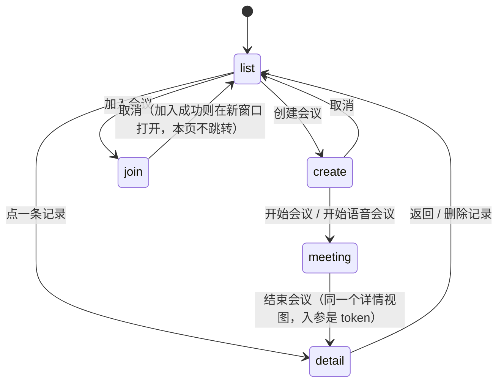

# 会议页签（听记与桌面共享合并）设计

日期：2026-11-01
状态：已实现（2026-11-02）
前置：[2026-10-28 桌面屏幕与声音共享](2026-10-28-desktop-screen-audio-share-design.md)、[2026-10-30 屏幕共享 AI 听记](2026-10-30-live-share-ai-notes-design.md)
交互 Demo：`.clawbench/generated/meeting_tab_demo.html`

## 1. 背景与问题

Dock 里现在有两个页签：

| 页签 | 能力 | 可见性 |
|---|---|---|
| AI 听记（`notes`） | 单人录音 + 实时转写 + 会后纪要 + 历史纪要 | 页签恒显示；能力不足在面板内提示 |
| 桌面共享（`live`） | 屏幕/声音共享、观众、聊天、听记、纪要 | 能采集屏幕的宿主（桌面壳 / 安卓 / 安全上下文浏览器） |

两者其实**已经在共用同一条流水线**：同一个 `useLiveNotes` 单例、同一组 `/api/live-share/notes/*` 端点、同一个磁盘产物目录（`.clawbench/notes/`）。它们只是被拆成了两个入口，并且靠 `NotesPanel.vue:579` 的 `watch(shareActive)` 互相踢来避免状态打架。

用户要的是把它们收成一个「会议」页签，并且改变入口语义：

- 进页签第一眼是**会议记录列表**，不是录音表单；
- 「创建会议」「加入会议」是两个独立页面，按钮放在列表 footer；
- 创建时可以选择**不共享屏幕**——语音会议，**仍然有链接、有观众、有聊天**；
- 会议结束后**直接落到该会议的记录详情**，不再有独立的「会后纪要」界面；
- 记录详情里能看到**聊天记录**，记录可以删除。

## 2. 目标与非目标

### 2.1 目标

1. 一个 Dock 页签「会议」，内部用状态机覆盖 列表 / 创建 / 加入 / 会议中 / 详情 五个视图。
2. 语音会议与屏幕会议走同一条链路（房间、信令、观众、聊天、转写、纪要），差异只在「有没有画面轨」。
3. **会议记录以 token 为身份，存在数据库里**；从会议开始那一刻就存在，与「有没有录到东西」无关；记录与它的转写分段、聊天**同生共死**——只有删除记录才会删掉它们。
4. 聊天**实时落库**，会议结束后可在记录详情里逐条回看。
5. 会议记录可删除，删的是记录行 + 它对应的产物目录。
6. 录音、转写、纪要在创建页与会议中**同一份状态**，两处可改、互相同步。
7. **观众端（浏览器 / 客户端成员）也必须先填称谓才能进入会议**，称谓用于观众列表与聊天署名，并记住上次输入。
8. **会议可以像 git 提交 / issue 一样被拖进聊天当上下文**：列表行拖拽、详情顶部按钮、详情正文选区，三条入口产出同一种引用卡片。

### 2.2 非目标

| 不做 | 原因 |
|---|---|
| 自动过期清理 | 用户明确「统一跟随会议记录管理」：转写、分段、聊天都不再按天数清理，只有删除记录或删除项目才会消失 |
| 迁移老数据 | 用户明确「老数据不管」：已有的 `.clawbench/notes/*` 目录不导入、不再出现在列表里（文件仍在磁盘，可从文件管理器打开） |
| 区分「单人听记」与「共享会议」 | 用户明确要求「不区分，照现状全列」 |
| 会议中的「共享记录」入口 | 初始态就是列表，会议中再挂一份是重复 |
| 会议回收站 / 恢复 | 删除即不可逆，二次确认足够；回收站要处理磁盘占用与「删了还能找回」的语义 |
| 会议列表的搜索 / 分页 | 首版按时间倒序取最近 200 条 |
| 观众端的会议历史 | 观众侧 token 在会议结束即失效，不提供任何持久视图 |
| 聊天富媒体（图片 / 文件 / 表情） | 首版纯文本，与现有 `chat` 控制帧一致 |

## 3. 决策汇总

| 维度 | 决策 |
|---|---|
| 页签数量 | **一个**：`live` 复用为「会议」，删除 `notes` |
| 页签可见性 | **始终显示**（记录永远可读）；创建入口按宿主能力置灰并说明原因 |
| 落地视图 | 会议记录列表 |
| 创建 / 加入 | 两个独立页面，入口是列表 footer 的两个按钮 |
| 会议名称 | 创建页**顶部**，选填 |
| 麦克风 / 系统声音 / AI 听记 | 创建页一份、会议中一份，**同一状态**，实时同步 |
| 语音会议 | 有链接、有观众、有聊天；无画面轨；标注/切源/远程控制/成员共享屏幕不出现 |
| 加入会议（发布端） | 称谓**必填** + 链接必填，两项齐了才能加入 |
| 加入会议（观众端） | 分享页先出称谓门，**填了才建立信令连接**；称谓随连接带上去，服务端拒绝空称谓 |
| 结束会议 | 直接进入该会议的记录详情，不另设界面 |
| **记录身份** | **token**（`live_notes` 表扩列后即会议记录），不是目录 |
| **记录存在时机** | 发布端信令连上时插入（`ON CONFLICT DO NOTHING`），点「开始」但没连上就不留记录 |
| 产物目录 | **可选**：第一次真正要写东西（录音 / 聊天归档 / 纪要）时才创建 |
| 记录详情 | 纪要 / 转写 / 聊天 三个页签 + 产物路径 + 打开文件 / 复制 / 删除 |
| 聊天 | 发布端在**两个入口**（主持人自己发 / 收到观众帧）都立即 POST；服务端按 `msg.id` 幂等落库 |
| 引用到聊天 | 复用现有 `x-clawbench-quote` 拖拽协议与 `kind:'quote'` 附件；新增引用类型 `meeting`，落点按 token 补齐正文 |
| 删除 | 按 token：删目录 → 删行（`live_notes` / `live_notes_segments` / `live_notes_chat`）；二次确认；房间在跑或正在生成纪要时拒绝 |
| 保留期 | **全部永久**：记录、转写分段、聊天、磁盘目录都不再按天清理；删除记录（或删除项目）是唯一的删除路径 |

## 4. 记录模型（token 为身份）

这是本次评审后改掉的核心决定，先说清楚它影响到的每一处。

### 4.1 为什么不是目录

现状是「目录即记录」：`LiveNoteSession.Dir` 的注释原文是 *"It is the folder name inside the notes root. It is the session's id."*，列表靠扫盘。它有两个硬伤：

1. **目录要等到第一段录音上传才建**（`EnsureLiveNotesDir` 只有 `live_notes.go:481`、`:704` 两个调用方）。没开听记、麦克风关着、或全程静音的会议，结束时**没有任何记录**——「进详情」没有目标，列表里也没有这一场。
2. 目录名只带 **6 位 token 后缀**，拿不到完整 token，聊天落库与删除清库都要靠 `live_notes.dir_path` 反查；而该列是绝对路径，项目改名后失效。

### 4.2 新模型

**不新建表**：把现有的 `live_notes` 从「7 天的内容缓存」升级成**永久的会议记录**，加三列即可。

```
live_notes（永久，一条 = 一场会）
  token         TEXT PRIMARY KEY
  project_id    INTEGER NOT NULL
  title         TEXT NOT NULL DEFAULT ''
  started_at    INTEGER NOT NULL DEFAULT 0   -- 新增：服务端时钟，unix ms
  ended_at      INTEGER NOT NULL DEFAULT 0   -- 新增：0 = 还在进行
  dir_name      TEXT NOT NULL DEFAULT ''     -- 新增：目录名（不是绝对路径），空 = 还没有产物
  status / minutes / revised / revise_status / error / file_path   -- 已有，继续用
  dir_path      -- 已有，停止读写（改名会失效的绝对路径）
  created_at / updated_at

live_notes_segments（永久）
  不变，仍是逐段转写的来源
live_notes_chat（永久，新增）
  id, token, project_id, client_msg_id, speaker, viewer_id, text, created_at
  UNIQUE(token, client_msg_id)
```

要点：

- **身份是 token**。列表查库，详情按 token 取，删除按 token 删。
- **记录在发布端连上信令 WS 时创建**，时间取服务端时钟，标题取房间标题。点「开始会议」但采集失败/立刻关掉的，不留记录。
- **`dir_name` 存目录名**，拼路径时用当前项目路径 → 项目改名/移动不影响。
- **目录可选**：第一次要写录音、`chat.md` 或纪要时才建。没有产物的会议就是一条纯记录（列表标「无产物」），不会留下一堆空文件夹。
- **不再有过期清理**：`CleanupLiveNotes`、`liveNotesRetention`、每小时清理那一段整体删除。转写分段与聊天会随会议数量一直增长（见 §14），换来的是「记录里的东西不会自己消失」。
- **删除是唯一出口**：删除记录时一次清掉 `live_notes` / `live_notes_segments` / `live_notes_chat` 三张表里该 token 的行；删除项目时随 `DeleteProjectData` 一起清。
- **老数据不迁移**：已有的会议目录不导入，也不会出现在会议列表里（文件仍在磁盘，可从文件管理器打开）。升级时**一次性清空升级前存在的 `live_notes` / `live_notes_segments` 行**（`started_at = 0` 的旧行），避免留下一批永远不会显示、也永远不会被清理的孤儿数据；磁盘上的纪要、转写、录音一律不动。

### 4.3 生命周期

| 时刻 | 动作 |
|---|---|
| 发布端 WS 连上 | `INSERT INTO live_notes(token, project_id, title, started_at) ON CONFLICT DO NOTHING` |
| 第一次写录音 / 聊天归档 / 纪要 | `EnsureMeetingDir`：建目录，`UPDATE live_notes SET dir_name = ?` |
| 发布端 WS 断开 | `UPDATE live_notes SET ended_at = ? WHERE token = ? AND ended_at = 0` |
| 进程重启 / 漏掉断开钩子 | 每小时回收器把 `ended_at = 0` 且 `updated_at` 超过 12 小时的记录收尾（`ended_at = updated_at`） |
| 删除记录 | 见 §6.7（也是这些行唯一的删除路径，没有定时清理） |

## 5. 信息架构与状态机



- **`meeting → detail` 不经过任何中间态，也不依赖目录**：停止时手上就有 token，直接按 token 打开详情。「上传未排空 / 纪要生成中 / 校对中 / 生成失败」全部由详情自己表达。
- `create` / `join` 是**页面**而不是弹窗或区块：它们各自有 header（返回箭头 + 标题）与 footer（取消 + 主操作）。
- **返回**：`create` / `join` / `detail` / `meeting` 四个子页都注册 `PRIORITY_PAGE` 返回处理器（`id: 'meeting'`，门 `active`），屏幕左右边缘内划与 Android 物理返回键都回到 `list`。
  - **`meeting` 的返回不结束会议**：房间在 `useLiveShare` 里而不是组件里，离开只是换视图；结束必须点「结束会议」（破坏性动作不能交给手势）。
  - 为了让返回不是单向门，列表里**运行中**的那条记录点开会回到 `meeting` 而不是详情（运行中的记录还没有可看的纪要/转写）。
- `MeetingPanel` 被 `TabPanel` 以 `v-if="everOpened"` + `v-show` 保活，**不会卸载**；切走再切回靠 `active` 属性复位到 `list`（会议进行中则回到 `meeting`），不能指望 `onMounted`。

## 6. 视图设计

### 6.1 列表（默认落地页）

```
┌ 会议 ──────────────────────────────┐
│ 会议记录  12 场              ⟳     │  ← toolbar：只有刷新
├────────────────────────────────────┤
│ 发版评审                            │
│ 今天 14:30 · 48 分钟 · 12 段录音     │
│ 4 条聊天          [有纪要][语音]  › │
├────────────────────────────────────┤
│ 客户接入沟通                        │
│ 昨天 16:10 · 31 分钟 · 9 段录音      │
│ 0 条聊天          [仅转写]        › │
├────────────────────────────────────┤
│ 说明：记录来自本项目的会议数据库…    │
├────────────────────────────────────┤
│          [加入会议]  [创建会议]     │  ← footer
└────────────────────────────────────┘
```

- 数据源：`live_notes` 表按 `project_id` 过滤、`started_at` 倒序取 200 条。
- 行信息：标题、开始时间、时长（`ended_at - started_at`；未结束显示已进行时长）、录音段数、聊天条数、产物标记（有纪要 / 仅转写 / 无产物）、语音会议标记。
- **时长与聊天条数现在是查得出来的**（表里有 `started_at/ended_at`，聊天有独立表），不再依赖目录名。
- 录音段数与三个产物标记来自目录：`dir` 为空直接判定「无产物」，否则对目录做一次 `os.Stat` / 读 `audio/`。列表规模在几百条以内，代价可接受；上千条时再考虑把标记写回表（见 §14）。
- 行内右侧 hover 出现删除按钮；详情页 footer 也有删除，触屏不依赖 hover。
- 空态：一句「还没有会议记录」，不加按钮（footer 已有）。

### 6.2 创建会议

```
┌ ← 创建会议 ────────────────────────┐
│ 会议名称                            │
│ [选填，不填则用日期命名          ]  │
│ 选择共享内容                        │
│ [不共享屏幕] [屏幕 1]               │
│ [屏幕 2]     [窗口 · 编辑器]        │
│ 声音与听记                          │
│ ☑ 🎤 包含麦克风                     │
│ ☐ 🔊 包含系统声音                   │
│ ☑ 📓 AI 听记                        │
├────────────────────────────────────┤
│                [取消] [开始会议]    │
└────────────────────────────────────┘
```

- **顺序固定**：名称（选填）→ 共享内容 → 声音与听记。名称在最上面，因为它是唯一需要打字的字段。
- 「不共享屏幕」是选源网格里的**第一块磁贴**，不是一个额外开关——它和其它源是互斥的一选一。
- 选「不共享屏幕」时：`包含系统声音` 置灰并说明「语音会议没有画面，也就没有系统回环声音」。
- 声音与听记三行**带图标**（麦克风 / 扬声器 / 笔记本），选中时图标跟随主题色；说明行随状态变化。
- 主按钮文案随选择变化：`开始会议` / `开始共享` / `开始语音会议`；未选源时置灰。
- 无法采集（HTTP 浏览器、无麦克风）时，整页降级为一行说明 + 返回，不显示选择网格。

### 6.3 加入会议（发布端）

```
┌ ← 加入会议 ────────────────────────┐
│ 你的称谓                            │
│ [其他人会看到这个名字            ]  │
│ 必填。发布端与其他观众用这个名字称呼你。│
│ 会议链接                            │
│ [http://192.168.x.x:20000/share/…]  │
│ 拿到链接的人无需登录即可加入…        │
├────────────────────────────────────┤
│                   [取消] [加入]     │
└────────────────────────────────────┘
```

- 称谓与链接都非空才可点「加入」；只填链接时点不动，但校验失败（例如非 `http(s)://`）要就地提示，不静默。
- 称谓写进与分享页称谓门**同一个** localStorage 键：打开链接后门里已预填，用户确认一次即可，不用输两遍。
- 桌面壳在独立窗口打开（复用现有 `openShareLink`），浏览器新开标签页。打开后本页留在原地，提示「已在新窗口打开」。

### 6.4 会议中

结构与现有共享面板一致：header（标题 + 状态徽标 + 计时 + 结束会议）+ 三个页签（基础 / 转写 / 聊天），**没有第 4 个页签**。

**基础**

- 屏幕会议：共享源信息 + 画面标注 / 切换共享源；语音会议：一条「语音会议，没有画面」的说明，两个按钮不出现。
- 链接块（主地址 + 查看全部 N 个地址）。
- **声音与听记**：三个运行时开关，与创建页同一状态。
  - 包含麦克风：关闭后提示「本端不再上传声音，转写只保留观众信道」。
  - 包含系统声音：语音会议下置灰；屏幕会议下开关控制回环音轨的 `enabled`。
  - AI 听记：关闭后转写页签的圆点消失、内容换成「不会生成转写与纪要，可在基础里重新打开」。
- 观众列表（显示称谓，发布端自己固定显示「主持人」）+ 允许观众发言 + 允许成员共享屏幕（语音会议隐藏后者）。

**转写**：按说话人分行，录音中圆点常驻；本端麦克风关闭时提示只记录其他参与者。

**聊天**：消息列表 + 输入框；主持人自己发的消息与收到的观众消息走同一个落库函数（见 §8.2）。

### 6.5 详情（结束会议后直接落到这里）

```
┌ ← 发版评审 ────────────────────────┐
│ 今天 14:30 · 48 分钟 · 屏幕共享  [有纪要] │
├─ 纪要 ─┬─ 转写 ─┬─ 聊天 4 ──────────┤
│ （生成中：校对转写 → 生成纪要）      │
│ 概要 / 结论与决定 / 待办            │
│ 已保存到                            │
│ 纪要   …/minutes.md          [复制] │
│ 转写   …/transcript.srt      [复制] │
│ 校对版 …/transcript-revised.md[复制]│
│ 录音 12 段 …/audio/          [复制] │
├────────────────────────────────────┤
│ [删除记录]        [打开文件] [复制] │
└────────────────────────────────────┘
```

- 入参是 **token**。与「点一条历史记录」是**同一个组件、同一份数据**；差别只有刚结束时可能处于生成中。
- 生成中、生成失败、无纪要（只有转写）、校对失败（纪要基于原始转写）都在这里表达，沿用现有文案。
- `dir_name` 为空（没有任何产物）时：三个页签都能打开，纪要/转写显示「无产物」，聊天显示落库内容，底部「打开文件」不出现。
- 底部「复制」按当前页签取内容：纪要/转写复制当前正文，**聊天页签复制全部聊天**（`[HH:MM] 称谓：文本` 逐行）。
- 记录永久之后要处理「卡在生成中」：打开详情时若 `status = generating` 且 `updated_at` 超过 10 分钟，显示「生成中断」并提供重试，否则一场被进程重启打断的会议会永远转圈。
- 聊天页签读数据库（见 §8.3），会议中发过的消息在这里逐条可见。
- 「打开文件」走现有文件查看器；路径分隔符按服务端返回的路径判断（Windows 反斜杠）。

### 6.6 观众端加入（浏览器 / 客户端成员）

观众不是「打开链接就直接进会」，而是先过一道称谓门：

```
┌ 发版评审 ───────────────────────────┐
│ 主持人邀请你加入会议                 │
│                                     │
│ 你的称谓                            │
│ [小明                            ]  │
│ 发布端与其他观众会看到这个名字。      │
│                                     │
│            [加入会议]               │
└────────────────────────────────────┘
```

- **门在连接之前**：称谓为空时**不建立 WS 信令连接**，因此不占观众名额、不消耗发布端上行。只有点了「加入会议」才 `connect(name)`。
- **称谓必填且服务端校验**：信令连接带 `name` 查询参数（URL 编码，≤24 字），服务端遇到空值直接 `400` 拒绝，不做「空名字也放行、显示成匿名」的兜底。
- **管道已存在，只差取值**：`liveshare.Viewer` 已有 `Name` 字段（`room.go:74`），`AddViewer(name, sink)` 已经接收名字，只是 `live_share.go:422` 恒传 `""`；`PublisherMessage.Name`、`ViewerControl.Name`、聊天帧的 `name` 也都已存在。本设计**不新增协议字段**，只把值填上。
- **本地记住**：`localStorage` 存上一次用的称谓，刷新后预填，一键即可重新加入；换会议也沿用同一个名字。桌面端「加入会议」页写的是同一个键。
- **服务端名字是权威**：发布端在 `viewer-join` 里拿到 `name` 后建立 `viewerId → 称谓` 映射，转发观众消息时**替换帧里的 `name`**，`from` 保持 viewerId 不动（`from` 是身份，远程控制靠它鉴权，见 §8.2）。观众列表、聊天署名、说话人高亮都读这个映射。
- **允许重名**：内部仍用 `viewerId` 区分，列表显示称谓，重名时追加 `#2`。
- **不支持中途改名**：改名字要重新加入（首版不做，见 §14）。

### 6.7 删除

- 入口：列表行 hover 的删除按钮、详情 footer 的「删除记录」。
- 确认框写明：删除这条记录**和它的全部产物**（纪要、转写、录音、聊天），**无法恢复**。
- 服务端拒绝的三种情况：token 不存在或不属于当前项目（404）、房间仍在运行（409）、纪要/校对任务正在跑（409，否则后台任务会把目录和行复活）。
- 顺序：**先删目录，再删行**。目录删失败直接报错、行不动（可重试）；行删失败时目录已经没了，记录仍在，详情显示「无产物」，再删一次即可——两种半状态都可恢复。
- 目录来自数据库里的 `dir`（服务端自己拼的路径），**不接受客户端传路径**，因此没有目录名解析与路径穿越问题。
- 成功后回列表并提示；当前正停在被删会议的详情时同样回列表。

### 6.8 引用到聊天（拖拽 + 顶部按钮）

会议要和 git 提交、定时任务、issue/PR 一样能直接拖进聊天当上下文。三条入口，**一种卡片**：

| 入口 | 产出 |
|---|---|
| 列表行拖拽 | 整场会议（纪要正文，截断） |
| 详情顶部按钮（参考 issue 详情右上角的引用图标） | 同上 |
| 详情正文里选中文字 | 选区引用（只带选中的那段） |

**载荷只带身份，正文在落点补齐。**

`dragstart` 必须同步写 `dataTransfer`，而列表行上没有正文可带；如果在这里发请求，拖拽会先开始、数据后到，浏览器已经拒绝了这次 drop。所以：

```ts
meetingDragPayload({ token, title, startedAt })  // 新增在 utils/quoteDrag.ts
  → {
      text: '',                                    // 落点补齐
      filePath: `会议 · ${title} · ${MM-DD HH:mm}`,
      language: 'meeting',
      startLine: 0, endLine: 0,
      sourceKind: 'meeting',
      meetingToken: token,
    }
```

落点（`App.vue` 的 `onChatColDrop`）读到 `meetingToken` 后走 `stageMeetingQuote(payload)`：

1. `GET /api/live-share/notes/sessions/artifact?token=&kind=minutes`；
2. 没有纪要就回落 `revised` → `transcript`；
3. 截断到 4000 字，末尾补「…（已截断，共 N 字）」；
4. 填进 `text` 再 `addStagedQuote(...)`，切到聊天页签并 toast。

顶部按钮走**同一个** `stageMeetingQuote()`，所以两条入口产出的卡片一字不差。拉取失败**不暂存**（给模型一个只有标题的空引用没有意义），只 toast 报错；纪要还在生成时提示「纪要还在生成，稍后再试」。

**新增一个引用类型**

| 位置 | 改动 |
|---|---|
| `utils/quoteItem.ts` | `QuoteItem` 增加 `meetingToken?: string`；`QuoteDisplayType` 增加 `'meeting'`；`TYPE_MARKER_LANGUAGE` 加 `meeting`；`resolveQuoteType` 在显式 marker 之后、`url` 之前判 `meetingToken` |
| `utils/quoteSourceMeta.ts` | `QUOTE_TYPE_ICON` / `QUOTE_TYPE_LABEL_KEY` 各加一行（图标 `CalendarDays`，文案「会议」） |
| `components/chat/ChatPanelContent.vue` 的 `jumpToQuoteSource` | 新增分支：`meetingToken` → `dispatchEvent('clawbench-open-meeting', { token })` |
| `App.vue` | 监听 `clawbench-open-meeting`：切到会议页签 → `MeetingPanel.openDetail(token)` |

**详情正文的选区引用**

正文容器挂 `data-quote-source="会议 · <标题> · <日期>"`、`data-quote-language="meeting"`，复用现有 `useQuoteQuestion` 选区管道（与 issue 正文同一套）。

**不要在正文上做 `draggable`**：那会劫持鼠标拖选，用户再也选不了字。整场会议的拖拽只挂在**头部标题块**和列表行上。

**边界**

| 场景 | 行为 |
|---|---|
| 纪要很长 | 截断 4000 字并注明总字数 |
| 没有纪要、也没有转写 | **不暂存**，提示「这场会议还没有可引用的内容」——只有标题的引用对模型没有信息量 |
| 纪要正在生成 | 不暂存，提示稍后再试 |
| 拉取失败 | 不暂存，toast 报错 |
| 拖到非聊天区 | 沿用现有行为：不处理，浏览器给「禁止」光标 |

## 7. 语音会议

### 7.1 与屏幕会议的唯一差别是「没有视频轨」

| 维度 | 屏幕会议 | 语音会议 |
|---|---|---|
| 采集 | `getDisplayMedia` + 麦克风 | 仅麦克风 |
| 发布端轨道 | `video` + 混音 `audio` | 仅混音 `audio` |
| 观众端 | 画面 + 声音 | 声音 + 「语音会议」占位 |
| 标注 / 切源 / 远程控制 | 有 | 不出现 |
| 成员共享屏幕 | 可开 | 不出现 |
| 系统声音 | 可采 | 不可采（无回环源） |
| 转写信道 | `mic` + `viewer:<id>` | 同左（本来就只录麦克风） |
| 房间 / 信令 / 聊天 / 听记 / 纪要 | 完全一致 | 完全一致 |

### 7.2 现状缺口（评审后逐条核对过）

**发布端不是「天然支持」**：`useLiveShare.ts:392` 在拿到采集流后就硬失败——

```ts
outVideoTrack = displayStream.getVideoTracks()[0] ?? null
if (!outVideoTrack) { fail('no video track captured'); await stop(); return false }
```

必须新增一条「只采麦克风」的启动分支：跳过 `getDisplayMedia`、`displayStream` 允许为 null、跳过上面的检查、`previewStream` 保持 null、`captureKind` 增加空态。

已经可以复用的部分（不用改）：`previewStream` 本来就是 `shallowRef<MediaStream | null>`；`LiveMixer(ctx, systemStream: MediaStream | null, micStream: MediaStream | null)` 的注释明确写了「缺一路是正常的」；`outgoing.addTrack` 对视频轨本来就是条件式的（`useLiveShare.ts:625`）。

**观众端要改的不止一处**：

| 位置 | 现在 | 语音会议下 |
|---|---|---|
| `liveViewer.ts:351` | 只在收到 video 轨时 `setState('playing')` | 音频轨到达即接通 |
| 等待层 | 以 `state !== 'playing'` 为条件 | 同上，否则永远转圈 |
| 远程控制按钮 | 无条件渲染 | `video:false` 时不出现（没有画面可控） |
| 标注层 `syncInkRect` / `contentRectOf` | 从 `videoWidth` 算 | 没有画面，不挂标注层 |
| 成员共享屏幕 / 视图切换 | 有画面才有意义 | 隐藏 |

### 7.3 协议

房间元信息增加布尔 `video`（`GET /api/share/{token}/meta` 与 WS 的 `joined` 帧都带）。观众端**只信这个字段**，不靠「等 3 秒没画面就猜语音」。

- `POST /api/live-share` 的 body 增加 `video?: boolean`（缺省 true），**每次都写**（与 `SetNotesEnabled` 同一处），避免房间在 10 秒宽限期被复用后继承上一场的标志。
- 三条 m-line 的数量与顺序**保持不变**——语音会议只是让第 2、3 条空着，前端只有一处分支。

## 8. 聊天

### 8.1 现状

聊天走 RTCDataChannel：观众发 → 发布端打 `from` 后广播。`internal/liveshare` 与 `internal/handler/live_share.go` 里**完全没有 chat**，消息只存在两端内存，后加入的观众看不到之前的，会议结束后全部消失。

聊天帧本来就带 `id`（`liveControl.ts:26`）与 `name` 字段，这两个字段是落库与署名的现成依据。

### 8.2 落库

- **两个写入点，一个函数**：观众消息在 `onControl` 里、主持人自己的消息在 `sendChat` 里——后者**不经过** `onControl`（它直接 `sendControl` 广播），只挂在收帧上是漏的。两处都调 `persistChat(msg)`。
- **署名**：`speaker` 取 `msg.name`，但观众消息的名字由发布端用 `viewerId → 称谓` 映射覆盖，不信任帧里的自报值。`from`（viewerId）保持原样，因为远程控制靠它鉴权。
- **幂等**：`UNIQUE(token, client_msg_id)`，`client_msg_id` 就是帧里的 `id`；重复 POST 返回 200。退避重试因此不会产生重复行。
- **顺序**：服务端自增 `id` 决定顺序，不按客户端时钟排序（观众的 `at` 可能偏）。
- 失败按 1s/3s/9s 退避重试三次；仍失败只记日志，**不阻塞聊天**。这种情况下详情里的聊天可能缺条，界面上不额外报警——聊天不是会议的正式产物。
- 限额：单条 ≤ 2000 字（复用 `liveControl.ts` 的 `CHAT_MAX_CHARS`）、称谓 ≤ 24 字（服务端兜底 40）；空文本拒绝。

### 8.3 读取与归档

- 详情页的聊天页签**读数据库**，按 `id` 升序；记录永久，所以不会出现「过几天聊天没了」。
- 会议结束时（纪要生成入口）仍把聊天物化成目录里的 `chat.md`，格式 `[HH:MM] 称谓：文本`。这一步不是为了过期兜底，而是与纪要、转写一致：**磁盘上有一份可以进 git、可以直接打开、可以带走的副本**。
- 不做「解析 `chat.md` 回填消息」：Markdown 是给人看的，数据库才是权威。
- 这也是「聊天-only 会议」创建目录的时机（没有录音、没有纪要，但有聊天）。

## 9. 数据与接口

### 9.1 数据

| 表 | 变化 |
|---|---|
| `live_notes` | **升格为会议记录，永久**；新增 `started_at` / `ended_at` / `dir_name`；`dir_path` 停止读写 |
| `live_notes_segments` | 不变，改为**永久**（不再按天清理） |
| `live_notes_chat` | **新增，永久**（见 §8.2） |

会议目录布局（存在时）：

```
<项目>/.clawbench/notes/2026-11-01-1430-发版评审-a1b2c3/
    minutes.md
    transcript.srt
    transcript-revised.md
    chat.md                 ← 新增
    audio/*.webm
```

`DeleteProjectData` 的清理清单要加上 `live_notes_chat`（现有约 15 张表；`live_notes` / `live_notes_segments` 已在清单里）。

### 9.2 接口

| 方法 | 路径 | 变化 |
|---|---|---|
| POST | `/api/live-share` | body 增加 `video?: boolean`（默认 true），每次写入房间 |
| GET | `/api/share/{token}/meta` | 响应增加 `video` |
| WS | `/api/share/{token}/signal?name=` | **新增必填参数**：空/纯空白或超长 → `400`；名字进 `Viewer.Name` |
| — | `joined` / `viewer-join` 帧 | 填上已有的 `name` 字段 |
| POST | `/api/live-share/notes/chat` | **新增**：登录 + 项目 + token 归属；幂等 |
| GET | `/api/live-share/notes/sessions` | **改为查 `live_notes`**（不再扫盘），返回 `token` 而非 `dir`；带 `?token=` 时返回单条 `{session}` |
| GET | `/api/live-share/notes/sessions/artifact?token=&kind=` | **入参由 `dir` 改为 `token`**；`kind` 增加 `chat` |
| DELETE | `/api/live-share/notes/sessions?token=` | **新增** |
| POST | `/api/live-share/notes/session` | **删除**（单人 token 不再有入口） |

`POST /notes/chat` 与听记上传共用同一套 token 归属判定：**`live_notes` 里存在该 token 且属于本项目**。会议刚结束那几秒的尾巴消息因此照常落地（记录在会议开始时就存在，不再依赖「房间存活或已有听记行」这种兜底）。

`GET /sessions/artifact` 改为 token 之后，目录由服务端从 `live_notes.dir_name` 解析，**客户端不再传任何路径**——顺带消掉了「目录名形状校验 + 路径逃逸」这一整类风险。

## 10. 前端结构

### 10.1 组件拆分

| 文件 | 职责 |
|---|---|
| `components/live/MeetingPanel.vue` | 外壳：状态机、页签头、角标、视图分发、`active` 复位 |
| `components/live/MeetingList.vue` | 记录列表 + 刷新 + footer 两个入口 |
| `components/live/MeetingCreate.vue` | 名称 / 选源 / 声音与听记 / 开始 |
| `components/live/MeetingJoin.vue` | 称谓 + 链接 + 加入 |
| `components/live/MeetingStage.vue` | 会议中（现 `LiveSharePanel.vue` 瘦身，去掉 minutes 分支与 footer 纪要栏） |
| `components/live/MeetingDetail.vue` | 详情三页签 + 产物 + 删除 + 顶部引用按钮 + 正文选区引用 |
| `share/LiveJoinGate.vue` | 观众端称谓门（分享页进入会议前的唯一入口） |
| `components/live/NotesPanel.vue` | **删除** |
| `composables/useMeetingHistory.ts` | 列表 / 详情 / 聊天 / 删除（从 `NotesPanel` 抽出约 150 行）+ `stageMeetingQuote` 的正文拉取 |
| `composables/useLiveNotes.ts` | 不变（录音与上传单例） |
| `composables/useLiveShare.ts` | 支持 `displayStream = null`（语音会议） |
| `share/liveViewer.ts` | `connect(name)`；`video:false` 的接通判定与占位 |

状态归属：

- **会议会话状态**（当前会议、页签、计时、转写、聊天）留在 `useLiveShare` / `useLiveNotes` 单例，切走页签不中断。
- **视图状态**（list/create/join/meeting/detail）留在 `MeetingPanel`，`active` 变 true 时复位：不在会议中就回 `list`，在会议中就回 `meeting`。
- **创建页与会议中的三个开关**共用 `useLiveNotes` 上的同一份布尔，不各存一份。
- **观众称谓**留在 `LiveJoinGate` 的本地状态，`liveViewer.connect(name)` 接收它作为参数；`liveViewer` 不自己读 `localStorage`，便于测试。

### 10.2 Dock

- `dockTabs.ts`：删除 `notes` 描述符；`live` 的 `titleKey` 改为 `nav.meeting`。
- `dockTabMeta.ts`：`live` 图标改为 `CalendarDays`（已确认该图标在安装的 `lucide-vue-next` 中存在）；**`DOCK_TAB_ICONS` 的 `Record<DockTabId, Component>` 必须同步删掉 `notes` 键**，否则类型报错。
- `secondaryDockTabs()`：**去掉 `liveUnavailable` 过滤**，页签恒显示。
- 角标：**只保留一个主题色圆点 = 会议进行中**（复用现有 `.dock-badge--live` 的样式与脉冲动画）。不再用红色 tint 表示录音——红色在本 UI 里表示错误/危险；「在录还是在播」进面板看。这同时解决了「语音会议既是 publishing 又是 recording」的叠加问题：只有一个状态要表达。
- 需要同步改的 `App.vue` 位置：`notesPhase` / `notesRecording`（:1994-1995）、两处 `is-recording` 判断（:3433、:3671）、`<TabPanel tabId="notes">` 块（:227）。
- `panelState` 的 `leftTab` 记忆值：`leftTab` 条目现在用 `stringCodec(null)`，要在该条目上**覆盖 `parse`**，把 `notes` 映射为 `live`。不做的话 `resolvePanelTab` 会把未知 id 落到默认页签（`browse`/`chat`），老用户切不回来。

### 10.3 i18n

- `nav.notes` 删除；`nav.liveShare`（桌面共享）改为 `nav.meeting`（会议）。
- 新增 `meeting.*` 命名空间：列表、创建、加入、详情、删除确认。
- `liveShare.*` 保留给会议中与产物（`notes.*` / `history.*` 沿用），避免大面积改键；`liveShare.solo.*` 随单人入口一起删除。
- 引用相关：`quoteBar.typeMeeting`（卡片与抽屉的类型标签）、`meeting.detail.quote`（顶部按钮 tooltip）、`meeting.quote.loading` / `failed` / `generating`。

## 11. 边界与异常

| 场景 | 行为 |
|---|---|
| 无麦克风 / HTTP 上下文 | 列表可读；「创建会议」置灰并说明缺什么（沿用现有三分支文案） |
| 会议进行中再点「创建会议」 | 回到会议中视图，不新建（同一时刻只有一场） |
| 上一场还在收尾（上传/生成）时开新会议 | 禁止并提示「上一场还在生成纪要」——`useLiveNotes` 的 `sessionGen` 会掐断旧会话，导致上一场既没有纪要也没有 `chat.md` |
| 会议中切换项目 | 会议结束并提示；否则上传与聊天会因项目 Cookie 变化连续 403 |
| 信令断开（网络抖动 / 恢复） | 与现在一致视为会议结束，但要在详情里标「连接中断，本场可能缺少结尾」，不静默回列表 |
| 删除正在进行的会议 | 服务端 409；前端提示先结束 |
| 删除正在生成纪要的会议 | 服务端 409；前端提示稍后重试 |
| 会议刚结束、上传未排空 | 详情显示「上传中 N 段」，纪要在排空后才开始 |
| 纪要生成失败 | 详情内联错误 + 重试，不弹窗 |
| 生成中但进程重启了 | 详情打开时按「`status=generating` 且 10 分钟未更新」判定为中断，显示可重试，不永久转圈 |
| 聊天落库失败 | 不影响聊天，只记日志；详情可能缺条 |
| 记录没有任何产物 | 列表标「无产物」；详情三个页签可开，产物区为空，「打开文件」不出现 |
| 观众端 token 失效 | 沿用现有「共享已结束」提示 |
| 引用时纪要正在生成 / 拉取失败 | 不暂存空引用，toast 说明原因（见 §6.8） |
| 转写/聊天占用的空间 | 不再自动清理；删除记录或删除项目才会释放（见 §14） |
| 观众称谓为空 / 纯空白 / 超长 | 前端按钮不可点；绕过前端直接连 WS 的由服务端 `400` 拒绝 |
| 称谓门收到 400 | 服务端 400 表现为 WS 握手失败，浏览器拿不到状态码；前端已保证非空且 ≤24 字，正常路径不会触发。若真触发，页面落在通用的「连接失败」，重试前会回到称谓门 |
| 观众重名 | 允许；列表用 `viewerId` 区分，重名追加序号 |
| 观众刷新页面 | 回到称谓门，预填上次称谓，一键重新加入（不自动重连，避免静默占用名额） |

## 12. 测试

**Go**

- `live_notes_record_test.go`：建记录幂等（重复连上不重置 `started_at`）、断开收尾、12 小时收尾、按项目倒序、项目删除级联；并断言**不再有过期清理**（`CleanupLiveNotes` 与 `liveNotesRetention` 已删除）。
- `live_notes_chat_test.go`：追加 / 增量读取 / 幂等（同一 `client_msg_id` 两次只留一条）/ 空文本拒绝 / 长度上限 / 删除记录时一并清空。
- `live_notes_delete_test.go`：按 token 删除、他人项目 404、房间运行中 409、生成中 409、目录删失败不删行、行删失败后重试仍可完成。
- `live_notes_test.go` 增补：`chat.md` 物化、`dir_name` 为空时详情可读、老 `dir_path` 不再被读取。
- `live_share_test.go` 增补：`video:false` 出现在 meta 与 `joined`；信令 WS 缺 `name` 返回 `400`；`viewer-join` 带回称谓。

**前端**

- `MeetingPanel.test.ts`：状态机（list → create → meeting → detail → list）、结束即进详情、`active` 复位、会议进行中切走再回来落在 meeting。
- `MeetingCreate.test.ts`：名称选填、未选源时按钮禁用、选语音时系统声音置灰、三个开关与 `useLiveNotes` 同步。
- `MeetingJoin.test.ts`：称谓必填、链接格式校验、两项齐了才可点。
- `quoteDrag.test.ts` 增补：`meetingDragPayload` 的 label/类型/locator，空 token 返回 null。
- `quoteItem.test.ts` 增补：`resolveQuoteType` 认 `meetingToken`，不被 `url`/`filePath` 抢走。
- `MeetingPanel.test.ts` 增补：顶部按钮 → `stageMeetingQuote` 被调用；`clawbench-open-meeting` 能按 token 打开详情。
- `MeetingDetail.test.ts`：生成中 / 生成中断（超时判定）/ 失败 / 无纪要 / 无产物 / 聊天空态、复制全部、删除确认。
- `LiveJoinGate.test.ts`：称谓为空时按钮不可点且不发起连接、本地记住上次称谓、提交后把名字传给 `connect()`。
- `dockTabs.test.ts` / `useWideScreenLayout.test.ts`：`notes` 已移除、`live` 恒可见且位置变化、`leftTab` 记忆迁移（现有断言 `live` 在 `proxy-1` 且被 `liveUnavailable` 隐藏的两处要重写）。

**E2E**（`e2e/specs/meeting-tab.spec.ts`）

两条主线：①创建语音会议 → 发一条聊天 → 结束 → 详情里看到聊天 → 删除 → 列表少一条；②打开分享链接 → 称谓门出现 → 空称谓点不动 → 填名进入 → 聊天里显示该称谓。现有的 `share-page.spec.ts` / `live-share.spec.ts` 假定「打开即连」，要跟着改成先过门。

## 13. 文档同步

- `docs/spec/features/live-share.md`：新增「会议页签」一节，改写「界面位置」与「AI 听记」中的入口描述，补观众称谓门。
- `docs/spec/database.md`：`live_notes` 扩列与永久化、新增 `live_notes_chat`、删除保留期说明。
- `internal/api/openapi.yaml`：`POST /api/live-share`、`GET /api/share/{token}/meta`、`POST /notes/chat`、`GET/DELETE /notes/sessions`、artifact 入参与 `kind=chat`、删除 `POST /notes/session`。
- `dockTabs.ts` / `dockTabMeta.ts` 的注释同步（它们承载了「为什么两个页签」的旧论证）。

## 14. 已知限制

- 老会议目录不再出现在列表里（用户已确认不迁移）。
- 语音会议里「允许成员共享屏幕」不出现：发布端没有画面，转发别人的屏幕没有对照物。
- 聊天落库失败不重试到成功，极端情况下详情缺条。
- **数据库不再自动清理**：一场一小时的会约几百条转写分段，长期使用后 `live_notes_segments` 与 `live_notes_chat` 会持续增长。首版接受这个代价（换来「记录里的东西不会自己消失」），后续可以只对分段做压缩或按记录数分批归档。
- 会议记录不区分单人/共享（用户已确认）。
- 列表每次刷新会为每条有产物的记录做一次目录探测；记录到几千条时需要把产物标记写回表。
- 列表查询会连带读出该行的纪要正文（SQLite 按行存储）；记录很多且纪要很长时，可以再拆一张只放索引字段的表。
- 观众不支持中途改名，改名需退出重进；发布端也不支持把某个观众改名。

## 15. 已定（原待确认）

| 问题 | 决定 |
|---|---|
| 页签角标 | **一个主题色圆点 = 会议进行中**。不再用红色 tint 表示录音：红色留给错误；「在录 / 在播」进面板看 |
| 发布端名字 | 固定「主持人」，创建页不再多一个称谓输入框 |
| 聊天导出 | 详情页「聊天」加一个**复制全部**，与纪要、转写的复制按钮一致；不做下载 |
| 保留期 | **取消 7 天限制**，记录、分段、聊天、目录统一跟随会议记录；删除记录是唯一出口 |

## 16. 实现记录（2026-11-01）

实现与设计的差异，逐条说明（以代码为准）：

| 项 | 实现 |
|---|---|
| 记录表 | **没有新建 `meetings` 表**：`live_notes` 直接扩三列（`started_at` / `ended_at` / `dir_name`）成为永久记录。少一次迁移，也少一个「两个表谁权威」的问题 |
| 记录创建时机 | 发布端信令 **attach 成功之后**（不是 `POST /api/live-share`），所以点开始但采集失败的不留记录 |
| 记录收尾 | 发布端 socket 释放时 `ended_at = now`（`WHERE ended_at = 0`，幂等）；显式结束也走同一个 `finalizeLiveNotes`。漏掉的由每小时扫描把 12 小时未动的记录收尾 |
| 升级 | 一次性删除 `started_at = 0` 的旧行与分段（只在首次加列那次执行）；磁盘文件不动 |
| 列表 | 一次查询 + 一次聊天计数分组查询；产物标记对每个有目录的记录做 `stat`，音频数读目录 |
| 详情 | 单条记录走 `GET /sessions?token=`；聊天页签徽标用**已加载条数**而不是服务端总数（两者不一致时以列表为准） |
| 删除 | 先删目录、再删三张表的行；目录删失败则不动行（可重试） |
| 聊天归档 | 会议结束时写 `chat.md`；详情**只读数据库**，不做 Markdown 反解析 |
| 观众称谓 | 复用已有的 `Viewer.Name` / `viewer-join.name` / 聊天帧 `name`；服务端校验 ≤24 字，空值 400；发布端用 `viewerId → 称谓` 覆盖自报值，`from` 保持不变 |
| 语音会议 | `POST /api/live-share` 的 `video`（默认 true）→ 房间 → `joined.video`；发布端 `start({video:false})` 跳过采集；观众端音频轨即接通 |
| 运行时开关 | 麦克风/系统声音切换轨道 `enabled`（不重协商）；听记开关走 `useLiveShare.startNotes()/stopNotes()` |
| 引用 | 拖拽只带 token；落点/按钮统一走 `handleMeetingQuote` → 拉纪要（无则校对版转写 → 原始转写）→ 截断 4000 字 → 暂存；失败不暂存 |
| 角标 | 只剩一个主题色圆点（`liveDotVisible`），红色的 `is-recording` tint 删除 |
| 评审后修正 | `video` 字段**去掉 `omitempty`**（false 必须真的发出去）；观众称谓在 `onViewerJoin` **之后**回填（否则行还不存在）；引用卡片补 `meetingToken` 三处映射 + 选区 `data-quote-meeting-token`；详情在会议刚结束时轮询纪要；分享自行停止时由外壳切走（阶段页没有返回键）；删除项目补三张会议表；列表删除失败弹提示；转写按纯文本渲染（SRT 过 Markdown 会把时间轴箭头吃掉）；观众重名加 `#2` |

## 附：评审修订记录（2026-11-01）

| 评审意见 | 处理 |
|---|---|
| 语音会议「天然支持」是错的：`useLiveShare.ts:392` 硬失败 | §7.2 改为「必须新增只采麦克风分支」，并列出可复用与需改的位置 |
| 会议可能没有任何记录 | 记录模型改为 token（§4），开始即建行；目录可选 |
| 发布端自己的聊天漏落库 | §8.2 改为两个写入点共用一个函数 |
| 覆盖 `from` 会打断远程控制 | §6.6 / §8.2 改为只替换 `name`，`from` 保持 viewerId |
| 称谓管道其实已存在 | §6.6 明确「不新增协议字段，只填值」 |
| 删除会被后台纪要任务复活 | §6.7 / §11 增加「生成中 409」，改为先删目录后删行 |
| `dir_path` 改名后失效 | `live_notes.dir_name` 存目录名，路径按当前项目拼 |
| 观众端缺口不止一条轨 | §7.2 列出五处（接通判定、等待层、远程控制、标注、成员共享） |
| 称谓门 400 没有失败路径 | §11 增加「回到称谓门并提示」 |
| 聊天重试乱序/重复 | §8.2 用 `client_msg_id` 幂等 + 服务端自增序 |
| 目录名只有 6 位 token，拿不到 token | 记录改以 token 为身份；artifact/删除都不再吃目录名 |
| 路径穿越（`\` 在 Linux 不算分隔符） | artifact 与删除都不再接受客户端路径 |
| 徽标「互斥」不成立 | §10.2 改为单一「会议进行中」圆点（见 §15 已定） |
| 迁移点遗漏 | §10.2 列出 `DOCK_TAB_ICONS`、两处 `is-recording`、`notesPhase`、`TabPanel` 块、`leftTab.parse` |
| 列表字段推不出来 | 时长/聊天条数改由表提供；§6.1 说明产物标记仍靠目录探测 |
| （评审后新决定）取消 7 天保留期 | §4.2 / §9.1 改为全部永久，删除记录是唯一出口；`CleanupLiveNotes` 与清理 goroutine 一并删除 |
| （评审后新决定）角标合并 | §10.2 改为「一个主题色圆点 = 会议进行中」，红色只留给错误 |
| （评审后新决定）发布端固定「主持人」 | §6.4 / §15 |
| （评审后新决定）聊天加「复制全部」 | §6.5 / §15 |
| （追加需求）会议可拖进聊天当上下文 | §6.8：复用 `x-clawbench-quote` + `kind:'quote'`，新增 `meeting` 引用类型；拖拽只带身份、落点补正文；详情顶部按钮与列表行同一实现 |
