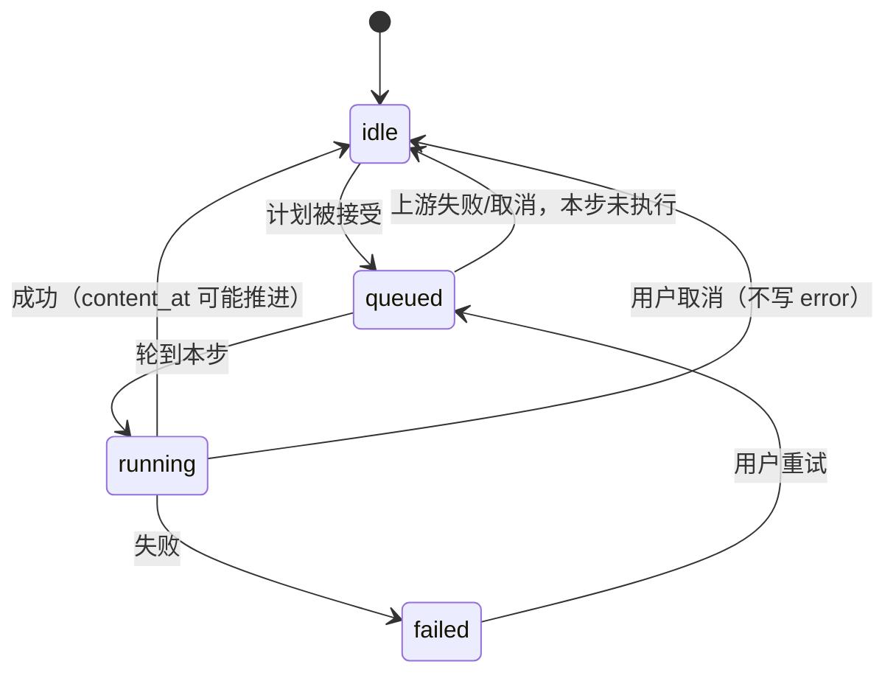

# 会议产物重新生成（转写 / 校对稿 / 纪要）设计

日期：2026-11-03
状态：已实现（2026-11-03，两期合并交付）

> **评审结论（2026-11-03）**
>
> 1. **转写「重新生成」= 重跑语音识别**：对录音重新跑 STT，而不是只按分段重渲染。
> 2. **生成链读数据库文本**：校对稿/纪要的输入取数据库里的上一级文本；磁盘文件是导出副本，手工编辑不回流。
>
> 这两条把「转写」这一步从纯渲染升级成 **音频切片 → 重新识别 → 替换分段 → 渲染 VTT** 的完整链路（§4.6），是本设计里工作量与风险最大的一块。

## 1. 背景与问题

会议结束后，`generateLiveNotesArtifacts`（`internal/handler/live_notes.go:878`）在后台按固定顺序跑三步，每一步都有自己的持久化产物：

```
录音（audio/<channel>.webm，按声道合并后的永久文件）
        │  重新识别（本次新增，见 §4.6）
        ▼
live_notes_segments（数据库，永久；ASR 结果）
        │  BuildLiveNotesTranscript / BuildLiveNotesVTT
        ▼
transcript.vtt（原始转写）
        │  结合项目背景校对（保留时间戳/说话人/行数）
        ▼
transcript-revised.md（校对稿，即「修订稿」）
        │  分段 map-reduce 汇总
        ▼
minutes.md（会议纪要）
```

会议进行中的分段来自客户端（每 10–20 秒一片，边录边传、边识别），**不经过**图中的「重新识别」；只有用户手动重新识别时，才从录音重新切、重新跑 STT 并替换分段。这是本设计与「只重渲染」方案的根本区别。

现状的缺口：

| # | 问题 | 证据 |
|---|---|---|
| 1 | **只有纪要能重新生成**，入口还藏在「生成被中断」的警告里，正常状态没有按钮 | `MeetingDetail.vue:75-78`、`:595` |
| 2 | **校对稿失败无法单独重试**：只能等下一次纪要重跑，连带重做已经正确的部分 | `generateLiveNotesArtifacts` 串行执行，无独立入口 |
| 3 | **转写文件丢失/损坏无法重建**，识别质量不满意时也无法重跑 ASR：分段还在数据库里，但没有任何入口重新渲染或重新识别 | 无 transcript 状态/入口 |
| 4 | **服务端没有音频切片能力**：分段是客户端切的，合并后的 `audio/<channel>.webm` 只有整条声道，无法直接喂给 STT 拿到逐段时间戳 | `live_notes_audio.go` 只有合并，没有拆分 |
| 5 | **状态只有一个总状态**，且纪要/校对共用 `live_notes.updated_at` 判断 10 分钟中断：一次校对写入会给一个已经死掉的纪要任务「续命」 | `ResetStaleLiveNoteGeneration`（`live_notes.go:854`） |
| 6 | **前端只轮询纪要**：`shouldPoll` 只看 `record.status`，重新生成校对稿/转写时页面不知道要刷新 | `MeetingDetail.vue:545` |
| 7 | **空状态文案承诺「可以稍后重新生成」，但没有入口** | `meeting.detail.emptyMinutesDesc` |

另外，当前整条链共用一个 10 分钟超时（`liveNoteMinutesTimeout`）。长会议「校对 + 纪要」两段都分段调用模型时，10 分钟不够；再加上重新识别（逐片 STT）就更不够，且没有任何进度心跳，界面只能显示一个转圈。

## 2. 目标与非目标

### 2.1 目标

1. **三个产物各自可重新生成**：入口在详情页对应页签，不再藏在警告里；**转写重新生成 = 对录音重新跑语音识别**（按声道切片 → 逐片 STT → 替换分段 → 渲染 VTT）。
2. **依赖链严格**：每个级别都基于上一级的内容生成；上一级缺失（或已过期）时自动先补上一级，可递归到录音。
3. **向上级联是硬要求，向下级联可选**：重新生成上游时默认连带更新下游，保证内容一致；也可以只重做本级，下游标「待更新」。
4. **非破坏性**：新内容生成成功才替换；失败保留旧内容并说明「仍显示上次内容」；重新识别失败时**旧分段与旧转写都不动**。
5. **状态可恢复**：页签内进度、页签角标、列表行状态；切走再回来、刷新页面、App 切前台、多设备都能看到同一份状态；进程重启后 10 分钟判中断。
6. **单会议同一时刻只有一个生成任务**；重复点击、并发请求、删除、取消都有明确行为。
7. **长任务可见**：重新识别按片报进度（`12/90`），可取消，单步超时 30 分钟、模型步 10 分钟。

### 2.2 非目标

- **不做说话人分离（diarization）**：重新识别沿用「一个声道 = 一个人」的既有事实；声道没有历史分段时用声道名作说话人标签。
- **不做部分识别结果续跑**：一次重新识别中途失败/超时，已完成的分片不落库，重试从头再来（见 §12）。
- 不引入持久任务队列、自动重试、跨进程续跑。
- 不改会议进行中的听记/上传流程（客户端仍然边录边切边传）。
- 不做逐句编辑、批注、版本对比。
- 不改「占位标题由纪要自动命名」的现有规则。

## 3. 决策汇总

| # | 决策 | 理由 |
|---|---|---|
| D1 | 每个产物两条轴：**内容轴**（有没有内容、什么时候写的）+ **任务轴**（当前/上次尝试的状态） | 「正在重新生成」与「已有旧内容」必须能同时成立，单状态表达不了 |
| D2 | 新增 `live_notes_artifacts` 表（token, kind） | 三个产物 × 状态/错误/内容时间/心跳 = 12 列，塞进 `live_notes` 会让每处 SQL 都变成三份 CASE；新表天然支持按 token 聚合与后续产物扩展 |
| D3 | 向上级联条件 = **缺失或过期**，不只是缺失 | 只补缺失会让「转写已更新、校对稿是旧的」这种情况产出基于旧输入的纪要 |
| D4 | 向下级联默认开，确认面板可取消勾选 | 默认保持内容一致；允许「我只想修转写错字，先别花纪要的钱」 |
| D5 | 非破坏性：只在成功后写内容；失败保留旧内容 | 重新生成是修复动作，不能把唯一可用的旧稿弄丢 |
| D6 | 内容没变化时**不推进 `content_at`** | 避免「转写重建后字节相同」却把下游标成过期、白跑两次模型 |
| D7 | 任务状态落库，心跳按模型分片写；10 分钟无心跳判中断 | 进程内 goroutine 会随重启消失，数据库是唯一可恢复的证据 |
| D8 | 单会议单任务用数据库事务抢占，不靠内存锁 | 多设备/多标签页/重启后都能正确互斥 |
| D9 | 取消只发 context cancel，状态由任务 goroutine 唯一写入 | 避免「取消处理器」和「任务」同时写状态产生竞态 |
| D10 | 生成链的输入是**数据库里的上一级文本**，磁盘文件是导出副本 | 不引入 VTT/校对稿反向解析；手工编辑文件不回流（见 §12） |
| D11 | 手动重新生成完成时复用 `live_event` 通知（页面可见时客户端自己抑制） | 用户离开会议页后仍能收到结果；不需要新的一套通知通道 |
| D12 | **转写重新生成 = 重跑 ASR**：声道录音 → 切片 → 逐片 STT → 替换分段 → 渲染 VTT | 用户明确要求改善识别质量；只重渲染分段无法达到这个目的 |
| D13 | 切片在服务端做，复用现有 EBML 原语按 Cluster 流式切 20 秒窗口 | 合并后的声道文件是唯一的完整录音；不引入 ffmpeg 依赖，不整文件读入内存 |
| D14 | 重新识别**先写内存、全部成功后再一个事务替换分段** | 半途失败不能把旧分段删掉；替换与 `pending_asr_at` 同一事务，保证可恢复 |
| D15 | 说话人沿用声道：每个声道取历史分段里出现最多的标签；只有混音时用单标签 | 没有 diarization，声道就是「谁在说话」的既有事实 |
| D16 | 级联触发转写时默认 **render（按分段重建）**；只有用户明确点转写才 **asr（重新识别）** | 级联的目的是补齐产物，不应无预警地重跑一遍昂贵的语音识别 |

## 4. 依赖链与重新生成语义

### 4.1 三级依赖

- **转写** ← 录音（重新识别）或 `live_notes_segments`（仅重建，不重新识别）
- **校对稿** ← 转写文本（由分段构建，`BuildLiveNotesTranscript`）
- **纪要** ← 校对稿文本（数据库 `live_notes.revised`）

> 校对稿和转写同源（都来自分段），所以重新生成校对稿**不依赖磁盘上的 `transcript.vtt` 内容**；但级联仍会先把缺失的转写文件补出来，因为它是这一级产物的可见形态，缺了它详情页仍然是空的。

### 4.2 向上级联（硬要求）

请求生成产物 K 时：

1. 若 K 的上一级 P **不存在**（文件缺失/为空）或**已过期**（见 §5.3），把 P 加入计划，并对 P 递归执行本规则；
2. 最后把 K 加入计划；
3. 根是录音 / 分段：
   - 转写步骤有两种模式：`asr`（重新识别）与 `render`（按现有分段重建，见 §4.6）；
   - 用户**直接点转写** → `asr`（录音可用时）；级联触发转写 → `render`；
   - 没有任何分段、也没有可用录音 → 无法生成，返回 `no_source`；
   - 有录音但没有分段（ASR 当初整体失败）→ `asr` 是唯一可行的恢复路径，允许。

每个步骤的前置输入：

| 步骤 | 需要 |
|---|---|
| 转写 `asr` | 可用录音 |
| 转写 `render` | 至少一条分段 |
| 校对稿 | 至少一条分段；没有分段但有录音 → 计划里先插入 `asr` 转写；两者都没有 → 阻断 |
| 纪要 | 数据库里非空的 `revised`，或计划里先产出的校对稿；都没有但分段/录音可用 → 先补校对稿 |

前置输入不满足 → 计划在**该步**阻断 `no_source`，而不是等任务跑起来才失败。

示例（✓ 存在且不过期，✗ 缺失，! 过期）：

| 请求 | 转写 | 校对稿 | 纪要 | 实际计划 |
|---|---|---|---|---|
| 纪要 | ✓ | ✓ | — | 纪要 |
| 纪要 | ✓ | ✗ | — | 转写(render) → 校对稿 → 纪要 |
| 纪要 | ✗ | ✗ | — | 转写(render) → 校对稿 → 纪要 |
| 纪要 | ✓ | ! | — | 校对稿 → 纪要 |
| 校对稿 | ✓ | — | — | 校对稿 |
| 校对稿 | ✗ | — | — | 转写(render) → 校对稿 |
| 转写 | — | — | — | 转写(asr) |
| 转写（无录音，有分段） | — | — | — | 转写(render) + 警告 `audio_unavailable` |
| 转写（无录音，无分段） | — | — | — | 阻断：`no_source` |

> 表中「转写(render)」的前提是还有分段；如果分段也没了、但有录音，则升级为 `asr`（否则链根本走不下去）。

### 4.3 向下级联（可选，默认开）

重新生成某一级后，它的下游内容基于旧版。确认面板提供「同时更新下游」：

- 目标 = 转写 → 下游 = 校对稿、纪要；
- 目标 = 校对稿 → 下游 = 纪要；
- 目标 = 纪要 → 没有下游，不显示勾选项。

勾选（默认）：计划在向上级联之后追加下游（已在上游计划里的去重，保持顺序）。
不勾选：只做本级；下游保留但标 `stale`，详情页显示「校对稿已更新 · [更新]」。

### 4.4 非破坏性

- 每个步骤**只在成功后**写文件/写库，并更新 `content_at`；
- 开始/进行中**不清空**旧内容（现有 `SetLiveNoteMinutes(..., generating, "", "", "")` 会清空，必须改掉）；
- 失败：该步 `job_status=failed` + `error_code/error`，`content_at` 不变；旧内容继续显示；
- 链中后续未执行的步骤从 `queued` 回到 `idle`（内容轴不受影响）；
- 取消：同失败，但不标记错误，回 `idle`，客户端提示「已取消」。

### 4.5 内容未变化

步骤成功后先比较新内容与现有内容（转写比文件文本，校对稿/纪要比数据库文本）：

- 相同：不写文件（或写也等价）、**不推进 `content_at`**、不触发下游过期；完成提示「内容没有变化」；
- 不同：写文件/写库、推进 `content_at`；下游若存在则自然变 `stale`。

### 4.6 重新识别（asr）的完整链路

这是本设计新增的最大一块，单独展开。

```
audio/<channel>.webm（或 meeting.webm）
        │ ① MergeLiveNoteAudio（幂等；老会议可能还是散片）
        │ ② 发现声道 → 文件、说话人标签
        │ ③ SplitLiveNoteAudio：按 Cluster 流式切 20s 窗口，每片是完整 WebM
        ▼
[chunk 0] [chunk 1] … [chunk N]   （offsetMS 已知）
        │ ④ 逐片 STT（4 路并发，受 liveNoteSTTSlots 全局上限约束）
        ▼
新 segments（内存：channel, speaker, startedAt=base_at+offsetMS, durationMs, text）
        │ ⑤ 全部成功 → 一个事务：DELETE 旧 segments + INSERT 新 segments
        │            同时写 pending_asr_at = now
        ▼
⑥ 渲染 VTT（BuildLiveNotesVTT）→ 写 transcript.vtt
        │  成功 → 清 pending_asr_at；内容变化才推进 content_at
        ▼
继续链上的 revised / minutes
```

**① 确保有合并音频**：`MergeLiveNoteAudio` 本来就是幂等的；重新识别前先跑一遍，老会议（散片未合并）也能工作。合并结果带上每个声道的 `base_at/duration_ms`，写进 `live_notes_audio`（首次生成纪要的 job 也走同一步，老会议因此被补写）。合并失败 → 整步失败（`error_code=audio`），不猜哪些是声道文件、哪些是残留散片。

**② 声道 → 文件 + 说话人**：

- 枚举 `audio/*.webm`，排除 `meeting.webm`（混音）；此时剩下的应当都是合并后的声道文件（散片已被 ① 清掉）；
- 文件名是声道 slug（`viewer:2` → `viewer-2`），用 `liveNotesChannelSlug(原声道)` 反向匹配，**新 segments 的 `channel` 写回原声道**（不是 slug），保证头像/分组和旧数据一致；
- 每个声道取旧 segments 里出现次数最多的 `speaker` 作标签（并列取最新一条）；没有旧分段时用声道 slug；
- 每片的绝对时间 = `base_at + offsetMS`：`base_at` 取 `live_notes_audio`（合并时记下的文件 0ms 原点，见 §6.1.1）；没有元数据时回退该声道最早分段的 `started_at`（混音/无分段时回退会议 `started_at`），并加警告 `audio_base_estimated`；
- 一个非混音文件都没有、只有 `meeting.webm`（单人会议合并时会把唯一声道折叠进混音）→ 用混音，标签取全局出现最多的 `speaker`，没有则用「说话人」；
- 某个**有旧分段**的声道找不到音频文件 → 音频不完整：计划降级为 `render` + 警告 `audio_incomplete`（面板明确说明「部分声道没有录音，本次不会重新识别」），不静默丢内容。

**③ 切片**（`internal/service/live_notes_audio.go`）：

- 复用现有 EBML 原语整文件读取，但把上限从「单段 32MB」提高到「合并声道 256MB」：合并文件由我们自己写出，4 小时 Opus 也只有几十 MB，避免为切片再写一套流式解析；
- 以 20 秒为窗口累积 Cluster（与客户端录制片长同量级），每片重写为自包含 WebM：EBML Header + Info（Duration 改成窗口长度）+ Tracks + 时间码归零的 Cluster；现有 `shiftLiveNoteCluster` 只能加正偏移，需要补一个「把时间码设为窗口起点 0」的变体（带下溢保护）；
- 记录每片的 `offsetMS`（窗口第一个 Cluster 的原始时间码）；
- 边界可能切断一个词——客户端原来的 timeslice 分片也是任意边界，没有额外劣化；
- 每片在内存 `[]byte` 里组装并回填 Segment size / Duration（不落临时文件）；合并与切片共用同一组 EBML 原语；

**④ 识别**：

- 每片调用 `GetSTTProvider().Transcribe(ctx, bytes.NewReader(chunk), language)`；
- 复用 `liveNoteSTTSlots`（4 路）做全局并发上限；同一场会议内部也用 4 个 worker，结果按索引回收保序；
- 空文本（静音片）跳过，不建空行；
- 每片完成写一次心跳 `job_at` + `detail = 12/90`；
- 任一片失败 → 整步失败，**不替换分段**，旧内容不动。

**⑤ 替换分段**（事务）：

```sql
DELETE FROM live_notes_segments WHERE token = ?;
INSERT INTO live_notes_segments (...) VALUES ...;   -- 新结果
INSERT INTO live_notes_artifacts (token, kind, pending_asr_at, job_at)
VALUES (?, 'transcript', ?, ?)
ON CONFLICT(token, kind) DO UPDATE SET pending_asr_at = excluded.pending_asr_at,
                                       job_at = excluded.job_at;
```

- `pending_asr_at > 0` 表示「识别已完成、VTT 还没写成功」；
- 下一步开始前若看到 `pending_asr_at > 0`，**跳过识别直接渲染**（避免文件写入失败后重跑整场 ASR）；计划里该步显示 `reason=pending`、`mode=render`；
- 渲染成功后清 `pending_asr_at`。

**⑥ 渲染**：`BuildLiveNotesVTT(新 segments, files, screens)`；与旧文件相同则不算变化。

**说话人归属的限制**：没有 diarization，混音场景只能给一个标签；声道没有历史标签时显示 slug。见 §12。


## 5. 状态模型

### 5.1 两条轴

每个产物（transcript / revised / minutes）各有一行状态：

| 字段 | 含义 |
|---|---|
| `job_status` | `idle` / `queued` / `running` / `failed` |
| `error_code` | `interrupted` / `no_source` / `model` / `stt` / `audio` / `io` / `timeout` / `unknown` |
| `error` | 原始错误详情（英文，日志/兜底展示） |
| `detail` | 当前进度短句，如 `12/90`、`3/8`、`汇总中` |
| `content_at` | 最后一次**内容发生变化**的成功时间（Unix ms）；0 = 未知/从未生成 |
| `job_at` | 最后一次任务状态变化/心跳（Unix ms），用于判中断 |
| `started_at` | 当前尝试开始时间（Unix ms） |
| `pending_asr_at` | 仅 transcript：识别已完成、VTT 尚未写成功的时间（0 = 无待渲染结果） |

**内容是否存在**不存这一行：仍然由磁盘探测（`hasTranscript/hasRevised/hasMinutes`）回答，它是用户实际能看到的东西。

### 5.2 状态机



一次链式任务的所有步骤在受理时一起置 `queued`；只有当前步骤是 `running`。因此「还剩哪些步骤」= 所有 `queued` 的 kind，按固定顺序 `transcript → revised → minutes`。

### 5.3 过期（stale）

只比较相邻两级的内容时间：

```
revised.stale = transcript.content_at > 0 && revised.content_at > 0
             && transcript.content_at > revised.content_at
minutes.stale = revised.content_at > 0 && minutes.content_at > 0
             && revised.content_at > minutes.content_at
```

- 转写不参与过期判断：录音是外部输入，没有「录音版本」可比；重新识别后由 `content_at` 推进让下游过期；
- 用 `>` 而不是 `>=`：正常链式生成里下游总是晚于上游，同一毫秒也不会误判；
- 旧数据迁移后 `content_at` 都来自同一条 `updated_at`，不会凭空出现「全部过期」。

### 5.4 中断与心跳

- 每个模型分片 / 每个 ASR 分片返回后写一次 `job_at` + `detail`（`3/8`、`12/90`）；步骤开始/结束/写文件前后也写；
- 读取时归一化：`job_status in (queued,running)` 且 `now - job_at > 10min` → 展示为 `failed` + `error_code=interrupted`（不依赖每小时清扫是否跑过）；
- 每小时清扫与启动时把同样的行真正落成 `failed`；
- 单步超时：**ASR 30 分钟**（长会议），校对/纪要各 10 分钟；整链上限 60 分钟（`liveNoteChainTimeout`），替代现在「整条链 10 分钟」；
- 进程重启后任务不会续跑：10 分钟后变「已中断」，用户手动重试；已完成的步骤保留，重试时不会重做（计划只看缺失/过期）。

### 5.5 单会议单任务

受理请求时在**一个写事务**里：

```sql
SELECT COUNT(*) FROM live_notes_artifacts
 WHERE token = ? AND job_status IN ('queued','running') AND job_at >= ?
```

- >0：不新建任务，直接返回当前状态（幂等，双击/双设备都安全）；
- =0：把计划内所有 kind `UPSERT` 成 `queued`（`job_at/started_at=now`，清空 `error/detail`），第一个置 `running`。

### 5.6 取消

- 进程内 `map[token]context.CancelFunc` 注册（`sync.Map`，任务 goroutine 用 `defer` 注销）；
- `POST /notes/regenerate/cancel` 只调用 cancel，不写状态；
- 任务 goroutine 看到 `ctx.Err()`：当前步不写内容、不标 failed，把本步与所有 `queued` 回 `idle`，退出；
- 重启后注册表为空：取消返回 409「没有正在运行的任务」；
- 取消在模型/STT 调用进行中生效（`AskAboutContext` 与 `Transcribe` 都走 ctx）；写文件是毫秒级窗口，不做额外事务保护。

## 6. 数据与接口

### 6.1 新表

```sql
CREATE TABLE IF NOT EXISTS live_notes_artifacts (
    token      TEXT NOT NULL,
    kind       TEXT NOT NULL,              -- transcript | revised | minutes
    job_status TEXT NOT NULL DEFAULT 'idle',
    error_code TEXT NOT NULL DEFAULT '',
    error      TEXT NOT NULL DEFAULT '',
    detail     TEXT NOT NULL DEFAULT '',
    content_at INTEGER NOT NULL DEFAULT 0, -- Unix ms，内容最后一次变化
    job_at     INTEGER NOT NULL DEFAULT 0, -- Unix ms，心跳/状态变化
    started_at INTEGER NOT NULL DEFAULT 0, -- Unix ms，本次尝试开始
    pending_asr_at INTEGER NOT NULL DEFAULT 0, -- 仅 transcript：识别完成、待渲染
    PRIMARY KEY (token, kind)
);
CREATE INDEX IF NOT EXISTS idx_live_note_artifacts_token ON live_notes_artifacts(token);
```

- 加入 `LiveNotesTablesDDL`（`CREATE TABLE IF NOT EXISTS` 对新老库都安全），索引加入 `LiveNotesIndexesDDL`；
- 删除会议时在 `DeleteMeetingRecord` 的 DELETE 列表加 `live_notes_artifacts` / `live_notes_audio`；项目删除在 `project_delete.go` 的清单同样加这两张表。

### 6.1.1 音频声道表（重新识别需要精确时间原点）

合并后的声道文件从 0ms 开始，但 **0ms 对应的绝对时间只有合并那一刻知道**：开头的静音片不会产生 `live_notes_segments` 行（空文本不落库），所以用 `MIN(started_at)` 反推会把整条转写往后平移（会议开场静音 2 分钟就偏 2 分钟）。重新识别必须记住这个原点：

```sql
CREATE TABLE IF NOT EXISTS live_notes_audio (
    token       TEXT NOT NULL,
    channel     TEXT NOT NULL,              -- 原声道（viewer:2），不是文件名 slug
    file        TEXT NOT NULL,              -- audio/ 下的文件名
    base_at     INTEGER NOT NULL,           -- 文件 0ms 对应的绝对时间（Unix ms）
    duration_ms INTEGER NOT NULL DEFAULT 0,
    PRIMARY KEY (token, channel)
);
```

- `MergeLiveNoteAudio` 保持纯文件操作（测试不依赖 DB），在返回值里带上每个声道的 `base_at/duration_ms/file`；handler（合并端点、首次生成 job、重新识别前）调完后写这张表（`RecordLiveNoteAudioChannels`）；
- 老会议没有这张表的行：重新识别时先跑一次合并补写；仍拿不到（文件已不存在）→ 回退该声道最早分段 / 会议 `started_at`，并在计划里加警告 `audio_base_estimated`（字幕级误差可能几十秒）；
- 计划里的 `audio_base_estimated` 只在「已经是合并文件、但没有元数据行」时出现；还是散片的会议会由本次合并补写，不警告；
- 删除会议 / 删除项目时一并清理。

### 6.2 迁移

1. 建表后一次性回填（`INSERT OR IGNORE`，每次启动跑也无副作用）：
   - `minutes`：`content_at` = `updated_at` 的毫秒值（仅当 `minutes != '' OR file_path != ''`），`job_status` = `generating → failed`（`error_code=interrupted`），`failed → failed`，其余 `idle`；
   - `revised`：同理，用 `revise_status/revise_error`；
   - `transcript`：不建行；读取时缺行按 `idle/content_at=0` 处理，第一次重新生成时落行。
2. `live_notes_audio` 不迁移：下一次合并（首次生成纪要或重新识别）补写；老会议在此之前重新识别会带 `audio_base_estimated` 警告；
3. `live_notes.status / revise_status / error / revise_error` 保留为 **`/notes` 实时面板的投影**：`SetLiveNoteMinutes` / `SetLiveNoteRevise` 在写内容的同时更新新表，因此两处不会漂移；记录/详情/删除守卫只读新表。SQLite 上不做破坏性 DROP；
4. `live_notes.minutes / revised` 继续作为内容存储（纪要/校对稿的生成输入与 `/notes` 实时面板的返回）。

### 6.3 接口

| 方法 | 路径 | 说明 |
|---|---|---|
| GET | `/api/live-share/notes/regenerate/plan?token=&target=&downstream=` | **新增**：返回将要执行的步骤、原因、警告、阻断原因。确认面板打开时调用，保证「看到的计划 = 执行的计划」 |
| POST | `/api/live-share/notes/regenerate` | **新增**：body `{token, target, includeDownstream}`；服务端重新计算计划并受理；幂等；返回 `{session}` |
| POST | `/api/live-share/notes/regenerate/cancel` | **新增**：body `{token}`；无任务 409 |
| GET | `/api/live-share/notes/sessions?token=` | **扩展**：`MeetingRecord` 增加 `hasSegments` / `hasAudio` / `artifacts` / `generation`，移除 `status`（改由 `artifacts.minutes` 表达） |
| POST | `/api/live-share/notes/minutes` | 保留（会议结束后的首次生成 + 实时面板重试），内部改走同一执行器；`regenerate` 参数保留 |
| DELETE | `/api/live-share/notes/sessions?token=` | 409 条件从「纪要/校对运行中」扩展为「任意产物 queued/running」 |

**计划响应**：

```json
{
  "target": "minutes",
  "steps": [
    { "kind": "transcript", "reason": "missing", "mode": "render" },
    { "kind": "revised",    "reason": "stale",   "mode": "model" },
    { "kind": "minutes",    "reason": "target",  "mode": "model" }
  ],
  "warnings": [],
  "blocked": null
}
```

- `reason`: `missing | stale | pending | target | downstream`（`pending` = 上次识别已完成，只差渲染）
- `mode`（仅 transcript 有意义）：`asr`（重新识别录音）| `render`（按现有分段重建）| `model`（校对/纪要）
- `warnings`: `overwrite_transcript`（转写已存在且会被重建，手工修改会丢）、`audio_unavailable`（无录音，只能按分段重建）、`audio_incomplete`（部分声道没有录音）、`mixed_audio_only`（只有混音，说话人无法区分）、`audio_base_estimated`（缺音频原点元数据，时间戳可能偏移）
- `blocked`: `{ "code": "no_source", "message": "..." }`，此时前端禁用「开始生成」

**错误**：404 token 不存在/不属于本项目；400 target 非法；409 `no_source`（绕过 plan 直接 POST）、`busy`（会议仍在进行）；403 无项目上下文。已有任务时返回 200 + 当前状态（幂等），不报 409。

### 6.4 记录负载

```json
{
  "token": "...",
  "hasSegments": true,
  "hasAudio": true,
  "artifacts": {
    "transcript": { "hasContent": true, "jobStatus": "idle", "errorCode": "", "error": "", "contentAt": 1762000000000, "stale": false },
    "revised":    { "hasContent": true, "jobStatus": "running", "errorCode": "", "error": "", "contentAt": 1762000000000, "stale": false },
    "minutes":    { "hasContent": true, "jobStatus": "queued", "errorCode": "", "error": "", "contentAt": 1761990000000, "stale": true }
  },
  "generation": {
    "step": "revised",
    "remaining": ["minutes"],
    "detail": "3/8",
    "startedAt": 1762000000000
  }
}
```

- `generation` 为 `null` 表示没有任务；
- `detail` 只在 running 时有值；
- 列表查询用一次 `WHERE token IN (...)` 聚合 + 一次分段计数，避免 200 条记录逐条查。

### 6.5 事件与通知

- 链结束时按**最后一步**发一次 `live_event`：
  - 最后一步 = minutes → 现有 `minutes_ready` / `minutes_failed`；
  - 最后一步 = revised → 新增 `revised_ready` / `revised_failed`；
  - 最后一步 = transcript → 新增 `transcript_ready` / `transcript_failed`（重新识别可能跑几分钟，离开页面也要能收到）。
- 事件同时写通知中心（沿用 `EmitMeetingEvent` 的「日志 + 广播」）；手动重新生成也写，因为通知中心是事件日志，不是「未读」。
- 客户端 `shouldNotifyMeeting` 已经会抑制「会议页正在屏幕上」的 toast/OS 通知，不会和详情页自己的完成提示重复。
- 服务端 i18n 新增 `MeetingEventTranscriptReady/Failed`、`MeetingEventRevisedReady/Failed`（中英），前端 `MEETING_EVENT_PRESENTATION` 与通知中心图标映射各补两条。

## 7. 前端结构

| 文件 | 职责 |
|---|---|
| `web/src/composables/useMeetingHistory.ts` | 类型扩展；新增 `planRegeneration()` / `regenerate()` / `cancelRegeneration()` |
| `web/src/components/live/MeetingArtifactBar.vue` | **新增**：记录页顶部的状态条（状态文案 + 主操作）；位于页签之上，任何页签都可见 |
| `web/src/components/live/MeetingRegenerateSheet.vue` | **新增**：确认面板（计划、原因、下游勾选、警告、成本提示） |
| `web/src/components/live/MeetingDetail.vue` | 三个页签接入状态条；空状态 CTA；轮询条件与增量拉取；完成/取消 toast |
| `web/src/components/live/MeetingEmpty.vue` | 新增可选 `#action` 插槽（空状态里的主按钮） |
| `web/src/components/live/MeetingList.vue` | 行状态聚合（生成中/失败/待更新）；有任务时 5s 轻量轮询 |
| `web/src/i18n/locales/{zh,en}.ts` | 新增文案（见 §8.8） |

**依赖方向**：`MeetingDetail` → `MeetingArtifactBar` / `MeetingRegenerateSheet` → `useMeetingHistory`；`MeetingArtifactBar` 不直接发请求，只 emit `regenerate` / `cancel`，由详情页统一处理（和页脚动作同一条路径）。

## 8. 交互设计

### 8.1 入口

- **文本页签顶部状态条**（不占页脚）：转写 / 校对 / 纪要三个页签各一条，滚动时吸顶（`position: sticky; top: 0`），阅读长文也能看到进度。
- **空状态里的主按钮**：空页签除了状态条，再给一个明确 CTA（「生成纪要」/「生成校对稿」/「重新识别转写」/「由分段重建转写」），避免只有右上角一个小按钮。
- 页脚不动：仍然是删除 / 打开 / 复制，避免窄屏挤成横向滚动。

### 8.2 状态条

一行，左侧状态，右侧动作：

```
生成于 10-30 14:32                              [重新生成]
生成于 10-30 14:32 · 转写已更新                  [更新]      ← 过期
⟳ 正在重新识别转写 · 第 12/90 片 · 已用 3:20      [取消]      ← asr
⟳ 正在重建转写 · 已用 0:02                       [取消]      ← render
⟳ 正在重新生成校对稿 · 第 3/8 段 · 已用 1:20      [取消]
⟳ 等待生成：校对稿 → 纪要                        [取消]
生成失败：语音识别不可用 · 仍显示上次内容          [重试]
还没有生成                                       [生成]
没有录音，也没有分段                             [生成]（禁用）
```

- 转写页签的主操作按 `hasAudio` 显示 **「重新识别」**（有录音）或 **「重新生成」**（只能按分段重建）；点开后以 plan 返回的 `mode` 为准；
- 旧数据 `contentAt=0` 时状态文案显示「已生成」，不编造时间；
- 状态文案：`--font-size-xs`、`--text-muted`；过期/失败分别用 `--color-orange` / `--color-red`；
- 按钮是文字按钮（`--accent-color`），高 `calc(26 * var(--dp))`；触屏命中区不小于 32dp；
- 生成中不整块换骨架屏：**保留旧内容**，只在状态条显示进度；首次生成（无旧内容）才在正文居中显示 spinner + 「正在生成…」。

### 8.3 确认面板

复用 `BottomSheet`（窄屏底部抽屉 / 宽屏居中卡片）。打开时先请求 plan，plan 到达前主按钮禁用并显示「准备中…」。

```
重新生成纪要

将依次执行
  1  转写     缺失，先补上（按现有分段重建）
  2  校对稿   基于旧版，先更新
  3  纪要     目标

☑ 同时更新下游（没有下游）

长会议可能需要几分钟，期间可以离开这个页面。

[取消]                      [开始生成]
```

重新识别转写时：

```
重新识别转写

将依次执行
  1  转写     重新识别录音（长会议可能需要几分钟）
  2  校对稿   一并更新
  3  纪要     一并更新

☑ 同时更新下游（校对稿、纪要）

⚠ 会覆盖现有转写，手工修改的内容会丢失。
⚠ 长会议需要更久，期间可以离开这个页面。

[取消]                      [开始识别]
```

规则：

- **只有「会覆盖已有内容」或「计划超过 1 步」才弹确认**；首次生成（空产物、单步）直接开始，按钮文案是「生成」；
- 目标 = 转写时：
  - 录音可用 → 步骤显示「重新识别录音」，按钮「开始识别」；追加覆盖警告；
  - 录音不可用但有分段 → 步骤显示「按现有分段重建」，并提示「没有可用录音，本次不会重新识别」；
  - 部分声道没有录音 → 同上，并列出缺失的声道（`audio_incomplete`）；
- 目标 = 转写且只有混音 → 追加提示「这场会议只保留了混音，重新识别无法区分说话人」；
- 下游勾选默认 **开**；取消勾选时提示「下游会标注「待更新」，之后可以单独更新。」；
- `blocked` 时把原因显示在面板里，主按钮禁用（例如「这场会议没有录音，也没有分段，无法生成」）。

### 8.4 进度与完成

- 页签标签：该产物 `queued/running` 时显示小 spinner（`LoadingIndicator size="xs"` 或现有 13dp 环）；角标计数逻辑不变；
- 状态条：步骤名 + `detail`（`3/8`）+ 已用时间（按轮询刷新，不额外起 ticker）；
- App 切回前台立即 `load(true)` 一次（`onAppResume`），不等被节流的定时器；
- 完成：轮询看到 `generation` 变 null：
  - 目标内容时间变了 → toast「{纪要}已更新」；
  - 没变 → toast「内容没有变化」；
  - 目标失败 → 状态条已经变红，不额外弹窗；
- 自动替换正文，保持滚动位置（不强制回顶部）；内容变化很大时用户自己滚。

### 8.5 失败

- 状态条红色 + 错误码本地化：
  - `interrupted` → 「生成中断（应用可能重启过）」
  - `no_source` → 「没有录音，也没有可用的分段」
  - `stt` → 「语音识别失败：{error}」
  - `audio` → 「录音不可用：{error}」
  - `model` → 「生成失败：{error}」
  - `io` → 「写入文件失败：{error}」
  - `timeout` → 「生成超时，可以重试」
  - 未知 → 「生成失败」
- 有旧内容时追加「· 仍显示上次内容」；
- 动作变「重试」，直接重开确认面板（计划可能因上游状态变化而不同）。

### 8.6 空状态

| 页签 | 有来源 | 无来源 |
|---|---|---|
| 纪要 | 「还没有纪要」+「转写已保存，可以生成纪要」+ [生成纪要] | 「还没有纪要」+「这场会议没有开启 AI 听记，无法生成」 |
| 校对 | 「还没有校对稿」+「可以由转写生成」+ [生成校对稿] | 同上 |
| 转写 | 「转写文件缺失」+「录音还在，可以重新识别」+ [重新识别转写]（无录音时改为「分段还在，可以重建」+ [由分段重建]） | 「没有转写」+「没有录音，也没有分段，无法生成」 |

### 8.7 列表

- 行状态优先级：进行中 > 有任务 > 失败 > 待更新 > 无状态；
  - 进行中：`生成中 · 校对稿`（`generation.step`）
  - 失败：`生成失败`（任一产物 failed）
  - 待更新：`待更新`（任一产物 stale）
- 有任务时每 5s 轻量重读列表，任务结束即停（用户停在列表也能看到完成）；切回页签仍然重读一次；
- 产物 pill（纪要/转写/校对）不变；
- 删除确认文案补上「校对稿」（现在写的是纪要、转写、录音、聊天，漏了校对稿）。

### 8.8 文案（新增 key）

`meeting.detail.artifact.*`：`generatedAt` / `generate` / `regenerate` / `reasr` / `renderTranscript` / `update` / `retry` / `cancel` / `running` / `waiting` / `elapsed` / `progress` / `failed` / `failedKeepOld` / `stale` / `unchanged` / `noSource` / `interrupted` / `cancelled` / `sttFailed` / `audioUnavailable` / `timeout`
`meeting.detail.regen.*`：`title` / `plan` / `reasonMissing` / `reasonStale` / `reasonPending` / `reasonTarget` / `reasonDownstream` / `modeAsr` / `modeRender` / `downstream` / `downstreamHint` / `overwriteTranscript` / `audioUnavailable` / `audioIncomplete` / `mixedAudioOnly` / `audioBaseEstimated` / `cost` / `start` / `startAsr` / `preparing` / `blockedNoSource`
`meeting.list.*`：`updating`（待更新）/ `regenerating`（生成中 · {kind}）/ `regenerateFailed`
通知中心：`notifications.event.transcriptReady` / `transcriptFailed` / `revisedReady` / `revisedFailed`

中英同步；全仓 i18n 守卫会抓裸键。

## 9. 边界与异常

| 场景 | 行为 |
|---|---|
| 没有录音、没有分段、也没有校对稿 | 三个入口都禁用，说明「没有可用的来源」；POST 409 `no_source` |
| 有录音但没有分段 | 转写入口可用，模式 `asr`（这正是「ASR 当初整体失败」的恢复路径）；校对/纪要需先识别 |
| 有分段但没有录音 | 转写降级为 `render` + 警告 `audio_unavailable`；校对/纪要正常 |
| 部分声道没有录音 | 计划降级为 `render` + 警告 `audio_incomplete`（列出声道），不静默丢内容 |
| 只有混音（单人会议） | 用 `meeting.webm` 识别，说话人取全局标签；警告 `mixed_audio_only` |
| 缺音频原点元数据（老会议） | 回退 `MIN(started_at)` / 会议 `started_at`，警告 `audio_base_estimated`（时间戳可能偏几十秒） |
| 某声道没有历史分段 | 仍然识别，说话人标签用声道 slug（如 `viewer-2`）；不丢弃音频 |
| 识别到空文本（静音片） | 跳过该片，不建空行；全部为空 → `no_source`（无有效语音） |
| 切片边界切断一个词 | 与客户端 timeslice 分片同等风险；不额外处理（重叠窗口会引入重复文本） |
| 识别中途某片失败 | 整步失败，**不替换分段**，旧转写/旧分段不动；重试从头识别 |
| 识别完成、写 VTT 失败 | 分段已替换 + `pending_asr_at > 0`；重试跳过识别直接渲染 |
| 识别超时（30 分钟） | `error_code=timeout`；分段未替换，旧内容保留；重试从头 |
| 取消在识别中途 | ctx 取消；未提交的分片全部丢弃，旧内容保留 |
| STT 未配置 / 服务不可用 | `error_code=stt`，文案指向设置页；旧内容保留 |
| 会议进行中 | 详情不可达（进入会议中视图）；绕过前端直接调 API → 409 `busy`（录音还在写） |
| 重复点击 / 双设备同时点 | 服务端事务抢占：第二个请求返回当前状态，前端进入进度态 |
| 生成中删除记录 | 409（沿用现有提示），任意产物 queued/running 都算忙 |
| 生成中切换项目 / 关页面 | 任务继续；回来轮询恢复；完成事件通过 WS 通知 |
| 进程重启 | 任务丢失；10 分钟内仍显示「生成中」，之后归一化为「已中断」，可重试 |
| 校对稿失败、纪要也在计划里 | **手动重新生成严格模式**：整链停在失败步，不再用原始转写偷偷生成纪要；首次生成（`/minutes`）保持现有降级（校对失败仍用原始转写生成纪要） |
| 纪要失败但校对成功 | 校对内容保留且 `ready`；纪要 `failed` + 旧内容保留 |
| 转写内容与旧文件相同 | 不推进 `content_at`，下游不变旧，提示「内容没有变化」 |
| 转写文件被手工改过 | 重新识别/重建都会覆盖（确认面板警告）；手工修改不会回流到校对/纪要（§12） |
| 模型未配置 | 步骤失败，`error_code=model`，文案指向设置页；不提前禁用（配置可能在另一台设备上改） |
| 模型返回空 | 沿用 `summarize` 现有报错（provider 层已拒绝空答案） |
| 写文件失败 | 内容不落库（与现状一致），`error_code=io`，旧内容保留 |
| 取消时正在写文件 | 毫秒级窗口，不额外保护；最坏是半截文件，重试可覆盖 |
| 旧数据（无新表行） | 读取按 `idle/content_at=0`；迁移回填纪要/校对的时间；不会误报过期 |

## 10. 测试

**Go**

- `live_notes_regen_plan_test.go`：表驱动覆盖 §4.2 全部组合 + 下游开/关 + `no_source` + `asr`/`render` 选择 + `audio_unavailable` / `audio_incomplete` / `mixed_audio_only` + 顺序与去重。
- `live_notes_audio_split_test.go`（新）：
  - 用现有 `testSegment` 夹具造一条多 Cluster 的合并声道，按 20s 切开：片数、每片 Cluster 时间码归零、每片有 Header/Info/Tracks、`offsetMS` 累加正确；
  - 单 Cluster 超过窗口、末尾不足一个窗口、空文件、非 WebM、文件被截断；
  - 切片再拼接（split → 用 merge 的读取逻辑读回）时间码与原文一致，证明容器改写没有丢音频。
- `live_notes_audio_meta_test.go`（新）：合并结果带上每个声道的 `base_at/duration_ms`；handler 写入 `live_notes_audio`；二次合并（`done`）不覆盖已有行；删除会议/项目时清理。
- `live_notes_reasr_test.go`（新，handler）：
  - 声道 → 说话人映射：取历史最多标签；无历史用 slug；混音用全局标签；
  - 逐片 STT（stub provider）→ 分段的时间/声道/文本正确；空文本跳过；
  - 任一片失败 → 旧 segments 与旧 transcript 完全不变；
  - 全部成功 → 一个事务替换；`pending_asr_at` 置位，渲染成功后清零；
  - 渲染失败后重试只渲染、不再调用 STT（stub 计数）；
  - 取消：ctx 取消后不提交分段；
  - 超时：`error_code=timeout`，旧内容保留。
- `live_notes_artifacts_test.go`：
  - 抢占事务：两个并发受理只有一个成功；过期 running 行允许新任务；
  - 心跳：分片回调推进 `job_at`；10 分钟无心跳读取归一化为 failed(interrupted)；
  - 非破坏性：校对失败后旧 `revised/minutes` 文本不变、queued 全部回 idle；
  - 内容未变化：`content_at` 不变、下游不 stale；
  - 取消：ctx 取消后本步与 queued 回 idle，不写 error；
  - 迁移：旧 `status/revise_status` 回填正确，`generating` → failed(interrupted)。
- `live_notes_test.go` 增补：`/minutes` 仍幂等；`/notes` 实时面板 payload 形状不变。
- handler 测试：plan / regenerate / cancel 的 200/400/404/409；幂等；`hasSegments` / `hasAudio`；记录负载；删除守卫。
- 删除/项目删除：新表行一并清理。

**前端**

- `useMeetingHistory`：plan/regenerate/cancel 请求；只有 `generation != null` 才轮询；`silent` 不切 loading；`contentAt` 未变不重复拉产物。
- `MeetingArtifactBar`：ready / stale / running(asr) / running(render) / waiting / failed / empty / no-source 的按钮与文案。
- `MeetingRegenerateSheet`：计划渲染、`asr`/`render` 模式文案、原因文案、下游默认勾选、`overwrite_transcript` / `audio_unavailable` / `audio_incomplete` / `mixed_audio_only` 警告、blocked 禁用。
- `MeetingDetail`：生成中保留旧内容；完成后 toast；取消；空状态 CTA（重新识别 vs 重建）；切走再回来状态恢复。
- `MeetingList`：状态优先级、待更新徽标、有任务时的 5s 轮询与卸载清理。
- 源码守卫：`MeetingDetail` 不得再出现旧的 `shouldPoll`/`isStaleGenerating` 分支。

**E2E**

- 会议 tab 的浏览器用例无法造出真实录音，因此 e2e 只覆盖：无录音/无分段时三个入口禁用与说明、确认面板不可达。
- 完整链路由 Go handler 测试（stub STT + 假摘要服务）+ 前端组件测试覆盖；如后续有测试夹具能直接插录音/分段，再补一条「点重新识别 → 进度 → 完成」的 e2e。

## 11. 实现顺序

分两期交付：**第一期先把状态机与三个入口跑通（转写这一步先只做 render）**，第二期再把它升级成重新识别。这样第一期本身就是可用的（纪要/校对稿可重生成、丢失的转写可重建），第二期的风险集中在一个独立模块里。

**第一期：状态 + 链 + 交互**

1. **表 + 迁移 + store 原语**（`live_notes_artifacts`、`pending_asr_at`、抢占、心跳、归一化、清理），先让旧流程写新表。
2. **纯计划函数** `PlanRegeneration` + 测试（不碰文件、不碰模型）；此时 transcript 只有 `render`。
3. **执行器重构**：把 `generateLiveNotesArtifacts` 拆成 `buildTranscript / buildRevised / buildMinutes` + 链执行器；`/minutes` 改走执行器；保持现有降级行为；测试。
4. **新接口** plan/regenerate/cancel + `MeetingRecord` 扩展 + OpenAPI + 删除守卫 + 事件；handler 测试。
5. **前端数据层 + 交互**：类型、plan/regenerate/cancel、轮询条件、增量拉取；状态条、确认面板、空状态 CTA、完成/取消 toast。
6. **列表 + 通知 + i18n**；删除确认文案补校对稿。

**第二期：重新识别（asr）**

7. **音频元数据**：`live_notes_audio` 表 + 合并结果带 `base_at/duration_ms` + `RecordLiveNoteAudioChannels` + 清理；测试。
8. **音频切片器** `SplitLiveNoteAudio` + 测试（EBML 流式切 20s 窗口；复用合并的 Header 写入原语）。
9. **重新识别步骤**：声道/说话人发现、切片、STT 并发、事务替换分段、`pending_asr_at`、渲染 VTT；stub STT 测试。
10. **接线**：计划函数加入 `asr`/`render` 选择与音频警告；前端 asr 文案与警告；通知类型。
11. **E2E + 文档同步 + 构建**（`npm run build`；动 Go 后 `./build.sh`）。

## 12. 已知限制

1. **没有 diarization**：重新识别按「一个声道 = 一个人」归属说话人；只有混音时全场一个标签；声道没有历史标签时显示声道 slug（如 `viewer-2`）。
2. **部分识别结果不续跑**：一次重新识别中途失败/超时，已完成的分片不落库，重试从头再来。长会议（数小时）的重试成本较高。
3. **切片边界可能切断一个词**：与客户端原来的 timeslice 分片同等风险；不做重叠窗口（会引入重复文本）。
4. **手工编辑文件不回流**：生成链读数据库里的上一级文本；用户在文件管理器里改 `transcript.vtt` 或 `transcript-revised.md`，不会被下游使用。要支持这一点需要 VTT/校对稿反向解析（并处理校对稿里混入的文件/共享事件行），本次不做。
5. **重新识别会覆盖手工修改**（确认面板明确警告）。
6. **没有全局生成并发上限**：多个会议同时重新生成会同时打 STT/摘要模型；STT 有 4 路全局槽，摘要没有。如需要，可后续加进程级信号量。
7. **重启不续跑**：只能等 10 分钟判中断后手动重试。
8. **占位标题仍会被自动命名**：重新生成纪要时若标题还是 `11-01 17:35` 这类占位，会再尝试用纪要命名（现有行为）。

## 附：现状核对（2026-11-03）

| 位置 | 现状 |
|---|---|
| `internal/handler/live_notes.go:878` | `generateLiveNotesArtifacts` 三步串行，整链 10 分钟超时 |
| `internal/handler/live_notes.go:763` | `ServeLiveShareNotesMinutes` 受理首次生成；`regenerate` 只做幂等跳过 |
| `internal/handler/live_notes.go:824` | 开始生成时清空 `minutes`（非破坏性要改） |
| `internal/service/live_notes.go:70` | `live_notes` DDL（status / revise_status / error / revise_error） |
| `internal/service/live_notes.go:854` | 中断判定共用 `updated_at` |
| `internal/service/live_notes.go:886` | `LiveNoteGenerationRunning`（删除守卫） |
| `internal/service/live_notes.go:973` | `MeetingRecord`（只有 `status`，无产物级状态） |
| `web/src/components/live/MeetingDetail.vue:595` | `regenerate()` 只在中断警告里可达 |
| `web/src/components/live/MeetingDetail.vue:545` | `shouldPoll` 只看纪要状态 |
| `web/src/composables/useMeetingHistory.ts:69` | `isStaleGenerating` 用客户端时钟算 10 分钟 |
| `web/src/components/live/MeetingList.vue:255` | `rowState` 只读纪要 `status` |
| `internal/api/openapi.yaml:4106` / `:4276` / `:7909` | `/notes/minutes`、`/notes/sessions`、`MeetingRecord` |
| `internal/service/live_notes_audio.go:80` | `MergeLiveNoteAudio`：只有合并，没有拆分 |
| `internal/service/live_notes_audio.go:207` | `liveNoteSoloChannel`：单人会议把唯一声道折叠进混音（重新识别要用 `meeting.webm`） |
| `internal/service/live_notes_audio.go:374` / `:659` | `writeLiveNoteHeader` / `shiftLiveNoteCluster`：切片可复用的 EBML 原语 |
| `internal/stt/interface.go:9` | `STTProvider.Transcribe(ctx, io.Reader, language) (string, error)`：只返回整段文本，无时间戳 → 必须切片 |
| `internal/handler/live_notes.go:1233` | `transcribeLiveNoteSegment`：STT 全局 4 路并发槽 |
| `internal/service/live_notes.go:2671` / `:2681` | 音频文件名用 `liveNotesChannelSlug`（`viewer:2` → `viewer-2`，不可逆） |

## 实现记录（2026-11-03）

两期合并交付，以下是与设计稿的差异/落地细节：

- **切片是整文件读取**（合并文件上限 256MB），不是流式解析：合并文件由本仓库写出，4 小时 Opus 只有几十 MB；避免为切片再写一套流式 EBML 解析。
- **旧状态列保留为 `/notes` 实时面板的投影**：`SetLiveNoteMinutes` / `SetLiveNoteRevise` 写内容时同步更新 `live_notes_artifacts`，详情/列表/删除守卫只读新表。这样实时面板与既有测试不需要双份状态。
- **重新识别先替换分段再渲染**：`ReplaceLiveNoteSegments` 在一个事务里 DELETE + INSERT + `pending_asr_at`；渲染成功后 `SetArtifactSucceeded` 清 `pending_asr_at`。渲染失败重试只渲染。
- **单人会议**：合并把唯一声道折叠进 `meeting.webm`，重新识别用混音 + 旧分段的说话人标签；`regenAudioState` 不会把这种情况误判为 `audio_incomplete`。
- **音频原点**：`MergeLiveNoteAudio` 的返回值带 `Origins/Durations/Files`；合并端点、首次生成 job、重新识别前都会落 `live_notes_audio`。老会议没有元数据时回退并警告。
- **计划端点**：`GET /api/live-share/notes/regenerate/plan` 的 `mode` 为 `asr|render|model`；POST 会重算同一份计划，409 携带 `{error, code, plan}`。
- **通知**：新增 `transcript_ready/failed`、`revised_ready/failed`，通知中心与 `MEETING_EVENT_PRESENTATION` 已接。
- **前端**：`MeetingArtifactBar` 位于**页签之上**（任何页签都可见，不随正文滚动）；确认面板用 `BottomSheet`；列表只在有 `generation` 时 5s 轮询。
  - 之所以不放在三个文本页签内部：记录打开时默认落在「资源」（main 的默认页签），页签内状态条会让「正在重新生成」在资源页完全不可见，重新生成入口也多一次点击。
  - 非文本页签上状态条的主体取「正在执行的步骤」，无任务时回退到纪要（记录的主产物）；此时用 `showKind` 在文案前加一个产物名 chip，避免「还没有生成」指代不明。运行中不加 chip——运行文案本身已经带产物名。

### 验证结果（2026-11-03）

| 检查 | 结果 |
|---|---|
| `go test ./internal/service ./internal/handler` | 通过（185s / 114s） |
| `golangci-lint run`（全仓） | 0 issues |
| `golangci-lint fmt --diff`（全仓） | 无差异 |
| 变更行覆盖率（Tier 2） | 543/571 = 95.1%（门槛 80%） |
| `go test -cover` 两个包 | service 87.1% / handler 89.6% |
| `npx vue-tsc --noEmit` | 通过 |
| 会议相关 vitest（26 文件） | 289 passed |
| `npx playwright test … meeting-tab.spec.ts` | 8 passed |
| `./build.sh` | 成功 |

e2e 只覆盖了「无录音 → 状态条显示无来源、按钮禁用、空状态无 CTA」这一支：e2e 没有配置 STT / 摘要模型，真实重新识别无法在浏览器里跑；确认面板的状态由 `MeetingRegenerateSheet.test.ts`（7 例）覆盖。

