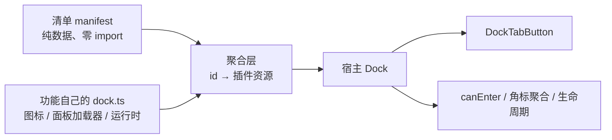

# Dock 插件化重构设计

日期：2026-11-14
状态：部分实现（2026-11-14：清单字段、插件管理器、预设、显示/排序已落地；每个插件的 `dock.ts` 运行时聚合尚未落地）
配套开发文档：[docs/plugin-dev/](../plugin-dev/README.md)
范围：`web/src` 前端 Dock；服务端只做只读适配，不改协议
相关文件：[dockTabs.ts](../../web/src/composables/dockTabs.ts)、[dockTabMeta.ts](../../web/src/composables/dockTabMeta.ts)、[App.vue](../../web/src/App.vue)、[useWideScreenLayout.ts](../../web/src/composables/useWideScreenLayout.ts)、[SettingsIndex.vue](../../web/src/components/settings/SettingsIndex.vue)

## 0. 摘要

- 这次是**内部功能模块化**：每个 Dock 功能自包含、能单独开关、单独打开；不是让第三方装插件。
- 三种“关闭”必须分开：**环境没有**（终端、端口映射）、**服务端真停**（Forge、邮件）、**只是不想看见**（任务、统计、通知等）。混成一个开关，用户就无法理解“为什么打开了还是灰的”。
- 永远不可关的只有四个：**聊天、文件管理、文件预览、设置**。设置页是重新打开插件的唯一入口，所以它自己也不能关。
- 新增一个可选插件只动两处：`DOCK_TABS` 加一条纯数据；功能目录加一个 `dock.ts`（图标 + 面板加载器 + 角标/生命周期）。不再改 `App.vue` 的模板、门控、角标、设置页。
- 分 6 个阶段迁移，每个阶段行为不变；先统一“描述”，再统一“可用性 / 角标 / 生命周期”，最后才搬面板。

## 1. 背景与问题

Dock 现在有 15 个页签（左栏 14 个 + 右栏聊天）。其中“页签是谁、什么顺序、标题是什么、哪些固定在宽屏头部”已经统一在 `dockTabs.ts` 的 `DOCK_TABS` 里，渲染列表、切换白名单、图标查找都从它派生。这层是好的，不要重做。

但它只统一了“身份与位置”。另外六层还是散的：

| 层 | 现在在哪 | 问题 |
|---|---|---|
| 面板显示 | `App.vue` 模板 115–324 | 新增页签必须改模板；静态/异步 import 混用 |
| 能不能用 | `App.vue` 2191–2222 四个 computed | 每个页签一套写法，三种语义混在一起 |
| 角标 | `App.vue` 4108 的 switch + 模板 596–610 三份条件 | 加一个角标要改五处 |
| 打开时的副作用 | `switchTab` 1450–1467 + 四个 watch 2254–2287 | 散在切换函数里，新增页签容易漏 |
| 设置入口 | `SettingsIndex.vue` 硬编码分类 | 插件无法自己贡献设置项 |
| 后台资源 | 各 composable 自己启停 | 没有统一的“启用/停用”生命周期 |

直接后果：

- 新增一个页签要改 `dockTabs.ts`、`dockTabMeta.ts`、`App.vue` 模板、门控、角标、设置页，至少 6 处；
- 三种完全不同性质的“禁用”被写成同一个布尔：终端是“环境没有”，Forge 是“服务端真停”，任务是“只是不想看见”；
- 宽屏竖 Dock、窄屏底 Dock、溢出菜单三套模板各写一遍角标条件；
- `forgeDockTabTitleWiring.test.ts` 和 `mailDockTabWiring.test.ts` 直接 grep `App.vue` 的源码字符串，任何模板重构都会把它们改红。

这次重构要解决的就是这六层，不是再建一个页签清单。

## 2. 目标与非目标

### 2.1 目标

1. 每个 Dock 功能是一个自包含模块（下称“插件”），有自己的身份、面板、可用性、角标、生命周期、设置入口。
2. 插件可以独立开关、独立打开；关掉一个不影响其他插件启动。
3. 三种可用性分开表达：环境能力、服务端功能、用户偏好。界面据此给出三种不同控件。
4. 宽屏竖 Dock、窄屏底 Dock、溢出菜单共用同一套按钮与角标逻辑。
5. 新增一个插件只动清单与功能目录（一个 `dock.ts`），不再改 `App.vue` 的模板、门控、角标、设置页。
6. 迁移期间行为不变：所有插件都开着时，界面与现在一致。

### 2.2 非目标

| 不做 | 原因 |
|---|---|
| 第三方插件市场 / 远程加载代码 | 需要沙箱、权限、版本兼容，是另一个量级的工程；本次只做内部模块化 |
| 用户自定义排序 / 固定 | 首版保持静态顺序，避免与宽屏固定头、溢出计算互相打架 |
| 按项目开关插件 | 首版只做全局开关；Forge 的项目绑定、任务的项目归属仍按现有逻辑走 |
| 重写面板内部 | 只搬外壳与资源，不动面板业务 |
| 搬核心面板的模板 | 聊天、文件管理、文件预览与 `App.vue` 的状态/事件耦合很深；首版只在清单里声明身份与不可关，模板仍留在 `App.vue`。可选面板才要求自包含 |
| 改 Dock 视觉 | 图标、间距、动效保持现状 |
| 服务端新增 `/api/features` | 首版用现有 `/api/config` 适配；统一接口放最后，可选 |

## 3. 术语

| 词 | 这里指什么 |
|---|---|
| Dock 插件 | 一个能独立开关、独立打开的 Dock 功能模块，不是第三方可安装的扩展 |
| 宿主 | 渲染 Dock、管页签切换与生命周期的外层，即 `App.vue` 里的 Dock 部分 |
| 清单 | 一份纯数据，描述插件是谁、放哪、能不能关 |
| 能力（capability） | 本机 / 宿主有没有这个条件，例如终端 PTY、端口映射可用的传输 |
| 功能（feature） | 服务端有没有开这个功能，例如 Forge 轮询、邮件同步 |
| 偏好（preference） | 这个客户端想不想显示这个入口，只影响 Dock，不影响后台 |

## 4. 决策汇总

| 维度 | 决策 |
|---|---|
| 插件化范围 | 内部功能模块化，不做第三方扩展 |
| 永远不可关 | 聊天 `chat`、文件管理 `browse`、文件预览 `view`、设置 `settings` |
| 其余页签 | 可关；具体是“真关”还是“只隐藏”由可用性类型决定 |
| 关闭语义 | 按插件性质决定，不统一成一个布尔 |
| 开关作用域 | 功能开关存服务端；偏好开关存本机；能力是计算值 |
| Dock 顺序 | 首版不变；`group` 只用于设置页分组与文档 |
| 面板加载 | 所有可选面板一律懒加载；核心面板保持现状 |
| 设置页 | 永远不可关，永远最后一个；新增“功能与 Dock”分类 |
| 兜底页签 | `browse`（文件管理）；它不可关，所以兜底永远有落点 |
| 运行时注册表 | 不做；静态清单 + 每个功能自己的 `dock.ts` 足够 |

## 5. 核心模型：三种可用性

### 5.1 三类分开

这是整个设计最重要的一刀。现在代码里其实已经是三种东西，只是都被叫成“禁用”：

| 类型 | 谁决定 | 关掉后的真实效果 | 现有例子 | 界面控件 |
|---|---|---|---|---|
| 能力 capability | 环境 / 宿主 | 不是“关”，是本来就没有 | 终端（PTY 没起来 / 平台不支持）、端口映射（没有可用传输） | 灰掉 + 一句原因，不给开关 |
| 功能 feature | 服务端配置 | 服务端真停（worker / 轮询 / 接口拒绝） | Forge（停轮询、清绑定）、邮件（停 IMAP 同步） | 真开关，文案写清“会停服务端” |
| 偏好 preference | 这个客户端 | 只是不显示入口，后台照常 | 任务、统计、通知、分享、Git 历史、知识库、会议 | “在 Dock 中显示”眼睛图标 |

### 5.2 组合规则

```
可见 = 能力可用 && 功能已开 && (不可关 || 用户没有隐藏)
```

- **不可关的四个页签**（聊天、文件管理、文件预览、设置）不受偏好影响，永远可见。
- **能力不满足**时，即使功能开着、用户没隐藏，也不可见（灰显只出现在设置页，Dock 里直接不渲染）。
- **功能关闭**时，Dock 不渲染；如果它当前正被打开，宿主把它切到兜底页签。
- **偏好隐藏**只影响 Dock 入口；已经挂载的面板保持挂载，状态不丢。

原因优先级：能力 > 功能 > 偏好。设置页只显示最根本的那一条，避免“既没开又隐藏了”时给出模糊提示。

### 5.3 三种控件

| 情况 | 控件 | 文案示例 |
|---|---|---|
| 不可关的核心页签 | 无控件，标“常驻” | “常驻在 Dock” |
| 可关、没有功能开关 | 眼睛图标 | “在 Dock 中显示” |
| 有功能开关 | 真开关 + 眼睛图标 | “启用 Forge 集成（会停止服务端轮询并清除项目绑定）” |
| 能力不满足 | 灰显 + 原因，无控件 | “当前环境没有可用的终端（PTY）” |

“眼睛”和“开关”是两件事：功能开着但不想看见，用眼睛；不想让服务端继续跑，用开关。两者不能合并。

### 5.4 现有页签映射

| 页签 | 分组 | 宽屏固定 | 可关 | 可用性 | 角标 | 关掉后前端 | 关掉后服务端 |
|---|---|---|---|---|---|---|---|
| 聊天 `chat` | 工作区（右栏） | — | 否 | 核心 | 未读会话数 | 没有主界面 | — |
| 文件管理 `browse` | 工作区 | 是 | 否 | 核心 | 无 | 很多跳转没有落点 | — |
| 文件预览 `view` | 工作区 | 是 | 否 | 核心 | 无 | 打开文件没地方看 | — |
| Git 历史 `history` | 工作区 | 是 | 是 | 偏好 | 工作区变更数 | 只是入口消失 | 不受影响 |
| Forge `forge` | 项目工具 | 否 | 是 | 功能 | 未读条目数 | 入口、角标消失 | 停轮询、清空绑定 |
| 任务 `tasks` | 项目工具 | 否 | 是 | 偏好 | 未读执行数 | 入口、角标消失 | 定时任务照跑 |
| 终端 `terminal` | 项目工具 | 否 | 是 | 能力 | 会话数 | 入口消失 | PTY 不在 |
| 端口映射 `proxy` | 项目工具 | 否 | 是 | 能力 | 已启用端口数 | 入口消失 | 没有可用传输 |
| 统计 `stats` | 项目工具 | 否 | 是 | 偏好 | 无 | 入口消失 | 不受影响 |
| 分享 `share` | 项目工具 | 否 | 是 | 偏好 | 无 | 入口消失 | 已发链接仍有效 |
| 邮件 `mail` | 沟通与资料 | 否 | 是 | 功能 | 未读数 | 停未读轮询 | 停 IMAP 同步 |
| 知识库 `kb` | 沟通与资料 | 否 | 是 | 偏好 | 无 | 停索引轮询 | 索引按需触发，无常驻 worker |
| 会议 `live` | 沟通与资料 | 否 | 是 | 偏好 | 进行中红点 | 停状态订阅 | 房间只在开会时建 |
| 通知 `notifications` | 系统 | 否 | 是 | 偏好 | 无 | 入口消失 | 事件照记 |
| 设置 `settings` | 系统 | 否 | 否 | 核心 | 无 | 没法再打开被关的插件 | — |

两个关键判断：

- **设置页必须永远不可关**。它是“重新打开插件”的唯一入口；用户把设置关了，就再也开不回来了。
- **文件管理必须不可关**。现在有四个地方把 `switchTab('browse')` 当默认落点（`App.vue` 2256、2263、2271、2285），文件管理一关，这些路径全都没有落点。

## 6. 插件清单（Manifest）

### 6.1 三层拆分

`dockTabs.ts` 的文件头写得很清楚：它必须零 import，否则很多测试的 `lucide-vue-next` 窄 mock 会在模块加载时直接炸。所以清单必须和图标、面板、运行时资源分开，不能塞进同一个文件。



| 层 | 文件 | 可以 import 什么 | 放什么 |
|---|---|---|---|
| 纯数据 | `dockTabs.ts` | 什么都不 import | id、标题键、分组、顺序、主次、能否关、能力键、功能键、角标键、接口前缀、设置分类 |
| 插件资源 | `components/<feature>/dock.ts` | 自己的组件、composable、lucide | 图标、面板（同步组件或加载器）、动态标题、角标、进入/离开、后台启停 |
| 聚合 | `dockPluginRuntime.ts` | 各功能的 `dock.ts` | 把 id 映射到资源；宿主只读这里 |

**面板永远不进清单。** 清单只放字符串和布尔；核心面板通过 `component` 同步给，可选面板通过 `loadPanel` 懒加载。

### 6.2 清单字段

```ts
// web/src/composables/dockTabs.ts（保持零 import）
export type DockGroup = 'workspace' | 'project' | 'personal' | 'system'
export type CapabilityKey = 'terminal' | 'portForward'
export type FeatureKey = 'forge.enabled' | 'mail.enabled'
export type BadgeKey =
  | 'gitChanges'
  | 'forgeUnread'
  | 'taskUnread'
  | 'terminalSessions'
  | 'portForwardPorts'
  | 'mailUnread'

export interface DockTabDescriptor {
  id: DockTabId
  /** 静态标题的 i18n key；动态标题在 runtime 里覆盖 */
  titleKey: string
  /** 只用于设置页分组与文档，不改变 Dock 顺序 */
  group: DockGroup
  /** 是否固定在宽屏 Dock 头部；不等于不可关 */
  primary?: boolean
  /** false = 用户不能关（核心页签） */
  closable: boolean
  /** 本机 / 宿主能力；不满足时灰掉并说明原因 */
  capability?: CapabilityKey
  /** 服务端功能开关；关闭时服务端也停 */
  feature?: FeatureKey
  /** 角标来源；不声明 = 没有角标 */
  badge?: BadgeKey
  /** 该插件拥有的接口前缀，仅用于文档与守卫 */
  apiPrefix?: string
  /** 插件自己的设置分类，供设置页深链 */
  settingsCategory?: string
}
```

`primary` 和 `closable` 是两件事：`history` 现在是 `primary: true`，但用户选了“只有聊天 / 文件管理 / 文件预览 / 设置不可关”，所以它是 `primary: true, closable: true`。宽屏固定头必须按“可见性”过滤后再渲染，不能直接拿 `WIDE_SCREEN_PRIMARY_TABS` 渲染。

### 6.3 运行时字段

```ts
export interface DockBadge {
  count: number
  /** 进行中红点，不是数字 */
  live?: boolean
}

export interface DockPluginRuntime {
  /** 动态标题（Forge 跟着绑定平台变），不写就用清单的 titleKey */
  title?: () => string
  /** 角标当前值；返回 null 表示没有 */
  badge?: () => DockBadge | null
  /** 进入页签时做什么（加载列表、清未读等） */
  onEnter?: () => void
  /** 离开页签时做什么 */
  onLeave?: () => void
  /**
   * 页签关闭时也要运行的资源（角标轮询等）。
   * 返回清理函数；宿主在停用 / 隐藏 / 卸载时调用。
   */
  startBackground?: () => () => void
}
```

只有邮件需要 `startBackground`（未读轮询）。Forge 未读是 WS 事件驱动，任务/终端/端口映射的角标也是事件或状态驱动，不需要常驻轮询。不要为了“统一”给每个插件加一个空轮询。

### 6.4 图标与面板

图标和面板加载器也放在功能自己的 `dock.ts` 里，不再单独维护一份 UI 清单：

```ts
export interface DockPluginModule extends DockPluginRuntime {
  icon: Component
  /** 核心面板：同步组件 */
  component?: Component
  /** 可选面板：动态 import，宿主用 buildAsyncComponentOptions 包装 */
  loadPanel?: () => Promise<unknown>
}
```

可选插件必须给 `loadPanel`；如果某个面板要同步渲染（例如以后搬出来的核心面板），用 `component`。守卫测试检查两者不能同时给，可选插件不能两个都空。

核心四个页签是例外：它们只需要清单里的身份与 `closable: false`，模板可以继续留在 `App.vue`，两个字段都可以不给。插件化首版的收益在 11 个可选页签，不在搬这几个大模板。

聊天更特殊：它在右栏，不参与左栏 `DOCK_TABS` 的渲染与切换；但它同样可以有一个 `chat/dock.ts`，提供角标和 `onEnter`（加载会话）。宿主对右栏走同一条解析路径，只是渲染位置不同。

核心面板（聊天、文件管理、文件预览）可以继续静态 import；可选面板（Forge、任务、终端、统计、邮件、知识库、会议、分享、通知）一律走 `buildAsyncComponentOptions`，复用现有的重试、错误兜底、陈旧 chunk 恢复。

### 6.5 示例

邮件 `dock.ts`（图标、面板、运行时放在一起）：

```ts
// web/src/components/mail/dock.ts
import { Mail } from 'lucide-vue-next'
import { mailUnread, startMailUnreadPolling, stopMailUnreadPolling } from '@/composables/useMailUnread'

export const mailDock: DockPluginModule = {
  icon: Mail,
  loadPanel: () => import('./MailPanel.vue'),
  badge: () => ({ count: mailUnread.value }),
  startBackground: () => {
    startMailUnreadPolling()
    return stopMailUnreadPolling
  },
}
```

邮件清单仍然只放纯数据：

```ts
{
  id: 'mail',
  titleKey: 'nav.mail',
  group: 'personal',
  closable: true,
  feature: 'mail.enabled',
  badge: 'mailUnread',
  apiPrefix: '/api/mail',
  settingsCategory: 'mail',
}
```

终端清单：

```ts
{
  id: 'terminal',
  titleKey: 'terminal.title',
  group: 'project',
  closable: true,
  capability: 'terminal',
  badge: 'terminalSessions',
  apiPrefix: '/api/terminal',
  settingsCategory: 'terminal',
}
```

终端没有 `startBackground`：会话数是 store 里的实时状态，WS 只在面板打开时连接。

### 6.6 约束

1. **纯数据层零 import。** 图标、组件、composable 一律不进 `dockTabs.ts`。
2. **动态标题放 runtime。** Forge 的标题跟着绑定平台变（GitHub / GitLab），不能写成静态 i18n key。
3. **面板懒加载。** 清单里只放加载函数，不放组件本身。
4. **插件不 import `App.vue`，也不 import 其他插件。** 跨插件动作走宿主提供的 props / events（见 §8.4）。
5. **插件自己的 `dock.ts` 只放轻资源。** 不能 import 自己的面板，否则懒加载失效。
6. **运行时资源不能把重依赖带回主包。** `dock.ts` 会被聚合层静态 import；WebRTC、DOMPurify、编辑器这类面板依赖不能出现在里面。重状态先抽到一个轻量模块，例如会议只暴露“是否在会中”的一个 ref，不把整个 `useLiveShare` 拖进来。

## 7. 宿主职责

宿主只做四件事，其他都交给插件。

### 7.1 一套按钮

新增 `DockTabButton.vue`，宽屏竖 Dock、窄屏底 Dock、溢出菜单三处共用：

- props：`tab`、`active`、`title`、`icon`、`badge`、`variant`（`wide` / `inline` / `popup`）
- 内部负责：按钮外观、角标数字、进行中红点、数字变化动画
- 外部只传数据，不再在模板里写 `v-if="tab === 'forge' && ..."`

这一步消掉三份重复模板和 8 个全局动画 ref（`chatBadgeAnim` / `historyBadgeAnim` / … / `overflowBadgeAnim`）。动画状态收进按钮内部，按自己的 `badge.count` 变化触发。

### 7.2 准入与兜底

新增两个纯函数：

```ts
/** 某个页签现在能不能进；核心页签恒 true */
export function canEnter(tab: DockTabId, ctx: DockAvailabilityContext): boolean

/** 当前可用的兜底页签；固定返回 browse（它不可关） */
export function fallbackTab(): DockTabId
```

`switchTab` 开头统一调 `canEnter`，替换现在 Forge / 邮件两个专用 `if`。启动恢复、通知深链、任务跳转、导航协调器重放，全部先过它。

### 7.3 生命周期

| 时刻 | 宿主动作 |
|---|---|
| 应用启动 | 对每个可见插件调用 `startBackground()`，保存清理函数 |
| 插件被隐藏 / 功能关闭 / 能力不可用 | 调用清理函数；如果是功能关闭或能力不可用，卸载面板 |
| 插件重新可见 | 重新 `startBackground()`；面板下次打开时重新挂载 |
| 进入页签 | 调 `onEnter()` |
| 离开页签 | 调 `onLeave()` |
| 应用卸载 | 停掉所有后台资源 |

`switchTab` 里现在三段硬编码（`browse` 加载目录、`chat` 加载会话、`tasks` 加载任务）搬进各自 `onEnter`。宿主只保留跨插件的公共动作：关不属于新页签的抽屉、关惰性路径选择器。

### 7.4 角标聚合

宿主遍历可见插件，读 `badge()`：

- 宽屏 / 窄屏按钮：显示自己的角标；
- 溢出按钮：只汇总“在溢出菜单里”的插件角标；
- 隐藏的插件不参与汇总（现在的 `overflowBadgeCount` 已经对 Forge 这么做了，推广到全部）；
- 聊天角标单独处理（它在右栏，不在左栏清单里）。

### 7.5 启动恢复

`resolveLeftTabOnEnter` 现在只校验 `isDockTabId`，不校验“现在还能不能用”。改成：

```ts
resolveAvailableTab(candidate, ctx):
  if (canEnter(candidate, ctx)) return candidate
  return fallbackTab()
```

上次停在邮件、这次邮件被关了，启动后落到文件管理，而不是一个没有入口的面板。

### 7.6 深链

程序化导航（通知、任务跳转、导航协调器）在 `canEnter` 为 false 时拒绝，保持当前页签不变，并记一条 warning。Forge / 邮件现在的行为就是这样，推广到全部插件。

### 7.7 设置页

设置页新增一个“功能与 Dock”分类，由清单生成，不硬编码：

- 按 `group` 分组：工作区 / 项目工具 / 沟通与资料 / 系统；
- 每行：图标、名称、一句话说明、控件（常驻 / 眼睛 / 开关 / 灰显+原因）；
- 有 `settingsCategory` 的插件，行尾给一个“设置”入口，深链到它自己的设置页（邮件账户、Forge 凭据、终端、端口映射等）；
- 核心四个页签也列出来，标“常驻”，让用户知道为什么关不掉。

这个页面是“重新打开插件”的唯一入口，所以设置页本身永远不可关、永远最后一个。

## 8. 资源归属

### 8.1 一张表

| 资源 | 新家 | 说明 |
|---|---|---|
| 身份（id / 标题 / 分组 / 顺序 / 主次 / 能否关） | `dockTabs.ts` | 纯数据，零 import |
| 图标 | 各功能 `dock.ts` 的 `icon` | 跟着插件走，不另维护 UI 清单 |
| 面板 | 各功能 `dock.ts` 的 `component` / `loadPanel` | 核心同步，可选懒加载 |
| 聚合 | `dockPluginRuntime.ts` | 把 id 映射到各功能 `dock.ts`；宿主只读这里 |
| 可用性 | `dockAvailability.ts` + `useDockAvailability()` | 能力 / 功能 / 偏好三轴 |
| 角标 | 各功能 `dock.ts` 的 `badge()` | 宿主只读，不关心来源 |
| 后台资源 | 各功能 `dock.ts` 的 `startBackground()` | 返回清理函数，成对启停 |
| 进入 / 离开副作用 | 各功能 `dock.ts` 的 `onEnter` / `onLeave` | 搬出 `switchTab` |
| 接口前缀 | 清单的 `apiPrefix` | 只用于文档与守卫，不参与运行时 |
| 设置分类 | 清单的 `settingsCategory` | 设置页深链 |
| 本地偏好 | `panelState.ts` 的 `dockHidden` | 全局、不跟随布局记忆 |
| 抽屉状态 | `useTabDrawer` | 停用插件时关闭该页签的抽屉 |

### 8.2 可用性上下文

```ts
export interface DockAvailabilityContext {
  /** 用户隐藏了哪些页签（本地偏好） */
  hidden: ReadonlySet<DockTabId>
  /** 服务端功能开关，来自 /api/config */
  features: Readonly<Record<FeatureKey, boolean>>
  /** 本机 / 宿主能力 */
  capabilities: Readonly<Record<CapabilityKey, boolean>>
}
```

`useDockAvailability()` 负责把三个响应式来源合成这个对象：

- `hidden`：`panelState` 的 `dockHidden`；
- `features`：`serverConfig.forge.enabled`、`serverConfig.mail.enabled`；
- `capabilities`：`useTerminalStatus`、`usePortForward`、原生桥的 `getCapabilities()`。

纯函数 `canEnter` / `visibleDockTabs` 只吃这个对象，测试可以枚举组合，不需要挂载组件。

### 8.3 接口归属

插件拥有的接口前缀写进清单，作为“这个功能的后端资源”的文档与守卫：

| 插件 | 接口前缀 |
|---|---|
| Forge | `/api/forge` |
| 任务 | `/api/tasks` |
| 终端 | `/api/terminal` |
| 端口映射 | `/api/proxy`、`/api/ssh`、`/api/tunnel` |
| 邮件 | `/api/mail` |
| 知识库 | `/api/kb` |
| 会议 | `/api/live-share` |
| 分享 | `/api/share` |
| 通知 | `/api/notifications` |
| 统计 | `/api/usage`、`/api/git/stats` |

核心（聊天、文件、Git 基础操作、配置）不属于任何插件，留在公共层。守卫测试可以检查“插件目录里的请求只打自己的前缀”，但首版不做运行时拦截，只做文档与 review 检查。

### 8.4 跨插件动作

插件之间不直接 import。需要“打开设置”“打开文件”“引用到聊天”“跳到另一个页签”时，用宿主传给面板的 props / events，保持现在的模式：

| 动作 | 现在 | 以后 |
|---|---|---|
| 邮件打开设置 | `@open-settings` | 不变，宿主处理 |
| Forge 请求项目 | `@request-project` | 不变 |
| 任务打开文件 | `@open-file` | 不变 |
| 通知跳到会话 / 任务 / Forge | 宿主函数 | 先过 `canEnter` |
| 分享引用到聊天 | 宿主函数 | 不变 |

不引入全局 service locator，也不让插件互相 import。Vue 的 props / events 已经够用，再抽一层只会增加理解成本。

## 9. 目录结构

```text
web/src/
  composables/
    dockTabs.ts              # 纯数据清单（保持零 import）
    dockAvailability.ts      # 纯函数：canEnter / visibleDockTabs / 兜底
    dockPluginRuntime.ts     # 聚合层：id → 各功能 dock.ts
    useDockAvailability.ts   # 三轴可用性的响应式上下文
    useDockLifecycle.ts      # 启用/停用/进入/离开/后台资源
  components/
    dock/
      DockTabButton.vue      # 三处共用
      DockOverflowMenu.vue   # 溢出菜单（用 DockTabButton 的 popup 变体）
    mail/
      dock.ts                # 图标 + 面板加载器 + 运行时资源
      MailPanel.vue
    forge/
      dock.ts
      ForgePanelContent.vue
    ...
```

`dockTabMeta.ts` 由各功能的 `dock.ts` 取代；如果迁移期间想少改文件，可以先保留 `dockTabMeta.ts` 作为临时聚合，等全部接完再删。

## 10. 迁移阶段

每个阶段都可单独合并，行为不变；不要一次把 `App.vue` 拆完。

### Phase 0：契约与守卫

- 给 `DockTabDescriptor` 补 `group`、`closable`、`capability`、`feature`、`badge`、`apiPrefix`、`settingsCategory`；
- 新增纯函数 `canEnter` / `visibleDockTabs` / `visiblePrimaryTabs` / `visibleSecondaryTabs`；
- 旧 `secondaryDockTabs(opts)` 改成新函数的薄包装，保证现有调用不变；
- 加守卫测试：每个页签必须有标题（中英）、图标、面板加载器、明确的可用性声明。

**退出标准**：现有测试全绿，界面无变化。

### Phase 1：可用性统一

- 新增 `useDockAvailability()`，把四个 computed 合成一个上下文；
- `overflowTabs` 改用 `visibleSecondaryTabs(ctx)`；
- `switchTab` 的 Forge / 邮件专用 `if` 改成 `canEnter`；
- 启动恢复改用 `resolveAvailableTab`；
- 四个“当前页签不可用就切走”的 watch 合成一个。

**退出标准**：Forge / 邮件开关、终端不可用、端口映射不可用、启动恢复、深链拒绝，行为与现在一致；新增测试覆盖能力/功能/偏好组合。

### Phase 2：按钮统一

- 新增 `DockTabButton.vue`，宽屏、窄屏、溢出菜单三处接入；
- 删除模板里三份角标条件与 8 个动画 ref；
- 角标聚合改成遍历可见插件。

**退出标准**：三种布局的角标、红点、动画与现在一致；新增一个角标只改插件的 `dock.ts`。

### Phase 3：生命周期统一

- 新增 `useDockLifecycle()`；
- `switchTab` 里 `browse` / `chat` / `tasks` 三段副作用搬进 `onEnter`；
- 邮件未读轮询搬进 `startBackground`；
- 停用插件时关闭它的抽屉、卸载它的面板。

**退出标准**：打开页签的加载行为不变；隐藏邮件后不再请求 `/api/mail/unread`；重新显示后立即恢复。

### Phase 4：设置页

- `panelState` 增加 `dockHidden`（全局，不跟随布局记忆）；
- 设置页新增“功能与 Dock”，由清单生成；
- 接入眼睛 / 开关 / 灰显三种控件；
- 核心页签标“常驻”。

**退出标准**：从设置页可以隐藏/显示任意可关插件；刷新后保持；设置页本身关不掉。

### Phase 5：面板懒加载

- Forge、任务、通知、统计从静态 import 改成 `buildAsyncComponentOptions`；
- 面板加载器搬进各功能的 `dock.ts`；
- 所有可选面板确认有错误兜底与重试。

**退出标准**：首屏不再包含可选面板代码；断网/陈旧 chunk 时显示可重试的错误页，不永久转圈。

### Phase 6（可选）：服务端统一

- 新增 `GET /api/features`，返回 `{ id, available, enabled, reason }`；
- 前端适配器从 `/api/config` 切到 `/api/features`；
- 只做读取，不做新的开关协议。

**退出标准**：前端不再直接读 `serverConfig.forge.enabled` / `mail.enabled`；加一个新功能开关只改服务端注册表。

## 11. 测试与守卫

### 11.1 新增

1. **清单完整性**：每个 `DockTabDescriptor` 的 `titleKey` 在中英两个 locale 都能解析；每个可选插件有 `icon` 和 `loadPanel`；核心页签可以没有面板资源（模板留在 `App.vue`）；`closable: false` 的页签没有 `capability` / `feature`。
2. **可用性组合**：能力 × 功能 × 偏好 8 种组合，`canEnter` 与 `visibleDockTabs` 的结果符合真值表。
3. **兜底**：`browse` 永远可见；任何不可用页签恢复时都落到 `browse`。
4. **角标聚合**：隐藏的插件不计入溢出角标；核心聊天角标不受影响。
5. **生命周期**：`startBackground` 的清理函数在隐藏、功能关闭、应用卸载时都被调用；重复启用不叠加轮询。
6. **零 import**：`dockTabs.ts` 与 `dockAvailability.ts` 的 import 列表为空（源码守卫；类型导入除外）。
7. **懒加载**：`App.vue` 不静态 import 可选面板（源码守卫，正则匹配 import 语句）。

### 11.2 改写

- `forgeDockTabTitleWiring.test.ts`、`mailDockTabWiring.test.ts` 现在 grep `App.vue` 的字符串。改成断言：
  - 清单里 Forge / 邮件声明了正确的 `feature`；
  - `canEnter` 在功能关闭时返回 false；
  - 角标在隐藏时不参与聚合；
  - 动态标题由 runtime 解析。
- `useWideScreenLayout.test.ts` 里对 `DOCK_TABS` 精确列表、主次顺序、`secondaryDockTabs` 过滤的断言，改成对新纯函数的断言；保留“渲染列表必须是切换白名单子集”这条核心不变量。

### 11.3 E2E

补一条：在设置页隐藏邮件 → Dock 里没有邮件入口 → 刷新后仍然没有 → 重新显示后入口回来、未读角标恢复。再补一条：功能关闭时，通知深链跳邮件被拒绝，当前页签不变。

## 12. 风险与坑

1. **`dockTabs.ts` 必须零 import。** 文件头已经写明：引入图标会让一批测试的 lucide 窄 mock 在模块加载时直接炸。清单只放字符串和布尔。
2. **Forge 标题是动态的。** 跟着绑定平台变（GitHub / GitLab），必须放 runtime，不能写成静态 i18n key。
3. **启动恢复只校验 id 不够。** `resolveLeftTabOnEnter` 现在只调 `isDockTabId`；关掉一个插件后如果上次停在它上面，会恢复到一个没有入口的面板。必须过 `canEnter`。
4. **兜底页签不能关。** 四个地方把 `switchTab('browse')` 当默认落点；`browse` 关了就没有落点。用户已确认它不可关。
5. **设置页不能关。** 它是重新打开插件的唯一入口；关了会把用户锁死。
6. **两个守卫测试直接 grep `App.vue`。** 重构会把它们改红；要改成断言注册表与纯函数，不要继续钉模板字符串。
7. **面板不要塞进清单。** 清单只放轻资源；面板一律 `buildAsyncComponentOptions` 懒加载，复用陈旧 chunk 恢复。
8. **功能关闭必须服务端也停。** Forge 端点已经检查 `Config.Forge.Enabled`，邮件 worker 已经检查 `Mail.Enabled`；新增功能开关时必须在服务端也检查，不能只藏 UI。
9. **隐藏不等于卸载。** 偏好隐藏只去掉 Dock 入口，已经挂载的面板保持挂载，避免会议进行中、终端会话中被卸载。功能关闭或能力不可用才卸载面板。
10. **活动中的插件不能硬关。** 会议进行中、终端有会话时，隐藏入口应先提示；首版至少做到“隐藏入口不卸载面板”。
11. **不要把三种开关合成一个布尔。** 这是本设计最重要的一条；合成后用户无法理解“为什么打开了还是灰的”。
12. **不要做运行时插件注册表。** 内部模块用静态清单足够；动态注册只在第三方可装时需要，现在做是负收益。
13. **`primary` 不等于不可关。** `history` 是 primary 但可关；宽屏固定头必须按可见性过滤后渲染。
14. **`App.vue` 拆分冲突。** 5918 行，面板模板搬迁是机械但高冲突的改动；按阶段小步合，不要一次重排整个模板。

## 13. 备选方案

| 方案 | 为什么不选 |
|---|---|
| 运行时 `registerPlugin()` 注册表 | 内部模块没有第三方加载需求；静态清单更简单、类型更安全、顺序稳定 |
| 一个 `enabled` 布尔 | 把能力、功能、偏好混成一件事，界面无法解释“为什么灰了” |
| 按项目开关插件 | 首版成本高；Forge 已有项目绑定，任务已有项目归属，先做全局开关 |
| 远程加载插件代码 | 需要沙箱、权限、版本兼容，完全另一个工程 |
| 把每个面板做成独立路由 | 应用现在无路由，Dock 就是导航模型；引入路由会牵动返回手势、深链、布局记忆 |
| 每个插件一套自己的 Dock 渲染 | 三套模板已经证明会漂移；必须共用 `DockTabButton` |

## 14. 开放问题

1. **偏好开关存哪**：首版存本机（每个设备可以不同）。如果希望多设备一致，后续把 `dockHidden` 挪到服务端用户配置。
2. **隐藏的插件要不要保留角标后台**：首版不保留——隐藏即停 `startBackground`，避免“看不见还在请求”。如果用户希望隐藏但仍收角标，再加一个“隐藏但保留角标”的选项。
3. **核心四个页签要不要在设置页出现**：建议出现，标“常驻”，否则用户会以为漏了。
4. **活动中的插件如何提示**：会议中 / 终端有会话时点关闭，首版提示“进行中，结束后再关闭”，不强制中断。
5. **服务端 `/api/features` 的时机**：首版不做；等功能开关超过两个、或需要给客户端返回“为什么不可用”的统一原因时再做。

## 15. 验收标准

全部满足才算完成：

1. 新增一个可选插件只动清单与功能目录：`DOCK_TABS` 一条记录 + 功能目录一个 `dock.ts` + 面板组件；不再改 `App.vue` 的模板、门控、角标、设置页。
2. 隐藏任意可关插件后：Dock 没有入口、角标不计入、后台轮询停止、刷新后保持、深链被拒绝、启动恢复到文件管理。
3. 关闭 Forge / 邮件功能后：服务端对应 worker / 轮询 / 端点真的停；重新打开后恢复。
4. 终端 / 端口映射能力不可用时：设置页灰显并给出一句人话原因，Dock 不渲染。
5. 核心四个页签（聊天、文件管理、文件预览、设置）永远可见；设置页永远最后一个且不可关。
6. 宽屏竖 Dock、窄屏底 Dock、溢出菜单的按钮、角标、红点、动画来自同一套组件。
7. 所有可选面板懒加载；断网 / 陈旧 chunk 有可重试的错误页。
8. 所有插件都开着时，界面与现在一致。
