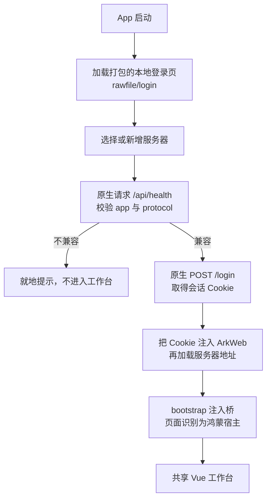
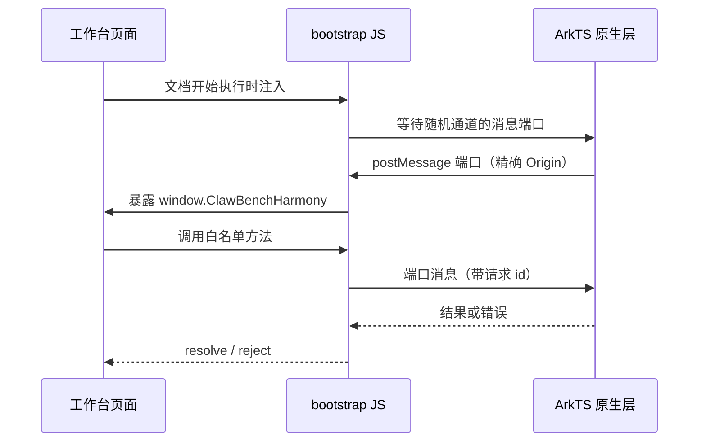
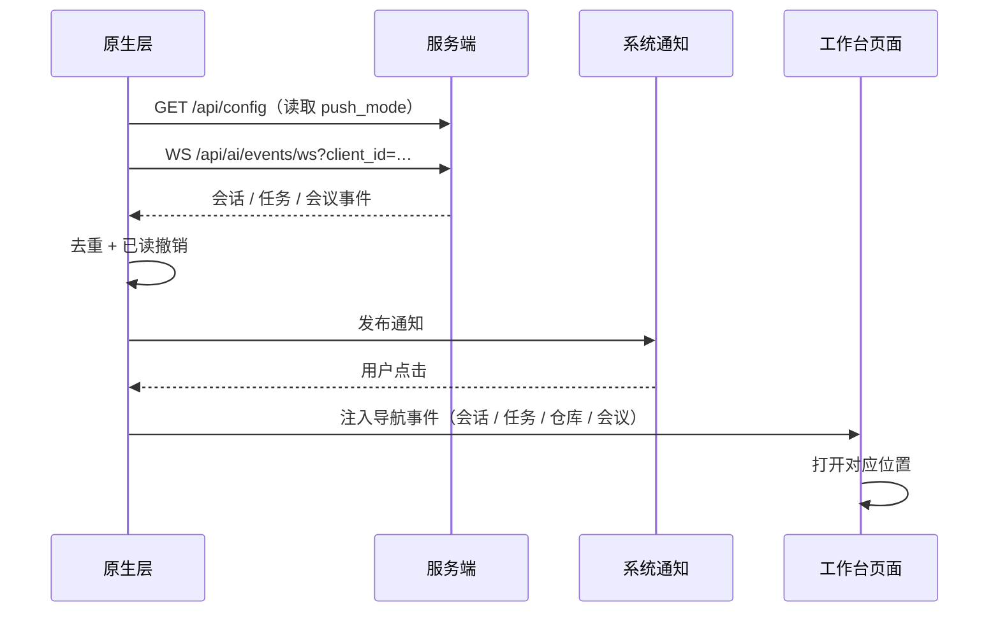

# 鸿蒙客户端（实验性）

鸿蒙客户端让 ClawBench 在 HarmonyOS 设备上以原生 App 的形态运行：ArkTS / ArkUI 负责窗口、生命周期与系统能力，ArkWeb 承载与服务端同一份 Vue 工作台。它不是一套新的界面实现——安卓端的工作台本来就不是 Java 原生控件，而是 WebView 加载服务端前端，因此复用同一份前端是保留交互与样式最直接的路线，原生层只补齐 Web 环境拿不到的能力：本地登录、凭据保存、文件保存与分享、通知、SSH / HTTP2 隧道、剪贴板与选区菜单。

客户端目前处于**实验性移植**阶段，尚未进入正式发布流水线，也不作为受支持的发行平台。它对齐的是 Android 客户端的能力面，验收按「功能项 × 子场景」逐条记录，模拟器里某个子场景通过不等于整项功能通过；当前逐项状态见 [功能对齐清单](../../harmonyos/FEATURE_PARITY.md)，平台限制见 [原生能力与平台边界](../../harmonyos/NATIVE_CAPABILITIES.md)。

## 流程图

### 启动、登录与工作台加载

登录页是随 HAP 打包的本地文档，由**独立**的 ArkWeb 控制器加载，只能导航到该文档；工作台用另一个控制器，只接受与当前服务器同源的顶层导航，其余链接交给系统浏览器。两者分离的收益是服务端不可达时仍能管理服务器列表，且远程页面永远拿不到登录页里的临时密码引用。密码本身保存在原生侧（按归一化后的服务器地址分别存放），Web 只使用 Cookie。

服务端兼容性判据是**协议号而非版本号**：`app` 必须是 `clawbench`，`protocol` 必须等于当前客户端支持的协议。这与桌面端、Android 端是同一份契约，因此服务端的一次普通发布不会把老客户端挡在门外。

### 原生桥：外观快照 + 消息端口

桥**不向页面注入一个可任意调用的全局代理**：先只给可信顶层文档一份能力外观快照，真正的调用通道是面向精确 Origin 的 `MessagePort`，通道标识每次连接随机生成；可调用的方法按白名单过滤，离开页面时关闭端口并拒绝所有未完成请求。每条连接、每个文档都带代次，旧页面的异步响应不能改写新页面的状态。

对前端来说这层完全透明：`getNative()` 优先读 `window.ClawBenchHarmony`，其形状与 Android / Electron 的 `ClawBenchNative` 相同，因此业务代码不需要为鸿蒙写分支，只有「这个宿主到底具备哪项能力」才需要单独判断。

### 后台通知

原生层自己维持一条事件订阅，不依赖页面里的 WebSocket——这正是它能工作到页面之外的原因。断线后用 `/api/ai/events/pending` 按游标补拉，重连补到的旧事件不会重复弹出。推送偏好由原生层直接读服务端配置，因此即使服务端下发的是旧版前端、页面本身没有鸿蒙适配，后台通知仍然可用。

## 功能与设计要点

### 功能清单

- **同一份工作台界面**：聊天、群聊、文件、Git、终端、任务、邮件、会议、统计与设置全部来自服务端下发的 Vue 前端，鸿蒙端不维护第二套界面。界面随服务端升级，客户端壳不需要跟着改。
- **本地登录与多服务器**：服务器列表、命名、增删改、协议健康检查、密码保存与已保存凭据直登都在原生侧完成，登录页在离线时同样可用。
- **原生桥与能力表**：文件选择、保存、ShareKit 分享与外部分享导入、剪贴板、选区菜单、系统栏与键盘避让、常亮、音量键都通过统一桥暴露；前端用一张能力表判断某个宿主是否真的支持某项能力，而不是靠「是原生环境」推断。
- **下载落在系统下载目录**：网页里触发的下载、原生认证流式下载与 Blob 保存都写系统 `Download/com.clawbench.harmony/`，重名自动加序号、不覆盖已有文件；页面导航不会中断已开始的下载，页面销毁时取消未完成任务。早期实现让网页下载落进 Web 私有缓存，用户以为「下载完了」却在文件管理器里找不到。
- **通知与点击定位**：系统授权状态与实际接收状态分开显示，不用修改服务端推送模式来掩盖系统层拒绝；点击通知直达会话、任务、仓库、用量提醒或会议。
- **原生 SSH / HTTP2 隧道**：正向与反向端口映射由原生网络栈实现（SSH 走 libssh2 + mbedTLS，HTTP2 走 nghttp2），按服务器保存配置并在重连后恢复。浏览器内核无法建立 SSH，这是必须由原生层承担的部分。
- **媒体授权**：摄像头与麦克风按可信来源动态授权并返回真实结果；屏幕与系统音频共享的授权入口已接入，但尚未取得可用流，因此不计入已具备的能力。
- **明确的「不支持」**：跨应用悬浮状态窗与实况窗需要签名级权限资格，能力表直接报 `false`，不提供空实现，也不用应用内弹层冒充。

### 设计要点

- **先判断能否复用，再决定重写**：安卓端的工作台是 WebView + Vue，不是 Java 控件页面，所以鸿蒙端走「原生壳 + ArkWeb + 共享前端」，而不是把 Vue 重写成 ArkUI、Flutter 或 React Native。需要重建的只有系统能力层，这也是工作量真正集中的地方；「网页能打开」不能当作移植完成的判据。
- **宿主身份多一个取值，不是 Android 的变体**：前端把「宿主是谁」这条轴拆成 Electron / Android / 鸿蒙 / 浏览器四种，鸿蒙必须单独判定。一旦被当成 Android，就会连带启用安卓专属的字体与合成分层补偿、APK 更新入口和后台断连策略，而这些在鸿蒙上都是错的；反过来，终端音量键这类能力按能力位开启，不按宿主身份开启。
- **凭据留在原生，Web 只拿 Cookie**：已保存的密码不回传给远程页面，登录页只持有一次性的临时引用，认证完成后由原生把 Cookie 注入 WebView。这样即使页面被替换或跳转，也拿不到可复用的密码。
- **桥的暴露面按最小权限设计**：不注入全局可调用对象、只认可信顶层文档与精确 Origin、命令走白名单、通道标识随机、离页即失效。原生桥能读剪贴板、能写文件、能建隧道，任何一条放宽都等于给页面一个越过浏览器沙箱的口子。
- **能力用布尔值如实上报，验证边界与能力分开表述**：「有这个入口」不等于「这个能力可用」。屏幕共享、悬浮窗这类未打通或受平台资格限制的部分，能力表报 `false`、文档写明未验收，而不是用授权弹窗出现、轨道短暂 live 之类的中间态充当通过。
