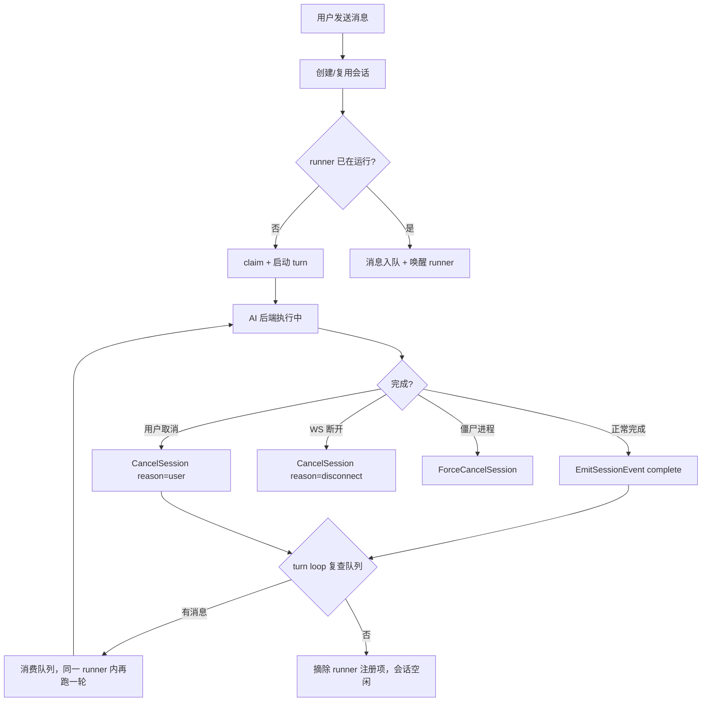
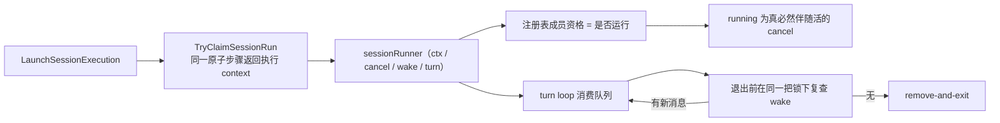
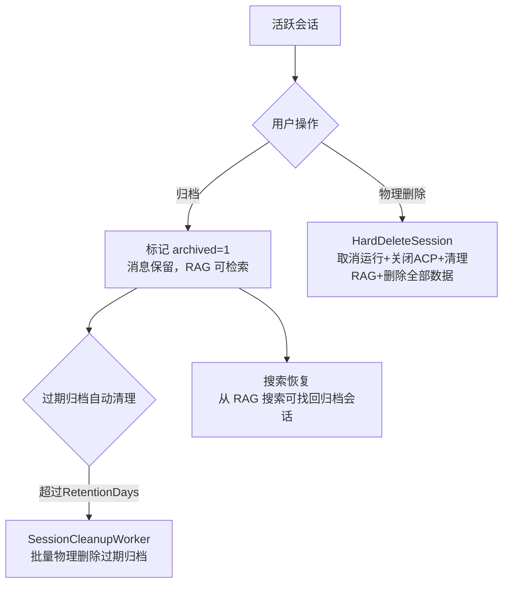
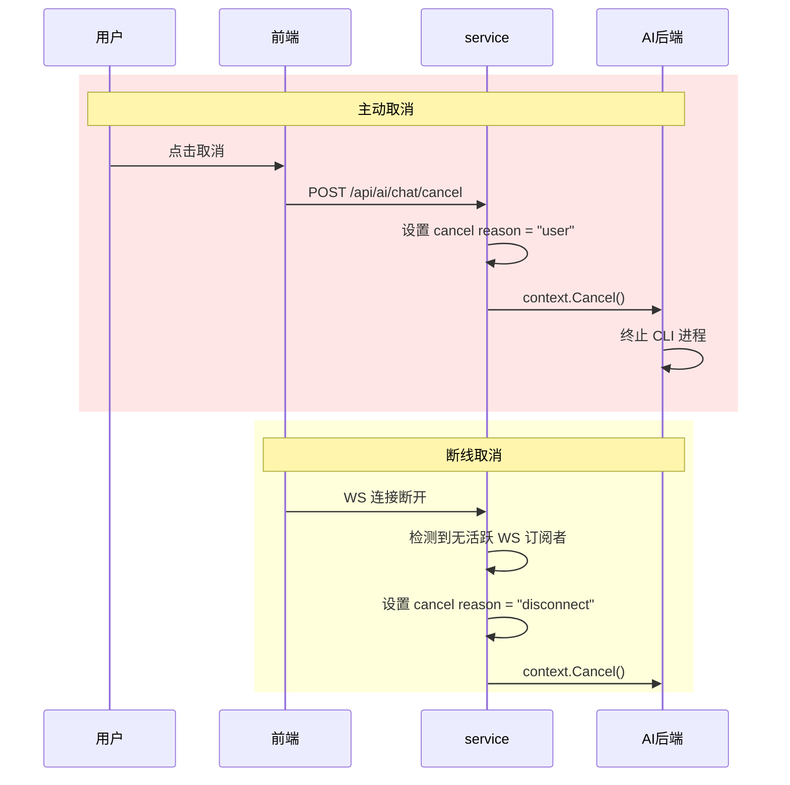

# 会话生命周期

聊天会话从用户发送第一条消息开始创建，经历执行、排队、取消、完成等状态，最终被归档（软删除）或物理删除（Destroy）。任务的执行结果可以续接为新的交互式会话，继承原始对话上下文。理解会话的生命周期是理解系统运行时行为的关键——大多数用户交互都围绕"当前会话"展开，而 service 层的会话管理是整个系统的运行时核心。

## Codex 项目级历史会话发现

Codex Agent 优先使用 ACP `session/list`，并在第一页合并本地
`CODEX_HOME/sessions`（默认 `~/.codex/sessions`）扫描结果。ACP 列举不可用
或在分页开始前失败时，自动使用本地扫描兜底。恢复时不转换会话 ID，直接将
`session_meta.payload.id` 作为 Codex thread ID 传给 ACP `LoadSession`。

本地扫描器仅在 JSONL 文件头部读取恢复所需的 `id`、`cwd` 和时间戳，并只返回
规范化后 `cwd` 与当前项目一致的会话。Windows 盘符大小写、正反斜杠、尾斜杠
以及 `.`/`..` 差异均会规范化比较；损坏或缺字段的文件会记录警告并跳过，不会
导致列表接口整体失败。

扫描按最新日期优先，单次最多检查 10,000 个 rollout 文件并返回 200 条匹配
会话，避免无界遍历。当前不解析 Codex 压缩的 `.jsonl.zst` 历史文件，此类会话
仍依赖优先级更高的 ACP 列举。Codex 数据目录非默认位置时需设置 `CODEX_HOME`。

排障时应确认：ClawBench 当前项目与 `session_meta.payload.cwd` 指向同一目录；
rollout 首条有效记录是 `session_meta`；若列表可见但恢复失败，升级 Codex 与
`codex-acp`，并确认 ACP `LoadSession` 接受该原始 thread ID。

## 流程图

### 会话主生命周期

### 运行态与可取消性由同一注册表持有

会话的"是否运行"与"如何取消"曾分别存放在 map+mutex 的运行标志与 `sync.Map` 的 cancel func 里，各自在自己的临界区更新——于是"running 但没有 cancel func"成为可表示状态，取消路径不得不写 force-clear 分支兜底。现在运行态由 runner 注册表的成员资格推导，running 为真必然伴随一个活的 cancel func，不一致状态在结构上无法构造。runner 退出前必须在同一把锁下复查 wake 标志：仅靠"get-or-create 与 remove-and-exit 互斥"不足以关闭窗口——消息落在"队列判定为空"与"删除自身"之间时仍会无人消费。

### 会话归档与物理删除

### 会话取消场景

## 功能与设计要点

### 功能清单

- **会话创建与复用**：用户发消息时，系统自动创建新会话或复用已有会话（同一 Agent）。每个会话绑定一个 Agent，保证对话上下文的一致性
- **消息排队**：同一会话内，前一条消息未执行完时后续消息自动入队，执行完成后依次消费。避免并发冲突，保证 AI 能看到完整的对话历史
- **唯一 turn 实现**：交互式发送、排队 drain、定时任务三条入口曾各有一份执行实现并已互相漂移（入队自愈只存在于 queue 路径，于是前端普通发送的消息可能永久滞留队列，表现为"发送后几分钟无响应、取消重发立刻就好"）。现在三者共用同一个 turn 实现，差异（i18n 文案、Finalize 是否 drain 事件通道、取消/失败/崩溃分支）以显式参数保留，不再靠复制代码承担
- **队列兜底回收**：独立的回收器周期性扫描 `queued_messages` 中超期、且会话非运行的消息行并重新驱动它们——作为状态机之外的最后一道止血，避免任何遗漏的唤醒路径把消息永久留在队列里
- **主动取消**：用户可以随时取消正在执行的会话。对于 ACP 后端，用户取消时如果进程仍然存活，不标记连接为 dead——避免不必要的 kill+respawn+ResumeSession 周期，下次发消息可以继续使用同一连接。系统区分"主动取消"和"连接断开"两种原因——主动取消不触发重连，断线取消可能触发重连尝试
- **异常终止自动续接**：会话意外中断（进程崩溃、本轮零产出、后端报错）时按配置自动发「继续」续接，聊天与任务两条路径共用同一分类器与消息构造（见[聊天流程](chat-flow.md)）。手动终止永不续接；判定优先级上取消高于一切
- **僵尸进程清理**：`ForceCancelSession` 直接 kill CLI 子进程，用于处理卡死的执行。这是最后的兜底手段，保证系统不会因异常进程而资源泄漏
- **会话归档**：归档会话仅标记 `archived=1`，消息仍然保留在数据库中供 RAG 检索。用户可通过会话搜索恢复归档的会话，整理对话列表时不会丢失历史知识
- **会话物理删除（Destroy）**：`HardDeleteSession` 事务性地删除会话及所有关联数据（消息、工具调用、thinking、摘要、标签关联、分享链接、任务执行记录），同时清理该会话的 RAG 索引条目（FTS + 向量）。对正在运行的会话先取消执行并关闭 ACP 连接，再执行删除。不可逆，适用于确信不再需要的历史会话。会话列表行尾的 `⋮` 菜单在「归档」下方提供入口，确认框按会话是否运行中区分文案——运行中意味着会连带取消执行与清空队列，必须让用户看到这层后果。**用量台账（`chat_metadata`）刻意保留**：它记录真实消耗的 token/成本，删除会让统计少算，且它没有指向 `chat_history` 的外键，删历史行不会波及
- **过期归档自动清理**：`SessionCleanupWorker` 后台定时清理超过保留期限（`ArchiveRetentionDays`）的归档会话，批量执行物理删除（含 RAG 索引清理）。清理功能默认关闭（`ArchiveRetentionEnabled=false`），保留天数默认 0 即永久保留——归档会话默认不自动消失，只有用户显式开启清理并设置天数后才触发。启动 5 分钟后首次执行，之后每 24 小时一次
- **ACP context_state 持久化**：ACP 会话的模式（mode）、思考深度（thinking effort）和上下文使用率（usage）持久化到 `chat_sessions.context_state` 列。服务重启后，前端加载会话时即可恢复这些状态显示，无需等待 ACP 重连。部分更新通过原子合并操作写入，避免并发读-写-合并竞态
- **会话身份持久化**：用户在会话中选择的模型、思考深度、工作模式和传输方式会被即时持久化（通过 PATCH `/api/ai/session/update`），页面重载后自动恢复——避免每次都需要重新配置。**思考档位按「模型」记忆**：`context_state` 只存用户显式选择（agent 自报的默认值仅用于显示，不参与重放），用户选择另存 `agents.thinking_effort_by_model`，换模型时重新推导该模型的档位（见 [AI 后端](ai-backend.md)）
- **续接对话**：任务的执行结果可以续接为新的聊天会话，继承源会话的消息、摘要和 `external_session_id`。用户看到任务结果后想继续追问，无需重新描述上下文。续接会话的标题带时间戳前缀（`⏰ [MM-DD HH:MM] <任务名>`）标识来自哪次运行，但该标题是 `placeholder`——**续接后的第一条用户消息会整体替换它**（时间前缀一并让位），与分叉行为一致；用户手动改名则写 `custom` 永不覆盖。已归档的续接会话会自动恢复
- **会话标题派生**：导入的 ACP 会话标题从 CLI transcript 派生，优先取后端持久化的自定义标题（用户改名或自动主题名），其次取首条人类提问（剥离机器生成前缀）。系统始终扫描完整 transcript 一次性提取两个候选，不设文件大小上限，并按 `(sessionID, modTime)` 缓存重复读取——确保导入会话的标题与外部会话列表一致，不会因大文件回退到中间消息作为标题
- **会话标题锁定（title_source）**：`chat_sessions.title_source` 是标题来源的优先级枚举，自动命名只在**严格更低 rank** 时才覆盖：`placeholder`（0，如 `New Session 3`、分叉继承的 `🔀 <源标题>`、续接的 `⏰ [时间] <任务名>`）< `auto`（1，由用户消息派生）< `custom`（2，有意选定：用户手动改名、创建/导入时显式指定标题、任务会话 `⏰ <任务名>`、ACP 导入）。避免"用户发消息前改的名字被首条消息冲掉"或"任务标题被任务 prompt 覆盖"；手动改名会 trim 空白，防止纯空格锁死自动命名。**派生会话（分叉 / 续接）的标题是 placeholder 而非 custom**——它们都复制源历史，使自身首条消息永远不是第 1 条，因此自动命名不能按"首条消息"计数门控（历史会把它顶过阈值），改按 `title_source` rank 门控：继承的标题（分叉的 `🔀 <源标题>`、续接的 `⏰ [时间] <任务名>`）描述的是来源而非用途，由派生后的**第一条**用户消息整体替换（此后 rank 升为 `auto`，后续消息不再改）；用户一旦手动改名则写 `custom` 永不覆盖。旧字段 `title_renamed` 已废弃，仅保留给老读取方
- **AI 自动命名（`chat.auto_rename_enabled`，默认开）**：开启后，在本地标题写入的**同一时机**（首条用户消息、或分叉/续接后的第一条）额外异步调用「AI 摘要模型」生成标题并覆盖。本地标题先同步写入（界面立刻有名字），AI 成功才覆盖；**模型未配置或调用失败则保留本地标题**（回退行为，零回归）。默认开是安全的：未配置「AI 摘要模型」时该功能实际不可用（`service.AutoRenameEnabled` 在开关之外再门控模型是否存在），等价于原行为而非新增失败路径；用户显式关掉则写 `false` 永久保留。**与手动「生成标题」共用同一实现**（`service.GenerateSessionTitleFromMessages`），只有触发时机不同——避免 prompt / 模型选择 / 截断策略在两处漂移。喂给模型的素材是**会话全部用户消息**：分叉与续接会话已把源历史复制进来，因此天然满足"旧消息 + 新消息一起总结"；排队中的首条消息尚未落库，以触发文本显式补入。覆盖前用原子 SQL 守卫 `title_source <> 'custom'`，用户中途手动改名永不被冲掉；成功后广播 `session_title_update` WS 事件让其他客户端收敛
- **会话分叉**：用户可以从历史用户消息创建独立会话，保留原会话不变。支持 `beforeMessageId` 参数指定分叉点（包括从 assistant 消息处分叉）。`targetKind` 决定目标形态：`chat`（默认，单聊，可用 `agentId` 覆盖智能体）或 `group`（新群聊，需 `hostAgentId` + `memberAgentIds`）；**源会话可以是单聊也可以是群聊**。分叉标题由源会话标题 + emoji 前缀派生，且作为 `placeholder` 留给分叉后的第一条用户消息替换（见上条"会话标题锁定"），长对话中的替代方案探索不会污染现有分支，详细流程见[会话导航与分叉](../features/session-navigation.md)
- **分叉的历史处理按「源/目标」组合分派**：只有**单聊 → 单聊**把源消息行复制进新会话（并沿用懒渲染的 `BuildForkContext` 注入）；其余三种组合（单聊→群、群→单、群→群）**不复制任何消息行**，而是把源历史渲染成背景文本写进目标会话的 `context_state.fork_context`，由目标会话首轮注入，并写入一条 `role='system'` 提示行标明来源会话名。原因是群时间线的 `chat_history.agent_id` 存的是**成员行 id**，复制到新会话里解析不到成员（会渲染成一整屏无归属的 AI 发言），而成员行本身没有任何历史行可复制。群聊源只取**聚合时间线**（用户消息 + 成员发言，跳过系统行与工具调用/思考——群内成员之间本就只交换发言文本），受 `chat.fork_context_budget` 约束
- **分叉背景的注入与消费**：单聊目标在「尚无成功回合」时注入（读门 `SessionHasRealAssistantContent`），并在**成功回合的 Finalize 之后**调 `ClearForkContext` 清除——这是必需的组合：只用 assistant 计数做门会在首轮失败后永久失效（失败会写 assistant warning 行），只用「首条是否 warning」判断则会在先失败后成功时每轮重复注入。群聊目标由**每位成员各自**在首次发言时收到（以成员自己的 `seen_cursor == 0` 为条件，游标只在成功回合后推进），群行上的背景**不清除**，因此分叉后新加入的成员首轮也会收到
- **中断必须立刻可见，不能只存在 DB 行里**：点停止后气泡上没有任何「已中断」标识、必须刷新或切走切回才出现——这是三条时序叠加的结果：① `CancelSession` 立刻广播 `session_update(cancelled)`；② 前端进安全网分支后**先退订**再 loadHistory；③ executor 的 finalize 晚几百毫秒才把 `cancelled:true` 写进 DB 行，此时真正的 `chat_stream cancelled` 已无订阅者（被 hub 以 `no_subscribers` 丢弃），而那次 loadHistory 读到的行还没有该字段，之后也没有事件再触发 reload。于是唯一的记录留在 DB 里，实时气泡从不采纳它。修法两处：安全网分支在退订**之前**给每个仍 streaming 的助手气泡置 `cancelled`（对齐后端逐行盖章的语义，`completed` 不能盖），`rebuildFromDb` 的活体占位符合并分支也采纳 DB 的 `cancelled`（仍 streaming 的行不盖）以兜住 reload 晚于 finalize 的场景
- **会话完成自动标记已读**：当前会话执行结束（completed/cancelled）时前端自动调用 `POST /api/ai/chat/read` 清空未读，`UpdateLastRead` 锚定最新已完结 assistant 消息的 `created_at` 避免秒精度竞态——用户正在查看的会话结束后不应残留未读徽标；后台完成的会话则保留未读，供悬浮窗/Live Updates 展示"有内容待看"。**插话（steer）分段会让一条回复产生两个完成时间**：分段时给 before 半段盖上 `completed_at` 并重锚水位线，而 after 半段要到回合结束才定稿、时间必然更新——若不在 Finalize 时再重锚一次，真实回合跨秒后会话会在用户仍盯着看时翻回未读（与"完成后仍残留未读"是同一个缺陷，只是晚一行）；**取消的回合不盖 `completed_at`、也不得重锚**——用户取消时正盯着会话，前端早已标记已读，补盖落地时间反而会把它推过该已读点。**标记已读的判定只有一处**：`composables/sessionReadGate.ts` 统一回答「聊天面板在屏幕上 ∧ App 在前台 ∧ 不是重连回放」，收编完成、取消、前台恢复、WS 重连、回合边界、切项目/冷启动落点六条推断型路径（此前各自只查其中一部分，于是停在文件管理器或折叠聊天列时也会清掉用户没看过的角标）；可见性谓词由 App.vue 注册（gate 保持叶子模块），未注册时 fail-open，`switchSession` 刻意不走 gate（明确点开是更强的信号）。**反向配套**：答案为否时角标会留着，而用户之后自己露出面板的几条路径都不会补标，故 App.vue 另监听「可见 ∧ 当前会话」的复合键补一次 read，否则角标卡在用户正盯着的那条回复上。**注意这只覆盖聊天会话**——任务执行与 forge 条目各自有独立的逐条已读模型（见[任务](../features/scheduled-tasks.md)与 [Forge 集成](../features/forge-integration.md)），不共用这条水位线
- **会话标签**：会话可挂任意多个标签（按项目隔离定义），通过 PATCH `/api/ai/session/update` 的 `tags` 字段全量替换；会话列表支持按标签服务端筛选。详见[会话标签](../features/session-tags.md)
- **会话列表行的跨项目智能体身份**：`GET /api/ai/sessions` 与 `GET /api/ai/sessions/overview` 的每行额外带 `agentName` / `agentAvatar`。客户端平时用 `GET /api/agents` 反查智能体名称与头像，但那个列表**按调用方的当前项目过滤**（项目级智能体只在其所属项目可见），而这两个列表**跨项目**返回。于是另一个项目里跑的、作用域属于那个项目的智能体，客户端的查找会落空、行退化成裸 `agentId` + 首字母图标。**因此 `agentName` 只要注册表能解析就返回**（同时覆盖「智能体已被删除」的情况），`agentAvatar` 只在该智能体对调用方不可见时才返回（避免给正常行附上数 KB 的 SVG），两者省略时交回客户端既有兜底。身份由全局注册表解析、从不存到会话行上——这是「列表按调用方项目过滤」与「列表跨项目返回」两套口径的必然缝合点

### 设计要点

- **取消原因区分"用户"与"断线"**：系统为每个 Session 记录取消原因。用户主动取消意味着"我不想再继续了"，断线意味着"网络问题，可能需要恢复"——两种场景的处理策略完全不同。ACP 后端在用户取消时保护存活连接，仅在进程已死时才标记连接为 dead。取消原因同时是自动续接的第一道闸门：任何取消原因（user / interrupt / cancel / disconnect / restart / panic / timeout / agent_init_timeout）都直接判为不续接，且判定顺序保证取消优先于其他信号
- **运行时 Session 是内存态**：活跃 Session 和 Stream 通道存储在内存中，重启后清空。运行时状态（是否在执行、Stream 通道）是瞬时的，不需要持久化。但 ACP context_state 等会话级持久状态现在存入数据库，重启后可恢复
- **重启后自动恢复被打断的会话（`service/restart_resume.go`）**：触发信号有**两个**（缺一则最常见的重启场景恢复不了）：①启动时 `chat_history.streaming=1` 的行——只可能由"上一个进程中途死掉"留下（优雅退出会 finalize 每个活动流，用户取消也 finalize 成 `streaming=0`）；②会话**最后一条 assistant 行**带 `reason=restart` 的 warning 块——这是**优雅重启**留下的（executor 在进程退出前就把行 finalize 成 `streaming=0` 并追加警告块，所以只看 ① 的话「点重启」永远恢复不了，只有 kill -9/OOM 能）。②必须限定「最后一条 assistant 行」：用户若在警告之后又发过消息，说明他已经接管，再插一轮恢复等于重复干活。②还必须带**时间窗**（`chat.restart_resume_window_minutes`，默认 60，设置面板可调，0 = 不限）：窗口的作用是**限定语义**而非缩小结果集——警告块永久留在库里，"刚被打断"和"几天前放弃"在数据上无法区分，窗口表达的是「只接刚才那次重启打断的活」。真正拦住陈旧会话的是**归档过滤**（见下），窗口是第二道独立边界。`InitDB` 在把那些行改写成 `cancelled + restart warning` 的同一处收集 `session_id`（去重）记入待恢复集合，`StartRestartResume` 在**主监听端口绑定之后**（`main.go` 的 `srv.Serve` 之前）延迟 5s 再逐个处理——计时锚点必须是「端口能接受连接」，否则启动尾巴（钉钉/飞书握手、文件监听遍历、TLS 解析）一长，恢复轮次就会在没有任何客户端能订阅时开始流式输出（回复仍落库，但用户要切走切回才看得到）。**每会话只落一行**：`role='system'` 的恢复提示，**只给用户看**（"会话已恢复，已通知智能体继续执行"）——它**不是**发给 AI 的指令，两个身份是两个独立的 i18n 键（`RestartResume` / `RestartResumeInstruction`），共用一个字符串会把"请重新评估当前状态并继续"这类命令式措辞泄漏给用户。指令只作为该轮 Prompt 注入、**永不落库**，**绝不落 user 消息**。**恢复不是重放原请求**——中断可能发生在工具调用之后，重放会让模型重复动手；提示词要求它"重新评估当前状态并继续"，由模型自己读盘判断。**单聊**走 `launchConsumerExecution`，**群聊**必须走 `runGroupDrainLoopFn`（与队列回收器同一规则：否则主持人单跑、成员不参与、回复无归属）。**归档会话在候选集生成时就被排除**（两条信号都排除），因此启动日志的 `count=N` 反映的是真正会恢复的数量；但**孤儿行仍照常 finalize**（`streaming=1` → 0），否则归档会话的残行会让前端永久显示「运行中」。**只恢复交互式会话**：`session_type` 不是 `chat`/`group` 的一律跳过——定时任务（`scheduled`）的执行记录在启动时已被调度器标成 `failed`、会话不在会话列表里、cron 到点还会再跑一次，在此恢复等于用交互模式重复干一遍活。五道跳过：会话已删/归档、`GetQueuedCount>0`（队列回收器会自己重跑，再起一个就是双消费者）、claim 失败（用户已抢先点了"继续"；claim 在写系统行**之前**，跳过的路径不留孤儿行）、非交互式会话、以及开关 `chat.auto_continue_enabled` 关闭（与异常终止自动续接同一个 opt-in——恢复会不经用户同意花 token）。集合被 `take` 一次性抽干，因此**运行中打开该开关不会补跑本次启动已发现的会话**（要等下一次重启）。恢复循环对每个会话单独套 panic barrier——这条链路跑在裸 goroutine 里且面对任意历史会话，未捕获的 panic 会带走整个进程，也会让后面的会话全部不被恢复；panic 分支与写系统行失败分支都必须 `FinishSessionRun` + 广播终态，否则 `tryClaimSessionRun` 已广播的 `running` 永远收不到收尾，前端一直转圈。**与优雅退出互斥**：`CancelAllSessions` 只取消「此刻已注册」的 runner，恢复 goroutine 若在它之后才 claim，新回合就看不见 drain、会在 DB 关闭期间继续跑并留下新的 `streaming=1` 行（下次启动再恢复一次，用户看到两条重复通知）。故 main 在 `CancelAllSessions` **之前**调 `MarkShuttingDown()`，恢复循环每个会话前检查 `IsShuttingDown()`
- **优雅退出兜底 flush**：服务收到 SIGTERM/SIGINT 时，在关闭 HTTP 之前对活动流强制 flush——流式输出最后 ≤500ms 的增量与 thinking 块平时只存在于内存，重启会永久丢失。`WaitStreamsDrained` 轮询活动流注册表等待所有流完成落库（5s 截止）；`GracefulStopAll` 先取消本地 prompt 让 ACP 后端发 done 事件，再等待进程自然退出，超时 SIGKILL 兜底；stopSweep 幂等（`sync.Once`）。编排顺序：flush → 等待 → 停 HTTP → 温和回收 ACP。优雅退出让重启丢内容的窗口收敛到最小，升级/重启对进行中的会话更友好
- **主监听端口绑定失败须有界重试**：主 HTTP 监听端口（默认 20000）的 listener 要留到 shutdown 第 4 步（`srv.Shutdown`）才释放，而那一步排在 5s 流收尾宽限之后——因此重启时新进程可能在旧进程尚未释放端口时绑定，报 `bind: address already in use` 后 `os.Exit(1)`（Windows 下由哨兵脚本 2s 后拉起、手工重启同理）。主端口没有 SSH 那样的「提前释放」路径（mainLn 必须留到第 4 步以阻止 drain 后新建连接），故对称修法是加**有界重试**（15s / 500ms）。重试判据用**任意绑定失败**而非 `errors.Is(EADDRINUSE)`——Go 在 Windows 的 `EADDRINUSE` 是发明值，永不等于真正的 `WSAEADDRINUSE`（与 `internal/ssh`、`internal/tunnel` 同结论）
- **会话设置即时持久化**：模式、思考深度、模型、传输方式、自动审批等设置通过 PATCH 端点即时写入数据库，无需发送聊天消息即可生效。模式/思考深度的变更还会异步转发给 ACP Agent
- **重启必须失败可见，且哨兵不能 `exec` 掉自己**：重启是「派生一个延后拉起的新进程 + 让当前进程优雅退出」，任何一步静默失败都会表现成「点了没反应」。三处必须显式处理：①**哨兵不能用 `exec` 替换 shell**——非交互 POSIX shell 在 `exec` 失败时立即以 127 退出，后面的重试循环与失败上报全是死代码（实测 `for i in 1 2 3; do exec "/nonexistent" && exit 0; done; echo fail` 直接 exit 127、`fail` 从未写出）；改为先判 `-x` 再 `exec`，保留 shell 存活以便写 stderr。目标二进制不可执行也应在**派生之前**判出来，变成用户可见的 500。②**Windows 不能用 `os.Interrupt` 让进程退出**——Go 在 Windows 上除 `Kill` 外一律返回 `EWINDOWS`，错误若被丢弃就变成「回 200 但进程不退出」的 100% 空操作；改为进程内的 shutdown 通道（`sync.Once` 幂等），main 的 shutdown goroutine 同时 select 信号与该通道，Unix 侧信号投递失败也回退到同一通道。③**Windows 命令行不能出现 POSIX 单引号**——`cmd.exe` 不识别，`'--port'` 会原样进入 argv，而参数解析是 `arg == "--port"` 精确比较，于是全部落空、新进程用默认端口 + 默认数据目录（比「起不来」更隐蔽）。④前端不要给后端已本地化的错误再加一层前缀，否则用户看到「重启失败：重启失败：…」
- **「重启完成」的判据是进程身份，不是应答成功**：前端点重启后要决定何时自动刷新页面。三种弱判据都不成立——轮询到任意 200 不行（旧进程要留到 `srv.Shutdown` 才闭嘴，请求后 2 秒去探很可能打到**旧进程**，于是刷新回同一个构建，用户读作「重启没生效」）；版本号不行（不升级的重启版本本来就不变）；只在请求处等响应也不行（响应只证明「已安排重启」）。因此 `GET /api/server/instance` 返回**每个进程唯一的 `instance_id`**（内存生成，不落库、不参与缓存），前端在**发请求之前**先取一次基线，之后每 2 秒探测、**只有拿到不同的 id 才刷新**。两条兜底：基线取不到（探测超时/端点缺失）时退化为「第一次成功应答即刷新」，因为那说明服务端本来就连不上；连续 15 次（30 秒）拿到**同一个** id 则判定「服务端没有重启」并给出可操作提示，而不是拖到两分钟总超时再说一句「没恢复」。这个端点必须刻意保持廉价——不碰 DB、不读配置文件，因为它会被轮询
- **自动审批默认值在创建时快照**：智能体配置面板的「新建会话默认自动审批」在创建会话时依据 `model.Agents[agentID].AutoApprove` 落库为 `chat_sessions.auto_approve=1`（创建/分叉/续接三条路径统一应用）。这是创建时快照——之后修改智能体默认开关不回写已有会话，用户仍可在会话抽屉单独切换。前端**不再**在切换会话时基于 agent 配置强制覆盖为开，改为读取服务端持久化值——否则 UI 显示开、DB 仍为 0，重启即丢失
- **归档与物理删除语义不同**：归档是软删除（`archived=1`），数据保留、RAG 可检索、可恢复；物理删除（Destroy）是不可逆的事务性删除，从数据库彻底移除。两种操作对应不同的用户意图——归档是"暂时不看了但以后可能需要"，物理删除是"彻底清理"
- **过期清理是后台自动化**：`SessionCleanupWorker` 按配置周期自动清理过期归档，用户无需手动管理。配置变更通过 `ReconfigureSessionCleanup` 热生效（停止旧 worker、启动新 worker），无需重启服务
- **强制终止是最后手段**：在常规取消失败或进程卡死时，直接终止 CLI 进程（跳过优雅退出），避免产生孤儿进程
- **运行态与可取消性是同一个事实**：把两者拆成两个容器会制造"running 但不可取消"的可表示状态，取消路径只能靠兜底分支掩盖症状。收敛为单一注册表后，定时任务第一次真正可被用户取消（此前它的 cancel 只存在于调度器自己的 map 里，对会话取消不可见）
- **消息消费必须与启动执行在同一原子步骤**：先消费队列行、再查注册表取 context 的写法，会在两步之间被取消插入——行已被消费、注册项已消失，消息就此丢失（回收器只扫仍留在 `queued_messages` 的行）。改为在 claim 的同一步返回 context 并透传，且 claim 在同一事务内 `DELETE` 队列行 + `INSERT` 历史行
- **入队后的唤醒不能依赖时序**：wake 标记是一次性的，若 runner 在"标记已置位"与"行尚未可见"之间退出，标记会被消费掉而消息滞留。因此行可见后必须重新置位唤醒，使保证不依赖插入顺序
- **ExitPlanMode 结束当前流**：CLI 后端在检测到 ExitPlanMode 事件时结束当前流，由服务层管理后续会话状态
- **续接对话是去重的**：同一个执行记录只能续接一次，已有续接会话时直接返回（已归档的自动恢复）——防止重复创建导致数据冗余
- **分叉与续接语义不同**：续接连接任务执行结果并复用其来源关系；分叉从聊天历史的指定位置复制上下文，两者都创建独立可执行会话但来源边界不同
