# ClawBench 数据库

主库：`{DataDir}/ClawBench.db`（SQLite，WAL 模式，foreign_keys=ON）
RAG：同一数据库文件，独立连接池

> 项目身份统一为整数 `project_id`（`projects` 表），所有项目作用域表存 id 而非路径——改名/移动目录只需一条 UPDATE。`project_id=0` 是保留哨兵（全局标签、无法归属的分享），故不声明外键。
>
> 本文档按**全新安装**跑完 `service.InitDB()` 后的实际 schema 描述（`sqlite_master` + `pragma_table_info` 实测），共 **39 张表**（含迁移台账 `schema_migrations`）。RAG 的三张表由 `internal/rag` 独立连接池创建，单列于文末。
>
> 升级路径上的列由 `database.go` 的 `ALTER TABLE ... ADD COLUMN` 补齐（102 条），最终形状与本文件一致；但 `CREATE TABLE IF NOT EXISTS` 对已存在的表是空操作，**所以老库不会自动获得新列，只能靠 ALTER**。改 schema 时必须两条路一起改。

## 表定义

### chat_sessions（聊天会话）

| 列名 | 类型 | 约束 | 默认值 | 说明 |
|---|---|---|---|---|
| id | TEXT | PRIMARY KEY | — | 会话 UUID |
| project_id | INTEGER | NOT NULL | — | 项目 id（逻辑关联 `projects.id`） |
| backend | TEXT | NOT NULL | — | AI 后端名称 |
| title | TEXT | NOT NULL | — | 会话显示标题 |
| agent_id | TEXT | | `''` | 关联的 Agent |
| agent_source | TEXT | | `'default'` | Agent 来源 |
| model | TEXT | | `''` | LLM 模型 |
| external_session_id | TEXT | | `''` | 外部 CLI 会话 ID |
| session_type | TEXT | NOT NULL | `'chat'` | chat / task / **group**（群会话）/ **group_member**（群成员连接绑定行，用户不可见） |
| group_id | TEXT | | `''` | 所属群会话 id（仅 `group_member` 行非空）；索引 `idx_sessions_group(group_id, session_type)` |
| archived | INTEGER | NOT NULL | `0` | 归档标记（归档会话默认不在列表显示）。**群成员行不用它表示"离开"**——那是 `disabled` |
| disabled | INTEGER | NOT NULL | `0` | **群成员行专用**（`session_type='group_member'`）：禁用该成员。只影响调度（不安排该成员发言），成员行、上下文窗口与历史全部保留；启用是一次普通置位，`seen_cursor` 在禁用期间不推进，故启用后下一轮注入禁用期间的全部积压。与 `archived` 正交：旧的"移除成员"（`archived=1`）由一次性迁移 `MigrateGroupMemberDisabled` 转成 `disabled=1`。**注意与 `agents.disabled` 同名不同义**：那个是智能体全局禁用（从所有新建入口消失），这个是单个群里的成员禁用，两者互不影响 |
| last_read_at | DATETIME | | — | 最后阅读时间 |
| awaiting_user_at | DATETIME | | — | **群会话专用**：最后一轮已结束、发言权已交回用户且用户尚未读。**是标记不是水位线** —— 交回时置位、`UpdateLastRead` 清空；群未读因此是 0/1（"群在等我"），不按成员发言条数累加（见 `unreadCountSubquery`）。非群会话恒为 NULL |
| created_at | DATETIME | | CURRENT_TIMESTAMP | 创建时间 |
| updated_at | DATETIME | | CURRENT_TIMESTAMP | 更新时间 |
| source_session_id | TEXT | | `NULL` | 派生来源。三种写入方共用：分叉/任务续接写源会话 ID，ACP 载入写标记串 `acp:{acpSessionId}`（非会话 ID，消费时须跳过该前缀）。部分索引 `idx_sessions_source_session ... WHERE source_session_id IS NOT NULL` |
| transport | TEXT | | `''` | 传输方式：cli / acp |
| auto_approve | INTEGER | NOT NULL | `0` | 自动批准模式 |
| context_state | TEXT | | `''` | 会话级上下文状态 JSON（模式、思考档位等）。drain/续接路径靠它避免回落到默认值 |
| agent_name | TEXT | NOT NULL | `''` | **群成员行的显示名（权威快照）**：首个实例=智能体本名，重复实例=名池名（池尽回退 `本名 序号`）。非成员行留空；成员行的 `title` 留空 |
| agent_avatar | TEXT | NOT NULL | `''` | **群成员行自身的头像 SVG 快照**（前端 DiceBear 按成员名生成）。仅同一智能体的第 2+ 个实例写入（用于区分副本）；第 1 个/唯一实例留空，回退智能体头像 |
| compacted | INTEGER | NOT NULL | `0` | 上下文刚被压缩：下一轮需重注入系统提示（`MarkSessionCompacted`） |
| title_renamed | INTEGER | NOT NULL | `0` | 用户是否手工改过标题 |
| title_source | TEXT | NOT NULL | `''` | 标题来源等级：`''`/`placeholder`(0) < `auto`(1) < `custom`(2)。自动改名按此等级决定能否覆盖（`titleSourceRank`） |
| pinned | INTEGER | NOT NULL | `0` | 置顶标记（排序第一优先） |
| sort_order | INTEGER | NOT NULL | `0` | 手工排序序号（置顶之后、创建时间之前） |

UNIQUE：`(backend, id)`

索引：`idx_sessions_group(group_id, session_type)`、`idx_sessions_order(session_type, project_id, archived, pinned DESC, sort_order ASC, created_at DESC, id DESC)`、`idx_sessions_project_backend(project_id, backend)`、`idx_sessions_source_session(source_session_id) WHERE source_session_id IS NOT NULL`、`idx_sessions_type(session_type, project_id, archived)`

> 列表排序恒为 `pinned DESC, sort_order ASC, created_at DESC, id DESC`（`idx_sessions_order` 就是为这个 ORDER BY 建的覆盖索引，缺它就要 filesort）。

### chat_history（聊天消息）

| 列名 | 类型 | 约束 | 默认值 | 说明 |
|---|---|---|---|---|
| id | INTEGER | PRIMARY KEY AUTOINCREMENT | — | 消息 ID |
| project_id | INTEGER | NOT NULL | — | 项目 id（逻辑关联 `projects.id`） |
| role | TEXT | NOT NULL, CHECK(role IN ('user','assistant','system')) | — | 消息角色（`system` 用于群成员增删的系统事件，**不是 AI 回复**，未读子查询只数 `assistant`） |
| content | TEXT | NOT NULL | — | 消息内容 |
| files | TEXT | | — | 附件 JSON |
| session_id | TEXT | | — | 逻辑关联 `chat_sessions.id`（**无 DB 外键**，见下） |
| backend | TEXT | NOT NULL | `'claude'` | AI 后端名称 |
| agent_id | TEXT | | `''` | **群聊发言人成员行 id**（非 agent id；普通会话留空）。前端据此解析发言人头像/名字并判定主持人发言 |
| injected | INTEGER | NOT NULL | `0` | 1=该用户消息被**并入正在生成的回复**（运行中插话，合并式后端）而非另起一回合；前端据此在气泡上显示「回复已并入上一轮」 |
| streaming | INTEGER | NOT NULL | `0` | 1=正在流式输出 |
| indexed | INTEGER | NOT NULL | `0` | RAG 已索引标记 |
| external_message_id | TEXT | | `''` | 外部 ACP messageId，用于增量 ACP 同步去重 |
| created_at | DATETIME | | CURRENT_TIMESTAMP | 创建时间 |
| completed_at | DATETIME | | — | 流式结束时间 |

索引：`idx_history_indexing(streaming, indexed)`、`idx_history_sess_unread(session_id, role, streaming, project_id)`、`idx_history_session(project_id, backend, session_id, created_at)`、`idx_history_session_id(session_id, role, streaming, created_at)`、`idx_history_unread(project_id, role, streaming, created_at)`

> **`session_id` 上没有外键。** 历史库曾声明 `FOREIGN KEY (message_id) REFERENCES chat_history(id)`，重建表时被有意去掉（见 `database.go:1995` 的注释）；会话删除靠应用层按固定顺序显式 DELETE。

### chat_metadata（用量台账）

独立用量台账，**无外键**（刻意不与 `chat_history` 级联）。记录真实消耗的 token/费用，会话/消息被删除后仍然保留，避免统计遗漏。`project_id` / `backend` / `agent_id` 在写入时冗余，统计查询无需回连会话表；`agent` 显示名仍通过 `LEFT JOIN agents` 实时解析。

| 列名 | 类型 | 约束 | 默认值 | 说明 |
|---|---|---|---|---|
| message_id | INTEGER | PRIMARY KEY | — | 原 chat_history.id（仅作标识，无 FK） |
| mode | TEXT | | `''` | 模式：chat / plan / code |
| thinking_effort | TEXT | | `''` | 思考力度等级 |
| transport | TEXT | | `''` | 传输方式：cli / acp |
| model | TEXT | | `''` | 使用的模型 |
| input_tokens | INTEGER | | `0` | 输入 token 数 |
| output_tokens | INTEGER | | `0` | 输出 token 数 |
| duration_ms | INTEGER | | `0` | 处理耗时（毫秒） |
| wall_ms | INTEGER | | `0` | 墙钟耗时（毫秒）——AI 每轮从开始到定稿的实际运行时长，是「用量统计」AI 工作时长指标的唯一数据源。取消的回合也写（`drainAndPersistCancelledMetadata` 补 `buildResult` 未写的值）；升级时 `MigrateLedgerWallClock` 回填历史行（先取消息 content 的 `metadata.wallMs`，再退化为 `completed_at − created_at`） |
| cost_usd | REAL | | `0` | **单轮增量**费用（美元）。求和即真实总额 |
| stop_reason | TEXT | | `''` | 停止原因 |
| is_error | INTEGER | | `0` | 是否出错 |
| error_message | TEXT | | `''` | 错误信息 |
| cached_read_tokens | INTEGER | | `0` | 缓存读取 token |
| cached_write_tokens | INTEGER | | `0` | 缓存写入 token |
| thought_tokens | INTEGER | | `0` | 思考 token |
| total_tokens | INTEGER | | `0` | 总 token |
| cache_creation_tokens | INTEGER | | `0` | 缓存创建 token |
| cache_hit_tokens | INTEGER | | `0` | 缓存命中 token |
| cache_miss_tokens | INTEGER | | `0` | 缓存未命中 token |
| credit | REAL | | `0` | 积分消耗 |
| usage_by_category | TEXT | | `''` | 上下文分类用量 JSON |
| session_id | TEXT | | `''` | 外部 ACP session id（CLI 代理为空） |
| request_id | TEXT | | `''` | 请求 ID |
| trace_id | TEXT | | `''` | 链路 ID |
| agent_message_id | TEXT | | `''` | 代理消息 ID |
| message_request_id | TEXT | | `''` | 请求级 ID |
| request_model_name | TEXT | | `''` | 请求模型名 |
| response_model_id | TEXT | | `''` | 响应模型 ID |
| finish_reason | TEXT | | `''` | 结束原因 |
| outcome | TEXT | | `''` | 结果 |
| agent_phase | TEXT | | `''` | 代理阶段 |
| project_id | INTEGER | | `0` | 冗余：项目 id（会话删除后统计仍可用） |
| backend | TEXT | | `''` | 冗余：AI 后端名称 |
| agent_id | TEXT | | `''` | 冗余：代理 ID（agent 维度兜底） |
| clawbench_session_id | TEXT | | `''` | 冗余：ClawBench 会话 ID |
| cost_session_total | REAL | | `0` | **原始累计值**：agent 自报的会话累计成本（ACP `usage_update.cost` 语义就是运行总计）。留它是为了下一轮（即使跨重启）能对它做差 |
| cost_cumulative | INTEGER | | `0` | 本行的 `cost_session_total` 是否为累计口径（1=是，用于差分的基准行识别） |
| created_at | DATETIME | | CURRENT_TIMESTAMP | 记录时间 |

索引：`idx_chat_metadata_created(created_at)`、`idx_chat_metadata_model(model)`、`idx_chat_metadata_project_created(project_id, created_at)`

### chat_tool_calls（工具调用）

| 列名 | 类型 | 约束 | 默认值 | 说明 |
|---|---|---|---|---|
| id | INTEGER | PRIMARY KEY AUTOINCREMENT | — | |
| message_id | INTEGER | NOT NULL, FK → chat_history.id (CASCADE) | — | 所属消息 |
| session_id | TEXT | NOT NULL | — | 会话 id（逻辑关联，无 DB 外键） |
| tool_id | TEXT | NOT NULL | — | 工具调用 ID |
| name | TEXT | NOT NULL | — | 工具名称 |
| input | TEXT | NOT NULL | `'{}'` | 输入 JSON |
| output | TEXT | NOT NULL | `''` | 输出文本 |
| status | TEXT | NOT NULL | `''` | 调用状态 |
| done | INTEGER | NOT NULL | `0` | 完成标记 |
| summary | TEXT | NOT NULL | `''` | 工具结果摘要 |
| duration_ms | INTEGER | NOT NULL | `0` | 工具耗时（毫秒） |
| created_at | DATETIME | | CURRENT_TIMESTAMP | 创建时间 |

UNIQUE：`(tool_id, message_id)`
索引：`idx_tool_calls_message(message_id)`、`idx_tool_calls_session(session_id, created_at DESC)`

### chat_thinking（思考过程）

正文与思考分表存放：`chat_history.content` 只留正文，思考正文按 `(think_id, seq)` 分片落这里。

| 列名 | 类型 | 约束 | 默认值 | 说明 |
|---|---|---|---|---|
| id | INTEGER | PRIMARY KEY AUTOINCREMENT | — | |
| message_id | INTEGER | NOT NULL, FK → chat_history.id (CASCADE) | — | 所属消息 |
| session_id | TEXT | NOT NULL | — | 会话 id |
| think_id | TEXT | NOT NULL | — | 思考块标识（同一块的多片共享） |
| seq | INTEGER | NOT NULL | `0` | 块内分片序号 |
| text | TEXT | NOT NULL | `''` | 思考文本分片 |
| created_at | DATETIME | | CURRENT_TIMESTAMP | 创建时间 |

UNIQUE：`(think_id, message_id, seq)`
索引：`idx_thinking_message(message_id)`、`idx_thinking_session(session_id, created_at DESC)`

### summaries（摘要）

| 列名 | 类型 | 约束 | 默认值 | 说明 |
|---|---|---|---|---|
| id | INTEGER | PRIMARY KEY AUTOINCREMENT | — | |
| target_type | TEXT | NOT NULL | — | 目标类型：chat_message / task_execution |
| target_id | INTEGER | NOT NULL | — | 多态外键（应用层） |
| summary | TEXT | NOT NULL | — | 摘要文本 |
| summary_cards | TEXT | NOT NULL | `''` | 结构化摘要卡片元数据 JSON（如提问卡片的 done 标记） |
| created_at | DATETIME | | CURRENT_TIMESTAMP | 创建时间 |

UNIQUE：`(target_type, target_id)`

### tts_summaries（TTS 摘要）

| 列名 | 类型 | 约束 | 默认值 | 说明 |
|---|---|---|---|---|
| id | INTEGER | PRIMARY KEY AUTOINCREMENT | — | |
| message_id | INTEGER | NOT NULL | — | 逻辑关联 `chat_history.id`（无 DB 外键） |
| tts_summary | TEXT | NOT NULL | — | 适合语音播报的摘要 |
| created_at | DATETIME | | CURRENT_TIMESTAMP | 创建时间 |

UNIQUE：`(message_id)`

> 本表**不在** `createTables` 的 DDL 里，由 `database.go:1609/1647` 的迁移逻辑显式 `CREATE TABLE`（先建表判定、旧版 `cache_key` 列则重建）。

### scheduled_tasks（任务）

| 列名 | 类型 | 约束 | 默认值 | 说明 |
|---|---|---|---|---|
| id | INTEGER | PRIMARY KEY AUTOINCREMENT | — | |
| project_id | INTEGER | NOT NULL | — | 项目 id（逻辑关联 `projects.id`） |
| name | TEXT | NOT NULL | — | 任务名称 |
| cron_expr | TEXT | NOT NULL | — | Cron 调度表达式 |
| agent_id | TEXT | NOT NULL | — | FK → agents.id（逻辑关联，无 DB 外键） |
| prompt | TEXT | NOT NULL | — | 提示词模板 |
| script | TEXT | NOT NULL | `''` | 前置脚本（静默成功即跳过 AI 且不发通知） |
| script_timeout | INTEGER | NOT NULL | `0` | 前置脚本超时（秒），0=用默认 |
| session_id | TEXT | | `''` | 关联会话 |
| status | TEXT | | `'active'` | 状态：active / paused / deleted |
| repeat_mode | TEXT | | `'unlimited'` | 重复模式：unlimited / fixed |
| max_runs | INTEGER | | `0` | 最大执行次数，0=不限 |
| last_run_at | DATETIME | | — | 上次执行时间 |
| next_run_at | DATETIME | | — | 下次调度时间 |
| run_count | INTEGER | | `0` | 累计执行次数 |
| last_read_at | DATETIME | | — | 最后阅读时间 |
| created_at | DATETIME | | CURRENT_TIMESTAMP | 创建时间 |
| updated_at | DATETIME | | CURRENT_TIMESTAMP | 更新时间 |
| trigger_mode | TEXT | NOT NULL | `'cron'` | 触发方式：cron / event（大小写敏感，`IsEventTriggered` 只认小写 `event`） |
| event_types | TEXT | NOT NULL | `''` | 事件类型列表（逗号分隔），仅 event 模式使用 |

索引：`idx_tasks_project(project_id, created_at DESC)`

### task_executions（任务执行记录）

| 列名 | 类型 | 约束 | 默认值 | 说明 |
|---|---|---|---|---|
| id | INTEGER | PRIMARY KEY AUTOINCREMENT | — | |
| task_id | INTEGER | NOT NULL | — | 所属任务（逻辑关联 `scheduled_tasks.id`，无 DB 外键） |
| session_id | TEXT | NOT NULL | — | 执行会话 |
| trigger_type | TEXT | NOT NULL | `'auto'` | 触发方式：auto / manual |
| status | TEXT | NOT NULL | `'running'` | 状态：running / completed / failed |
| event_url | TEXT | NOT NULL | `''` | 触发事件链接（event 模式） |
| event_summary | TEXT | NOT NULL | `''` | 触发事件摘要 |
| script_exit_code | INTEGER | | — | 前置脚本退出码（NULL=未跑脚本） |
| script_stdout | TEXT | NOT NULL | `''` | 前置脚本 stdout |
| script_stderr | TEXT | NOT NULL | `''` | 前置脚本 stderr |
| script_duration_ms | INTEGER | NOT NULL | `0` | 前置脚本耗时 |
| created_at | DATETIME | | CURRENT_TIMESTAMP | 创建时间 |
| read_at | DATETIME | | — | 阅读时间 |
| script_outcome | TEXT | NOT NULL | `''` | 脚本结论：skipped / failed / … |
| summary | TEXT | | — | 执行摘要 |

索引：`idx_executions_session(session_id)`、`idx_executions_task(task_id, created_at DESC)`

### agents（AI 代理）

| 列名 | 类型 | 约束 | 默认值 | 说明 |
|---|---|---|---|---|
| id | TEXT | PRIMARY KEY | — | Agent 标识符 |
| name | TEXT | NOT NULL | — | 显示名称 |
| icon | TEXT | NOT NULL | `''` | 已废弃：仅为 SQLite <3.35 兼容保留，不读不写 |
| specialty | TEXT | NOT NULL | `''` | 专长描述 |
| backend | TEXT | NOT NULL | — | AI 后端 |
| command | TEXT | NOT NULL | `''` | CLI 命令 |
| thinking_effort | TEXT | NOT NULL | `''` | 默认思考力度 |
| thinking_effort_levels | TEXT | NOT NULL | `'[]'` | 可选力度等级 JSON |
| preferred_mode | TEXT | NOT NULL | `''` | 首选模式 |
| preferred_model | TEXT | NOT NULL | `''` | 首选模型 |
| preferred_thinking_effort | TEXT | NOT NULL | `''` | 首选思考力度 |
| thinking_effort_by_model | TEXT | NOT NULL | `'{}'` | 按模型 id 记忆的**用户显式选择**档位（JSON map）。优先级：该模型的选择 > 全局默认 > agent 默认；只有它会被跨轮继承，agent 自报的档位只用于显示；空值表示该模型无显式选择 |
| custom_system_prompt | TEXT | NOT NULL | `''` | 用户自定义提示词 |
| avatar | TEXT | NOT NULL | `''` | 用户自选的 DiceBear 头像 SVG（空＝用内置图标）；写入前经 `avatarSVGLooksSafe` 校验 |
| models | TEXT | NOT NULL | `'[]'` | 可用模型列表 JSON |
| models_auto_detected | INTEGER | NOT NULL | `0` | 自动检测模型标记 |
| sort_order | INTEGER | NOT NULL | `0` | 排序顺序 |
| transport | TEXT | NOT NULL | `'cli'` | 传输方式：cli / acp |
| acp_command | TEXT | NOT NULL | `''` | ACP 命令 |
| acp_available_modes | TEXT | NOT NULL | `'[]'` | ACP 可用模式 JSON |
| acp_available_thinking_efforts | TEXT | NOT NULL | `'[]'` | ACP 可选力度 JSON |
| acp_available_commands | TEXT | NOT NULL | `'[]'` | ACP 可用命令 JSON |
| acp_available_models | TEXT | NOT NULL | `'[]'` | ACP 上报的模型列表 JSON（重启后仍可见） |
| acp_config_options | TEXT | NOT NULL | `''` | ACP 配置选项 |
| acp_mcp_http | INTEGER | NOT NULL | `0` | 该 agent 是否支持 ACP MCP over HTTP |
| acp_mcp_sse | INTEGER | NOT NULL | `0` | 该 agent 是否支持 ACP MCP over SSE |
| auto_approve | INTEGER | NOT NULL | `0` | 自动批准 |
| disabled | INTEGER | NOT NULL | `0` | 已禁用：从所有**新建**入口（新建会话/任务/群成员）隐藏，服务端兜底拒绝；已有会话/任务不受影响 |
| project_id | INTEGER | | `NULL` | 项目作用域：`NULL`=全局可见；值=仅在该 `projects.id` 项目可见（设置列表 + 所有新建入口）。只拦新建，不追溯已有会话/任务 |
| mcp_servers | TEXT | NOT NULL | `'{"mode":"all","names":[]}'` | 每 agent 的 MCP 策略（`model.MCPServerPolicy`，`{mode, names}`）。**只存策略不存定义**——定义在 `config.yaml` 的 `mcp.servers`，密钥只存一处。零值/解析失败按 `all` 处理，不按 `none`（否则一次坏行会让该智能体的 MCP 全部消失） |
| created_at | DATETIME | | CURRENT_TIMESTAMP | 创建时间 |
| updated_at | DATETIME | | CURRENT_TIMESTAMP | 更新时间 |
| acp_load_session | BOOLEAN | NOT NULL | `false` | 支持加载会话 |
| acp_list_sessions | BOOLEAN | NOT NULL | `false` | 支持列出会话 |

索引：`idx_agents_backend(backend)`、`idx_agents_sort(sort_order)`

### projects（项目注册表）

项目目录到稳定整数 id 的唯一映射。所有项目作用域表存 `project_id` 而非路径，改名/移动目录只需对本表一条 UPDATE。

| 列名 | 类型 | 约束 | 默认值 | 说明 |
|---|---|---|---|---|
| id | INTEGER | PRIMARY KEY AUTOINCREMENT | — | 项目身份（`0` 是保留哨兵＝全局标签/无法归属的分享，**不是本表的行**） |
| path | TEXT | UNIQUE NOT NULL | — | 规范化后的绝对项目目录（解析软链 + 清理） |
| forge_bind_opt_out | INTEGER | NOT NULL | `0` | 是否跳过 forge 绑定提示（由原 `project_meta` 并入） |
| created_at | DATETIME | | CURRENT_TIMESTAMP | 首次登记时间 |
| updated_at | DATETIME | | CURRENT_TIMESTAMP | 最后更新时间 |

> 本表**不被他表声明外键**：哨兵 `project_id=0` 需要可表示，真实 FK 会要求一行合成的 id=0 项目行。`path` 规范化 + `UNIQUE(path)` 让同一目录的两种写法折叠为一行。

### recent_projects（最近项目）

| 列名 | 类型 | 约束 | 默认值 | 说明 |
|---|---|---|---|---|
| id | INTEGER | PRIMARY KEY AUTOINCREMENT | — | |
| project_id | INTEGER | UNIQUE NOT NULL | — | 指向 `projects.id`（逻辑关联，无 DB 外键） |
| accessed_at | DATETIME | | CURRENT_TIMESTAMP | 最后访问时间 |
| is_default | INTEGER | NOT NULL | `0` | 是否为默认项目 |

### queued_messages（排队消息）

排队消息的**唯一存放处**：只有出队时才写进 `chat_history`，因此 `chat_history.id` 的顺序恒等于对话顺序。`queue_store.go` 的 claim 在同一事务里 DELETE 本表行 + INSERT 历史行。

| 列名 | 类型 | 约束 | 默认值 | 说明 |
|---|---|---|---|---|
| id | INTEGER | PRIMARY KEY AUTOINCREMENT | — | |
| session_id | TEXT | NOT NULL | — | 目标会话 |
| project_id | INTEGER | NOT NULL | — | 项目 id |
| backend | TEXT | NOT NULL | `''` | 入队时的后端 |
| queue_id | TEXT | NOT NULL | — | 队列条目标识（前端乐观 UI 与 drain 回执靠它对账） |
| content | TEXT | NOT NULL | — | 消息正文 |
| files | TEXT | | — | 附件 JSON |
| created_at | DATETIME | | CURRENT_TIMESTAMP | 入队时间 |

索引：`idx_queued_session(session_id, id)`、`idx_queued_identity UNIQUE(session_id, queue_id)`

### chat_recommendations（推荐回复）

| 列名 | 类型 | 约束 | 默认值 | 说明 |
|---|---|---|---|---|
| id | INTEGER | PRIMARY KEY AUTOINCREMENT | — | |
| session_id | TEXT | NOT NULL | — | 会话 id |
| project_id | INTEGER | NOT NULL | `0` | 项目 id |
| message_id | INTEGER | NOT NULL | `0` | 建议所针对的助手消息 |
| recommendation | TEXT | NOT NULL | — | 推荐文本 |
| created_at | DATETIME | | CURRENT_TIMESTAMP | 创建时间 |

索引：`idx_chat_rec_session(session_id, id)`

### btw_questions（`/btw` 旁路问答）

| 列名 | 类型 | 约束 | 默认值 | 说明 |
|---|---|---|---|---|
| id | INTEGER | PRIMARY KEY AUTOINCREMENT | — | |
| session_id | TEXT | NOT NULL | — | 提问所在的会话 |
| project_id | INTEGER | NOT NULL | `0` | 项目 id |
| anchor_message_id | INTEGER | NOT NULL | `0` | 挂在哪条消息上（0=会话级） |
| question | TEXT | NOT NULL | — | 问题 |
| answer | TEXT | NOT NULL | `''` | 回答 |
| model | TEXT | NOT NULL | `''` | 使用的模型 |
| error | TEXT | NOT NULL | `''` | 失败原因 |
| created_at | DATETIME | | CURRENT_TIMESTAMP | 创建时间 |

索引：`idx_btw_questions_session(session_id, anchor_message_id, id)`

### session_tags（会话标签）

| 列名 | 类型 | 约束 | 默认值 | 说明 |
|---|---|---|---|---|
| id | INTEGER | PRIMARY KEY AUTOINCREMENT | — | |
| name | TEXT | NOT NULL | — | 标签名 |
| scope | TEXT | NOT NULL | `'project'` | 作用域 |
| project_id | INTEGER | NOT NULL | `0` | 项目 id |
| created_at | DATETIME | | CURRENT_TIMESTAMP | 创建时间 |

UNIQUE：`(name, project_id)`
索引：`idx_session_tags_project(project_id, name)`

### session_tag_links（会话↔标签）

| 列名 | 类型 | 约束 | 默认值 | 说明 |
|---|---|---|---|---|
| session_id | TEXT | NOT NULL | — | 会话 id |
| tag_id | INTEGER | NOT NULL, FK → session_tags.id (CASCADE) | — | 标签 id |
| created_at | DATETIME | | CURRENT_TIMESTAMP | 创建时间 |

UNIQUE：`(session_id, tag_id)`
索引：`idx_session_tag_links_session(session_id)`、`idx_session_tag_links_tag(tag_id)`

### file_shares（文件分享）

不透明 token → 绝对路径的能力型凭证：公开端点凭 token 读，删行即刻吊销。

| 列名 | 类型 | 约束 | 默认值 | 说明 |
|---|---|---|---|---|
| token | TEXT | PRIMARY KEY | — | 32 hex（128 bit）随机 token |
| path | TEXT | NOT NULL | — | 分享的文件绝对路径 |
| name | TEXT | NOT NULL | — | 展示文件名 |
| root | TEXT | NOT NULL | `''` | 创建时解析的**目录边界**（安全边界，是冻结的 PATH 而非 id） |
| project_id | INTEGER | NOT NULL | `0` | 从哪个项目分享出去（管理列表按此过滤；老行无法归属时为 0） |
| created_at | DATETIME | | CURRENT_TIMESTAMP | 创建时间 |

索引：`idx_file_shares_path(path)`、`idx_file_shares_project(project_id)`

### session_shares（会话分享）

| 列名 | 类型 | 约束 | 默认值 | 说明 |
|---|---|---|---|---|
| token | TEXT | PRIMARY KEY | — | 分享 token（即凭证） |
| session_id | TEXT | NOT NULL | — | 被分享的会话 |
| message_ids | TEXT | NOT NULL | `'[]'` | **选中消息 id 的 JSON 数组**（已解析、去重、按时间排序；空数组非法——绝不存 `[]` 表示"全部"）。正文不落库，每次公开访问时实时装配 |
| created_at | DATETIME | | CURRENT_TIMESTAMP | 创建时间（也是装配结果的 `createdAt`，供 ETag 字节稳定） |

索引：`idx_session_shares_session(session_id)`，**UNIQUE**——一个会话至多一条分享（再次分享是旋转），并防止并发创建留下两个 token 其中一个永远撤不掉。

标题、后端、消息数**不在表里**：管理列表从 `chat_sessions` JOIN 实时取，消息数由 `len(message_ids)` 算出，因此改名会同步反映。

### live_notes_segments（直播共享 AI 听记的分段转写）

| 列名 | 类型 | 约束 | 默认值 | 说明 |
|---|---|---|---|---|
| id | INTEGER | PRIMARY KEY AUTOINCREMENT | — | 插入顺序（也是增量游标；说话顺序看 `started_at`） |
| token | TEXT | NOT NULL | — | 分享 token（房间唯一标识；房间在内存里，故无外键） |
| project_id | INTEGER | NOT NULL | 0 | 发布端项目，用于鉴权（房间已销毁时） |
| channel | TEXT | NOT NULL | — | `system` / `mic` / `viewer:<id>`——**信道即说话人** |
| speaker | TEXT | NOT NULL | `''` | 发布端写入的展示标签（已本地化，也用于喂给纪要模型） |
| started_at | INTEGER | NOT NULL | 0 | 该段音频起点（Unix 毫秒，发布端单一时钟，跨信道可比） |
| duration_ms | INTEGER | NOT NULL | 0 | 段长 |
| text | TEXT | NOT NULL | — | 转写文本（静音段不落库） |

索引：`idx_live_note_segments_token(token, started_at)`。保留 7 天，由房间回收器每小时清理。

### live_notes（直播共享的会议纪要）

| 列名 | 类型 | 约束 | 默认值 | 说明 |
|---|---|---|---|---|
| token | TEXT | PRIMARY KEY | — | 分享 token |
| project_id | INTEGER | NOT NULL | 0 | 发布端项目 |
| title | TEXT | NOT NULL | `''` | 会议标题 |
| status | TEXT | NOT NULL | `idle` | `idle` / `generating` / `ready` / `failed` |
| minutes | TEXT | NOT NULL | `''` | 生成的 Markdown 纪要 |
| error | TEXT | NOT NULL | `''` | 失败原因（仅 `failed`） |
| file_path | TEXT | NOT NULL | `''` | 纪要 Markdown 在项目内的落盘路径（`<项目>/.clawbench/notes/…`）；项目不可用时为空 |
| created_at | DATETIME | | CURRENT_TIMESTAMP | |
| updated_at | DATETIME | | CURRENT_TIMESTAMP | 保留期判定依据 |

索引：`idx_live_notes_updated(updated_at)`。

### project_forges（项目↔代码托管绑定）

| 列名 | 类型 | 约束 | 默认值 | 说明 |
|---|---|---|---|---|
| id | INTEGER | PRIMARY KEY AUTOINCREMENT | — | |
| project_id | INTEGER | NOT NULL | — | 项目 id |
| platform | TEXT | NOT NULL | — | github / gitlab |
| host | TEXT | NOT NULL | — | 实例 host（含自建） |
| scheme | TEXT | NOT NULL | `''` | http / https（与 host 分开存） |
| owner | TEXT | NOT NULL | — | 仓库 owner |
| repo | TEXT | NOT NULL | — | 仓库名 |
| source | TEXT | NOT NULL | `'auto'` | auto（从 remote 推导）/ manual（用户绑定） |
| created_at | DATETIME | | CURRENT_TIMESTAMP | 创建时间 |
| updated_at | DATETIME | | CURRENT_TIMESTAMP | 更新时间 |

UNIQUE：`idx_project_forges_path(project_id)`、索引 `idx_project_forges_repo(platform, host, owner, repo)`

### forge_items（forge 条目快照）

轮询时用于与上一轮比较从而推导事件。

| 列名 | 类型 | 约束 | 默认值 | 说明 |
|---|---|---|---|---|
| platform | TEXT | NOT NULL, PK | — | github / gitlab |
| host | TEXT | NOT NULL, PK | — | 实例 host |
| owner | TEXT | NOT NULL, PK | — | |
| repo | TEXT | NOT NULL, PK | — | |
| item_type | TEXT | NOT NULL, PK | — | issue / pr |
| number | INTEGER | NOT NULL, PK | — | 条目编号 |
| state | TEXT | NOT NULL | — | open / closed / merged |
| merged | INTEGER | NOT NULL | `0` | 是否已合并 |
| last_comment_id | INTEGER | NOT NULL | `0` | 已见的最大评论 id |
| last_comment_updated_at | DATETIME | | — | 已见的最新评论更新时间 |
| comments_baselined | INTEGER | NOT NULL | `0` | 评论基线是否已建立（首次同步不派发历史评论） |
| item_updated_at | DATETIME | | — | 条目自身更新时间 |
| seen_at | DATETIME | | CURRENT_TIMESTAMP | 最近一次见到的时间 |

主键：`(platform, host, owner, repo, item_type, number)`
索引：`idx_forge_items_repo(platform, host, owner, repo)`

### forge_events（forge 事件）

| 列名 | 类型 | 约束 | 默认值 | 说明 |
|---|---|---|---|---|
| id | INTEGER | PRIMARY KEY AUTOINCREMENT | — | |
| platform | TEXT | NOT NULL | — | |
| host | TEXT | NOT NULL | — | |
| owner | TEXT | NOT NULL | — | |
| repo | TEXT | NOT NULL | — | |
| item_type | TEXT | NOT NULL | — | |
| number | INTEGER | NOT NULL | — | 条目编号 |
| item_key | TEXT | NOT NULL | `''` | 条目复合键（`platform:host:owner:repo:type:number` 形式） |
| event_type | TEXT | NOT NULL | — | 事件类型（opened / commented / merged / …） |
| dedupe_key | TEXT | NOT NULL | — | 去重键（UNIQUE） |
| payload | TEXT | NOT NULL | `''` | 事件载荷 JSON |
| read_at | DATETIME | | — | 阅读时间（NULL=未读） |
| created_at | DATETIME | | CURRENT_TIMESTAMP | 创建时间 |

索引：`idx_forge_events_dedupe UNIQUE(dedupe_key)`、`idx_forge_events_item(platform, host, owner, repo, item_key, read_at)`、`idx_forge_events_repo(platform, host, owner, repo, id)`、`idx_forge_events_unread(read_at)`

### forge_pipeline_runs（CI 运行台账）

每行表示「该 run 已处理、绝不再派发」，同时充当基线（首次同步不派发历史 run）与去重。

| 列名 | 类型 | 约束 | 默认值 | 说明 |
|---|---|---|---|---|
| platform | TEXT | NOT NULL, PK | — | |
| host | TEXT | NOT NULL, PK | — | |
| owner | TEXT | NOT NULL, PK | — | |
| repo | TEXT | NOT NULL, PK | — | |
| run_id | INTEGER | NOT NULL, PK | — | CI run id |
| seen_at | DATETIME | | CURRENT_TIMESTAMP | 记录时间 |

主键：`(platform, host, owner, repo, run_id)`
索引：`idx_forge_pipeline_runs_seen(platform, host, owner, repo, seen_at)`

### forge_sync_state（forge 同步水位）

| 列名 | 类型 | 约束 | 默认值 | 说明 |
|---|---|---|---|---|
| platform | TEXT | NOT NULL, PK | — | |
| host | TEXT | NOT NULL, PK | — | |
| owner | TEXT | NOT NULL, PK | — | |
| repo | TEXT | NOT NULL, PK | — | |
| issue_watermark | DATETIME | | — | issue 同步水位 |
| pr_watermark | DATETIME | | — | PR 同步水位 |
| updated_at | DATETIME | | CURRENT_TIMESTAMP | 更新时间 |

主键：`(platform, host, owner, repo)`

### notifications（通知中心）

**单表即唯一数据源**：只追加的事件日志，**无已读状态、无角标**。`created_at` 是 TEXT 但存亚秒精度，供 `(created_at, id)` 复合游标分页。

| 列名 | 类型 | 约束 | 默认值 | 说明 |
|---|---|---|---|---|
| id | INTEGER | PRIMARY KEY AUTOINCREMENT | — | |
| event_id | TEXT | NOT NULL UNIQUE | — | 事件 UUID（幂等写入） |
| kind | TEXT | NOT NULL | — | 分类：session / task / forge |
| event_type | TEXT | NOT NULL | — | 细类型 |
| title | TEXT | NOT NULL | — | 标题 |
| body | TEXT | NOT NULL | `''` | 正文 |
| project_id | INTEGER | NOT NULL | `0` | 项目 id |
| session_id | TEXT | NOT NULL | `''` | 关联会话 |
| task_id | TEXT | NOT NULL | `''` | 关联任务 |
| execution_id | TEXT | NOT NULL | `''` | 关联执行记录 |
| forge_item_key | TEXT | NOT NULL | `''` | 关联 forge 条目 |
| agent_id | TEXT | NOT NULL | `''` | 关联 agent |
| created_at | TEXT | NOT NULL | — | 创建时间（亚秒精度） |

索引：`idx_notifications_created(created_at DESC, id DESC)`、`idx_notifications_event UNIQUE(event_id)`、`idx_notifications_filter(project_id, kind, created_at)`

### pending_events（待推送事件）

IM 机器人推送的暂存队列（**不是**通知中心的数据源，两者刻意不复用门控）。

| 列名 | 类型 | 约束 | 默认值 | 说明 |
|---|---|---|---|---|
| id | INTEGER | PRIMARY KEY AUTOINCREMENT | — | |
| event_id | TEXT | NOT NULL UNIQUE | — | 事件 UUID |
| event_type | TEXT | NOT NULL | — | 事件类型 |
| payload | TEXT | NOT NULL | — | 事件载荷 JSON |
| expires_at | DATETIME | NOT NULL | — | 过期时间 |
| created_at | DATETIME | | CURRENT_TIMESTAMP | 创建时间 |

索引：`idx_pending_created(created_at)`、`idx_pending_event_id UNIQUE(event_id)`、`idx_pending_expires(expires_at)`

### dingtalk_subscribers（钉钉订阅者）

| 列名 | 类型 | 约束 | 默认值 | 说明 |
|---|---|---|---|---|
| id | INTEGER | PRIMARY KEY AUTOINCREMENT | — | |
| user_id | TEXT | NOT NULL UNIQUE | — | 钉钉用户 ID |
| conversation_id | TEXT | NOT NULL | `''` | 会话 ID |
| user_name | TEXT | NOT NULL | `''` | 用户名 |
| source | TEXT | NOT NULL | `'stream'` | 订阅来源 |
| created_at | DATETIME | | CURRENT_TIMESTAMP | 创建时间 |
| last_session_id | TEXT | NOT NULL | `''` | 最近一次对话绑定的 ClawBench 会话 |

索引：`idx_dingtalk_user UNIQUE(user_id)`

### feishu_subscribers（飞书订阅者）

| 列名 | 类型 | 约束 | 默认值 | 说明 |
|---|---|---|---|---|
| id | INTEGER | PRIMARY KEY AUTOINCREMENT | — | |
| user_id | TEXT | NOT NULL UNIQUE | — | 飞书用户 ID |
| chat_id | TEXT | NOT NULL | `''` | 会话 ID |
| user_name | TEXT | NOT NULL | `''` | 用户名 |
| source | TEXT | NOT NULL | `'stream'` | 订阅来源 |
| created_at | DATETIME | | CURRENT_TIMESTAMP | 创建时间 |
| last_session_id | TEXT | NOT NULL | `''` | 最近一次对话绑定的 ClawBench 会话 |

索引：`idx_feishu_user UNIQUE(user_id)`

### wechat_subscribers（个人微信订阅者）

| 列名 | 类型 | 约束 | 默认值 | 说明 |
|---|---|---|---|---|
| id | INTEGER | PRIMARY KEY AUTOINCREMENT | — | |
| user_id | TEXT | NOT NULL UNIQUE | — | 微信用户 ID（`from_user_id`） |
| conversation_id | TEXT | NOT NULL | `''` | 会话 ID |
| user_name | TEXT | NOT NULL | `''` | 用户名 |
| source | TEXT | NOT NULL | `'stream'` | 订阅来源；微信只有 `stream`（主动推送必须带 `context_token`，静态名单是死字段） |
| context_token | TEXT | NOT NULL | `''` | 用户最近一条入站消息带回的回复令牌；主动推送必填 |
| created_at | DATETIME | | CURRENT_TIMESTAMP | 创建时间 |
| last_session_id | TEXT | NOT NULL | `''` | 最近一次对话绑定的 ClawBench 会话 |

索引：`idx_wechat_user UNIQUE(user_id)`

`context_token` 落库而不是只留在内存里：iLink SDK 的令牌缓存是进程内 `sync.Map`，重启即空，只靠它会让每次重启后的推送静默失效，直到每个用户恰好再发一条消息。

### group_pending_bcc（群密送待投递）

群聊密送（BCC）的待投递队列：主持人在发言里发出的 `private` 提及，按目标名字暂存于此，在**该目标下一次发言时**注入一次。行在成功投递后 **DELETE**；失败/取消的回合保留待下次重试（与成员注入游标"失败不推进"同语义）。人类用户用保留名 `User` 寻址。

| 列名 | 类型 | 约束 | 默认值 | 说明 |
|---|---|---|---|---|
| id | INTEGER | PRIMARY KEY AUTOINCREMENT | — | |
| group_id | TEXT | NOT NULL | — | 群会话 id |
| target_name | TEXT | NOT NULL | — | 目标成员显示名（去空白）；人类用 `User` |
| content | TEXT | NOT NULL | — | 密送内容 |
| sender_role | TEXT | NOT NULL | `''` | 发送者角色（host / member / user） |
| sender_name | TEXT | NOT NULL | `''` | 发送者显示名 |
| created_at | DATETIME | | CURRENT_TIMESTAMP | 创建时间 |

索引：`idx_group_pending_bcc(group_id, target_name, id)`

### message_clusters_cache（消息聚类结果缓存）

| 列名 | 类型 | 约束 | 默认值 | 说明 |
|---|---|---|---|---|
| id | INTEGER | PRIMARY KEY AUTOINCREMENT | — | |
| representative | TEXT | NOT NULL | — | 代表消息 |
| variants | TEXT | NOT NULL | — | 变体 JSON 数组 |
| total_count | INTEGER | NOT NULL | — | 簇内消息总数 |
| representative_count | INTEGER | NOT NULL | — | 代表消息出现次数 |
| sort_order | INTEGER | NOT NULL | `0` | 排序 |
| created_at | DATETIME | | CURRENT_TIMESTAMP | 创建时间 |

### message_clusters_meta（聚类状态）

单行表（`CHECK(id = 1)`），跟踪计算进度。

| 列名 | 类型 | 约束 | 默认值 | 说明 |
|---|---|---|---|---|
| id | INTEGER | PRIMARY KEY CHECK(id = 1) | — | 恒为 1 |
| mode | TEXT | NOT NULL | `''` | 聚类模式 |
| progress | TEXT | NOT NULL | `'idle'` | idle / running / done / error |
| phase | TEXT | NOT NULL | `''` | 当前阶段 |
| msg_count | INTEGER | NOT NULL | `0` | 参与消息数 |
| cluster_count | INTEGER | NOT NULL | `0` | 聚类结果数 |
| elapsed_ms | INTEGER | NOT NULL | `0` | 耗时 |
| error_msg | TEXT | NOT NULL | `''` | 错误信息 |
| updated_at | DATETIME | NOT NULL | CURRENT_TIMESTAMP | 更新时间 |

### forwarded_ports（端口映射）

| 列名 | 类型 | 约束 | 默认值 | 说明 |
|---|---|---|---|---|
| local_port | INTEGER | PRIMARY KEY | — | 本地端口 |
| port | INTEGER | NOT NULL | — | 远程端口 |
| host | TEXT | NOT NULL | `''` | 远程主机 |
| name | TEXT | NOT NULL | `''` | 端口名称 |
| protocol | TEXT | NOT NULL | `'http'` | 协议 |
| direction | TEXT | NOT NULL | `'forward'` | forward（`ssh -L`）/ reverse（`ssh -R`）。老行一律 forward |
| created_at | DATETIME | | CURRENT_TIMESTAMP | 创建时间 |
| enabled | INTEGER | NOT NULL | `1` | 是否启用 |

### terminal_quick_commands（终端快捷命令）

| 列名 | 类型 | 约束 | 默认值 | 说明 |
|---|---|---|---|---|
| id | INTEGER | PRIMARY KEY AUTOINCREMENT | — | |
| label | TEXT | NOT NULL | — | 显示标签 |
| command | TEXT | NOT NULL | — | Shell 命令 |
| hidden | INTEGER | NOT NULL | `0` | 是否隐藏 |
| auto_execute | INTEGER | NOT NULL | `0` | 连接时自动执行 |
| sort_order | INTEGER | NOT NULL | `0` | 排序顺序 |
| project_id | INTEGER | | `NULL` | 项目作用域（NULL=全局） |
| created_at | DATETIME | | CURRENT_TIMESTAMP | 创建时间 |
| updated_at | DATETIME | | CURRENT_TIMESTAMP | 更新时间 |

部分唯一索引：`idx_quick_commands_auto_execute UNIQUE(COALESCE(project_id, 0), auto_execute) WHERE auto_execute = 1` —— 每个作用域至多一条自动执行命令。

### terminal_key_config（终端按键配置）

| 列名 | 类型 | 约束 | 默认值 | 说明 |
|---|---|---|---|---|
| id | INTEGER | PRIMARY KEY AUTOINCREMENT | — | |
| type | TEXT | NOT NULL | — | 按键类型 |
| key_id | TEXT | NOT NULL | — | 按键标识符 |
| sort_order | INTEGER | NOT NULL | `0` | 排序顺序 |
| created_at | DATETIME | | CURRENT_TIMESTAMP | 创建时间 |
| updated_at | DATETIME | | CURRENT_TIMESTAMP | 更新时间 |

UNIQUE：`(type, key_id)`

### chat_quick_send（聊天快捷发送）

| 列名 | 类型 | 约束 | 默认值 | 说明 |
|---|---|---|---|---|
| id | INTEGER | PRIMARY KEY AUTOINCREMENT | — | |
| label | TEXT | NOT NULL | — | 显示标签 |
| command | TEXT | NOT NULL | — | 快捷命令 |
| sort_order | INTEGER | NOT NULL | `0` | 排序顺序 |
| project_id | INTEGER | | `NULL` | 项目作用域（NULL=全局） |
| created_at | DATETIME | | CURRENT_TIMESTAMP | 创建时间 |
| updated_at | DATETIME | | CURRENT_TIMESTAMP | 更新时间 |

### schema_migrations（数据转换迁移台账）

按名字记账，保证数据转换类迁移只跑一次。**名字一旦发布不得再改**——改了等于让所有已升级的库重跑一次全表扫描。

| 列名 | 类型 | 约束 | 默认值 | 说明 |
|---|---|---|---|---|
| name | TEXT | PRIMARY KEY | — | 迁移名（含日期，便于阅读） |
| applied_at | DATETIME | NOT NULL | CURRENT_TIMESTAMP | 应用时间 |

## 外键级联汇总

**数据库外键只有四条**（`PRAGMA foreign_keys=ON` 生效）：

| 子表列 | 父表 | ON DELETE | 类型 |
|---|---|---|---|
| chat_tool_calls.message_id | chat_history.id | CASCADE | 数据库外键 |
| chat_thinking.message_id | chat_history.id | CASCADE | 数据库外键 |
| session_tag_links.tag_id | session_tags.id | CASCADE | 数据库外键 |
| ~~agent_api_keys.agent_id~~ | ~~agents.id~~ | ~~CASCADE~~ | **已删除**（见下） |

其余全部是逻辑关联，靠应用层按固定顺序显式删除：

| 子表列 | 父表 | 说明 |
|---|---|---|
| chat_metadata.message_id | chat_history.id | 独立用量台账（刻意不级联，会话删除后保留） |
| chat_history.session_id | chat_sessions.id | 无 DB 外键；删除顺序 tool_calls → summaries → tts_summaries → history → sessions |
| chat_tool_calls.session_id | chat_sessions.id | 逻辑关联 |
| tts_summaries.message_id | chat_history.id | 逻辑关联 |
| task_executions.task_id | scheduled_tasks.id | 逻辑关联 |
| summaries.target_id（target_type=chat_message） | chat_history.id | 应用层 |
| summaries.target_id（target_type=task_execution） | task_executions.id | 应用层 |
| chat_sessions.agent_id | agents.id | 逻辑关联（无外键） |
| scheduled_tasks.agent_id | agents.id | 逻辑关联（无外键） |
| rag_chunks.session_id / message_id | chat_sessions.id / chat_history.id | 应用层（独立连接池） |
| recent_projects.project_id | projects.id | 逻辑关联（无外键） |
| chat_sessions.group_id（成员行） | chat_sessions.id（群行） | 删除群时应用层级联硬删成员行 |
| group_pending_bcc.group_id | chat_sessions.id | 逻辑关联（无外键） |
| session_tag_links.session_id | chat_sessions.id | 逻辑关联（无外键；只有 tag_id 有 FK） |
| 各项目作用域表.project_id | projects.id | 逻辑关联（无外键；`project_id=0` 哨兵需可表示，故不声明 FK） |

> **关于 `agent_api_keys`**：该表曾在旧版本存在（加密存储 agent 的 API Key），随 BYOK 改为运行时路由后被移除。`AgentDDL` 里的 `CREATE TABLE` 已删除，但**没有对应的 DROP 迁移**——老库里仍会残留这张表（列与数据都在），只是代码既不读也不写。全新安装不会有它。见到它属于历史遗留，可直接 `DROP TABLE agent_api_keys`。

## RAG 表（`internal/rag`，独立连接池）

同一数据库文件，由 `internal/rag/store_sqlite.go` 创建。

### rag_chunks（RAG 分块）

| 列名 | 类型 | 约束 | 默认值 | 说明 |
|---|---|---|---|---|
| id | INTEGER | PRIMARY KEY AUTOINCREMENT | — | |
| session_id | TEXT | NOT NULL | — | 逻辑关联 `chat_sessions.id` |
| message_id | INTEGER | NOT NULL | — | 逻辑关联 `chat_history.id` |
| chunk_text | TEXT | NOT NULL | — | 原始分块文本 |
| chunk_text_segmented | TEXT | NOT NULL | — | CJK 分词文本（FTS 索引源） |
| chunk_index | INTEGER | NOT NULL | `0` | 分块序号 |
| token_count | INTEGER | NOT NULL | — | Token 数量 |
| embedding | BLOB | | — | 嵌入向量（旧版 float64 BLOB；新写入走 `rag_vec`） |
| has_embedding | INTEGER | NOT NULL | `0` | 嵌入是否已生成 |
| embedding_dim | INTEGER | NOT NULL | `0` | 嵌入维度 |
| needs_resegment | INTEGER | NOT NULL | `0` | 待重新分词（分词器升级后置位） |
| project_id | INTEGER | NOT NULL | `0` | 项目 id（0＝无法归属） |
| backend | TEXT | NOT NULL | — | AI 后端 |
| role | TEXT | NOT NULL | — | 消息角色 |
| agent_id | TEXT | NOT NULL | `''` | 群聊发言人成员行 id |
| created_at | DATETIME | NOT NULL | — | 创建时间 |

### rag_chunks_fts（FTS5 虚表）

```sql
CREATE VIRTUAL TABLE rag_chunks_fts USING fts5(
    chunk_text_segmented,
    content='rag_chunks',
    content_rowid='id',
    tokenize='unicode61'
)
```

外部内容模式（`content=`）：只索引 `chunk_text_segmented`，正文仍在 `rag_chunks`。

### rag_vec（sqlite-vec 虚表）

```sql
CREATE VIRTUAL TABLE rag_vec USING vec0(
    embedding float[<dim>] distance_metric=cosine,
    project_id INTEGER,
    backend TEXT,
    role TEXT,
    session_id TEXT,
    ...
)
```

维度在首次向量写入时才确定（`ensureVecTable()`），因此**惰性创建**：全新库没有这张表，直到第一条 embedding 落库。`sqlite-vec` 不可用时整张表缺席，检索回退到 BLOB 路径。

## ER 关系图

```mermaid
erDiagram
    chat_sessions {
        TEXT id PK
        INTEGER project_id
        TEXT backend
        TEXT title
        TEXT agent_id
        TEXT agent_source
        TEXT model
        TEXT external_session_id
        TEXT session_type
        TEXT group_id
        INTEGER archived
        DATETIME last_read_at
        DATETIME awaiting_user_at
        DATETIME created_at
        DATETIME updated_at
        TEXT source_session_id
        TEXT transport
        INTEGER auto_approve
        TEXT context_state
        TEXT agent_name
        TEXT agent_avatar
        INTEGER compacted
        INTEGER title_renamed
        TEXT title_source
        INTEGER pinned
        INTEGER sort_order
    }

    chat_history {
        INTEGER id PK
        INTEGER project_id
        TEXT role
        TEXT content
        TEXT files
        TEXT session_id
        TEXT backend
        TEXT agent_id
        INTEGER injected
        INTEGER streaming
        INTEGER indexed
        TEXT external_message_id
        DATETIME created_at
        DATETIME completed_at
    }

    chat_metadata {
        INTEGER message_id PK
        TEXT mode
        TEXT thinking_effort
        TEXT transport
        TEXT model
        INTEGER input_tokens
        INTEGER output_tokens
        INTEGER duration_ms
        INTEGER wall_ms
        REAL cost_usd
        TEXT stop_reason
        INTEGER is_error
        TEXT error_message
        INTEGER project_id
        TEXT backend
        TEXT agent_id
        TEXT clawbench_session_id
        REAL cost_session_total
        INTEGER cost_cumulative
        DATETIME created_at
    }

    chat_tool_calls {
        INTEGER id PK
        INTEGER message_id FK
        TEXT session_id
        TEXT tool_id
        TEXT name
        TEXT input
        TEXT output
        TEXT status
        INTEGER done
        TEXT summary
        INTEGER duration_ms
        DATETIME created_at
    }

    chat_thinking {
        INTEGER id PK
        INTEGER message_id FK
        TEXT session_id
        TEXT think_id
        INTEGER seq
        TEXT text
        DATETIME created_at
    }

    tts_summaries {
        INTEGER id PK
        INTEGER message_id
        TEXT tts_summary
        DATETIME created_at
    }

    summaries {
        INTEGER id PK
        TEXT target_type
        INTEGER target_id
        TEXT summary
        TEXT summary_cards
        DATETIME created_at
    }

    scheduled_tasks {
        INTEGER id PK
        INTEGER project_id
        TEXT name
        TEXT cron_expr
        TEXT agent_id
        TEXT prompt
        TEXT script
        INTEGER script_timeout
        TEXT session_id
        TEXT status
        TEXT repeat_mode
        INTEGER max_runs
        DATETIME last_run_at
        DATETIME next_run_at
        INTEGER run_count
        DATETIME last_read_at
        DATETIME created_at
        DATETIME updated_at
        TEXT trigger_mode
        TEXT event_types
    }

    task_executions {
        INTEGER id PK
        INTEGER task_id
        TEXT session_id
        TEXT trigger_type
        TEXT status
        TEXT event_url
        TEXT event_summary
        INTEGER script_exit_code
        TEXT script_stdout
        TEXT script_stderr
        INTEGER script_duration_ms
        DATETIME created_at
        DATETIME read_at
        TEXT script_outcome
        TEXT summary
    }

    agents {
        TEXT id PK
        TEXT name
        TEXT specialty
        TEXT backend
        TEXT command
        TEXT thinking_effort
        TEXT thinking_effort_levels
        TEXT thinking_effort_by_model
        TEXT preferred_mode
        TEXT preferred_model
        TEXT preferred_thinking_effort
        TEXT custom_system_prompt
        TEXT avatar
        TEXT models
        INTEGER models_auto_detected
        INTEGER sort_order
        TEXT transport
        TEXT acp_command
        TEXT acp_available_modes
        TEXT acp_available_thinking_efforts
        TEXT acp_available_commands
        TEXT acp_available_models
        TEXT acp_config_options
        INTEGER acp_mcp_http
        INTEGER acp_mcp_sse
        INTEGER auto_approve
        INTEGER disabled
        INTEGER project_id
        TEXT mcp_servers
        BOOLEAN acp_load_session
        BOOLEAN acp_list_sessions
        DATETIME created_at
        DATETIME updated_at
    }

    projects {
        INTEGER id PK
        TEXT path
        INTEGER forge_bind_opt_out
        DATETIME created_at
        DATETIME updated_at
    }

    recent_projects {
        INTEGER id PK
        INTEGER project_id
        DATETIME accessed_at
        INTEGER is_default
    }

    queued_messages {
        INTEGER id PK
        TEXT session_id
        INTEGER project_id
        TEXT backend
        TEXT queue_id
        TEXT content
        TEXT files
        DATETIME created_at
    }

    chat_recommendations {
        INTEGER id PK
        TEXT session_id
        INTEGER project_id
        INTEGER message_id
        TEXT recommendation
        DATETIME created_at
    }

    btw_questions {
        INTEGER id PK
        TEXT session_id
        INTEGER project_id
        INTEGER anchor_message_id
        TEXT question
        TEXT answer
        TEXT model
        TEXT error
        DATETIME created_at
    }

    session_tags {
        INTEGER id PK
        TEXT name
        TEXT scope
        INTEGER project_id
        DATETIME created_at
    }

    session_tag_links {
        TEXT session_id
        INTEGER tag_id FK
        DATETIME created_at
    }

    file_shares {
        TEXT token PK
        TEXT path
        TEXT name
        TEXT root
        INTEGER project_id
        DATETIME created_at
    }

    session_shares {
        TEXT token PK
        TEXT session_id
        TEXT message_ids
        DATETIME created_at
    }

    project_forges {
        INTEGER id PK
        INTEGER project_id
        TEXT platform
        TEXT host
        TEXT scheme
        TEXT owner
        TEXT repo
        TEXT source
        DATETIME created_at
        DATETIME updated_at
    }

    forge_items {
        TEXT platform PK
        TEXT host PK
        TEXT owner PK
        TEXT repo PK
        TEXT item_type PK
        INTEGER number PK
        TEXT state
        INTEGER merged
        INTEGER last_comment_id
        DATETIME last_comment_updated_at
        INTEGER comments_baselined
        DATETIME item_updated_at
        DATETIME seen_at
    }

    forge_events {
        INTEGER id PK
        TEXT platform
        TEXT host
        TEXT owner
        TEXT repo
        TEXT item_type
        INTEGER number
        TEXT item_key
        TEXT event_type
        TEXT dedupe_key
        TEXT payload
        DATETIME read_at
        DATETIME created_at
    }

    forge_pipeline_runs {
        TEXT platform PK
        TEXT host PK
        TEXT owner PK
        TEXT repo PK
        INTEGER run_id PK
        DATETIME seen_at
    }

    forge_sync_state {
        TEXT platform PK
        TEXT host PK
        TEXT owner PK
        TEXT repo PK
        DATETIME issue_watermark
        DATETIME pr_watermark
        DATETIME updated_at
    }

    notifications {
        INTEGER id PK
        TEXT event_id
        TEXT kind
        TEXT event_type
        TEXT title
        TEXT body
        INTEGER project_id
        TEXT session_id
        TEXT task_id
        TEXT execution_id
        TEXT forge_item_key
        TEXT agent_id
        TEXT created_at
    }

    pending_events {
        INTEGER id PK
        TEXT event_id
        TEXT event_type
        TEXT payload
        DATETIME expires_at
        DATETIME created_at
    }

    dingtalk_subscribers {
        INTEGER id PK
        TEXT user_id
        TEXT conversation_id
        TEXT user_name
        TEXT source
        DATETIME created_at
        TEXT last_session_id
    }

    feishu_subscribers {
        INTEGER id PK
        TEXT user_id
        TEXT chat_id
        TEXT user_name
        TEXT source
        DATETIME created_at
        TEXT last_session_id
    }

    wechat_subscribers {
        INTEGER id PK
        TEXT user_id
        TEXT conversation_id
        TEXT user_name
        TEXT source
        TEXT context_token
        DATETIME created_at
        TEXT last_session_id
    }

    group_pending_bcc {
        INTEGER id PK
        TEXT group_id
        TEXT target_name
        TEXT content
        TEXT sender_role
        TEXT sender_name
        DATETIME created_at
    }

    message_clusters_cache {
        INTEGER id PK
        TEXT representative
        TEXT variants
        INTEGER total_count
        INTEGER representative_count
        INTEGER sort_order
        DATETIME created_at
    }

    message_clusters_meta {
        INTEGER id PK
        TEXT mode
        TEXT progress
        TEXT phase
        INTEGER msg_count
        INTEGER cluster_count
        INTEGER elapsed_ms
        TEXT error_msg
        DATETIME updated_at
    }

    forwarded_ports {
        INTEGER local_port PK
        INTEGER port
        TEXT host
        TEXT name
        TEXT protocol
        TEXT direction
        DATETIME created_at
        INTEGER enabled
    }

    terminal_quick_commands {
        INTEGER id PK
        TEXT label
        TEXT command
        INTEGER hidden
        INTEGER auto_execute
        INTEGER sort_order
        INTEGER project_id
        DATETIME created_at
        DATETIME updated_at
    }

    terminal_key_config {
        INTEGER id PK
        TEXT type
        TEXT key_id
        INTEGER sort_order
        DATETIME created_at
        DATETIME updated_at
    }

    chat_quick_send {
        INTEGER id PK
        TEXT label
        TEXT command
        INTEGER sort_order
        INTEGER project_id
        DATETIME created_at
        DATETIME updated_at
    }

    schema_migrations {
        TEXT name PK
        DATETIME applied_at
    }

    rag_chunks {
        INTEGER id PK
        TEXT session_id
        INTEGER message_id
        TEXT chunk_text
        TEXT chunk_text_segmented
        INTEGER chunk_index
        INTEGER token_count
        BLOB embedding
        INTEGER has_embedding
        INTEGER embedding_dim
        INTEGER needs_resegment
        INTEGER project_id
        TEXT backend
        TEXT role
        TEXT agent_id
        DATETIME created_at
    }

    chat_sessions ||--o{ chat_history : "session_id logical"
    chat_sessions ||--o{ chat_sessions : "group_id 群→成员行 logical"
    chat_sessions ||--o{ group_pending_bcc : "group_id logical"
    chat_sessions ||--o{ queued_messages : "session_id logical"
    chat_sessions ||--o{ chat_recommendations : "session_id logical"
    chat_sessions ||--o{ btw_questions : "session_id logical"
    chat_sessions ||--o{ session_shares : "session_id logical"
    chat_sessions ||--o{ session_tag_links : "session_id logical"
    chat_sessions ||--o{ file_shares : "project_id logical"
    chat_history ||--o| chat_metadata : "message_id 1:1 无外键（独立台账）"
    chat_history ||--o{ chat_tool_calls : "message_id CASCADE 1:N"
    chat_history ||--o{ chat_thinking : "message_id CASCADE 1:N"
    chat_history ||--o| tts_summaries : "message_id logical"
    scheduled_tasks ||--o{ task_executions : "task_id logical"
    session_tags ||--o{ session_tag_links : "tag_id CASCADE"
    agents ||--o{ chat_sessions : "agent_id logical"
    agents ||--o{ scheduled_tasks : "agent_id logical"
    projects ||--o{ chat_sessions : "project_id logical"
    projects ||--o{ recent_projects : "project_id logical"
    projects ||--o{ project_forges : "project_id logical"
    chat_history ||--o| summaries : "target_type=chat_message app-level"
    task_executions ||--o| summaries : "target_type=task_execution app-level"
    rag_chunks }o--|| chat_history : "message_id app-level"
```


