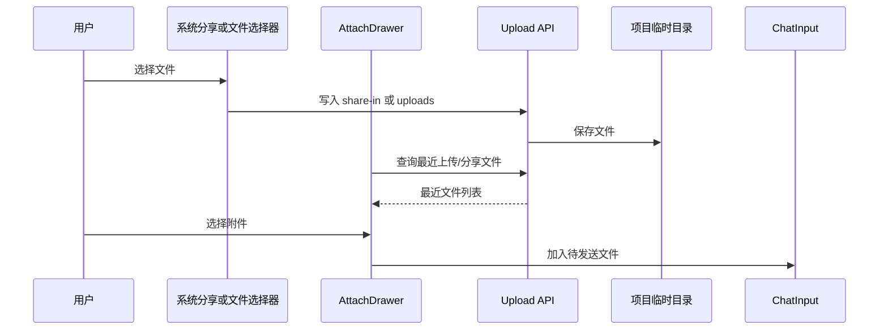

# 附件与系统分享

附件系统让用户把本地文件、项目文件和系统分享内容加入聊天。移动端文件选择容易被系统 Activity 打断，因此流程同时保存上传状态和最近记录，使用户返回应用后仍能找到刚选择的内容。

## 流程图

### 从系统文件到聊天附件

普通上传和系统 Share In 使用不同来源目录，但在附件抽屉中汇合。发送消息时只引用已落盘文件，避免把大型二进制内容直接塞入聊天请求。

## 功能与设计要点

### 功能清单

- **多文件附件**：从文件选择器上传一个或多个文件，显示文件类型、图片缩略图和上传进度。支持行范围选择（`startLine/endLine`），让 AI 聚焦于文件特定区域。移动端用户可以把截图、日志或文档直接交给 Agent
- **系统 Share In**：从其他 App 分享文件到 ClawBench，服务端保存在项目 `.clawbench/share-in` 目录，回到聊天后可从最近分享列表选择。支持删除最近分享文件（`DELETE /api/share-in/recent`），服务端确认后才从列表移除
- **PWA 分享目标（网页版也能被系统相册「分享到」）**：`manifest` 声明 `/share-target`（POST multipart），处理器把文件写进当前项目的 `.clawbench/uploads/` 并 303 回 `/?share_target=<路径数组>`，前端消费后直接放进输入框。**路由必须注册在 `middleware.Auth` 之外**、由处理器自己校验登录再重定向：`Auth` 返回的是 JSON 401，而浏览器是「导航」到这个地址的，会渲染成一页裸 JSON。该路由加入 Service Worker 的 network-only 表，且 SW 的 fetch 处理器只放行 GET——这正是保护 multipart body 的地方（WebKit 重发 multipart POST 会丢 body）。单文件仍受 `upload.max_size_mb` 限制，部分失败会把数量带回去让前端如实提示；同名文件用 `O_EXCL` 创建，避免并发分享时后者截断前者
- **移动端三个上传入口（拍照 / 照片 / 文件）**：附件抽屉头部在手机上改为正文里的整条来源栏。手机浏览器原先只有一个「上传文件」，未声明 `accept`/`capture` 时点开落到系统文档选择器而不是相册或相机。**三个入口各配一个隐藏 input**而不是共用一个再改属性——`accept`/`capture` 由系统在选择器打开时读取，Android WebView 上点击前改属性不可靠。`capture="environment"` 让相机直接打开，桌面无后置相机时降级为图片选择器。**桌面（浏览器与 Electron）仍用原来那个头部上传按钮**：鼠标背后没有相机或相册，来源栏只会占掉文件列表的竖向空间
- **上传目录 TTL 清理**：`.clawbench/uploads/` 原先从不清理，临时截图永久堆积。新增 `UploadCleanupWorker` 按项目删除已过期且**没有任何消息引用**的文件。引用来源三张表（`chat_history`、`queued_messages`、`file_shares`），且**按 `.clawbench/uploads/` 之后的名字比对而非绝对路径**——项目目录改名后 `chat_history.files` 不会重写，比绝对路径会把整个项目的附件判成无引用；`file_shares` 只按路径匹配（分享行记的是「创建分享时所在的项目」，可能不是文件所在的项目，按 `project_id` 过滤会漏掉真实引用）。**读不到引用集时整项目跳过**（宁可不清，也不能误删）。默认关闭，开启后天数默认 30（`0` 会与「永久保留」混淆，故 API 拒绝 `<1`）
- **上传历史**：`/api/upload/recent` 返回最近上传文件，文件选择器关闭或页面状态变化后仍可恢复刚才的操作。支持删除最近上传文件（`DELETE /api/upload/recent`），服务端确认后才从列表移除；两个最近列表顶部都提供**一键清空**（服务端确认后才清本地列表，失败可见）
- **来源合并**：上传历史和 Share In 最近项在统一附件体验中展示，同时保留来源以便排障和清理
- **任意文件类型**：上传不做扩展名白名单限制，实际可读性由文件预览和 AI 后端能力决定
- **文件夹上传**：支持拖放文件夹上传，保持嵌套目录结构（包括空目录），使用 webkitGetAsEntry 递归遍历。也支持通过文件夹选择器上传。目录上传有进度条和取消按钮
- **目录树下载**：使用 File System Access API 将整个目录下载到本地磁盘，保持完整目录结构。后端提供 `ServeListTree` 端点递归列出文件，前端逐文件写入目标目录
- **粘贴上传**：聊天中粘贴剪贴板图片自动上传并附加为消息附件
- **面包屑拖拽附件**：宽屏模式下，文件管理器的面包屑段（含 Home 图标）可拖拽到聊天区域，自动附加目录路径作为附件——与文件管理器拖拽使用相同的管道
- **多选拖拽附件**：文件管理器多选状态下可一次性把已选条目拖到聊天输入区，全部附加（而非只附加光标下的一个）；拖拽幽灵显示已选数量，放下后保留多选状态
- **结构化引用附件（`kind=quote`）**：引用内容（选中的文字、文件路径、议题/PR、CI 运行、聊天消息）以结构化条目承载，与本地文件、外部链接共用同一条 files 通道——因此无需新消息类型、无需 schema 迁移。五个入口生成同一张引用卡片，内容与批注一起注入 prompt；批注在发送后仍可修改（见 [聊天流程](../core/chat-flow.md) 的「引用统一为结构化附件」）。引用条目的 `Path` 是**人类可读标签**而非本地路径，因此发送时的路径校验必须跳过引用（对空 Path 做解析会 404），`titleFromFileEntries` 则优先取引用文本作会话标题
- **目标会话：评论默认进当前会话，跨会话走次级入口**：引用与「添加到会话」按**意图**分两条路，而不是按「哪个 Tab 恰好可见」分。**评论类**入口（在聊天消息、Markdown 预览、代码预览、终端、forge 对象上选区后「引用/讨论」）默认**直接投递到当前活跃会话**——用户是在批注眼前正在读的内容，99% 的场景就是它；一次点击完成，不弹任何弹窗。没有活跃会话时（尚未加载任何会话），或该次投递失败（如聊天面板尚未挂载、入队请求出错）时，才回退到选择器——那里也提供「新建会话」；卡片不会静默丢失。**显式选目标**的入口（文件管理器右键「添加到会话」、以及在浮条上**长按**引用/加入/发送按钮）仍然弹同一个选择器，跨会话引用由此保留，但不再占用主路径。选择器是紧凑的会话列表：图标 + 标题，进行中显示右侧加载指示器，当前会话置顶高亮，末尾一条「新建会话」（用默认智能体创建，不给智能体选择——用户是在为一条已写好的消息挑落点，不是在配置会话）。**两种意图用两个动作区分**，不让用户记模式：点行 = 只添加到该会话、留在当前界面；行尾 `→` 按钮 = 添加后打开该会话（切 Tab + 切换会话，且必须真正展开被折叠的聊天列——宽屏下 `switchTab('chat')` 会提前 return）。按钮悬停才显形，触屏无 hover 时常显半透明，并带 `title`/`aria-label`。**载荷必须在触发时快照**——浮条在弹窗打开前就收起了（否则会浮在弹窗之上，`--z-quote-bar` 层级更高），而实时草稿属于当前会话；等用户确认时两者都已不在，故 `PendingRequest` 里捕获引用/附件/文本。**只有"添加"方向走选择器**：移除附件必须即时——问"从哪个会话移除"是荒谬的，且用户只能移除眼前看得见的东西

### 设计要点

- **先落盘再发送引用**：聊天请求保持轻量，后端也能统一执行路径校验和大小限制
- **附件路径必须区分「绝对路径」与「相对项目根」**：附件落库时保存的是**解析后的绝对路径**，因此任何「再次发送已有附件」的路径——最近引用列表、恢复的附件草稿、排队消息——交回来的都是绝对路径。校验若一律把它拼到项目根上（`"/proj" + "/proj/sub"` → `"/proj/proj/sub"`），`os.Stat` 必然 404，客户端只看到通用的「发送失败，请重试」。正确做法是**绝对路径按已配置的根做归属校验**（不再重拼），越界仍然 403；相对路径才拼接。目录附件是最明显的触发形态，但同一缺陷影响任何被重新附加的文件
- **最近列表以目录为边界**：普通上传与系统分享分目录保存，避免来源混淆并便于生命周期管理
- **抽屉状态跨系统选择器保持**：启动原生文件选择器时不应把附件流程误判为用户关闭抽屉
- **缩略图按需生成**：只为需要预览的图片生成缩略图，不复制所有附件内容
- **项目隔离**：最近文件查询绑定当前项目，避免把一个项目的附件错误带入另一个项目
- **文件夹上传使用 webkitGetAsEntry 递归遍历**：回退到 dataTransfer.files 扁平模式，保证兼容性
- **目录树下载使用 File System Access API**：选择本地目标目录后逐文件写入，无需后端打包
- **去向按意图决定，不按可见性决定**：`requestTarget(req, { deliverTo: 'active' })` 表示「这是对眼前内容的批注」——直接投递到当前会话；不传则弹选择器，表示「我就是要挑一个目标」。两者都不再依赖聊天面板是否可见（那条旧捷径让同一手势在不同 Tab 下行为不一致，也让「从本会话引用到另一个会话」无法实现）。`requestTarget` 仍然**无返回值**——不存在"调用方自行处理"的分支，任何 `if (requestTarget(...)) return` 都会把载荷丢掉
