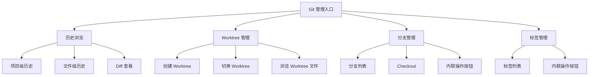
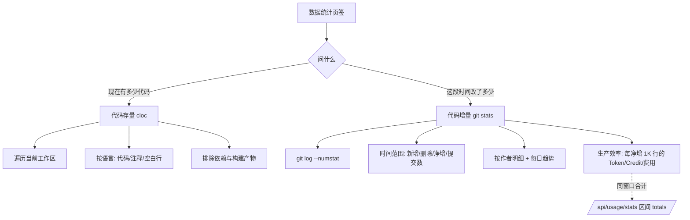
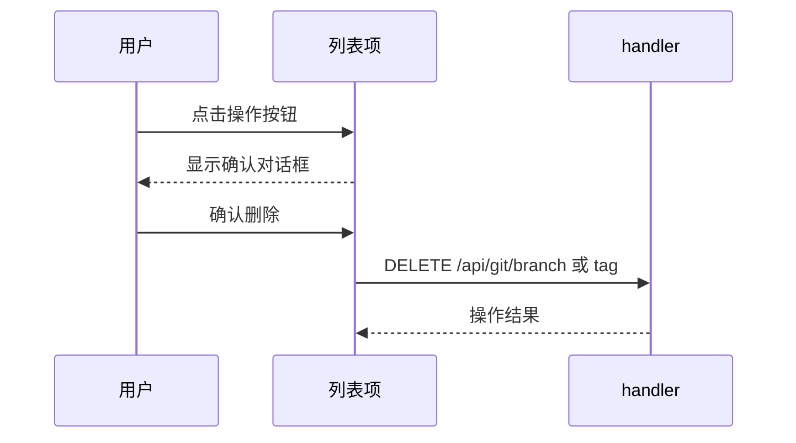
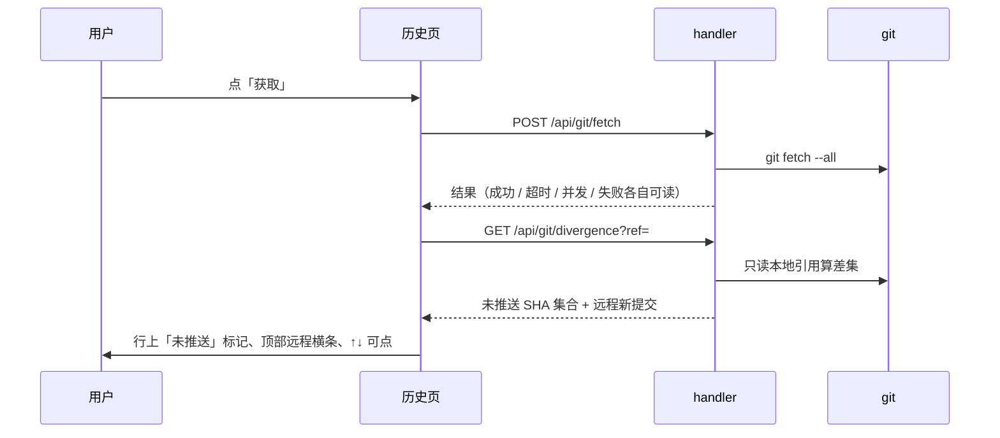

# Git 管理

Git 管理让用户在 Web 界面中浏览代码历史、管理 Worktree、操作分支和标签——不需要命令行，在手机上也能看清项目在发生什么。**它的定位是查看器，不是 Git 客户端**：暂存、提交、推送、合并一律不做，边界与理由见下文「[能力边界](#能力边界刻意不做)」。Worktree 隔离是核心亮点，让用户在不同分支间并行工作而不互相干扰。除操作类能力外，还包含**代码量统计**（数据统计页签下的代码存量/代码增量两个子页），让用户量化项目规模与变更节奏。

## 流程图

### Git 操作全景

### 代码量统计的两个视角

存量是"工作区当前快照"，增量是"已提交历史的时间窗聚合"——两者数据源与语义都不同，因此各自独立取数、互不依赖。生产效率是增量的**派生**指标：分母来自增量自身，分子来自同窗口的用量合计，故它只随增量页签的区间变化。

### 列表项操作交互

### 与远端比较：获取、领先落后与未推送标记

这是刻意拆开的两步：**获取**要联网，只把远端跟踪引用更新到最新；**比较**只读本地引用，每次现算。因此历史页可以在不碰工作区的前提下回答「远端比我这多了什么、我又有什么没推」。

## 功能与设计要点

### 功能清单

- **历史浏览**：支持项目级和文件级两种历史视图，ASCII 图形化展示 commit graph，可查看每个 commit 的详细 diff。用户快速了解项目的演进脉络。合成的工作树条目（"工作区变更"）在标题后带一个文件数徽章（`workingTreeFileCount`：项目模式 = 工作区变更文件数，文件模式 = 1，为 0 时不渲染），数量与点进去看到的文件列表同源（`wtFiles`），不另发请求。历史搜索同时匹配**提交信息**与 **commit SHA 前缀**——从聊天里复制的短 id 不必补全 40 位即可定位到提交；id 通道要求查询是 **≥4 位十六进制**（git 自身接受的最短缩写），更短的十六进制串（如 `a`、`dead`）仍只搜提交信息，避免命中几乎整段历史
- **工作区变更页**：展示当前工作区的已暂存/未暂存文件，可切回提交列表。它必须**按需重拉**（`/api/git/working-tree`）而不是纯缓存读——后台刷新会清空文件数据，若视图仍停在工作区变更且只读缓存，渲染出的就是空态（表现为"切回来列表空白，回提交列表再点一次才恢复"）。同时 `inPlace` 刷新只用 `filesRefreshing` 驱动按钮旋转、不清列表；点回 HEAD 提交时先塞缓存快照（无闪烁）再拉最新；重新加载前先快照 drill-down 状态、加载后恢复，工作区变干净（该行消失）则回退到提交列表。文件列表 header 带刷新按钮，历史提交的文件列表不可变，按钮退化为重跑文件加载
- **文件 Diff 抽屉**：`FileDiffsDrawer` 展示提交中所有文件的变更列表，支持 prev/next 顺序导航（`useDiffNavigation`），用户无需返回文件列表即可逐个浏览文件差异。合并提交的文件按分支分组展示
- **提交详情面板的文件/路径行可跳转**：提交详情元信息面板里的「文件」与「路径」两行做成文件标注——文件行打开该文件（全屏查看器），路径行在文件管理器中定位父目录并高亮该文件；两行尾部另有图标按钮，行为与点击标签一致（便于发现）。跳转**必须经宿主 emit 而非在面板内直接导航**：同一个面板既渲染在宽屏的历史页签，也渲染在移动端的文件历史底部抽屉，只有宿主知道这次跳转的来源是历史页签还是文件查看器自身的导航栈——在面板内写死来源会让移动端返回目标错乱。路径行的定位也必须走与聊天目录标注**完全相同**的来源记录流程（派发 `open-directory-from-context`，父目录为跳转目标、路径本身作为要高亮的条目），不能直接调只负责导航的文件管理器原语：后者不记录跨界面跳转来源，于是按返回只会退父目录、回不到 Git 历史——同一个「定位到文件」动作在两条入口上给出不同返回行为，正是把导航统一收敛到协调器的原因
- **Worktree 管理**：创建、切换、浏览 Git Worktree。Worktree 让用户在不同分支上并行工作，切换项目目录即可进入不同工作环境——这是移动端多任务开发的关键能力
- **分支操作**：列出所有分支、Checkout 切换、内联操作按钮删除。移动端不方便输入 `git checkout`，图形化操作降低了交互成本
- **只读查看其他分支的历史**：提交历史工具条上的分支选择器可以挂到任意本地分支看它的历史，**不切分支、不动工作区**——切到别的分支时整条历史变琥珀色并写明「工作区仍在 <当前分支>」，非当前分支时不显示「未提交的改动」，文件的打开/定位动作变灰。后端 `/api/git/project-history` 的 `ref` 参数先解析成提交号再作为 `git log` 起点（缓存按解析后的提交号区分），所以「看」与「切」是两件事。`/api/git/branches` 返回 `refView` 能力位，旧二进制下前端不显示选择器——旧服务端会**忽略** `ref`，挂着别的分支名显示当前分支历史比没有更糟
- **获取远端（只看，不动工作区）**：工具条上的「获取」按钮走 `POST /api/git/fetch`，执行 `git fetch --all`——**只更新远端跟踪引用，不移动当前分支、不改工作区里的任何文件**，所以挂着别的分支看历史时也能按。60 秒超时；同一仓库同时只允许一次获取（并发返回 409），但**不与切换分支互斥**：fetch 不碰工作区，没有理由让「看历史时顺手获取」被一次 checkout 卡住。需要真正把分支往前挪时用 pull，本能力刻意不做
- **与上游的领先 / 落后**：分支名旁显示 `↓落后 ↑领先`。没有差异、或该分支根本没有上游（detached HEAD、从未推送）时**不渲染**——显示 `↑0 ↓0` 会被读成「与远端同步」，而「没设上游」和「同步」是两件事
- **未推送标记与远程新提交**：`GET /api/git/divergence?ref=` 返回两组数据——本地有、上游没有的提交 SHA（历史列表里这些行本来就在，只需打上「未推送」标记），以及上游有、本地没有的提交（带标题 / 时间 / 作者，直接列在顶部可折叠横条里，点开照样看 diff）。明细上限 500 / 50 条，总数以工具条计数为准；明细拿不到（老服务端或请求失败）时 `↑N ↓N` 退回纯文本，**不做点了没反应的按钮**
- **合并提交筛选**：工具条上有「隐藏合并提交」开关（默认关）。合并行会展开两侧全部改动，在合并密集的仓库里把真正的改动埋掉；隐藏时提交图谱**一并隐藏**，否则图与列表互相矛盾。合并提交里「原样从某一侧带过来」的文件点开是空 diff（`git show` 对合并提交只渲染冲突解决部分），故文件 diff 改为逐个父提交对比、取第一个非空结果（与 `git show -m` 的约定一致）
- **标签管理**：列出所有标签、内联操作按钮删除。与分支管理共享交互模式
- **Commit 导航**：聊天中出现的 commit hash 自动标注为可点击链接，点击跳转到 Git 历史页面查看详情。打通了聊天与代码历史的关联
- **Worktree 路径标注**：聊天中出现的 Worktree 路径自动标注为可点击链接，提供"切换 Worktree"和"浏览文件"两个操作。让用户从对话直接跳转到工作环境
- **代码量统计（存量 + 增量）**：数据统计页签下除用量统计外的两个子页，回答"这个项目有多少代码、谁在改、改了多少"：
  - **代码存量（cloc）**：`GET /api/git/cloc` 用 gocloc 对**当前工作区**做快照式盘点——按语言统计代码/注释/空白行与文件数，附语言占比条形图与全列可排序明细表。它**不要求项目是 Git 仓库**（直接遍历目录树），且与时间范围无关。排除规则分两层取交集：① 内置的构建产物/依赖/VCS 目录名与生成文件后缀正则（`node_modules`/`vendor`/`.venv`/`dist`/`.git` 等）；② 项目自身的 `.gitignore`（含嵌套 `.gitignore` 与 `.git/info/exclude`），已跟踪文件即使命中规则也保留。非 Git 仓库时只应用第一层。与文件管理器里「被 git 忽略的条目灰显」共用同一份判定（见[文件管理](file-management.md)），两处对"git 会不会跟踪它"的理解不会分叉
  - **代码增量（git stats）**：`GET /api/git/stats?start&end&trend` 读 `git log --numstat`，按时间范围统计新增/删除/净增行数与提交数——总览卡 + 按作者明细表 + 每日趋势折线（可按作者多选过滤）。只统计**已提交**的变更，工作区/暂存区改动不计；合并提交不产生文件行因此不会双计；时间分桶与过滤用 **committer date**（提交被集成的稳定时间戳，author date 可被改写且不代表"何时进入主线"）。非 Git 仓库时明确提示无法统计
  - **生产效率（每千行消耗）**：同一页签内紧跟总览的一组派生指标——`Token / 1K 行`、`Credit / 1K 行`、`费用 / 1K 行`，回答"这段代码花了多少钱"。分子取**同一时间窗**的 `/api/usage/stats` 区间合计（`scope=project`、`dims=model&limit=1`，只要 `totals`），分母取上面的 `net`（净增行数）。两个 URL 由**同一次** `rangeToISO` 派生，避免各自 `new Date()` 造成窗口错开几毫秒。**净增 ≤ 0 时不出数**（分母为零或负，"每千行"无意义，且负数会渲染成一个巨大的负值被误读成真实数据），改为提示"净增行数为 0 或为负"；用量侧为空（全零合计）时同样不出数、单独提示"没有用量记录"——两种缺失的成因完全不同，不能合并成一句通用的"无数据"。费用低于 1 美分时显示 `<$0.01`，否则四舍五入成 `$0.00` 会被读成"免费"

### 能力边界（刻意不做）

**这个面板不会长成全功能版本管理客户端。** 明确不做：暂存（`git add`）、提交（`git commit`）、推送（`git push`）、合并（`git merge` / `rebase` / 解决冲突）。工作区变更页只回答「哪些文件改了、改成了什么样」，不提供勾选框、提交信息输入框和推送按钮。

理由有三条，按重要性排序：

1. **手动提交写不出可用的提交信息。** 界面上一个输入框能得到的典型内容是 `update`、`fix bug`、`改了点东西`——过几个月没人读得懂，而本项目的提交信息是历史搜索的一等入口（见功能清单里的「历史搜索同时匹配提交信息与 SHA 前缀」），一条读不懂的 message 等于把这段历史从搜索里删掉。
2. **手动合并的失败方式都发生在点完之后。** 冲突解到一半退出、合完忘了跑验证、顺手把不该带的改动一起合进去——这些在终端里都真实发生过，图形化点两下反而让人低估风险，因为按钮看起来比命令无害。
3. **提交与分支的编排是 AI 的强项。** 它读过改动本身，能写清「改了什么、为什么改」，也知道这次该新开分支还是直接落在当前分支。方向是把「AI 协助提交代码、处理分支」这条路打磨好，而不是在面板里再做一个终端。

因此允许的写操作只有下面这些，共同点是**都不产生提交、不写历史**：

| 操作 | 端点 | 为什么不算越界 |
|---|---|---|
| 切分支 / 标签 | `POST /api/git/checkout` | 移动 HEAD，未提交改动会被 stash 且失败时还原；不产生新提交 |
| 获取远端 | `POST /api/git/fetch` | 只更新远端跟踪引用，工作区一个字节都不动 |
| 删除分支 / 标签 / Worktree | `DELETE /api/git/branch`、`/api/git/tags`、`/api/git/worktrees` | 资源管理，删的是引用或目录，不进入历史 |

**「看」的能力可以继续加，但必须仍是只读**：谁在哪次提交改了某段代码（blame 类）、两个分支之间的差异、某个提交被哪些分支包含。这类需求不受本节限制。

> 背景：issue #673「希望 Git 面板能直接提交和推送」按此边界关闭（not planned）。

### 设计要点

- **获取用 fetch 而不是 pull**：历史页是「看远端有什么」的地方，把分支和工作区往前挪是一次会改文件的显式操作，应该由用户在别处主动做。fetch 之后领先/落后立刻是准的，而磁盘上什么都没变
- **对比单独开端点，不塞进项目历史响应**：项目历史按 `(path, skip, HEAD sha)` 缓存，而 fetch 只移动远端跟踪引用、HEAD 不变——塞进去的话缓存永远不会失效，数字会停在获取之前。对比每次现算，只读本地引用，成本可以忽略
- **获取与切换分支用两把锁**：fetch 只写远端跟踪引用，与 checkout 的工作区操作没有共享资源。共用一把锁的结果是慢网络下无法切分支、切分支时无法获取，两个互不相干的操作互相拖累
- **内联操作按钮替代滑动删除**：分支和标签列表项的操作按钮内联显示（空间允许时），空间不足时折叠到 More 菜单。删除操作需确认对话框，防止误操作。替代了之前容易误触的滑动手势删除
- **Worktree 标注先于文件路径标注**：Worktree 标注逻辑先于文件路径标注执行，已标注的 Worktree 路径不再被文件路径标注二次匹配——避免 Worktree 路径被错误识别为普通文件路径
- **Commit hash 匹配严格且缓存**：匹配规则精确避免误匹配，且缓存已查询的 hash 信息避免重复请求——聊天中可能出现大量 commit hash，每次都请求后端会严重影响性能
- **参数注入防护**：Git 操作的分支名、commit hash 等参数直接传递给命令而非通过 shell 拼接，从根本上避免命令注入风险
- **存量与增量是两个正交的问题**："工作区现在有多少代码"（cloc，快照、不依赖 git）与"这段时间改了多少代码"（git stats，历史、依赖 git）回答不同问题，因此拆成两个独立子页而非塞进同一张图——用户不会困惑"为什么我改了代码但存量没变"（未提交）或"为什么删除文件后增量还是正的"
- **统计用 committer date 而非 author date**：author date 可被 rebase/cherry-pick 改写，不能反映变更真正进入主线的时间；committer date 是提交记录的稳定时间戳，更符合"这段时间合入了多少"的语义
- **cloc 必须排除依赖与构建产物**：gocloc 默认会遍历整个目录树，若不过滤 `node_modules`/`vendor`/`.venv`/模型目录等，一个中小项目也能扫出几十万行第三方代码，让"项目规模"失真
- **"刷新数据"与"切换视图"是两个正交的状态**：工作区变更页变空的根因是刷新流程清空数据但从不改变当前视图，而该视图又只读缓存——于是数据没了、视图还在、渲染出空态。修法不是给缓存打补丁，而是让视图能按需重拉自己的数据，并让"原地刷新"只驱动进度指示、不动列表内容
- **两个宿主必须共享逻辑而非各写一份**：同一个历史视图同时存在于停靠页与抽屉（窄屏/宽屏），两处各写一份的结果是修复只落在一条路径上（工作区变更页的 bug 就是这样漏的）。收敛到共享 composable 后，宿主差异（读哪个 props、用哪个 fetch 形态、有无分页）以注入保留，而不是靠复制代码承担
- **diff 算不完必须报「全变了」，绝不报「没变」**：jsdiff 的 `timeout` 按墙钟中止并返回 `undefined`，而三处调用都写成 `diffX(...) ?? []`——中止与「完全没变化」在下游长得一模一样，于是一个被修改的大文件会渲染成完全相同，用户看到「无改动」而文件其实变了。3ms/1ms 的预算甚至低于一次 GC 停顿，这不是理论问题（大文件用例在负载下偶发失败正是它）。现在不传 `timeout`；jsdiff 真的给不出结果时按「整段替换」报告。**空变更列表在这条链上只能表示「确实相同」**
- **cloc 的 .gitignore 过滤放在扫描之后，而不是改成传文件列表**：gocloc 的 VCS 判断是对路径做**子串**匹配（`.github` 含 `.git`），走目录时会丢掉已跟踪的 `.github/` 树、传显式文件列表时却会保留。改成传列表会顺带改变这一无关行为（实测本仓多出 9 个 `.github/` 文件、YAML 多 1274 行）。因此保持"gocloc 走目录 + 事后按文件过滤再聚合"，结果恰好等于"gocloc 数到的 − git 不跟踪的"
