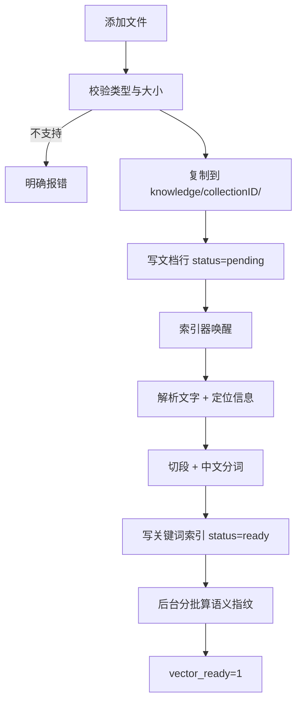
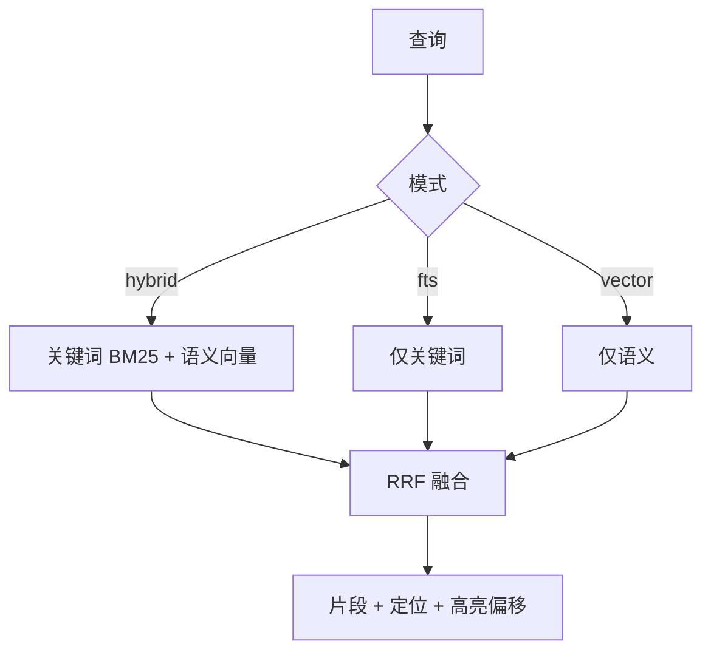

# 知识库

知识库把「文件」变成「可检索的知识」：可以建多个知识库，每个库归全局或某个项目；文件复制进数据目录后，后台解析文字、切段、建关键词索引与语义索引；面板里能搜，聊天时也能自动带上相关片段。

它与会话搜索（RAG）是**两套独立的索引**：会话搜索回答「以前聊过什么」，知识库回答「资料里怎么写的」。两者共用切段器、中文分词和嵌入客户端，但表、索引器、检索入口完全分开——聊天搜索的结果里永远不会混进知识库内容。

## 流程图

### 添加与索引

### 检索

## 功能与设计要点

### 多库与两级归属

- `kb_collections.scope` 为 `global` 或 `project`。全局库 `project_id=0`，任何项目可见；项目库只在该项目可见。
- 列表与检索的隐式范围是「全局 + 当前项目」，**不会跨项目**。
- 归属创建后不可修改：改归属意味着整库文件在别的项目里突然可见或消失，风险大于收益。
- 删项目时，该项目的知识库、文件、索引与磁盘副本一起删除（`service.DeleteProjectData` 调 `kb.DeleteProjectData`）。

### 添加文件的入口

- 面板的「添加文件」**复用聊天输入框的附件选择器**（`components/attach/AttachmentPicker.vue`，`variant="kb"` + `selection-only`）：浏览项目文件、上传本机文件（带进度与中止）、从「最近上传」里挑，三个入口与聊天完全一致。
- 与聊天版的差别只有四处，都由 props 表达：没有「最近分享」页签（那是聊天历史）；手机端不提供拍照/相册（知识库只收文本类文件，拍了也只会被拒）；不能选文件夹；确认后由面板自己逐个提交，而不是把路径写进输入框——提交失败时选择器保持打开，用户可去掉被拒的那个再试。
- 一次确认可以提交多个文件：接口仍是单文件（`POST /api/kb/documents`），面板按顺序逐个添加，单个失败不影响其余。

### 文件复制与去重

- 文件复制到 `{DataDir}/knowledge/<collection id>/<时间戳>_<原文件名>`，原始路径只作展示。原文件移动或删除不影响知识库。
- 同一知识库内按 SHA-256 内容指纹去重，重复添加返回 409；不同知识库允许各存一份。
- 单文件上限 `kb.max_file_mb`（默认 50MB）；解析出的文字上限 `kb.max_text_mb`（默认 20MB），超出会截断并在文档 `warning` 里标注，不静默丢弃。
- 删除文档时副本、片段、FTS 行与向量行一起删除；删除知识库时整个目录 `RemoveAll`。

### 支持的文件类型

- 文本类：txt / md / 代码 / json / csv / html / yaml / 日志等。按内容判断二进制（NUL 字节），不只看扩展名；编码依次尝试 UTF-8（含 BOM）、UTF-16（BOM）、GB18030，最后用替换字符兜底。
- PDF：逐页提取文字。扫描件（图片型 PDF）没有可提取文字，返回「可能是扫描件」而不是假装成功。
- Word / Excel / PPT：只支持 `.docx` / `.xlsx` / `.pptx`（OOXML，本质是 zip + XML，用标准库解析）。旧版 `.doc` / `.xls` / `.ppt` 是二进制格式，明确拒绝并提示另存为新格式。
- 图片、音视频、压缩包、可执行文件、字体：明确拒绝并说明原因。**不做 OCR、不做音视频转写**。
- 每个 XML 部件有 64MB 解压上限，防止 zip bomb。

### 定位信息

每个片段携带 `location`，但存的是**语言中立**的短标签，由面板按界面语言格式化：

| 来源 | 标签 |
|---|---|
| PDF | `p.12` |
| PPT | `slide 3` |
| Excel | `sheet 报价 · rows 1-50` |
| 文本 | `L1-L80` |
| Word | `¶1-¶6` |

切段不跨块合并，所以定位始终指向片段真正开始的位置。

### 索引与降级

- 添加立即返回，状态 `pending`；后台索引器解析（`extracting`）→ 写关键词索引（`ready`）→ 分批嵌入。`vector_ready` 单独表示语义索引是否完成，因此「可搜（仅关键词）」是一个真实可见的中间态。
- 嵌入服务不可用：关键词检索始终可用；索引器失败后退避 30 秒重试，服务恢复后自动补算。
- 换嵌入模型：`kb_vec` 的宽度变化会触发自动重建向量层（丢弃旧向量、标记全部未嵌入、按新维度重建），关键词索引不受影响。
- 重建粒度：单文件重建、按库重建、仅重建语义索引（`POST /api/kb/reindex` 的 `kind: "vector"`）。
- 崩溃恢复：启动时把停留在 `extracting` 的文档重置为 `pending`。
- **分词器不能依赖 RAG 的初始化顺序**：`kb.Init` 在 `rag.SegmenterAvailable()` 为 false 时自行初始化 gse。否则一旦 RAG 初始化失败，中文会被 FTS5 的 `unicode61` 整句当成一个 token，任何短查询都搜不到。

### 检索

- 默认混合检索：关键词 BM25 与语义向量各自取候选，用 RRF（k=60）融合。语义服务不可用或 `kb_vec` 为空时自动退化为关键词检索，不报错。
- 集合过滤下推到 vec0 的 `collection_id IN (...)`（sqlite-vec 支持元数据 `IN`），避免先取全局 top-k 再过滤导致漏召回。
- 结果带 `match_positions`（片段内字符偏移），与聊天搜索共用 `rag.TextMatchPositions` 的高亮语义。
- `vector_score` / `fts_score` 保留各通道原始分，便于调用方对「仅语义命中」施加相似度门槛。

### 聊天自动带片段

- 总开关 `kb.auto_inject`（默认开）+ 每个库的 `auto_inject` 开关。
- 时机：每次用户发消息，用这句话检索「当前项目库 + 全局库」。
- 预算：`inject_top_n`（默认 4 段）、`inject_max_chars`（默认 2000 字）、同一文件最多 2 段、纯语义命中低于 `inject_min_similarity`（默认 0.35）不带。
- 时限：1.5 秒。超时、嵌入服务不可用或没有命中都返回空，**绝不阻塞聊天**。
- 注入位置是**本轮 prompt**，不是系统提示词：续聊时系统提示词不一定重发，放那里只有第一句生效。prompt 是瞬态的，不会进入用户气泡或历史。
- 斜杠命令豁免（前缀会破坏 ACP 的命令识别）。自动续轮、`/compact`、群成员压缩等内部回合默认不注入。
- 群聊：每轮用户消息只给**第一个非主持人发言的成员**带一次（`sync.Once`，并行组安全）；主持人的回合只做路由，不浪费片段。
- 定时任务：在用户消息落库**之后**才把片段拼到发给模型的 prompt 上，转录里保留任务原文。
- 引用可追溯：拼进 prompt 的片段同时写进该条助手消息的 `metadata.kbRefs`，气泡下方显示「参考了知识库 · N 段」；点开是文档标题、库名、语言中立定位与原文片段。数据随消息持久化，刷新、切会话后都还在。**分享链接会剥掉 `kbRefs`**——匿名读者没有知识库权限，片段与标记都不随快照外泄。

### 为什么单独建表

聊天索引的 `rag_chunks` 有聊天专属的列与不变量（`message_id`、`session_id`、按消息的 chunk 唯一性），会话搜索的 SQL 也围绕会话/项目/角色过滤。把文档塞进同一张表会让每条聊天检索都多一个「不是知识库行」的谓词、每个聊天索引批次都要跳过文档行，且文档的定位信息与文档标题无处安放。分开后两边都能保持各自最简单的形状，只共享真正通用的零件。

## 关键表

| 表 | 说明 |
|---|---|
| `kb_collections` | 知识库：名称、说明、`scope`、`project_id`、`auto_inject` |
| `kb_documents` | 文件：所属库、标题、原路径、副本路径、扩展名、大小、内容指纹、状态、错误/警告、片段数、`fts_ready` / `vector_ready` |
| `kb_chunks` | 片段：文档、库、项目（冗余用于检索过滤）、序号、原文、分词文本、定位、token 数、向量 BLOB、是否已嵌入 |
| `kb_chunks_fts` | FTS5 external-content 表（`content='kb_chunks'`，`unicode61`） |
| `kb_vec` | sqlite-vec vec0 表（惰性创建，宽度由嵌入维度决定；元数据列 `collection_id` / `project_id`） |

FTS 删除必须用 `INSERT INTO kb_chunks_fts(kb_chunks_fts, rowid, chunk_text_segmented) SELECT 'delete', ...` 带上**旧值**；直接 `DELETE` 或先改内容表再更新 FTS 会损坏外部内容索引。

## 接口

| 方法 | 路径 | 说明 |
|---|---|---|
| GET | `/api/kb/collections` | 全局 + 当前项目的库列表 |
| POST | `/api/kb/collections` | 新建（`scope` 决定归属） |
| PATCH | `/api/kb/collections?id=` | 改名/说明/是否参与自动检索 |
| DELETE | `/api/kb/collections?id=` | 删库（含文件与副本） |
| GET | `/api/kb/documents?collection_id=` | 文件列表 |
| GET | `/api/kb/documents?id=` | 文件详情 + 前 20 个片段 |
| POST | `/api/kb/documents` | 添加服务器上的文件 |
| POST | `/api/kb/documents/upload` | 上传文件（multipart） |
| DELETE | `/api/kb/documents?id=` | 删除文件 |
| POST | `/api/kb/documents/reindex?id=` | 重建单文件 |
| POST | `/api/kb/search` | 混合/关键词/语义搜索 |
| POST | `/api/kb/reindex` | 按库重建 / 仅重建语义层 |
| GET | `/api/kb/status` | 库数、文件数、片段数、已嵌入数、磁盘占用 |

## 配置

见 `docs/user-guide/configuration.md` 的「知识库 `kb`」一节。嵌入地址与模型复用 `rag.base_url` / `rag.model` / `rag.api_key`；切段大小复用 `rag.chunk_size` / `rag.chunk_overlap`。
