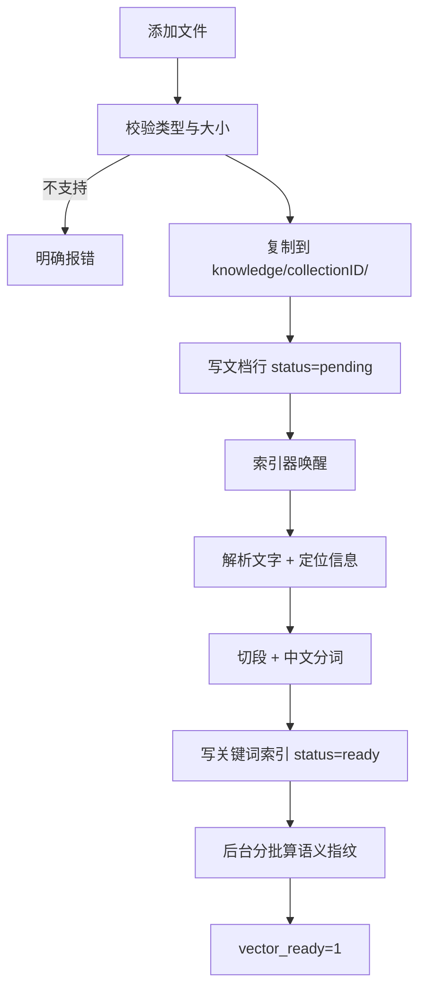
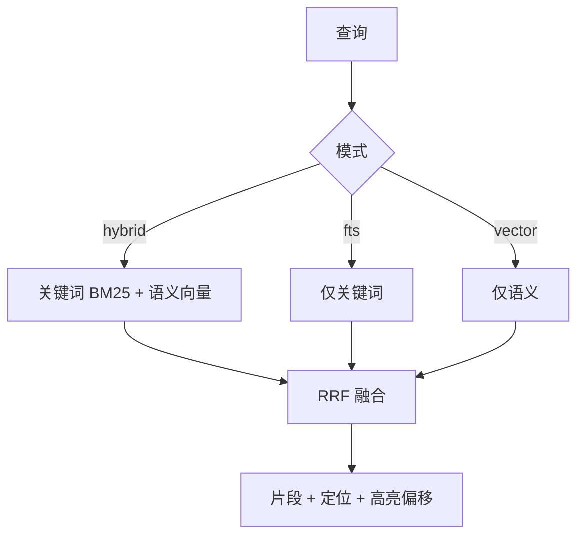

# 知识库

知识库把「文件」变成「可检索的知识」：可以建多个知识库，每个库归全局或某个项目；文件复制进数据目录后，后台解析文字、切段、建关键词索引与语义索引；面板里能搜，聊天时也能自动带上相关片段。

它与会话搜索（RAG）是**两套独立的索引**：会话搜索回答「以前聊过什么」，知识库回答「资料里怎么写的」。两者共用切段器、中文分词和嵌入客户端，但表、索引器、检索入口完全分开——聊天搜索的结果里永远不会混进知识库内容。

## 流程图

### 添加与索引

### 检索

## 功能与设计要点

### 多库与两级归属

- `kb_collections.scope` 为 `global` 或 `project`。全局库 `project_id=0`，任何项目可见；项目库只在该项目可见。
- 列表与检索的隐式范围是「全局 + 当前项目」，**不会跨项目**。
- 归属创建后不可修改：改归属意味着整库文件在别的项目里突然可见或消失，风险大于收益。
- 删项目时，该项目的知识库、文件、索引与磁盘副本一起删除（`service.DeleteProjectData` 调 `kb.DeleteProjectData`）。

### 面板与交互

- **搜索是面板级的**，不在某个库里面：搜索框常驻在库列表上方，没选库时默认搜「全部」，选中库后默认「当前库」。手机上不点进任何库也能直接搜。
- **输入即搜走关键词，回车走所选模式**（默认混合）：逐字触发嵌入请求太贵，而关键词足够即时。
- 搜索结果显示服务端实际使用的模式（混合 / 关键词 / 语义），**结果条数是「前 N 条」而不是命中总数**。
- 点结果或文件行打开**文件详情抽屉**：解析出的片段、页码/行号、原文件路径、失败原因；命中片段会高亮。抽屉里可单文件重建或删除。
- 库列表每个库带健康徽章（失败 / 处理中），详情页标题下有一行健康信息；点徽章即筛出对应文件。
- 库名与说明可改，**归属仍不可改**。
- **切项目会重新加载**：面板被 `TabPanel` 以 `v-show` 保活，不重载会继续显示上一个项目的库，并在添加文件时拿到旧库 id 而 403。
- 语义索引不可用（未配置嵌入）或尚未嵌完时，搜索框下方明确说明「当前仅关键词检索」，不把关键词结果标成混合。
- 索引失败的原因以稳定原因码开头存储（`FileError.Error()` 形如 `pdf_no_text: ...`），面板按码出人话，未知原因回落原文。
- **多选模式**：进入后行点击改为勾选，工具栏换成全选 / 移动 / 重建 / 删除 / 取消；批量删除只弹一次确认。
- **跨库移动**：移动磁盘副本并把文档重新排队（片段里带旧库/项目元数据，不能原地保留）；目标库已有相同内容返回 409。
- **库列表**：按名字筛选、按「最近添加 / 名称」排序；`kb_collections.pinned` 支持置顶（同分组内排最前）。
- **原文件状态**：列表与详情在读取时 stat 原文件，给出 `source_stale`（原文件比副本新）与 `source_missing`（原文件不在了）。这两个字段是派生的，不落库。
- **标签**：`kb_documents.tags` 是逗号分隔的自由文本，详情里编辑、列表显示并可筛选；只改标签，不触发重建索引。
- **引用统计**：注入知识库片段时按「文档 × 会话」写一行 `kb_document_usage`（同一轮去重），详情显示被引用次数与最近时间。只统计自动检索带进对话的，不统计手动搜索。
- **删除撤销**：删文件后的提示可点击，从 `source_path` 重新加入。恢复的是原文件的当前内容，不是删除时的副本；原文件不在则明确失败。
- **筛选与排序**：状态（失败 / 处理中 / 仅关键词）、类型（PDF / Word / Excel / PPT / 文本）、排序（最近添加 / 名称）。超过 100 个文件先渲染一页，「显示更多」增量加载，避免 500 行同时进 DOM。
- **轮询只取变化字段**：`/api/kb/documents/progress` 返回状态、错误、片段数等，前端按 id 原地合并，只有状态变了的行重新渲染。
- **索引完成反馈**：离开面板后仍会轮询全局索引队列，整批完成时给一条 toast（有失败则报失败数），不会每个文件弹一次。
- **用原文件更新**：抽屉里重新读取 `source_path`，按内容指纹比对；没变就只提示「没有变化」，变了才替换副本并重建。原文件不在了返回 409，副本仍可用。
- **导入前预览**：选文件夹后先 `dry_run` 遍历，给出「将加入 / 跳过 / 重复 / 失败」的数量，确认后才真正复制。
- **文件管理器右键「加入知识库」**：复用知识库自己的目标选择器（`KBCollectionPickerDialog`，可选现有库或就地新建），文件按路径添加、文件夹走导入（同样先预览）。入口受 `kb.enabled` 门控。动作本身是无状态的共享函数（`kbAddByPath` / `kbImportDirectory` / `kbPreviewDirectory`），面板与面板外的入口共用，不复制一份。
- **面板内拖放**：接受文件管理器的内部附件拖拽载荷（`utils/attachDrag`），落到当前选中的库；没选库时提示先选。
- **粘贴文本 / 从链接添加**：文本走 multipart 上传；链接由服务端抓取（http/https、20 秒超时、20MB 上限、非 2xx 视为抓取失败），正文按 HTML 解析。链接不作为「原文件」记录，因此不适用「用原文件更新」。
- **片段引用到聊天**：详情抽屉每段的「引用到聊天」把「文档名 · 位置 + 原文」作为一段引用（`sourceKind: 'selection'`）放进聊天输入框；面板通过 `kbPendingQuote` 把请求交给 App，由 App 切到聊天并落卡片。
- **会议纪要存为知识**：会议记录「纪要」页的「存为知识」把纪要文本作为 Markdown 上传到指定库，走同一条上传路径。

### 添加文件的入口

- 面板的「添加文件」**复用聊天输入框的附件选择器**（`components/attach/AttachmentPicker.vue`，`variant="kb"` + `selection-only`）：浏览项目文件、上传本机文件（带进度与中止）、从「最近上传」里挑，三个入口与聊天完全一致。
- 与聊天版的差别只有三处，都由 props 表达：没有「最近分享」页签（那是聊天历史）；手机端不提供拍照/相册（知识库只收文本类文件，拍了也只会被拒）；确认后由面板自己提交，而不是把路径写进输入框——文件提交失败时选择器保持打开，用户可去掉被拒的那个再试。
- 一次确认可以提交多个文件：接口仍是单文件（`POST /api/kb/documents`），面板按顺序逐个添加，单个失败不影响其余。
- **选文件夹 = 把整棵子树收进知识库**（`POST /api/kb/documents/import`）：服务端递归遍历，逐个加入受支持的文件；隐藏文件/目录、依赖与构建目录（`.git`、`node_modules`、`dist` 等）、符号链接一律跳过，不支持的类型与超大文件计入 `skipped`。单次最多 500 个文件（超出标记 `truncated`），单个文件失败不影响其余。文件夹导入无论成败都会关闭选择器（重试同一目录只会重复添加），结果用一条汇总提示说明新增/跳过/重复/失败的数量。

### 文件复制与去重

- 文件复制到 `{DataDir}/knowledge/<collection id>/<时间戳>_<原文件名>`，原始路径只作展示。原文件移动或删除不影响知识库。
- 同一知识库内按 SHA-256 内容指纹去重，重复添加返回 409；不同知识库允许各存一份。
- 单文件上限 `kb.max_file_mb`（默认 50MB）；解析出的文字上限 `kb.max_text_mb`（默认 20MB），超出会截断并在文档 `warning` 里标注，不静默丢弃。
- 删除文档时副本、片段、FTS 行与向量行一起删除；删除知识库时整个目录 `RemoveAll`。

### 支持的文件类型

- 文本类：txt / md / 代码 / json / csv / html / yaml / 日志等。按内容判断二进制（NUL 字节），不只看扩展名；编码依次尝试 UTF-8（含 BOM）、UTF-16（BOM）、GB18030，最后用替换字符兜底。
- PDF：逐页提取文字。扫描件（图片型 PDF）没有可提取文字，返回「可能是扫描件」而不是假装成功。
- Word / Excel / PPT：只支持 `.docx` / `.xlsx` / `.pptx`（OOXML，本质是 zip + XML，用标准库解析）。旧版 `.doc` / `.xls` / `.ppt` 是二进制格式，明确拒绝并提示另存为新格式。
- 图片、音视频、压缩包、可执行文件、字体：明确拒绝并说明原因。**不做 OCR、不做音视频转写**。
- 每个 XML 部件有 64MB 解压上限，防止 zip bomb。

### 定位信息

每个片段携带 `location`，但存的是**语言中立**的短标签，由面板按界面语言格式化：

| 来源 | 标签 |
|---|---|
| PDF | `p.12` |
| PPT | `slide 3` |
| Excel | `sheet 报价 · rows 1-50` |
| 文本 | `L1-L80` |
| Word | `¶1-¶6` |

切段不跨块合并，所以定位始终指向片段真正开始的位置。

### 索引与降级

- 添加立即返回，状态 `pending`；后台索引器解析（`extracting`）→ 写关键词索引（`ready`）→ 分批嵌入。`vector_ready` 单独表示语义索引是否完成，因此「可搜（仅关键词）」是一个真实可见的中间态。
- 嵌入服务不可用：关键词检索始终可用；索引器失败后退避 30 秒重试，服务恢复后自动补算。
- 换嵌入模型：`kb_vec` 的宽度变化会触发自动重建向量层（丢弃旧向量、标记全部未嵌入、按新维度重建），关键词索引不受影响。
- 重建粒度：单文件重建、按库重建、仅重建语义索引（`POST /api/kb/reindex` 的 `kind: "vector"`）。
- 崩溃恢复：启动时把停留在 `extracting` 的文档重置为 `pending`。
- **分词器不能依赖 RAG 的初始化顺序**：`kb.Init` 在 `rag.SegmenterAvailable()` 为 false 时自行初始化 gse。否则一旦 RAG 初始化失败，中文会被 FTS5 的 `unicode61` 整句当成一个 token，任何短查询都搜不到。

### 检索

- 默认混合检索：关键词 BM25 与语义向量各自取候选，用 RRF（k=60）融合。语义服务不可用或 `kb_vec` 为空时自动退化为关键词检索，不报错。
- 集合过滤下推到 vec0 的 `collection_id IN (...)`（sqlite-vec 支持元数据 `IN`），避免先取全局 top-k 再过滤导致漏召回。
- 结果带 `match_positions`（片段内字符偏移），与聊天搜索共用 `rag.TextMatchPositions` 的高亮语义。
- `vector_score` / `fts_score` 保留各通道原始分，便于调用方对「仅语义命中」施加相似度门槛。
- 面板里**逐字输入走关键词**（便宜且即时），**回车走所选模式**（默认混合）。响应里的 `mode` 是实际使用的模式，界面照实显示；`total` 是本次返回条数（默认上限 10），所以文案写「前 N 条」而不是「命中 N 条」。

### 聊天自动带片段

- 总开关 `kb.auto_inject`（默认关，opt-in）+ 每个库的 `auto_inject` 开关。
- 时机：每次用户发消息，用这句话检索「当前项目库 + 全局库」。
- 预算：`inject_top_n`（默认 4 段）、`inject_max_chars`（默认 2000 字）、同一文件最多 2 段、纯语义命中低于 `inject_min_similarity`（默认 0.35）不带。
- 时限：1.5 秒。超时、嵌入服务不可用或没有命中都返回空，**绝不阻塞聊天**。
- 注入位置是**本轮 prompt**，不是系统提示词：续聊时系统提示词不一定重发，放那里只有第一句生效。prompt 是瞬态的，不会进入用户气泡或历史。
- 斜杠命令豁免（前缀会破坏 ACP 的命令识别）。自动续轮、`/compact`、群成员压缩等内部回合默认不注入。
- 群聊：每轮用户消息只给**第一个非主持人发言的成员**带一次（`sync.Once`，并行组安全）；主持人的回合只做路由，不浪费片段。
- 定时任务：在用户消息落库**之后**才把片段拼到发给模型的 prompt 上，转录里保留任务原文。
- **从聊天沉淀**：助手回复的「存为知识」按钮把这条回复（`quotableMessageText`，去掉工具/思考噪声）作为一篇 Markdown 上传到指定知识库，走的是普通上传路径，因此大小限制、去重、解析、索引全部一致。入口受 `kb.enabled` 门控，只出现在已定稿的助手消息上。
- 引用可追溯：拼进 prompt 的片段同时写进该条助手消息的 `metadata.kbRefs`（含 `chunkId`、文档标题、库名、语言中立定位与原文片段），气泡下方显示「参考了知识库 · N 段」；点开是片段内容，并可**跳到知识库打开该文档**（新消息定位到命中片段；早于 `chunkId` 的历史消息打开文档开头）。数据随消息持久化，刷新、切会话后都还在。**分享链接会剥掉 `kbRefs`**——匿名读者没有知识库权限，片段与标记都不随快照外泄。

### 为什么单独建表

聊天索引的 `rag_chunks` 有聊天专属的列与不变量（`message_id`、`session_id`、按消息的 chunk 唯一性），会话搜索的 SQL 也围绕会话/项目/角色过滤。把文档塞进同一张表会让每条聊天检索都多一个「不是知识库行」的谓词、每个聊天索引批次都要跳过文档行，且文档的定位信息与文档标题无处安放。分开后两边都能保持各自最简单的形状，只共享真正通用的零件。

## 关键表

| 表 | 说明 |
|---|---|
| `kb_collections` | 知识库：名称、说明、`scope`、`project_id`、`auto_inject` |
| `kb_documents` | 文件：所属库、标题、原路径、副本路径、扩展名、大小、内容指纹、状态、错误/警告、片段数、`fts_ready` / `vector_ready` |
| `kb_chunks` | 片段：文档、库、项目（冗余用于检索过滤）、序号、原文、分词文本、定位、token 数、向量 BLOB、是否已嵌入 |
| `kb_chunks_fts` | FTS5 external-content 表（`content='kb_chunks'`，`unicode61`） |
| `kb_vec` | sqlite-vec vec0 表（惰性创建，宽度由嵌入维度决定；元数据列 `collection_id` / `project_id`） |

FTS 删除必须用 `INSERT INTO kb_chunks_fts(kb_chunks_fts, rowid, chunk_text_segmented) SELECT 'delete', ...` 带上**旧值**；直接 `DELETE` 或先改内容表再更新 FTS 会损坏外部内容索引。

## 接口

| 方法 | 路径 | 说明 |
|---|---|---|
| GET | `/api/kb/collections` | 全局 + 当前项目的库列表（含 `failed_count` / `pending_count`） |
| POST | `/api/kb/collections` | 新建（`scope` 决定归属） |
| PATCH | `/api/kb/collections?id=` | 改名/说明/是否参与自动检索 |
| DELETE | `/api/kb/collections?id=` | 删库（含文件与副本） |
| GET | `/api/kb/documents?collection_id=` | 文件列表 |
| GET | `/api/kb/documents?id=` | 文件详情 + 前 20 个片段 |
| GET | `/api/kb/documents?id=&chunk_id=` | 文件详情 + 该片段前后各 5 段（`focus_chunk_id` 回传目标；片段已不存在则回落前 20 段） |
| POST | `/api/kb/documents` | 添加服务器上的文件 |
| POST | `/api/kb/documents/upload` | 上传文件（multipart） |
| POST | `/api/kb/documents/import` | 导入文件夹；`dry_run: true` 只预览不写入 |
| POST | `/api/kb/documents/url` | 抓取网页并入库（http/https，最多 20MB） |
| POST | `/api/kb/documents/move` | 移动到另一个知识库（重新排队建索引；目标库已有相同内容返回 409） |
| PATCH | `/api/kb/documents?id=` | 修改标签（`tags` 逗号分隔） |
| GET | `/api/kb/documents/usage?collection_id=` | 文件被聊天引用的次数与最近时间 |
| DELETE | `/api/kb/documents?id=` | 删除文件 |
| POST | `/api/kb/documents/reindex?id=` | 重建单文件 |
| POST | `/api/kb/documents/refresh?id=` | 用原文件更新（内容没变返回 `changed:false`；原文件不在返回 409） |
| GET | `/api/kb/documents/progress?collection_id=` | 轮询状态（只返回会变化的字段） |
| POST | `/api/kb/search` | 混合/关键词/语义搜索；语义这一路没跑成时 `vector_degraded=true`，`mode` 回落 `fts`，`vector_error` 说明原因 |
| POST | `/api/kb/reindex` | 按库重建 / 仅重建语义层；无可见库时 `200` + `queued:false`（`detail:"no_collections"`），不会退化成重建全部 |
| GET | `/api/kb/status` | 库数、文件数、片段数、已嵌入数、磁盘占用；`?scope=project` 只统计全局 + 当前项目的库 |

## 配置

见 `docs/user-guide/configuration.md` 的「知识库 `kb`」一节。嵌入地址与模型复用 `rag.base_url` / `rag.model` / `rag.api_key`；切段大小复用 `rag.chunk_size` / `rag.chunk_overlap`。
