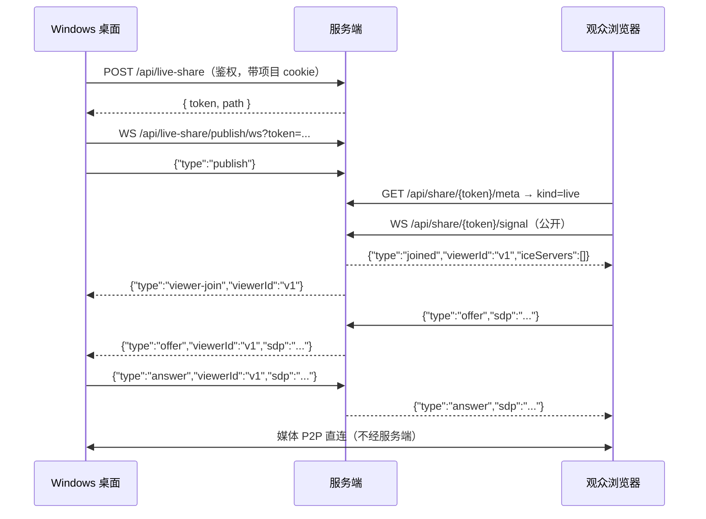

# 屏幕与声音共享（实时）

Windows 桌面客户端可以把**屏幕画面 + 系统声音 + 麦克风**共享出去，生成一个链接；任何拿到链接的人在浏览器里打开就能看画面、听声音，**无需登录**。多个观众之间还能互相说话（经发布端混音）。

这是「看着 AI 干活」的直播，不是投屏工具：链接的模型与文件/会话分享一致——**token 即凭证**。

## 流程图

### 建立连接



**服务端只转发 SDP / ICE，从不解析、从不承载媒体。** 每个观众与发布端之间是独立的 `RTCPeerConnection`，观众发 offer、发布端答 answer。

## 功能与设计要点

### 功能清单

- **纯 P2P WebRTC**：媒体点对点直传。观众上限 **8**，受发布端上行带宽约束（每个观众一条独立编码流）
- **分享链接**：复用现有 `/share/{token}` SPA，`kind: 'live'`。token 32 位 hex，与文件/会话分享同级。**链接按本机全部地址生成**（见下）
- **系统声音**：Windows 上通过 `audio: 'loopback'` 采集。**macOS / Linux 不支持**——这是 Electron 的限制，非实现取舍；非 Windows 平台 UI 不提供该开关
- **麦克风**：与系统声音在 `AudioContext` 里混音后发送。麦克风被拒绝不影响共享（画面仍可发）
- **多人语音**：观众打开自己的麦克风开关即可发言，**其他观众也能听到**（见下）
- **发言授权**：房间级开关默认**关闭**；开启后观众自行开关麦克风；发布端可单人静音与「全部静音」
- **零新增依赖、零新增端口**：服务端只多一个内存房间表，端口仍然只有 TCP 20000

### 为什么多人语音不需要 SFU

发布端本来就和每个观众各有一条连接，也本来就收到所有人的音频。所以为每个观众建一个独立混音即可：

```
dest[A] = 系统声音 + 发布端麦克风 + 观众B的音轨 + 观众C的音轨 + …   ← 排除 A 自己
dest[B] = 系统声音 + 发布端麦克风 + 观众A的音轨 + 观众C的音轨 + …   ← 排除 B 自己
```

- **0 条额外连接、0 服务端媒体工作**
- 8 人只多约 256kbps 上行（视频本身就要 16Mbps，占 1.6%）
- 代价是多一跳：A 说话 → 发布端 → B，局域网下约多 100–200ms

视频 mesh 才需要 SFU（8 人 28 条额外连接、56Mbps 上行）；音频不需要。

**排除自己是一条代码级不变量**：把 `viewerTrack[X]` 连进 `dest[X]` 会让 X 听到自己，并经发布端外放再被麦克风拾取，产生无限回声。

### 观众上行不需要重新协商

观众加入时先占一条 `sendrecv` 音频 m-line（不挂 track），之后开麦/闭麦只用 `replaceTrack`：

```ts
const tx = pc.addTransceiver('audio', { direction: 'sendrecv' })
await tx.sender.replaceTrack(micTrack)   // 说
await tx.sender.replaceTrack(null)       // 停
```

实测（Electron 44 / Chromium）`signalingState` 全程保持 `stable`、SDP 不变。若改成"发言时重新 offer"，会引入 SDP 抖动与连接重建风险。

### 发言授权：一个房间开关 + 一个麦克风开关

文件分享的 token 是**只读**的，泄露顶多被看。**多人语音的 token 是写权限**——拿到链接的任何人都能往房间灌声音，且**所有观众都会听到**。所以授权模型只有两层：

| 层级 | 机制 |
|---|---|
| 房间级 | 发布端显式勾选「允许观众发言」，**默认关闭**。关闭时服务端直接拒绝 `talk-start`（观众端回 `talk-disabled`） |
| 人级 | 房间开启后，观众自己点麦克风开关即可发言/静音；发布端可随时静音某个人或「全部静音」 |

**刻意没有「申请 → 批准」这一层。** 早期设计有逐人审批，后来移除了：房间开关本身就是安全边界（默认关闭，只有发布端能打开），在其之上再加一层逐人确认只是摩擦，没有对应的威胁模型。

观众端只有一个麦克风开关（开 = 上行麦克风，关 = 静音），**不是**按住说话。开关式在这个场景更好：多人语音是「一起聊」而不是「轮流发言」，按住说话在长时间讨论里是纯粹的负担。

### 状态机

每个观众只有一个布尔：麦克风开/关。

```
none --talk-start--> talking        （要求房间开关已开）
talking --talk-end--> none
talking --talk-revoke--> none        （发布端静音这个人）
talking --mute-all--> none           （发布端全部静音）
talking --set-talk-enabled(false)--> none  （房间开关关闭，连带静音所有人）
```

`talk-start` 在房间开关关闭时**拒绝并回 `talk-disabled`**，不静默忽略——静默会让「开关点了没反应」变成不可诊断的问题。`talk-end` 永远允许，这样发布端刚关掉开关时观众仍能正常上报自己已静音。

### 分享链接按「全部本机地址」生成

`window.location.origin` 只知道浏览器恰好用的**那一个**地址。一台机器同时有 Wi-Fi（`192.168.100.104`）、USB 网卡（`192.168.100.142`）和 Docker 网桥（`172.17.0.1`）时，同事可能不在同一网段，拿到的链接打不开。

所以三个分享入口（屏幕共享 / 文件分享 / 会话分享）都改为请求 `GET /api/server/addresses`，由服务端枚举地址：

- **默认只显示一条主链接**，其余折叠在「查看全部 N 个地址」后面——常见场景下满屏 IP 只是噪音
- **主链接优先选浏览器当前用的那个地址**：用户此刻能用它访问，说明它在这个网络里是通的，这是最好的证据。当前地址不在列表里时（localhost / 域名 / 反向代理），仍以浏览器 origin 为主
- **虚拟网卡不隐藏，只标注**：`172.17.0.1` 这类地址仍会列出，但标「虚拟网卡」。静默丢弃会让用户无法解释「为什么这个地址别人打不开」

**唯一被过滤的是 IPv6 隐私地址**。现代系统每个接口会额外分配若干 RFC 4941 临时地址，**每隔几小时轮换**。实测一台双栈笔记本 17 个地址里有 14 个是这种，发给同事时大概率已失效，还会把真正可用的 3 个埋掉。`net.IP` 拿不到 temporary 标志，所以按 **(接口, /64)** 折叠：稳定地址与它的临时兄弟共享 /64，折叠后每个前缀只剩一条。

### 发布端能听到观众

`LiveMixer` 把每个观众的远端音轨连到 `ctx.destination`（扬声器），所以发布端能听到观众说话。**只有远端音轨连扬声器**——发布端自己的系统声音和麦克风绝不监听，否则会听到自己的延迟回声。

### 观众端必须处理的三件事

1. **自动播放策略**：带音轨的 `<video>` 在无用户手势时会被拦截。处理是先 `muted` 播画面，顶部显示「点击开启声音」。**不要**直接报错。
2. **发布端断开**：收到 `publisher-gone` 或 `pc.connectionState === 'failed'` 时显示「共享已结束」。每次 `POST` 都是新 token，所以只能提示重新索要链接。
3. **ICE 失败要说清原因**：纯 P2P 下常见原因是双方不在同一网段、AP 禁了组播（mDNS 候选解析失败）、或开了客户端隔离。提示里要列出这三条，不能只说「连接失败」。

### 已知限制

| 限制 | 说明 |
|---|---|
| 仅同一局域网 | **无 TURN 中继**。跨网段、公网、开客户端隔离的 AP 一律不可用 |
| mDNS 候选 | 观众端是浏览器、通常无媒体权限，Chromium 会把 host candidate 伪装成 `<uuid>.local`。AP 禁组播则解析失败 |
| 系统声音仅 Windows | Electron 的 `loopback` 只支持 Windows |
| 8 人上限 | 发布端上行 = N × 码率 |
| 房间是内存态 | 进程重启即失效（语义正确：直播是瞬时的） |

## 成员反向共享屏幕

发布端可以打开「允许成员共享屏幕」，成员（**电脑**浏览器）就能把自己的屏幕共享给**所有人**。

### 链路

```
成员浏览器                发布端（Electron）              其他观众
getDisplayMedia
  └ 屏幕轨 ──P2P──▶ 收到 ──replaceTrack──▶ 转发 ──P2P──▶ 看到
```

- **一次只允许一个人**：第二个人点会收到 `screen-denied / busy`。原因是转发成本：每个共享者都要在发布端复制成 N 路，N 个共享者就是 N×N。
- **共享者收不到自己的画面**（发布端转发时跳过它）——否则自己的屏幕会延迟一拍回放，变成回声。
- **三条 m-line 在加入时就协商好**，开始/停止只 `replaceTrack`，不重新协商：

  | m-line | 方向 | 内容 |
  |---|---|---|
  | 1 | sendrecv | 成员麦克风 ↑ / 混音 ↓ |
  | 2 | sendrecv | 发布端画面 ↓ / 成员共享画面 ↑ |
  | 3 | sendonly / recvonly | 发布端**转发**别人的共享画面 ↓ |

  这个顺序是前后端的契约（`useLiveShare.ts` 与 `liveViewer.ts` 必须一致）。中途加 m-line 会强制重新协商，而连接上正跑着会议。

### 权限

- 房间级开关「允许成员共享屏幕」，**默认关闭**（和发言一致：token 是读凭证，共享屏幕比开麦交出去的东西更多）。
- 发布端可随时关开关（连带停掉正在共享的人），也可只停某一个人。
- 被拒绝时服务端回 `screen-denied`，成员端**立即释放本地采集**——否则浏览器的「正在共享」指示会一直亮着，实际什么也没发出去。

### HTTPS 是硬门槛

`getDisplayMedia` 只在安全上下文存在：`http://192.168.x.x:20000` 这种页面里 `navigator.mediaDevices` 直接是 undefined。所以：

- 成员端**必须通过 HTTPS 打开分享页**（自签名即可：`./clawbench --gen-cert` 生成覆盖本机所有 IPv4 + localhost 的证书，重启后生效，浏览器点一次「继续访问」）。
- 同一限制也作用于**观众麦克风**——HTTP 下「允许观众发言」同样用不了。
- 手机浏览器（Chrome Android / Safari iOS）不支持共享屏幕，只能看。
- 开关打开但当前不是安全上下文时，按钮**仍然显示但置灰**并提示需要 HTTPS：直接隐藏会让人以为功能不存在。

## AI 听记

发布端可选开启「AI 听记」：共享过程中实时转写，停止后生成结构化会议纪要（概要 / 议题与讨论 / 结论与决定 / 待办事项），观众可以展开只读面板跟读。**默认收起**，不挡画面。

### 为什么必须在发布端采集

共享是纯 P2P，**服务端一个音频包都收不到**。而发布端本来就握着全部音源：系统声音、自己的麦克风、以及每个观众的麦克风（`pc.ontrack`）。所以转写只能在发布端做——它也是唯一还保留着**信道分离**的地方。

### 信道分离 + 按时间重排

每个音源单独录一条信道，互不混音：

```
system      系统声音（屏幕里对方会议的声音）
mic         发布端的麦克风
viewer:<id> 每个观众的麦克风，一人一条
```

于是**说话人标签是免费拿到的**，不需要说话人分离（diarization）模型。代价是各信道独立转写、完成顺序与说话顺序不同，所以读取时必须按 `startedAt` 重排——`startedAt` 由发布端**同一个时钟**打，跨信道可比。

- **在停顿处切段**，不是按固定时钟切：用 `AnalyserNode` 每 100ms 取一次 RMS，静音超过 450ms 且本段已满 4s 就收尾；连续说话则由 20s 硬上限兜底（仍在 Whisper 原生窗口内）。固定 10s 切会让每句话都有概率在词中间断开，Whisper 在切口处会吞词或猜词，一小时会议几百个切口，转写质量会明显变差。
- 每次收尾都得到**独立可解码**的完整 WebM/Opus 文件（`timeslice` 更省，但只有第一片带容器头，后续切片单独解不出来）。整段全是静音的会被丢弃——它不含内容，送上去只会换回一个空字符串；无法测电平的短尾段则保留（「不知道」不能当成「静音」）。
- 上传**每信道串行**，失败按 1s/3s/9s 退避重试。**积压不丢段**——字幕可以滞后，转写不能缺口；队列上限 180 段/信道（约 30 分钟音频）只是防内存泄漏的硬闸门，触顶会在界面上标「转写不完整」。
- 停止时先停录音机、等最后一段真正产出（`onstop` 才生成 blob）再关 `AudioContext`，然后等队列排空（最长 3 分钟）才生成纪要；排不空就明确提示「纪要可能缺少结尾」。
- 回声去重：观众的声音经发布端扬声器被系统回环再次采集，同一句话会在两条信道各出现一次。合并时若两条信道在 **±5s** 内出现**归一化后完全相同**的文本，只保留较早的那条。真正的同时说话用词不同，不受影响。

### 数据流

```
发布端  ── POST /api/live-share/notes/segment（multipart 音频 + channel + startedAt）
        ←─ { id, text }                     服务端用 STT provider 同步转写后落库
观众    ── GET /api/share/{token}/notes?since=<maxId>   （公开，token 即凭证，面板展开时才轮询）
发布端  ── POST /api/live-share/notes/minutes           （异步生成，轮询 GET 取状态）
```

- **鉴权**：发布端三个端点需登录 + 项目 cookie。token 归属判定接受两种来源：房间还在（`room.ProjectKey() == 项目`），或**已有本项目的听记行**——后者让「结束共享」瞬间的最后一段上传与纪要请求仍能落地（房间随发布端断开立刻销毁）。
- **公开读**：`{token}/notes` 只在房间存活期间可读。共享结束后 token 立即失效，不会留下可长期读取的转写。
- **保留期**：转写与纪要按 token 落库保留 **7 天**，由房间回收器每小时顺带清理。
- **纪要生成**：转写超过 6000 字时先分段提取要点，再合并成纪要（map-reduce），避免整段塞进模型窗口被截断。
- **落盘**：纪要生成后同时写一份 Markdown 到 `<项目>/.clawbench/notes/<YYYY-MM-DD-HHmm>[-标题].md`，正文后附**完整转写**（带时间戳与说话人）。数据库行 7 天后清掉，这个文件不会——它是用户真正拥有的那份副本，可以编辑、可以进 git。同一场共享重新生成会覆盖同名文件而不是堆副本。

### 隐私

听记默认开启（用户是主动开共享的），但**观众端会显示「听记」入口**——被记录的人能看见，不做静默录音。关闭开关则完全不采集、不上传。

## 安全

- 管理端点（`POST`/`GET`/`DELETE /api/live-share`）**需登录**，且只操作本项目；发布端 WS 校验 token 与项目归属
- 观众 WS（`/api/share/{token}/signal`）与听记读取（`/api/share/{token}/notes`）**公开**，token 即凭证
- 听记上传（`/api/live-share/notes/segment`）需登录 + 项目 cookie，且 token 必须属于该项目；上传体上限 4MB、单段时长上限 120s、每段文本上限 2000 字
- 成员共享屏幕需要发布端先打开房间开关（默认关闭）；同一时刻只允许一个共享者
- `setPendingCaptureSource` 一次性消费：消费后清空，任何页面后续调用 `getDisplayMedia` 都会被拒绝
- 复用 `ServeSharePage` 的 `Referrer-Policy: no-referrer`，避免 token 经子资源请求泄露

## 关键文件

| 文件 | 职责 |
|---|---|
| `internal/liveshare/room.go` | 房间注册表（双索引、幂等创建、上限、空闲回收） |
| `internal/liveshare/talk.go` | 发言授权状态机 |
| `internal/liveshare/signal.go` | 协议结构体（与前端镜像） |
| `internal/handler/live_share.go` | HTTP/WS 绑定、鉴权切分、信令转发 |
| `internal/handler/live_notes.go` | 听记上传 / 读取 / 纪要端点、STT 并发闸门 |
| `internal/service/live_notes.go` | 听记落库、时间线重排与去重、纪要生成 |
| `web/src/composables/liveNotes.ts` | 分信道录音（纯逻辑，可单测） |
| `web/src/composables/useLiveNotes.ts` | 听记响应式状态、上传与纪要轮询 |
| `web/src/share/liveNotesClient.ts` | 观众端听记轮询 |
| `web/src/composables/useLiveShare.ts` | 发布端：房间、采集、每观众 PeerConnection |
| `web/src/composables/useLiveMixer.ts` | 混音图（纯逻辑，可单测） |
| `web/src/share/liveViewer.ts` | 观众端：信令 + 单个 PeerConnection |
| `web/src/share/LiveShareView.vue` | 观众端页面 |
| `web/src/components/live/LiveShareDialog.vue` | 发布端弹窗（含实时字幕与纪要） |
| `desktop/src/main/capture.ts` | 捕获源列表、`setDisplayMediaRequestHandler`、节流开关 |

设计文档：[docs/plans/2026-10-28-desktop-screen-audio-share-design.md](../../plans/2026-10-28-desktop-screen-audio-share-design.md)
