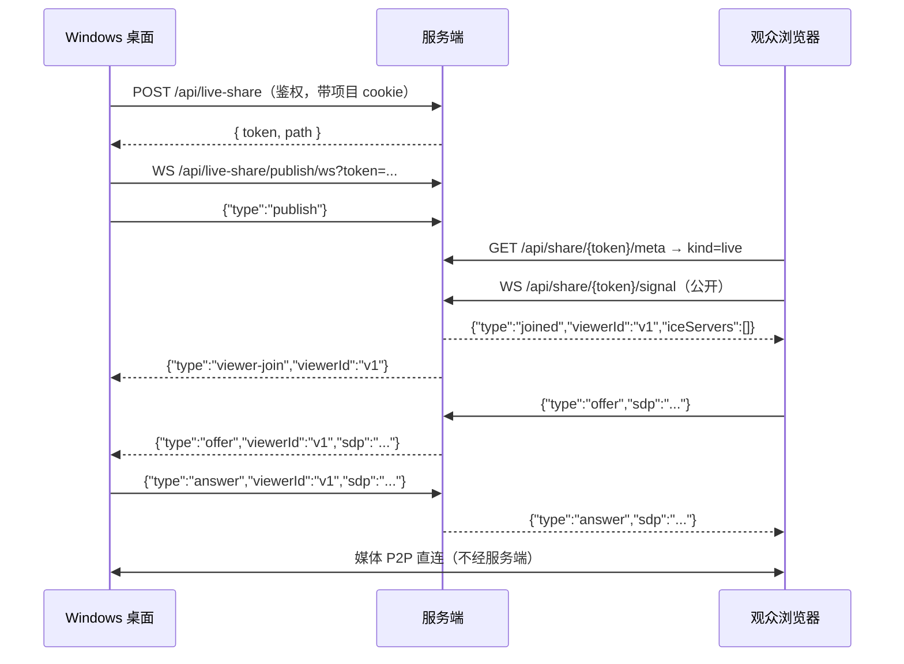

# 屏幕与声音共享（实时）

Windows 桌面客户端可以把**屏幕画面 + 系统声音 + 麦克风**共享出去，生成一个链接；任何拿到链接的人在浏览器里打开就能看画面、听声音，**无需登录**。多个观众之间还能互相说话（经发布端混音）。

这是「看着 AI 干活」的直播，不是投屏工具：链接的模型与文件/会话分享一致——**token 即凭证**。

## 流程图

### 建立连接



**服务端只转发 SDP / ICE，从不解析、从不承载媒体。** 每个观众与发布端之间是独立的 `RTCPeerConnection`，观众发 offer、发布端答 answer。

## 功能与设计要点

### 功能清单

- **纯 P2P WebRTC**：媒体点对点直传。观众上限 **8**，受发布端上行带宽约束（每个观众一条独立编码流）
- **分享链接**：复用现有 `/share/{token}` SPA，`kind: 'live'`。token 32 位 hex，与文件/会话分享同级
- **系统声音**：Windows 上通过 `audio: 'loopback'` 采集。**macOS / Linux 不支持**——这是 Electron 的限制，非实现取舍；非 Windows 平台 UI 不提供该开关
- **麦克风**：与系统声音在 `AudioContext` 里混音后发送。麦克风被拒绝不影响共享（画面仍可发）
- **多人语音**：观众打开自己的麦克风开关即可发言，**其他观众也能听到**（见下）
- **发言授权**：房间级开关默认**关闭**；开启后观众自行开关麦克风；发布端可单人静音与「全部静音」
- **零新增依赖、零新增端口**：服务端只多一个内存房间表，端口仍然只有 TCP 20000

### 为什么多人语音不需要 SFU

发布端本来就和每个观众各有一条连接，也本来就收到所有人的音频。所以为每个观众建一个独立混音即可：

```
dest[A] = 系统声音 + 发布端麦克风 + 观众B的音轨 + 观众C的音轨 + …   ← 排除 A 自己
dest[B] = 系统声音 + 发布端麦克风 + 观众A的音轨 + 观众C的音轨 + …   ← 排除 B 自己
```

- **0 条额外连接、0 服务端媒体工作**
- 8 人只多约 256kbps 上行（视频本身就要 16Mbps，占 1.6%）
- 代价是多一跳：A 说话 → 发布端 → B，局域网下约多 100–200ms

视频 mesh 才需要 SFU（8 人 28 条额外连接、56Mbps 上行）；音频不需要。

**排除自己是一条代码级不变量**：把 `viewerTrack[X]` 连进 `dest[X]` 会让 X 听到自己，并经发布端外放再被麦克风拾取，产生无限回声。

### 观众上行不需要重新协商

观众加入时先占一条 `sendrecv` 音频 m-line（不挂 track），之后开麦/闭麦只用 `replaceTrack`：

```ts
const tx = pc.addTransceiver('audio', { direction: 'sendrecv' })
await tx.sender.replaceTrack(micTrack)   // 说
await tx.sender.replaceTrack(null)       // 停
```

实测（Electron 44 / Chromium）`signalingState` 全程保持 `stable`、SDP 不变。若改成"发言时重新 offer"，会引入 SDP 抖动与连接重建风险。

### 发言授权：一个房间开关 + 一个麦克风开关

文件分享的 token 是**只读**的，泄露顶多被看。**多人语音的 token 是写权限**——拿到链接的任何人都能往房间灌声音，且**所有观众都会听到**。所以授权模型只有两层：

| 层级 | 机制 |
|---|---|
| 房间级 | 发布端显式勾选「允许观众发言」，**默认关闭**。关闭时服务端直接拒绝 `talk-start`（观众端回 `talk-disabled`） |
| 人级 | 房间开启后，观众自己点麦克风开关即可发言/静音；发布端可随时静音某个人或「全部静音」 |

**刻意没有「申请 → 批准」这一层。** 早期设计有逐人审批，后来移除了：房间开关本身就是安全边界（默认关闭，只有发布端能打开），在其之上再加一层逐人确认只是摩擦，没有对应的威胁模型。

观众端只有一个麦克风开关（开 = 上行麦克风，关 = 静音），**不是**按住说话。开关式在这个场景更好：多人语音是「一起聊」而不是「轮流发言」，按住说话在长时间讨论里是纯粹的负担。

### 状态机

每个观众只有一个布尔：麦克风开/关。

```
none --talk-start--> talking        （要求房间开关已开）
talking --talk-end--> none
talking --talk-revoke--> none        （发布端静音这个人）
talking --mute-all--> none           （发布端全部静音）
talking --set-talk-enabled(false)--> none  （房间开关关闭，连带静音所有人）
```

`talk-start` 在房间开关关闭时**拒绝并回 `talk-disabled`**，不静默忽略——静默会让「开关点了没反应」变成不可诊断的问题。`talk-end` 永远允许，这样发布端刚关掉开关时观众仍能正常上报自己已静音。

### 发布端能听到观众

`LiveMixer` 把每个观众的远端音轨连到 `ctx.destination`（扬声器），所以发布端能听到观众说话。**只有远端音轨连扬声器**——发布端自己的系统声音和麦克风绝不监听，否则会听到自己的延迟回声。

### 观众端必须处理的三件事

1. **自动播放策略**：带音轨的 `<video>` 在无用户手势时会被拦截。处理是先 `muted` 播画面，顶部显示「点击开启声音」。**不要**直接报错。
2. **发布端断开**：收到 `publisher-gone` 或 `pc.connectionState === 'failed'` 时显示「共享已结束」。每次 `POST` 都是新 token，所以只能提示重新索要链接。
3. **ICE 失败要说清原因**：纯 P2P 下常见原因是双方不在同一网段、AP 禁了组播（mDNS 候选解析失败）、或开了客户端隔离。提示里要列出这三条，不能只说「连接失败」。

### 已知限制

| 限制 | 说明 |
|---|---|
| 仅同一局域网 | **无 TURN 中继**。跨网段、公网、开客户端隔离的 AP 一律不可用 |
| mDNS 候选 | 观众端是浏览器、通常无媒体权限，Chromium 会把 host candidate 伪装成 `<uuid>.local`。AP 禁组播则解析失败 |
| 系统声音仅 Windows | Electron 的 `loopback` 只支持 Windows |
| 8 人上限 | 发布端上行 = N × 码率 |
| 房间是内存态 | 进程重启即失效（语义正确：直播是瞬时的） |

### 安全

- 管理端点（`POST`/`GET`/`DELETE /api/live-share`）**需登录**，且只操作本项目；发布端 WS 校验 token 与项目归属
- 观众 WS（`/api/share/{token}/signal`）**公开**，token 即凭证
- `setPendingCaptureSource` 一次性消费：消费后清空，任何页面后续调用 `getDisplayMedia` 都会被拒绝
- 复用 `ServeSharePage` 的 `Referrer-Policy: no-referrer`，避免 token 经子资源请求泄露

## 关键文件

| 文件 | 职责 |
|---|---|
| `internal/liveshare/room.go` | 房间注册表（双索引、幂等创建、上限、空闲回收） |
| `internal/liveshare/talk.go` | 发言授权状态机 |
| `internal/liveshare/signal.go` | 协议结构体（与前端镜像） |
| `internal/handler/live_share.go` | HTTP/WS 绑定、鉴权切分、信令转发 |
| `web/src/composables/useLiveShare.ts` | 发布端：房间、采集、每观众 PeerConnection |
| `web/src/composables/useLiveMixer.ts` | 混音图（纯逻辑，可单测） |
| `web/src/share/liveViewer.ts` | 观众端：信令 + 单个 PeerConnection |
| `web/src/share/LiveShareView.vue` | 观众端页面 |
| `web/src/components/live/LiveShareDialog.vue` | 发布端弹窗 |
| `desktop/src/main/capture.ts` | 捕获源列表、`setDisplayMediaRequestHandler`、节流开关 |

设计文档：[docs/plans/2026-10-28-desktop-screen-audio-share-design.md](../../plans/2026-10-28-desktop-screen-audio-share-design.md)
