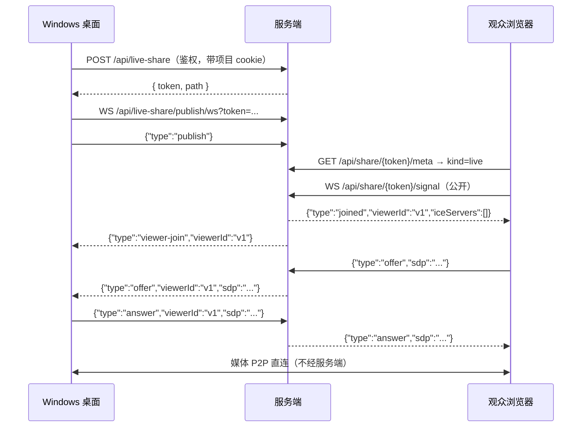

# 屏幕与声音共享（实时）

Windows 桌面客户端和 **Android App** 都可以把**屏幕画面 + 系统声音 + 麦克风**共享出去，生成一个链接；任何拿到链接的人在浏览器里打开就能看画面、听声音，**无需登录**。多个观众之间还能互相说话（经发布端混音）。

macOS / Linux 桌面客户端同样可以发布，只是**没有系统声音**（Electron 的 `audio: 'loopback'` 仅 Windows 可用），画面与麦克风不受影响。

这是「看着 AI 干活」的直播，不是投屏工具：链接的模型与文件/会话分享一致——**token 即凭证**。

## 流程图

### 建立连接



**服务端只转发 SDP / ICE，从不解析、从不承载媒体。** 每个观众与发布端之间是独立的 `RTCPeerConnection`，观众发 offer、发布端答 answer。

## 功能与设计要点

### 功能清单

- **纯 P2P WebRTC**：媒体点对点直传。观众上限 **8**，受发布端上行带宽约束（每个观众一条独立编码流）
- **分享链接**：复用现有 `/share/{token}` SPA，`kind: 'live'`。token 32 位 hex，与文件/会话分享同级。**链接按本机全部地址生成**（见下）
- **系统声音**：Windows 上通过 `audio: 'loopback'` 采集。**macOS / Linux 不支持**——这是 Electron 的限制，非实现取舍；非 Windows 平台 UI 不提供该开关
- **麦克风**：与系统声音在 `AudioContext` 里混音后发送。麦克风被拒绝不影响共享（画面仍可发）
- **多人语音**：观众打开自己的麦克风开关即可发言，**其他观众也能听到**（见下）
- **发言授权**：房间级开关默认**关闭**；开启后观众自行开关麦克风；发布端可单人静音与「全部静音」
- **零新增依赖、零新增端口**：服务端只多一个内存房间表，端口仍然只有 TCP 20000

### 为什么多人语音不需要 SFU

发布端本来就和每个观众各有一条连接，也本来就收到所有人的音频。所以为每个观众建一个独立混音即可：

```
dest[A] = 系统声音 + 发布端麦克风 + 观众B的音轨 + 观众C的音轨 + …   ← 排除 A 自己
dest[B] = 系统声音 + 发布端麦克风 + 观众A的音轨 + 观众C的音轨 + …   ← 排除 B 自己
```

- **0 条额外连接、0 服务端媒体工作**
- 8 人只多约 256kbps 上行（视频本身就要 16Mbps，占 1.6%）
- 代价是多一跳：A 说话 → 发布端 → B，局域网下约多 100–200ms

视频 mesh 才需要 SFU（8 人 28 条额外连接、56Mbps 上行）；音频不需要。

**排除自己是一条代码级不变量**：把 `viewerTrack[X]` 连进 `dest[X]` 会让 X 听到自己，并经发布端外放再被麦克风拾取，产生无限回声。

### 观众上行不需要重新协商

观众加入时先占一条 `sendrecv` 音频 m-line（不挂 track），之后开麦/闭麦只用 `replaceTrack`：

```ts
const tx = pc.addTransceiver('audio', { direction: 'sendrecv' })
await tx.sender.replaceTrack(micTrack)   // 说
await tx.sender.replaceTrack(null)       // 停
```

实测（Electron 44 / Chromium）`signalingState` 全程保持 `stable`、SDP 不变。若改成"发言时重新 offer"，会引入 SDP 抖动与连接重建风险。

### 发言授权：一个房间开关 + 一个麦克风开关

文件分享的 token 是**只读**的，泄露顶多被看。**多人语音的 token 是写权限**——拿到链接的任何人都能往房间灌声音，且**所有观众都会听到**。所以授权模型只有两层：

| 层级 | 机制 |
|---|---|
| 房间级 | 发布端显式勾选「允许观众发言」，**默认关闭**。关闭时服务端直接拒绝 `talk-start`（观众端回 `talk-disabled`） |
| 人级 | 房间开启后，观众自己点麦克风开关即可发言/静音；发布端可随时静音某个人或「全部静音」 |

**刻意没有「申请 → 批准」这一层。** 早期设计有逐人审批，后来移除了：房间开关本身就是安全边界（默认关闭，只有发布端能打开），在其之上再加一层逐人确认只是摩擦，没有对应的威胁模型。

观众端只有一个麦克风开关（开 = 上行麦克风，关 = 静音），**不是**按住说话。开关式在这个场景更好：多人语音是「一起聊」而不是「轮流发言」，按住说话在长时间讨论里是纯粹的负担。

### 状态机

每个观众只有一个布尔：麦克风开/关。

```
none --talk-start--> talking        （要求房间开关已开）
talking --talk-end--> none
talking --talk-revoke--> none        （发布端静音这个人）
talking --mute-all--> none           （发布端全部静音）
talking --set-talk-enabled(false)--> none  （房间开关关闭，连带静音所有人）
```

`talk-start` 在房间开关关闭时**拒绝并回 `talk-disabled`**，不静默忽略——静默会让「开关点了没反应」变成不可诊断的问题。`talk-end` 永远允许，这样发布端刚关掉开关时观众仍能正常上报自己已静音。

### 分享链接按「全部本机地址」生成

`window.location.origin` 只知道浏览器恰好用的**那一个**地址。一台机器同时有 Wi-Fi（`192.168.100.104`）、USB 网卡（`192.168.100.142`）和 Docker 网桥（`172.17.0.1`）时，同事可能不在同一网段，拿到的链接打不开。

所以三个分享入口（屏幕共享 / 文件分享 / 会话分享）都改为请求 `GET /api/server/addresses`，由服务端枚举地址：

- **默认只显示一条主链接**，其余折叠在「查看全部 N 个地址」后面——常见场景下满屏 IP 只是噪音
- **主链接优先选浏览器当前用的那个地址**：用户此刻能用它访问，说明它在这个网络里是通的，这是最好的证据。当前地址不在列表里时（localhost / 域名 / 反向代理），仍以浏览器 origin 为主
- **虚拟网卡不隐藏，只标注**：`172.17.0.1` 这类地址仍会列出，但标「虚拟网卡」。静默丢弃会让用户无法解释「为什么这个地址别人打不开」

**唯一被过滤的是 IPv6 隐私地址**。现代系统每个接口会额外分配若干 RFC 4941 临时地址，**每隔几小时轮换**。实测一台双栈笔记本 17 个地址里有 14 个是这种，发给同事时大概率已失效，还会把真正可用的 3 个埋掉。`net.IP` 拿不到 temporary 标志，所以按 **(接口, /64)** 折叠：稳定地址与它的临时兄弟共享 /64，折叠后每个前缀只剩一条。

### 发布端能听到观众

`LiveMixer` 把每个观众的远端音轨连到 `ctx.destination`（扬声器），所以发布端能听到观众说话。**只有远端音轨连扬声器**——发布端自己的系统声音和麦克风绝不监听，否则会听到自己的延迟回声。

### 观众端必须处理的三件事

1. **自动播放策略**：带音轨的 `<video>` 在无用户手势时会被拦截。处理是先 `muted` 播画面，顶部显示「点击开启声音」。**不要**直接报错。
2. **发布端断开**：收到 `publisher-gone` 或 `pc.connectionState === 'failed'` 时显示「共享已结束」。每次 `POST` 都是新 token，所以只能提示重新索要链接。
3. **ICE 失败要说清原因**：纯 P2P 下常见原因是双方不在同一网段、AP 禁了组播（mDNS 候选解析失败）、或开了客户端隔离。提示里要列出这三条，不能只说「连接失败」。

### 已知限制

| 限制 | 说明 |
|---|---|
| 仅同一局域网 | **无 TURN 中继**。跨网段、公网、开客户端隔离的 AP 一律不可用 |
| mDNS 候选 | 观众端是浏览器、通常无媒体权限，Chromium 会把 host candidate 伪装成 `<uuid>.local`。AP 禁组播则解析失败 |
| 系统声音仅 Windows / Android 10+ / 部分浏览器 | Electron 的 `loopback` 只支持 Windows；安卓走 AudioPlaybackCapture，且只能录到允许被录制的声音；浏览器由选择器决定（Chrome 只在共享标签页或整个屏幕时给音频） |
| 8 人上限 | 发布端上行 = N × 码率 |
| 房间是内存态 | 进程重启即失效（语义正确：直播是瞬时的） |

## 控制通道（小会工具）

媒体之外还有一条 **RTCDataChannel**（发布端在每条连接上创建，观众 `ondatachannel` 接收）。它承载的不是画面，而是：

| 消息 | 用途 |
|---|---|
| `laser` | 激光笔位置（2.5s 无更新自动隐藏） |
| `ink` / `ink-undo` / `ink-clear` | 画面标注（自由笔迹） |
| `chat` | 文字聊天（两端各自保留本次会话的消息；后加入的观众看不到之前的聊天） |
| `presence` | 观众窗口是否可见（「离开」标记） |
| `talk` | 说话电平（发布端 → 观众，0..1，只在跨越阈值或明显变化时发） |
| `ctrl-req` / `ctrl-grant` / `ctrl-ev` | 远程控制的申请、授权与指针事件 |

**坐标系是 0–1 归一化到画面内容**，不是像素：观众 A 是 16:9 带黑边、观众 B 是全屏裁切，同一个像素坐标在两人屏幕上落在不同位置。换算只在 `liveControl.ts` 的 `contentRectOf` / `toNormalized` / `fromNormalized` 里做，绘制层与标注层都走它。

**发布端是这条通道的中转**：观众发来的帧被打上 `from` 后广播给其他观众，所以观众的激光笔别人也能看见，且不需要服务端参与。

**说话人高亮由发布端测量**：所有麦克风都在它这里汇合（观众只收到混音，自己量不出来）。`LiveMixer` 给每条远端音轨和发布端自己的麦克风各挂一个 `AnalyserNode`，每 200ms 算一次 RMS；只有**跨越「在说话」阈值**或数值变化超过 0.1 才发一帧 `talk`，安静的会场因此零流量。观众端收到后点亮 900ms 的「X 正在说话」，超时自动熄灭——发布端停止发送（静音、切后台）时不能留一个常亮的灯。

**远程控制**注入指针（移动/点击/滚轮）与键盘（命名键 + 任意文本）。

- **不需要安装任何东西**：注入由随应用分发的 `input-helper.exe` 完成（Go 写的，纯 `syscall` 调 `SendInput`，无 CGO、无原生 npm 模块）。Electron 在首次需要时 spawn 它，用 NDJSON 走 stdin/stdout，一次一个回执。
- **键盘分两种**：命名键（Enter/方向键/F1–F12/Delete…）按虚拟键码发；单个可打印字符走 `KEYEVENTF_UNICODE`，所以中文、emoji 都能输入，不依赖键盘布局。
- **只有 Windows 发布端能注入**：`internal/inputinject` 在其它平台是 stub（`Supported()` 恒 false），因为只有 Windows 会发起共享。发布端面板挂载时读一次 `remoteControlSupported()`，不支持时**不显示「允许」按钮**，改成一行说明——让人点了没反应比不给按钮更糟。
- **`input-helper.exe` 是打包产物**，不在仓库里：`release.yml` 的每个桌面 job 会跑 `desktop/scripts/build-input-helper.mjs`，`build.sh` 也跑一次（否则本地 `npx electron-builder --dir` 出来的包里没有它，远程控制会静默失效）。
- **Escape 是本地逃生键**：按 Esc 只结束自己的控制，不会转发给对端。
- 限制：仅 Windows 可注入；对端窗口若以管理员权限运行（UIPI），`SendInput` 会被系统拒绝，界面会收到 `ok:false` 而不是假装成功。

## 成员端：浏览器 vs 客户端

同一个分享页在两种宿主里跑，能力不同：

| 能力 | 浏览器 | 桌面客户端 |
|---|---|---|
| 观看画面 / 聊天 / 标注 / 缩放 | ✓ | ✓ |
| 共享自己的屏幕 | 仅 HTTPS | ✓（原生选择器，HTTP 也行） |
| 使用麦克风 | 仅 HTTPS | ✓ |
| 被主持人远程控制 | ✗（浏览器没有输入注入 API） | ✓ |
| 系统声音 | ✗ | ✗（成员端没有第二条音频 m-line） |

客户端入口在共享弹窗里：「加入别人的共享」→ 粘贴链接 → 在独立窗口打开（复用同一 preload，所以分享页能识别出自己跑在客户端里）。

**为什么客户端能绕开 HTTPS**：桌面壳启动时对配置的服务器 origin 加了 Chromium 的 `unsafely-treat-insecure-origin-as-secure`（见 `desktop/src/main/index.ts`），所以 `navigator.mediaDevices` 在该 origin 上存在。切换服务器需要重启才生效——这是进程级开关的固有限制。

**客户端模式下共享屏幕要先选源**：Electron 的 `setDisplayMediaRequestHandler` 拒绝未声明的源，所以分享页会先调 `listCaptureSources()` 弹一个选择器，再 `setPendingCaptureSource()` + `getDisplayMedia()`。

浏览器端在主持人开启「允许成员共享屏幕」时会显示一条提示，说明共享屏幕/系统声音/被控制需要客户端——只在真的用得上时出现，不是每场都弹。

## 成员反向共享屏幕

发布端可以打开「允许成员共享屏幕」，成员（**电脑**浏览器）就能把自己的屏幕共享给**所有人**。

### 链路

```
成员浏览器                发布端（Electron）              其他观众
getDisplayMedia
  └ 屏幕轨 ──P2P──▶ 收到 ──replaceTrack──▶ 转发 ──P2P──▶ 看到
```

- **一次只允许一个人**：第二个人点会收到 `screen-denied / busy`。原因是转发成本：每个共享者都要在发布端复制成 N 路，N 个共享者就是 N×N。
- **共享者收不到自己的画面**（发布端转发时跳过它）——否则自己的屏幕会延迟一拍回放，变成回声。
- **三条 m-line 在加入时就协商好**，开始/停止只 `replaceTrack`，不重新协商：

  | m-line | 方向 | 内容 |
  |---|---|---|
  | 1 | sendrecv | 成员麦克风 ↑ / 混音 ↓ |
  | 2 | sendrecv | 发布端画面 ↓ / 成员共享画面 ↑ |
  | 3 | sendonly / recvonly | 发布端**转发**别人的共享画面 ↓ |

  这个顺序是前后端的契约（`useLiveShare.ts` 与 `liveViewer.ts` 必须一致）。中途加 m-line 会强制重新协商，而连接上正跑着会议。

### 权限

- 房间级开关「允许成员共享屏幕」，**默认关闭**（和发言一致：token 是读凭证，共享屏幕比开麦交出去的东西更多）。
- 发布端可随时关开关（连带停掉正在共享的人），也可只停某一个人。
- 被拒绝时服务端回 `screen-denied`，成员端**立即释放本地采集**——否则浏览器的「正在共享」指示会一直亮着，实际什么也没发出去。

### HTTPS 是硬门槛

`getDisplayMedia` 只在安全上下文存在：`http://192.168.x.x:20000` 这种页面里 `navigator.mediaDevices` 直接是 undefined。所以：

- 成员端**必须通过 HTTPS 打开分享页**。自签名证书有两条路：设置 → 安全 →「HTTPS 证书」里点「生成自签名证书」（覆盖本机所有 IPv4 + localhost，一键重启），或命令行 `./clawbench --gen-cert`。浏览器点一次「继续访问」之后即生效。
- 证书把**IP 写进 SAN**（浏览器不认 CN）；换网络后 IP 变了要重新生成一次。设置面板会显示当前覆盖的地址。
- 同一限制也作用于**观众麦克风**——HTTP 下「允许观众发言」同样用不了。
- 手机**浏览器**（Chrome Android / Safari iOS）不支持共享屏幕，只能看；安卓**App** 内可以发起共享（见下一节）。
- 开关打开但当前不是安全上下文时，按钮**仍然显示但置灰**并提示需要 HTTPS：直接隐藏会让人以为功能不存在。

## 浏览器发起共享

桌面浏览器（Chrome / Edge / Firefox / Safari 15+）也能当发布端：Dock 的「桌面共享」页签在安全上下文里出现，采集走标准 `getDisplayMedia`。房间、信令、P2P、混音、听记、观众端与客户端完全一致，服务端一行没改。

### 与客户端的三点差异

| 能力 | 桌面客户端 | 浏览器 |
|---|---|---|
| 选择共享源 | 先列出屏幕/窗口（带缩略图），再 `setPendingCaptureSource` 声明 | 无列表：`getDisplayMedia` 自带系统选择器 |
| 中途切换共享源 | 源网格里选一个 | 再调一次 `getDisplayMedia`（等于再弹一次选择器） |
| 系统声音 | 原生探测 `getAudioCaptureSupport()` | 由选择器决定（Chrome 只在标签页/整个屏幕时提供），开关默认按「支持」显示 |
| 窗口最小化 | `setPublishingActive` 保活，编码不降频 | 无等价物，标签页被隐藏时可能掉帧 |
| 被观众远程控制 | Windows 可注入 | ✗（浏览器没有输入注入能力，按钮显示为不支持） |

### 两个实现分支

- **没有源列表就没有「选源」这一步**：`start()` 只在宿主提供 `setPendingCaptureSource` 时才声明源并先校验；否则直接 `getDisplayMedia`。浏览器每次调用都会弹自己的选择器，所以「切换源」在浏览器端就是再调一次，不渲染源网格（`openSwitch()` 按 `hasNativeCapture` 分叉）。
- **`captureKind` 由 `getSettings().displaySurface` 推导**：`monitor` = 整个屏幕，`window` / `browser` = 窗口或标签页。它只影响远程控制与标注覆盖层：窗口/标签页共享时指针映射到桌面会错位，所以按「非桌面」处理。
- **先采集、再建房间**：`getDisplayMedia` 要求瞬时用户激活，而建房间 + 查地址是两次网络往返，慢网下会把手势窗口耗掉，浏览器随后拒绝一个用户明明发起的请求（Firefox / Safari 最严格）。采集只依赖本地能力（原生声明是 IPC），所以放在最前不损失什么；代价是建房间失败时要显式 `stop()` 释放采集，否则浏览器的「正在共享」指示会一直亮着。

### 门槛

- **必须是安全上下文**：`http://192.168.x.x:20000` 下 `navigator.mediaDevices` 是 undefined，页签直接不出现（与之前一致）。要发起就开 HTTPS（见「HTTPS 是硬门槛」的证书说明）或用 localhost。
- **手机浏览器不支持**：Chrome for Android / Safari iOS 都没有 `getDisplayMedia`，手机端发起仍然只能靠安卓 App。
- **观众开麦同样要安全上下文**：HTTP 打开的分享页能看画面，但发言要 `getUserMedia`。麦克风开关与「共享屏幕」走同一套判定（`canTalk` / `canShareScreen`），不可用时置灰并提示需要 HTTPS——否则按钮点下去只会静默弹回。
- 能力判定集中在 `web/src/utils/screenCaptureSupport.ts`：`getDisplayMedia` 是否存在决定「能不能采」，`isSecureContext` 只用来选提示文案（「需要 HTTPS」而不是「请更新客户端」）。

## 安卓端发起共享

Android App 也能当发布端：Dock 的「桌面共享」页签在安卓上可用，分享出去的是**手机屏幕 + 系统声音 + 麦克风**。房间、信令、P2P、混音、听记、观众端全部复用桌面那套，服务端一行没改。

### 为什么不能直接用 getDisplayMedia

Android WebView 里**没有** `getDisplayMedia`（Chrome for Android 也一直没有）。所以采集必须是原生的 `MediaProjection`，再想办法把画面送回 WebView 变成一条 `MediaStreamTrack`：

```
MediaProjection ─▶ VirtualDisplay ─▶ ImageReader ─▶ 缩放 + JPEG
                                                        │
                                          （原生 tick 通知页面）
                                                        ▼
                            JS 桥取帧 ─▶ 解码 ─▶ VideoTrackGenerator / canvas
                                                        │
                                                        ▼
                                            现有的 RTCPeerConnection
```

- **帧走「原生推、页面拉」**：原生每产出一帧就 `evaluateJavascript` 触发一次 tick，页面在 tick 里调 `takeScreenFrame()` 取走。反过来让页面 `setInterval` 轮询是不行的——分享自己屏幕时 App 必然在后台，Chromium 会把隐藏页面的定时器压到约 1 Hz，轮询当场瘫掉；而脚本求值不受这个限制。
- **只有最新一帧有意义**：原生只保留一个帧槽，页面没取走就被下一帧覆盖。解码期间到来的 tick 直接丢弃，天然形成背压，不会越积越多。
- **优先 `VideoTrackGenerator`，回退 canvas**：canvas 的画面由合成器产出，而 App 在后台时合成器是暂停的；`VideoTrackGenerator` 的帧直接进 WebRTC 管线，不经过合成器，后台也能持续出帧。老 WebView 没有这个 API 时退回 `canvas.captureStream(0)` + `requestFrame()`，代价是后台可能卡顿。

### 系统声音

`AudioPlaybackCapture`（Android 10 / API 29 起）把设备播放的声音录成 PCM，按 100 ms 一块推给页面；页面用一个环形缓冲 + `ScriptProcessor` 把它转成音轨，之后就走桌面端完全相同的 `LiveMixer` 混音链路。

- **只能录到「允许被录制」的声音**：媒体、游戏可以；通话（`USAGE_VOICE_COMMUNICATION`）平台层面就抓不到，DRM 内容同理。UI 上明确写了这一点，避免用户以为录不上是 bug。
- **抖动缓冲**：先攒 0.2 s 再开始播，超过 0.6 s 就丢掉多余的（回到 0.2 s）。不这么做的话，桥接侧的抖动会一路累积成越来越长的延迟。
- 低于 Android 10 时 `getAudioCaptureSupport()` 返回 `systemAudio:false`，开关置灰并说明原因，而不是点了没反应。

### 前台服务与系统确认

- 采集跑在 `ScreenShareService`（`foregroundServiceType="mediaProjection"`）里。这不是选择而是要求：**必须先有该类型的前台服务，才能调 `getMediaProjection()`**，且投影回调要在 `createVirtualDisplay()` 之前注册。App 在共享期间始终处于后台（用户在看别的应用），Activity 级的采集会被直接回收。
- Android 14+ **每次开始共享都要用户点一次系统确认**，无法缓存或复用。确认框由系统绘制，应用无法跳过。
- 共享期间常驻一条通知（`正在共享屏幕`）——这既是平台的硬性要求，也是用户唯一能看到的「还在共享」提示。
- `MainActivity.pauseWebView()` 只调 `onPause()`、**刻意不调 `pauseTimers()`**，所以切到后台后 JS 仍在跑；再叠加「原生推 tick」，共享不会因为切应用而断流。
- 旋转屏幕会重建 VirtualDisplay：不重建的话虚拟显示还停在旧尺寸，画面会被拉伸。

### 安卓端的差异

| 能力 | 桌面端 | 安卓 App |
|---|---|---|
| 选择共享源 | 屏幕 / 窗口列表 | 无（系统确认框决定，恒为整屏） |
| 中途切换共享源 | ✓ | ✗（只有一个源，按钮不显示） |
| 系统声音 | Windows | Android 10+，且只限允许录制的声音 |
| 被观众远程控制 | Windows 可注入 | ✗（需要无障碍服务，不做） |
| AI 听记 | ✓ | ✓（与听记页签同一条链路） |
| 分辨率 / 帧率 | 原始分辨率 | 最长边 1280、10 fps（桥接 + 二次编码的成本上限） |

## 界面位置

桌面共享不再是顶栏的一个弹窗，而是**左栏 Dock 的一个页签**（在「端口映射」前面）：链接、观众、发言授权、成员共享、实时转写、会后纪要都在这一个面板里，切走再切回不中断共享。共享期间页签右上角挂一个**主题色角标点**（`.dock-badge--live`，无数字——共享是状态不是未读数），面板头部有同色的「共享中」标记，所以离开页签也看得出还在直播。**不用红色**：红色在本 UI 里表示错误/录音中，而共享是正常进行中的活动；红色只留给旁边的「停止共享」按钮。

**AI 听记**同样是 Dock 的一个页签（在「桌面共享」前面），不是一个弹窗：上面是录音区（标题、开始/停止、实时转写、会后纪要），下面是**历史纪要**。切走再切回不中断录音，页签在录音期间标红。

顶栏**没有**听记入口：Dock 页签是唯一入口。共享按钮当初从顶栏搬进 Dock 时留下了一个麦克风按钮占位，后来又被改成「快捷入口」，结果是顶栏出现两个同款按钮、间距被 `margin-left: auto` 平分。现在两个按钮都只在 Dock 里，顶栏右侧回到「主题 → 服务器」这一对（`headerClusterSpacing.test.ts` 钉住这条）。

听记页签的可见性与共享页签**不同**：它只需要 `getUserMedia`，浏览器标签页、桌面端和 **Android App 都能用**（安卓壳已声明 `RECORD_AUDIO` 并在 `onPermissionRequest` 里只授权 `AUDIO_CAPTURE`，与输入框的语音转写同一条权限链）。共享页签在桌面端、**Android App** 和**安全上下文里的桌面浏览器**出现：前两者是原生采集（安卓走 MediaProjection），浏览器走 `getDisplayMedia`（见「浏览器发起共享」）；非安全上下文（HTTP 访问）下浏览器没有采集能力，页签不出现。

**单人听记**与会议听记共用这个页签和同一条流水线：不建房间、不生成链接，服务端只生成一个 token 并写入 `live_notes`，之后的分段上传、上下文校对、纪要与产物落盘全部照旧，鉴权依据是那一行而不是房间。

## AI 听记

发布端可选开启「AI 听记」：共享过程中实时转写，停止后生成结构化会议纪要（概要 / 议题与讨论 / 结论与决定 / 待办事项），观众可以展开只读面板跟读。**默认收起**，不挡画面。

### 为什么必须在发布端采集

共享是纯 P2P，**服务端一个音频包都收不到**。而发布端本来就握着全部音源：系统声音、自己的麦克风、以及每个观众的麦克风（`pc.ontrack`）。所以转写只能在发布端做——它也是唯一还保留着**信道分离**的地方。

### 信道分离 + 按时间重排

每个音源单独录一条信道，互不混音：

```
mic         发布端的麦克风
viewer:<id> 每个观众的麦克风，一人一条
```

**只录麦克风，不录系统声音**。系统回环会把机器上正在播放的一切都录进来（音乐、通知音、另一个会议），而它唯一有价值的内容——远程参与者——在本产品里本来就通过 `viewer:<id>` 单独一路进来。早先两路都录时，同一句话会在 `system` 和 `mic` 各出现一次，靠 5 秒窗口去重才勉强合并；去掉之后这段重复从源头消失了。

于是**说话人标签是免费拿到的**，不需要说话人分离（diarization）模型。代价是各信道独立转写、完成顺序与说话顺序不同，所以读取时必须按 `startedAt` 重排——`startedAt` 由发布端**同一个时钟**打，跨信道可比。

- **在停顿处切段**，不是按固定时钟切：用 `AnalyserNode` 每 100ms 取一次 RMS，静音超过 450ms 且本段已满 4s 就收尾；连续说话则由 20s 硬上限兜底（仍在 Whisper 原生窗口内）。固定 10s 切会让每句话都有概率在词中间断开，Whisper 在切口处会吞词或猜词，一小时会议几百个切口，转写质量会明显变差。
- 每次收尾都得到**独立可解码**的完整 WebM/Opus 文件（`timeslice` 更省，但只有第一片带容器头，后续切片单独解不出来）。整段全是静音的会被丢弃——它不含内容，送上去只会换回一个空字符串；无法测电平的短尾段则保留（「不知道」不能当成「静音」）。
- 上传**每信道串行**，失败按 1s/3s/9s 退避重试。**积压不丢段**——字幕可以滞后，转写不能缺口；队列上限 180 段/信道（约 30 分钟音频）只是防内存泄漏的硬闸门，触顶会在界面上标「转写不完整」。
- 停止时先停录音机、等最后一段真正产出（`onstop` 才生成 blob）再关 `AudioContext`，然后等队列排空（最长 3 分钟）才生成纪要；排不空就明确提示「纪要可能缺少结尾」。
- 回声去重：发布端用扬声器外放时，观众的声音会被自己的麦克风再次采到，同一句话可能出现在两条信道。合并时若两条信道在 **±5s** 内出现**归一化后完全相同**的文本，只保留较早的那条。真正的同时说话用词不同，不受影响。

### 产物：录音 + 三份 Markdown（永久）

停止共享后，这场会落成一个目录。**数据库行 7 天后清掉，目录不清**：

```
<项目>/.clawbench/notes/2026-10-31-1430-周会-a1b2c3/
    minutes.md               纪要（末尾链接同目录的另外两份）
    transcript.srt           原始转写（STT 原样输出，SubRip 字幕；老会议仍是 transcript.md）
    transcript-revised.md    修订版转写（结合项目上下文校对）
    audio/                   录音，一段一个 WebM
        1700000000123-system.webm
        1700000004123-mic.webm
        1700000007123-viewer-2.webm
```

- **录音在转写之前落盘**：STT 挂了要重转、模型升级要复跑、某句听错要复核——都需要原始音频，而它是唯一无法再生的产物。写盘失败只记警告，不阻断转写。
- **文件名带 token 后缀**：同一分钟、同一标题的两场会不能共用目录，否则录音会交错、纪要会互相覆盖。
- **`audio/.gitignore` 内容为 `*`**：录音是二进制，一小时约 14MB/信道；同目录的 Markdown 仍然可以进 git。
- 录音片段按 `<开始毫秒>-<信道>.webm` 命名，**按文件名排序就是按时间排序**，不需要索引文件。

### 修订版转写（转写与纪要之间的中间层）

原始转写是语音识别的结果，专有名词基本靠猜：`ClawBench`、`ACP`、人名、缩写，识别出来常常是同音词。所以在生成纪要**之前**多一道校对：

```
原始转写 ──(项目上下文)──▶ 修订版转写 ──▶ 纪要
```

- **上下文来自项目自己的文档**：按 `AGENTS.md → CLAUDE.md → CODEBUDDY.md → GEMINI.md → README.md` 取第一个存在的，截断 4KB，作为「专有名词以此为准」连同待修订片段一起给模型。不查 RAG、不读代码——这是它的全部依据。
- **只许替换，不许改写**：提示词明确禁止润色、改写句式、合并或拆分句子、删减信息；时间戳、说话人、行序必须原样保留。否则「修订」会变成「重写」，纪要描述的就是模型以为该说的话。
- **长会分段**：与纪要相同的 6000 字切分，按行切，不会把一句拆成两半。
- **失败不阻断**：校对失败时纪要改用原始转写生成，`revise_status` 记为 `failed`，界面上写明「纪要基于原始转写」。有摘要胜过没摘要。
- 修订版本身也是文件，可以人工再改；改了不影响已生成的纪要（要重新生成一次纪要才会用上新版本）。

### 数据流

```
发布端  ── POST /api/live-share/notes/segment（multipart 音频 + channel + startedAt）
        ←─ { id, text }                     服务端用 STT provider 同步转写后落库
观众    ── GET /api/share/{token}/notes?since=<maxId>   （公开，token 即凭证，面板展开时才轮询）
发布端  ── POST /api/live-share/notes/minutes           （异步生成，轮询 GET 取状态）
发布端  ── GET  /api/live-share/notes/sessions          （历史：磁盘上的会议目录）
发布端  ── GET  /api/live-share/notes/sessions/artifact （历史：读某个目录的 Markdown）
```

- **鉴权**：发布端三个端点需登录 + 项目 cookie。token 归属判定接受两种来源：房间还在（`room.ProjectKey() == 项目`），或**已有本项目的听记行**——后者让「结束共享」瞬间的最后一段上传与纪要请求仍能落地（房间随发布端断开立刻销毁）。
- **公开读**：`{token}/notes` 只在房间存活期间可读。共享结束后 token 立即失效，不会留下可长期读取的转写。
- **保留期**：数据库里的转写与纪要按 token 保留 **7 天**，由房间回收器每小时顺带清理；磁盘上的会议目录**永久保留**，只能由用户删除。
- **纪要生成**：修订版转写超过 6000 字时先分段提取要点，再合并成纪要（map-reduce），避免整段塞进模型窗口被截断。
- **落盘**：见上面的「产物」一节。纪要生成后写 `minutes.md`，同时把两份转写和录音留在同一目录；同一场共享重新生成会覆盖同名文件而不是堆副本。

### 历史纪要（页签下半部分）

历史读的是**磁盘上的会议目录**，不是 `live_notes` 表：表行 7 天后清理，目录永久保留。页签要列的是用户还拥有的东西，不是数据库还记得的东西。

- `GET /api/live-share/notes/sessions` 扫描 `<项目>/.clawbench/notes/`，按会议开始时间倒序。只认 `<YYYY-MM-DD-HHMM>[-<标题>]-<token6>` 形状的目录；标题从目录名解析（尾部 token 剥掉），没有标题时显示「未命名听记」。目录从第一段录音就存在，所以「有录音但还没有纪要」是正常状态，行上会标出来。
- `GET /api/live-share/notes/sessions/artifact?dir=&kind=` 读 `minutes.md` / `transcript.srt`（老会议回退 `transcript.md`）/ `transcript-revised.md`，响应里的 `file` 是实际读到的文件名。`dir` 是目录**名**不是路径，服务端按目录名形状校验，越权取值一律 404，读不到 notes 根目录之外的文件。
- 「在编辑器中打开」走前端已有的文件查看器，传目录里那个文件的绝对路径。
- 每次切到页签、以及录音结束后都会重读一次，另有手动刷新按钮。

### 隐私

听记默认开启（用户是主动开共享的），但**观众端会显示「听记」入口**——被记录的人能看见，不做静默录音。关闭开关则完全不采集、不上传。

开启后**录音会以文件形式永久留在发布端项目目录里**（`audio/`），不只是转写文本。默认被 `audio/.gitignore` 排除在 git 之外，但文件确实在磁盘上，共享前应当让参与者知情。

## 安全

- 管理端点（`POST`/`GET`/`DELETE /api/live-share`）**需登录**，且只操作本项目；发布端 WS 校验 token 与项目归属
- 观众 WS（`/api/share/{token}/signal`）与听记读取（`/api/share/{token}/notes`）**公开**，token 即凭证
- 听记上传（`/api/live-share/notes/segment`）需登录 + 项目 cookie，且 token 必须属于该项目；上传体上限 4MB、单段时长上限 120s、每段文本上限 2000 字
- 成员共享屏幕需要发布端先打开房间开关（默认关闭）；同一时刻只允许一个共享者
- `setPendingCaptureSource` 一次性消费：消费后清空，任何页面后续调用 `getDisplayMedia` 都会被拒绝
- 复用 `ServeSharePage` 的 `Referrer-Policy: no-referrer`，避免 token 经子资源请求泄露

## 关键文件

| 文件 | 职责 |
|---|---|
| `internal/liveshare/room.go` | 房间注册表（双索引、幂等创建、上限、空闲回收） |
| `internal/liveshare/talk.go` | 发言授权状态机 |
| `internal/liveshare/signal.go` | 协议结构体（与前端镜像） |
| `internal/handler/live_share.go` | HTTP/WS 绑定、鉴权切分、信令转发 |
| `internal/handler/live_notes.go` | 听记上传 / 读取 / 纪要端点、历史列表与产物读取、STT 并发闸门 |
| `internal/service/live_notes.go` | 听记落库、时间线重排与去重、产物落盘、历史目录扫描、上下文修订、纪要生成 |
| `web/src/composables/liveNotes.ts` | 分信道录音（纯逻辑，可单测） |
| `web/src/composables/useLiveNotes.ts` | 听记响应式状态、上传与纪要轮询 |
| `web/src/components/live/NotesPanel.vue` | 听记页签：录音区 + 实时转写 + 纪要 + 历史纪要列表 |
| `web/src/share/liveNotesClient.ts` | 观众端听记轮询 |
| `web/src/composables/useLiveShare.ts` | 发布端：房间、采集、每观众 PeerConnection |
| `web/src/utils/screenCaptureSupport.ts` | 浏览器能否采集（`getDisplayMedia` 存在性）与是否非安全上下文，供 Dock 页签门槛与面板提示共用 |
| `web/src/composables/useLiveMixer.ts` | 混音图（纯逻辑，可单测） |
| `web/src/share/liveViewer.ts` | 观众端：信令 + 单个 PeerConnection |
| `web/src/share/LiveShareView.vue` | 观众端页面 |
| `web/src/components/live/LiveShareDialog.vue` | 发布端弹窗（含实时字幕与纪要） |
| `desktop/src/main/capture.ts` | 捕获源列表、`setDisplayMediaRequestHandler`、节流开关 |
| `android/.../ScreenShareService.java` | MediaProjection 采集：VirtualDisplay → JPEG、AudioPlaybackCapture → PCM、前台服务与常驻通知 |
| `android/.../ScreenShareStatus.java` | 服务与 JS 桥之间的帧槽 / 音频队列 / 状态快照（原生推 tick 的触发点） |
| `android/.../ScreenShareOptions.java` | 桥传来的采集参数解析与钳制（fps / 最长边 / 质量） |
| `web/src/composables/androidScreenCapture.ts` | 安卓采集适配：状态轮询、帧解码、PCM 抖动缓冲、`VideoTrackGenerator`/canvas 兜底 |

设计文档：[docs/plans/2026-10-28-desktop-screen-audio-share-design.md](../../plans/2026-10-28-desktop-screen-audio-share-design.md)
