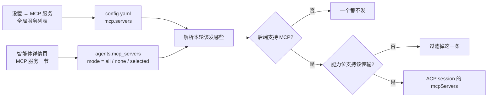
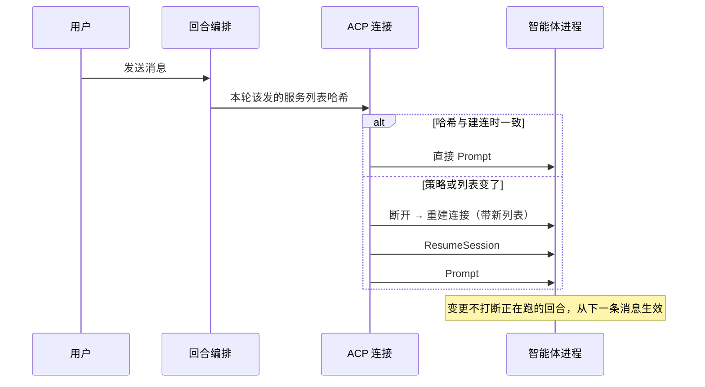

# MCP 服务（全局定义 + 按智能体启用）

MCP（Model Context Protocol）让 AI 智能体连上外部工具服务——搜索、数据库、内部系统。ClawBench 之前完全不管理它：用户只能去改每个 CLI 自己的配置文件（Claude 的 `.mcp.json`、Codex 的 `config.toml`…），格式各不相同，且每个智能体各配一遍；唯一例外是 CodeBuddy 有一条 `--mcp-config` 的历史 workaround。

本模块把这件事收敛成一句话：**在 ClawBench 里配置一次，所有走 ACP 的智能体默认可用，也能按智能体单独开关。**

## 流程图

### 定义与策略分离

定义（含 API key、命令、URL）只有一份，策略只记「这个智能体能用其中哪几个」。这样改一个密钥只改一处，而不是逐个智能体粘贴。

### 一轮对话前的注入与重连

哈希只覆盖「策略 + 定义」，**不含能力位**。能力位要等 Initialize 之后才知道，而 Initialize 发生在建连过程中——若把过滤后的结果拿去算哈希，建连瞬间算出的是「只有 stdio」，实际却发了完整列表，于是下一轮永远对不上、每个进程都要多断连一次。

## 功能与设计要点

### 功能清单

- **全局服务列表**：设置里新增「MCP 服务」分类，一条服务 = 名称 + 传输方式（stdio / http / sse）+ 对应字段（stdio 用命令/参数/环境变量，http 与 sse 用地址/请求头）。配置一次，所有 ACP 智能体默认可用。它解决的是「同一个搜索服务要在五个智能体里配五遍、密钥散落五处」的问题。
- **真实握手测试**：每条服务带一个「测试」按钮，实际完成 MCP 握手并列出工具。**能保存不代表能用**——命令能启动但说错协议、URL 返回 200 却是一张 HTML、服务接了 socket 却永不回复，这些都要连上去才暴露；只测「端口通不通」会把大多数坏配置判成成功。
- **按智能体启用策略**：智能体详情页多一节，三选一——全部启用（默认）/ 全部禁用 / 只选这几个。默认给「全部启用」是安全的：全局列表为空时它什么也不做，而用户加完服务不必再逐个智能体去打勾。
- **不支持的组合被明确挡住**：`dsh` / `deepseek` / `pi` 三个后端实测「接受字段、然后完全忽略」——工具永远不出现。它们在执行层被拦掉（不只是界面置灰），因为默认策略是「全部启用」，只靠 UI 提示的话每个用户都会先撞上一次静默无效。同理 `codex` / `commandcode` 不支持 sse，发过去会让整个 `session/new` 失败，因此按能力位过滤而不是「发过去试试」。
- **对话内配置**：`/cb-mcp` 内置命令让 AI 通过 HTTP API 读写同样两份资源（全局列表 + 智能体策略），适合「帮我把这个搜索服务加上，只给某个智能体用」这类自然语言请求。命令提示词里明确要求「先 GET 再改、整体替换数组、改完回读」，因为列表是整表替换语义，盲写会删掉别的服务。
- **生效时机可预期**：改完不需要重启，也不打断正在跑的回合——连接在每轮开始前重新读取策略，变了就带新列表重连。界面文案统一说「下一条消息生效」。

### 设计要点

- **定义与策略必须分离**：定义里有密钥，策略只是「允许哪些」。合并存（每个智能体各存一份完整定义）会让改一个 key 变成改 N 处，且密钥在库里散落 N 份；只存策略则一处更新、全局同步。这也是业界一致做法（Claude 的 `enabledMcpjsonServers`、CodeBuddy 的 `AgentScopedMcp`）。
- **只对 ACP 传输生效，且必须写在界面上**：CLI 传输根本没有 `mcpServers` 参数，它读自己的配置文件。把这条藏起来会让 CLI 用户配完发现毫无变化却找不到原因。
- **策略的零值必须是「全部启用」而不是「全部禁用」**：一行旧数据（该列还不存在时写入的）、一次反序列化失败，若落到「禁用」，表现是「所有智能体的 MCP 突然全没了」，与「功能坏了」无法区分。宁可默认放行——全局列表为空时放行本来也无副作用。
- **不支持的智能体在执行层拦，而不是只在界面标灰**：默认策略是「全部启用」，纯 UI 层的提示会被默认值绕过。反过来，界面仍要标灰——否则用户会以为勾上了就生效。
- **变更检测的哈希要刻意排除能力位**：见上方流程图后的说明。代价是「给不支持 sse 的智能体加一条 sse 服务」会触发一次无谓重连，这远比「每个进程都多断一次」便宜。
- **建会话的超时要随服务数量放宽**：stdio 服务的启动是同步的，一个「接上但永不回应」的服务会吃掉 agent 自己的 MCP 超时（实测 30–80 秒，正常情况 0.1–3 秒）。把超时按是否挂了 MCP 分档，比统一调大或统一调小都更合适。
- **hermes 的首轮不可用只提示、不自动重试**：它异步挂载 MCP，首轮可能拿不到工具。自动重试会增加延迟与不确定性；让用户再发一次，行为可预期。
- **CodeBuddy 的 `--mcp-config` 保留为兼容路径**：仅在全局列表为空时才走它。直接删掉会让现有 `~/.codebuddy/.mcp.json` 用户静默失去工具；而一旦用户在 ClawBench 里配了服务，就走统一注入，避免两套来源互相覆盖。
