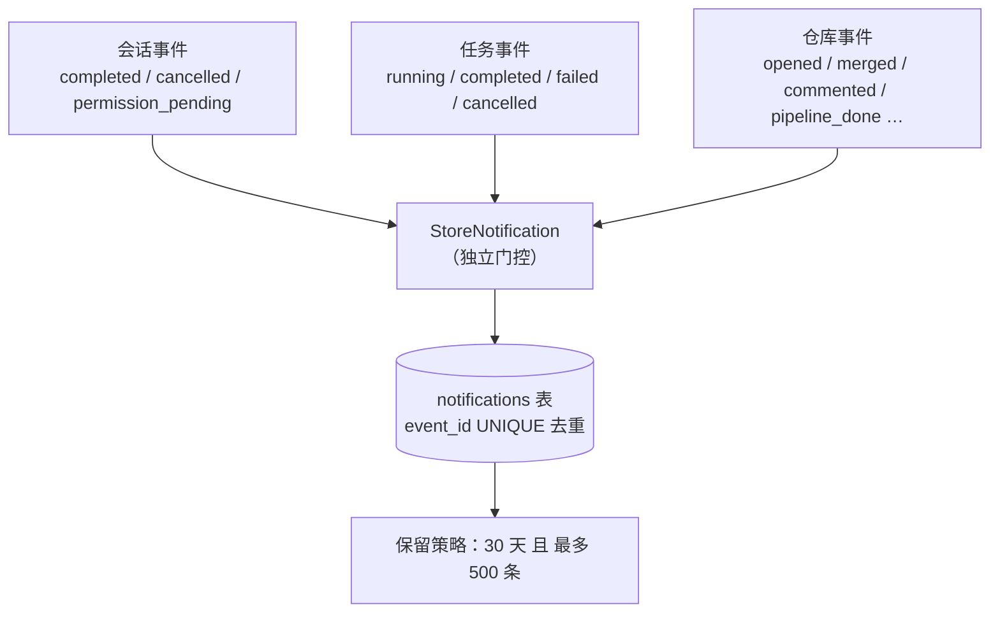
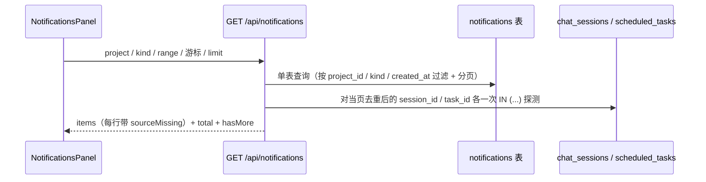

# 通知中心（Notification Center）

## 概述

通知中心把所有**已发生的事件**汇聚成一张**可回溯的日志**：会话完成 / 取消 / 待审批、任务开始 / 完成 / 失败 / 取消、仓库（GitHub/GitLab）六类动态，都记一行，按时间倒序排列，可按项目 / 类型 / 时间段筛选。它回答的问题是「**过去发生过什么**」。

这与既有的三个角标（会话未读、任务未读、仓库未读）**刻意分工**：角标回答「**现在有什么要处理**」，是即时、可清零的状态；通知中心回答「发生过什么」，是只追加、不可清零（除手动清空）的历史。二者是两组独立的数，**互不联动**——通知中心既没有角标，也没有已读/未读概念（见下文「设计要点」）。它是此前「完成弹窗 / 系统通知 / IM 推送」这三条**瞬时**通道之外的**持久**通道：那三条推送完即消失（`pending_events` 是回放日志，推送成功即删、有 TTL），通知中心则留痕。

## 流程图

### 写入：三类事件各写一行

三条写入路径分别挂在会话终态（`pushSessionTerminal`，正常完成与排队逐条通知的共同出口）与会话状态事件（`emitSessionEvent`，覆盖 cancelled / permission_pending）、任务事件（`emitTaskEvent`）、仓库事件（`ForgeNotificationRecorder` sink，与现有 dispatcher / 任务触发并列注册）。三处都以 `event_id` 作 `INSERT OR IGNORE` 去重键。

### 读取：单表查询 + 源存在性探测

列表渲染时对当页去重后的 `session_id` / `task_id` 各做一次存在性探测，给源已删除的行打 `sourceMissing`——覆盖所有删除路径，无需在每处删除点挂钩子。**归档不算删除**（`archived=1` 的行仍可 resume），探测只看行是否存在。仓库条目不参与探测（条目在上游、本地无删除语义），故永不标 `sourceMissing`。

## 功能与设计要点

### 功能清单

- **统一时间线**：会话 / 任务 / 仓库三类事件按发生时间倒序混排成一张扁平卡片列表。每条卡片是「类别图标 + 标题 + 时间 → 摘要（最多两行）→ 事件类型 chip + 项目 + 源状态」的信息层次。用户不必再在三个角标、完成弹窗、钉钉/飞书之间拼凑「今天到底发生了什么」。
- **筛选与分页**：一行三个下拉（项目 / 类型 / 时间段）复用 `MenuSelect` + `PopupMenu`，右侧显示当前筛选结果条数。列表按 `(created_at, id)` 复合游标翻页（**亚秒精度时间戳**，保证同一秒内产生的多条事件稳定排序、翻页不重不漏）。
- **点击跳转**：点有源的通知复用既有三个 CustomEvent（`clawbench-open-session` / `clawbench-open-task` / `clawbench-open-forge`）跳转到事件源，跨项目时各自已实现热切换。**不标记任何已读状态**（无此概念）。
- **源已删除的就地提示**：源（会话/任务）已被删除时，卡片标「源已删除」；点击**不发跳转**，就地提示——因为源自身的降级是**静默改道**（打开已删会话会清空 sessionId 并自动选中最新会话），照常跳转会让用户莫名落到别的会话上。
- **手动清空**：一次清空**整条日志**（不是清筛选子集）——「清空」是破坏性重置，按筛选清空会让用户无法推断剩下的是什么。
- **保留策略**：30 天 且 最多 500 条双上限，接入既有周期性清理 worker，防止日志无限增长。

### 设计要点

- **单表 `notifications` 是唯一数据源，通知中心不引入已读/未读**：通知的本质是「事情发生了，记一笔」，不是收件箱——它要么已在应用内完成卡片弹过、要么已在钉钉/飞书弹过，再叠一层已读状态是多余的。这一个决策一次消掉四处复杂度：不需要 `read_at` 列、不需要与三个既有角标双向同步、不存在「读了会话通知却不更新」的矛盾、不需要「全部已读」按钮与已读/未读筛选。这是本设计最关键的简化。
- **与三个既有角标刻意不统一**：把通知表向上蔓延为三个角标的已读源**不是存储重构，而是三个角标语义的重新定义 + 跨模块数据迁移**。三条硬证据：①**计数单位不同**（会话角标数会话数、任务角标数执行数、仓库角标数去重后的条目数），单表无法在不加 per-kind 聚合规则下同时保住三者；②**会话角标不是事件派生的**（它读 `chat_history` vs `last_read_at` 水位线，而事件写入受 `push_mode != "disabled"` 门控——改由通知表派生会让关闭推送的用户角标永不亮，是功能回归）；③**性能路径会被推翻**（会话角标靠 `idx_history_sess_unread` 把 186ms 压到 0.01ms，改为扫通知表等于重造）。因此二者各答各的问题、零交互。
- **写入不复用 `pending_events` 的任何门控**：`StoreNotifiableEvent` 受 `push_mode != "disabled"` 与「有客户端订阅」双重门控——通知中心必须无视这两条（**推送关 ≠ 不记录，没人在看也要记录**）。这是「日志」与「推送」两种语义的分野：推送是尽力而为的实时投递，日志是无条件的事实记录。三个 `Record*` 适配器还都先查 `store.DBReady()` 再碰 DB（无 DB 的测试路径下不得 panic）。
- **`created_at` 用亚秒精度文本而非秒级 `CURRENT_TIMESTAMP`**：一次仓库轮询会 drain 一批事件、同一秒内产生多条通知，秒级时间戳会让它们无法稳定排序，翻页时可能重复或漏行。分页游标用 `(created_at, id)` 复合条件。
- **源存在性靠「渲染时批量探测」而非「删除时挂钩子」**：删除路径有硬删、归档、项目删除、清理 worker 等多条，逐条挂钩子必漏；反过来，只在列表渲染时对当页去重 id 各查一次，就天然覆盖所有删除路径、零新增钩子。代价是每页 2 次 `IN (...)` 查询——以通知量级（≤500 条）计可忽略。
