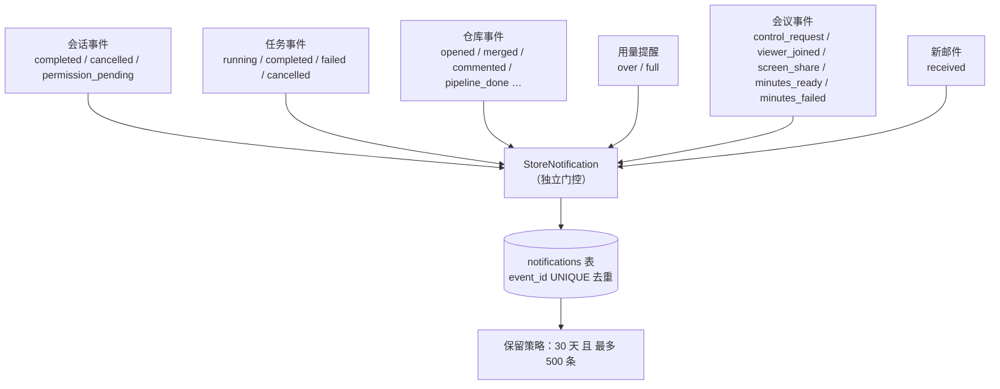
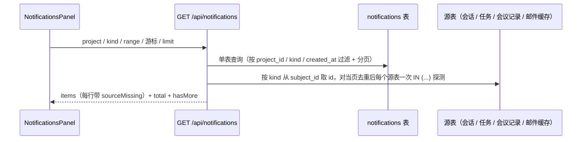
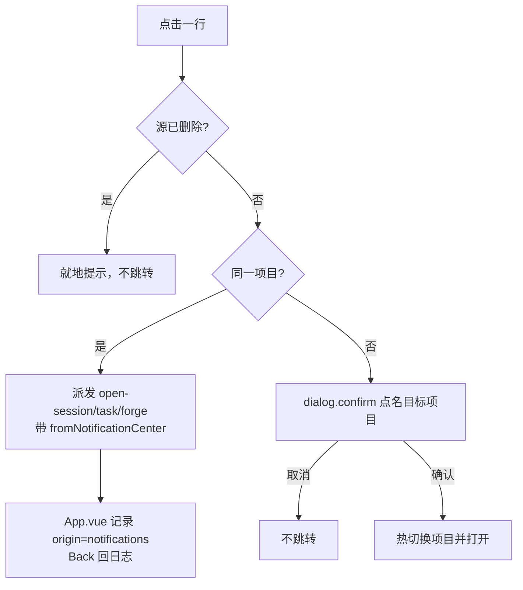

# 通知中心（Notification Center）

## 概述

通知中心把所有**已发生的事件**汇聚成一张**可回溯的日志**：会话完成 / 取消 / 待审批、任务开始 / 完成 / 失败 / 取消、仓库（GitHub/GitLab）六类动态、用量提醒、会议里的五件事（远程控制请求 / 成员加入 / 成员共享屏幕 / 纪要生成成功 / 失败）、新邮件，都记一行，按时间倒序排列，可按项目 / 类型 / 时间段筛选。它回答的问题是「**过去发生过什么**」。

这与既有的三个角标（会话未读、任务未读、仓库未读）**刻意分工**：角标回答「**现在有什么要处理**」，是即时、可清零的状态；通知中心回答「发生过什么」，是只追加、不可清零（除手动清空）的历史。二者是两组独立的数，**互不联动**——通知中心既没有角标，也没有已读/未读概念（见下文「设计要点」）。它是此前「完成弹窗 / 系统通知 / IM 推送」这三条**瞬时**通道之外的**持久**通道：那三条推送完即消失（`pending_events` 是回放日志，推送成功即删、有 TTL），通知中心则留痕。

## 流程图

### 写入：六类事件各写一行

写入路径分别挂在会话终态（`pushSessionTerminal`，正常完成与排队逐条通知的共同出口）与会话状态事件（`emitSessionEvent`，覆盖 cancelled / permission_pending）、任务事件（`emitTaskEvent`）、仓库事件（`ForgeNotificationRecorder` sink，与现有 dispatcher / 任务触发并列注册）、用量提醒（`usage_meter`）、会议事件（`EmitMeetingEvent`，见 `docs/spec/features/live-share.md` 的「会议通知」）、新邮件（`notifyNewInboxMail`，见 `docs/spec/features/mail.md` 的「新邮件提醒」）。每处都以 `event_id` 作 `INSERT OR IGNORE` 去重键。

### 读取：单表查询 + 源存在性探测

列表渲染时按 `kind` 从 `subject_id` 取出当页去重后的 id，对每个源表各做一次存在性探测，给源已删除的行打 `sourceMissing`——覆盖所有删除路径，无需在每处删除点挂钩子。**归档不算删除**（`archived=1` 的行仍可 resume），探测只看行是否存在。仓库条目不参与探测（条目在上游、本地无删除语义），故永不标 `sourceMissing`。

### 跳转：同项目记来源、跨项目先确认

通知中心虽是 dock 页签，但 `NavigationSurface` 需要显式收录它，否则跳走时记录的 origin 是「上一个页签」，Back 会把用户送到他没待过的地方。**同项目**跳转在事件里带 `fromNotificationCenter`，由 `App.vue` 三个 handler 记录来源；**跨项目**刻意**不**记来源——那条路径拆掉整个项目子树并重建，`hotSwitchProject` 有意丢弃上一项目的导航上下文，留一个指回旧项目的 Back 目标是撒谎，确认框就是它的替代品。列表里只有「其他项目」的行显示项目名（靠右、无底色），**没有名字即当前项目**。

## 功能与设计要点

### 功能清单

- **统一时间线**：会话 / 任务 / 仓库 / 用量 / 会议 / 邮件六类事件按发生时间倒序混排成一张扁平卡片列表。每条卡片是「类别图标 + 标题 + 时间 → 摘要（最多两行）→ 事件类型 chip + 项目 + 源状态」的信息层次。用户不必再在三个角标、完成弹窗、钉钉/飞书之间拼凑「今天到底发生了什么」。
- **筛选与分页**：一行三个下拉（项目 / 类型 / 时间段）。类型和时间段用公共 `FilterSelect` 药丸（内部仍是 `MenuSelect` + `PopupMenu`）；项目仍用 `MenuSelect` 的 app-header 两行样式（图标 + 名称/路径 + 分隔线），因为项目重名时只显示名称无法区分。右侧显示当前筛选结果条数。列表按 `(created_at, id)` 复合游标翻页（**亚秒精度时间戳**，保证同一秒内产生的多条事件稳定排序、翻页不重不漏）。
- **点击跳转**：点有源的通知复用既有的 `clawbench-open-*` 事件（会话 / 任务 / 仓库 / 用量 / 会议 / 邮件）跳转到事件源。**同项目**跳转带 `fromNotificationCenter` 让 `App.vue` 记下来源，Back（顶部返回键 / 边缘内划 / Android 硬件返回共用同一状态机）回到日志；**跨项目**先弹确认框（点名目标项目），确认后热切换——跨项目**不**记来源，因为该路径会丢弃上一项目的导航上下文。**不标记任何已读状态**（无此概念）。
- **外部项目标识**：只有「其他项目」的行在元信息行右端显示项目名（与元信息同色、无底色无边框、靠右对齐），当前项目的行**什么都不显示**——「没有名字」即判据；项目名悬停提示"点击将切换项目"。项目路径比较必须**规范化**（去尾斜杠 / `./`、大小写与分隔符归一），否则用户粘贴带尾斜杠的路径后，自己项目的每一行都会被判成「其他项目」而挂上项目名。
- **源已删除的就地提示**：源（会话/任务/会议记录/邮件）已被删除时，卡片标「源已删除」；点击**不发跳转**，就地提示——因为源自身的降级是**静默改道**（打开已删会话会清空 sessionId 并自动选中最新会话），照常跳转会让用户莫名落到别的会话上。
- **手动清空**：一次清空**整条日志**（不是清筛选子集）——「清空」是破坏性重置，按筛选清空会让用户无法推断剩下的是什么。
- **保留策略**：30 天 且 最多 500 条双上限，接入既有周期性清理 worker，防止日志无限增长。

### 设计要点

- **单表 `notifications` 是唯一数据源，通知中心不引入已读/未读**：通知的本质是「事情发生了，记一笔」，不是收件箱——它要么已在应用内完成卡片弹过、要么已在钉钉/飞书弹过，再叠一层已读状态是多余的。这一个决策一次消掉四处复杂度：不需要 `read_at` 列、不需要与三个既有角标双向同步、不存在「读了会话通知却不更新」的矛盾、不需要「全部已读」按钮与已读/未读筛选。这是本设计最关键的简化。
- **与三个既有角标刻意不统一**：把通知表向上蔓延为三个角标的已读源**不是存储重构，而是三个角标语义的重新定义 + 跨模块数据迁移**。三条硬证据：①**计数单位不同**（会话角标数会话数、任务角标数执行数、仓库角标数去重后的条目数），单表无法在不加 per-kind 聚合规则下同时保住三者；②**会话角标不是事件派生的**（它读 `chat_history` vs `last_read_at` 水位线，而事件写入受 `push_mode != "disabled"` 门控——改由通知表派生会让关闭推送的用户角标永不亮，是功能回归）；③**性能路径会被推翻**（会话角标靠 `idx_history_sess_unread` 把 186ms 压到 0.01ms，改为扫通知表等于重造）。因此二者各答各的问题、零交互。
- **写入不复用 `pending_events` 的任何门控**：`StoreNotifiableEvent` 受 `push_mode != "disabled"` 与「有客户端订阅」双重门控——通知中心必须无视这两条（**推送关 ≠ 不记录，没人在看也要记录**）。这是「日志」与「推送」两种语义的分野：推送是尽力而为的实时投递，日志是无条件的事实记录。各 `Record*` 适配器还都先查 `store.DBReady()` 再碰 DB（无 DB 的测试路径下不得 panic）。
- **`created_at` 用亚秒精度文本而非秒级 `CURRENT_TIMESTAMP`**：一次仓库轮询会 drain 一批事件、同一秒内产生多条通知，秒级时间戳会让它们无法稳定排序，翻页时可能重复或漏行。分页游标用 `(created_at, id)` 复合条件。
- **源存在性靠「渲染时批量探测」而非「删除时挂钩子」**：删除路径有硬删、归档、项目删除、清理 worker 等多条，逐条挂钩子必漏；反过来，只在列表渲染时对当页去重 id 各查一次，就天然覆盖所有删除路径、零新增钩子。代价是每页每个源表一次 `IN (...)`（当前最多 4 次）——以通知量级（≤500 条）计可忽略。
- **会议通知的身份存在 `subject_id`，源探测走自己的表**：会议没有会话，身份是分享 token，`subject_id` 存的就是它，点击走 `clawbench-open-meeting`。`sourceMissing` 探测 `live_notes` 而**不是**内存里的房间——房间随发布端 socket 消失，拿它当判据会让每一行在会议结束后立刻变成「源已删除」；记录行只在用户删记录时才消失，那才是「点不开了」。
- **会议事件不进 `pending_events`**：一次远程控制请求只在会议还活着时有意义，而房间是内存对象、进程重启即消失。持久副本是通知中心那一行；客户端重新打开应用后看到的是日志，不是一条迟到两小时的「有人请求远程控制」弹窗。
- **邮件行的 `subject_id` 存邮件 id（十进制文本），并进 `pending_events`**：邮件是「实体」（缓存里的 `mail_messages` 行），所以点开走 `clawbench-open-mail` 并带本地邮件 id，阅读器按 id 取，不受当前文件夹 / 已加载页限制。与会议相反，邮件事件值得离线补发（收件箱里确实多了一封），因此写进 `pending_events`；`sourceMissing` 探测 `mail_messages`，账号或缓存被删后那行就点不开了。
- **群聊通知的 subject_id 必须解析到群时间线（三层修复）**：群成员的 ACP 连接以**隐藏成员行**为键，权限回调把 member id 交给 `EmitSessionEvent`，通知里存的就是 member id——点开是一条空的单聊。三层都要修：①回调处 `ResolveGroupTimelineID`（同时覆盖 WS 广播与 `pending_events`）；②`RecordSessionNotification` 写入时解析；③`MarkMissingSources` 读取时**修复已落盘的旧行**（保留期 30 天，只修写入要等过期才自愈）。

### 新增一种通知（接入收口）

新增一类通知只改三处，不再有并行的 switch 需要逐个记得：

1. **服务端注册表** `internal/service/notification_subjects.go`：在 `notificationSubjects` 里加一条，写明 `kind`、源表与主键（`table` / `key`）、以及源主键是不是整数（`integer`，邮件那种）。没有本地源的（仓库条目在上游、用量阈值是聚合值）只写 `{kind: …}` 声明。主体标识统一读 `subject_id`，**不需要改表结构**。存在性探测、`sourceMissing` 与探测前的修复都遍历这张表；`TestNotificationSubjects_EveryKindRegisteredOnce` 会拦住漏注册。
2. **前端表** `web/src/utils/notificationKinds.ts`：在 `NOTIFICATION_SPECS` 里加一条，写图标、类型名、事件 chip（文案键 / 色调 / 图标）、可选的 `feature`（功能关着时点击改为提示）与 `instanceWide`（不涉及项目切换）、以及 `open`（返回是否真的跳转）。表由 `satisfies Record<NotificationKind, …>` 约束，少一条编译不过；面板的筛选下拉、行图标、chip、兜底标题与点击目的地全部从这张表读。
3. **文案**：`notifications.kind.<id>` 与每个 `notifications.event.<eventType>` 在中英两份 locale 都要有（`notificationKinds.test.ts` 会查）。

写入端调 `StoreNotification`（或照 `RecordSessionNotification` 加一个适配器），`event_id` 用产生该事件的稳定 id（重发靠它去重）。

**未知类型必须安全降级**：服务端未注册的 kind 仍会落库（日志不丢事实）并打一条 warning；前端未声明的 kind 显示「其他」并提示当前版本打不开——**绝不冒充某个已知类型**，点击也不会静默无反应。

**老库升级**：`migrateNotificationSubjects` 在启动时把旧的按类型列（`session_id` / `task_id` / `forge_item_key` / `meeting_token` / `mail_message_id`）写进 `subject_id` 再删列。每列独立判断是否存在，中途崩溃可从下一列续跑；回填带 `subject_id = ''` 守卫，不会覆盖已写入的值。
