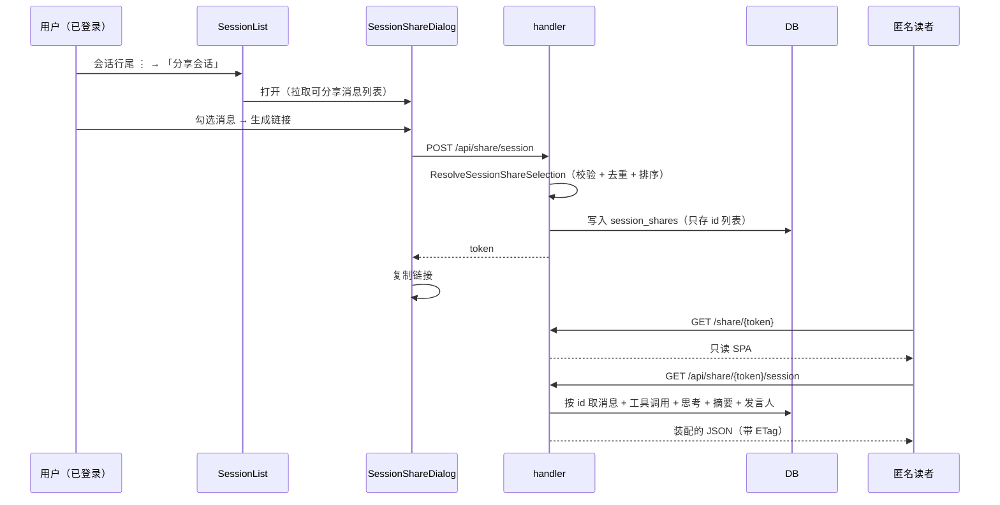
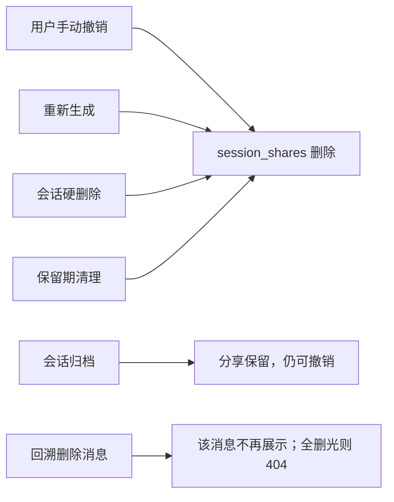

# 会话分享

会话分享把一段 AI 对话发布为**公开只读链接**：任何人拿到链接即可免登录查看，语义与既有的[文件分享](file-management.md)对齐。

文件分享只覆盖文件，而会话里最有价值的产出——推理过程、工具调用、多轮结论——反而无法对外分享，想给别人看只能截图或复制粘贴。会话分享补上这一环。

与文件分享的一处**有意分歧**：

- **归档不撤销分享**。文件被归档没有对应概念；会话归档后分享**保留**且仍可撤销（只是不能再"打开会话"），理由见下。

（会话与文件分享的**管理列表都按项目隔离**，这一点已统一，不再构成分歧。）

## 冻结的是「选择」，不是「内容」

分享记录只存**选中消息的 id 列表**，正文在每次公开访问时从 `chat_history` / `chat_tool_calls` / `chat_thinking` / `summaries` / `chat_sessions` / `agents` 实时装配。这换来两条性质：

- **链接不会随对话增长**：选中的 id 在创建时定死，之后用户继续聊的内容永远不进这条链接。`message_ids` 存的是**已解析的显式列表**，绝不存 `[]` 表示"全部"——那会把点选式分享变成直播。
- **内容以会话最新状态为准**：消息被回溯删除后不再展示（整条链接全删光则 404）；后到的摘要、改名后的智能体头像、改过的会话标题都会反映在链接上。

代价是几条可以预期的语义变化，见文末「与冻结快照的差异」。

## 流程图

### 创建分享与匿名查看

### 撤销的触发点

## 功能与设计要点

### 功能清单

- **创建分享**：会话列表行尾的 `⋮` 按钮 →「分享会话」（**各端统一走这个入口**，见设计要点），打开对话框勾选要公开的消息，生成公开链接。已分享的会话在菜单项上**高亮并在右侧带一个 ✓**——状态指示放在操作入口上，而不是行内的装饰性角标（见设计要点）
- **重新生成**：为已分享会话再点一次，旋转 token 使**旧链接立即失效**并签发新链接。用于"链接发错人了"的场景
- **撤销分享**：菜单项与「已分享会话」抽屉都能撤销，撤销后链接立即 404
- **已分享会话抽屉**：列出**当前项目**的全部分享（会话标题、消息数、创建时间），支持打开会话、在新标签页打开链接、复制链接、逐个撤销、一键清空。会话列表头的入口按钮**常驻**（不再按"本项目是否存在分享"显隐）——抽屉是查看与撤销链接的唯一入口，藏起来只会让用户找不到它；无分享时点开显示抽屉自身的空状态即可
- **归档会话的分享保留**：会话归档后其分享仍留在抽屉里（标注「会话已归档」），可撤销但不能再打开会话。链接本身依然有效——归档不等于删除
- **公开只读页**：`/share/{token}` 是独立 SPA（`share.html` 入口），实时装配完整对话：思考过程、工具调用（输入/输出可展开）、**原始内容**。底部工具栏只保留**只读动作**——复制、查看详情、摘要/原文切换；**引用/朗读/分叉/回溯全部抑制**（引用需要输入区，朗读走鉴权 TTS 端点，分叉/回溯需要活会话）。顶栏是**单行**（logo + 会话标题 + 目录/导出动作）；会话元信息（后端、消息条数与**会话总耗时**，只累加 assistant 回合的 `wallMs`，无任何回合带耗时时整个元素不渲染，不显示 "0ms"）放在**内容列顶部**（随对话一起滚动），不占用顶栏空间；**群会话**的元信息行渲染与会话内一致的**成员头像堆叠**（主持人排最前）。HTML 渲染预览解除宽度限制，便于宽表格/长代码横向铺开
- **目录导航**：分享页顶栏提供对话目录（TOC），列出装配结果里的每条消息，点击即滚动定位。宽屏是右侧常驻/可收起的导航栏，窄屏是抽屉式滑入面板——布局与聊天区的 TOC 停靠栏一致，读者不必依赖浏览器的查找功能在长对话里找某轮。跳转高亮用**底色脉冲**（与应用内主会话一致），而非描边/加粗这类会改变布局的样式
- **导出 JSON**：分享页标题右侧的下载按钮导出 `GET /api/share/{token}/session` 的**原始文档**（零额外请求），便于读者离线留存或二次处理。**导出必须是深拷贝**：`parseMessages` 会**原地**改写 payload 的消息对象（写入 blocks/metadata/showingSummary），直接导出活对象会得到"原始 content 字符串 + 派生 blocks"双份内容，并泄漏读者当前的摘要切换状态。文件名按 Unicode 码点截断（避免切断 emoji 代理对），控制字符用 `\p{Cc}` 剔除
- **群会话的 @ 与发言人还原**：群会话里用户或成员对成员的 `@` 提及会**解析为对应的智能体名**再展示（读者看不到内部路由标签），发言人按成员名册还原成真实名字与头像，而非统一的「助手」。**「是否群会话」必须由 `session.sessionType` 显式判定，不能用名册非空来推断**：`groupMembers` 只是**在群**名册，成员全部离场时为空数组，靠它判断会把群分享当成单聊，读者就会看到原始的 `<clawbench-mention>` 路由标签

### 设计要点

- **冻结的是「选择」，不是「内容」**：创建时只把选中消息的 **id 列表**存进 `session_shares.message_ids`，正文每次公开访问时实时装配。选中的 id 定死，所以链接不会随对话继续增长；内容实时读，所以回溯删除的消息不再展示、后到的摘要与改名的头像会反映出来。`message_ids` **绝不存 `[]` 表示"全部"**——那会让链接变成直播
- **装配必须内联工具输入输出与思考文本**：`chat_history.content` 里 tool_use 块的 `input`/`output` 是**被剥掉的**（`model.ContentBlock.MarshalJSON` 有意为之），thinking 块只存 `think_id`，真实内容分别在 `chat_tool_calls` / `chat_thinking`。因此装配工作在 `map[string]any` 上、**绝不经过 `ContentBlock` 往返**——否则会静默产出满屏空工具卡片。这是最容易写错的一处：直接 re-marshal `ContentBlock` 编译能过、单测若不覆盖内容也会过
- **装配必须确定（字节稳定）**：ETag 由装配结果的 sha256 派生，所以同一份未变的对话两次请求必须逐字节相同。`payload.createdAt` 因此取**分享行的 `created_at`**，不是 `time.Now()`——后者会让 ETag 永不命中，功能"实现了但不生效"
- **装配同时带上摘要与原文，分享页默认原文**：两者都在，使分享页**不必二次请求**就能切换。默认原文是因为分享页是存档，读者的全局 `messageDisplayMode` 是应用侧偏好、不属于被分享的对话；切换按钮仍然可用（`isShowingSummary` 让显式偏好优先于全局模式）。唯一的强制例外是"有摘要但无 blocks"的消息（罕见：agent 只吐了元信息），此时回退显示摘要，避免渲染成空白
- **执行计划有意不含**：`chat_sessions.context_state` / ACP 缓存态是瞬时的、不按消息持久化、在 `ContentBlock` 里也没有表示，放进 payload 既无来源也无消费方
- **自定义头像实时解析**：公开读者**无法**调用 `/api/agents`，所以头像随 `sessionAgent` 与消息级 `speakers` 一起下发，但**每次请求现取**（`model.GetAgent` + 成员行），不冻结——改名/换头像会反映到链接上。**群会话另需有序名册 `groupMembers`**：`speakers` 是 map（JSON 序列化按 UUID 排序、顺序随机）且含**已离场**成员、还缺 `isHost` 标记，无法决定顶栏头像堆叠的**顺序与构成**——名册提供顺序与主持人标记，每片的头像再从 `speakers`（按成员行 id 键控）取。名册是 best-effort：拉取失败不应让整次请求失败，此时顶栏回退到单个会话图标（代价是这一次的 ETag 会与上一次不同）
- **分享抽屉的时间是相对时间，且时区必须显式**：两个分享抽屉（文件/会话）的日期用相对时间展示。时间列由 SQLite `DEFAULT CURRENT_TIMESTAMP` 写成**裸 UTC 文本**（无时区后缀），原样下发会被浏览器当**本地时间**解析——UTC 以东/以西的客户端会把分享读成年轻/年老数小时。因此服务端 `formatShareTime` 统一补上 RFC3339 的 `Z` 后缀再交给前端本地化，与 API 其余时间戳（消息、会话、forge 事件）口径一致
- **不做路径净化，内容原样输出**：早期版本会把 `projectRoot` 前缀替换成 `./`、`homeDir` 替换成 `~/`，试图隐藏创建者的目录结构。这套逻辑被**删除了**，理由是它只能做到"看起来净化过"：
  - 只做前缀字符串替换，`/opt/...`、`/srv/...`、`/mnt/...` 一个字符都不改
  - 家目录下的其他项目只被缩成 `~/other-project/...`，项目名照样露出
  - 转义形态（JSON 双重反斜杠、URL 编码、base64）全部漏过
  - **最要命的是工具输出**：一次 `whoami`、`hostname`、`env`、`git remote -v`，或者 `Read` 一个 `.env`，就能把用户名、内网地址、密钥、客户名全带出去——这些净化**根本不看**

  也就是说它挡不住任何真正敏感的泄露，却让页面显得"已脱敏"。现在 payload 原样输出，由创建者自己决定分享什么。**分享对话框应当提示这一点**（内容可能包含本机路径、文件内容与命令输出）。

- **超限时裁剪而不是拒绝**：单份 payload 上限 16 MiB（工具输出是体积主因）。超限时**先裁剪最长的工具输出**（下限 4 KiB，低于此不再裁）并打上 `truncated` 标记，而不是让请求失败——分享一份降级的长会话，好过完全无法分享。**裁剪实现有个必须记住的约束**：消息体是 JSON **字符串**，裁剪发生在解码后的 wrapper map 上，改动只有写回 `payload.Messages[i].Content` 再重新序列化才会生效；漏掉写回会让整个函数变成 no-op（重新序列化的是原始字符串，返回超限 payload，`truncated` 标记也随改动一起丢弃）
- **只装配选中的消息**：工具调用/思考/消息体都按**选中 id** 查询（分块，每块 500 个以避开 SQLite 变量上限），不扫整个会话。分享 3 条 / 会话 300 条时这是 100 倍的差别，而 `output` 是最大的列
- **已删除的消息跳过，全删光才 404**：回溯或硬删会让某些 id 消失。读取路径**宽容**（跳过），因为链接不该因为对话被裁剪就整条坏掉；一条都不剩时返回 404——对读者而言这与撤销是同一件事，页面也没有内容可渲染。创建路径仍然**严格**（选中未知 id 返回 400），保证存下来的选择与用户勾选的一致
- **ETag + 304，且不做廉价指纹**：装配结果算 sha256 作强 ETag，命中 `If-None-Match` 返回 304（省的是 16 MiB 传输，不是装配）。**不用 SQL 指纹预先短路**：`summaries` 是消息定稿后**异步**写入且时间戳只有秒级、`chat_tool_calls` 会原地更新 `output`、头像来自**进程内** agent 注册表——任何一条漏掉就是"304 之后永远看不到摘要"的静默错误。`Cache-Control: private, no-cache, max-age=0`：必须覆盖 `middleware.NoCache` 已写的 `no-store`（与 304 自相矛盾），`private` 保证撤销不会被共享缓存继续吐
- **撤销优先于条件请求**：token 查不到就直接 404，即使调用方持有有效 ETag
- **并发闸门**：读池只有两条连接（`store/db.go`），公开端点无鉴权无限流，一次装配是数条查询加最多 16 MiB JSON。因此装配前抢信号量（容量 `min(4, NumCPU)`）。排队有三条出路：拿到槽位、客户端断开（直接返回，不写任何东西）、或**等待超时**（`sessionShareQueueTimeout`，默认 10s）→ **503 + `Retry-After: 5`**。必须有超时：无界排队会让一条热门链接把 goroutine 连同请求缓冲堆到 OOM，比拒绝服务更糟
- **`createdAt` 取分享行的 `created_at`，且解析要接受两种形态**：`session_shares.created_at` 是 `DATETIME`，驱动可能把它扫成 `time.Time` 再格式化（RFC3339），也可能保留 SQLite 的裸 UTC 文本。只认后者会让 payload 恒为 `0001-01-01T00:00:00Z`。`parseShareTime` 两种都接受；解析失败时**保留零值并告警**，不回退 `time.Now()`——那会让每次请求字节都不同，ETag 永不命中
- **token 即唯一凭证，无状态公开访问**：公开端点不加登录——"发给任何人即开即用"的零摩擦是分享功能的核心。防线是 token 不可猜测：**无分享记录一律 404**（功能不被使用时零暴露），重新生成即旋转 token 使旧链接立即失效，因此不需要令牌黑名单
- **管理端点鉴权 + 归属校验**：创建/查询/撤销都走 `middleware.Auth`，并校验会话属于请求携带的项目 cookie 所指的项目。**归档会话的归属解析必须走不排除归档的查询**——归档会话在常规查询里被过滤掉，沿用它会得到空项目路径，导致分享被记到"无项目"下而从管理列表消失（链接却仍然有效，等于造出一个撤不掉的分享）
- **归档保留分享**：归档只是移出主列表，消息本身还在。若归档时撤销分享，用户会意外失去一个仍然有效的链接；若归档后从管理列表隐藏，链接有效却再也撤不掉。两者都不可接受，因此选择"保留 + 可撤销 + 不能再打开会话"。**装配路径必须用 `GetSessionFullInfoAny`**（不排除归档）——用常规的 `GetSessionFullInfo` 会让每个归档链接 500
- **硬删除与保留期清理要同步撤销**：这两条路径下消息真的没了。实时装配让这条变成**双保险**：即使某条撤销漏了，链接也会因为消息不存在而 404。会话删除的**批量路径**与**单条路径**都要清理（`IN (...)` 与 `= ?` 两处）
- **只读渲染复用现有聊天管线**：分享页把 payload 喂进既有的渲染管线，而不是另写一套渲染。这保证分享页与聊天区渲染天然一致，不必长期维护第二套实现（与[导出用共享管线而非 DOM 克隆](file-management.md)同一条理由）。**两个 prop 分工**：`readOnly` 抑制一切需要鉴权或活会话的动作（引用/朗读/分叉/回溯）以及工具卡的 POST 动作；`allowLocalActions` 只把**纯本地**的复制/详情/摘要切换放回来。后者刻意是独立 prop，`BtwAnswerDrawer` / `TaskExecDetail` 不传即维持全隐藏。注意这套机制本身是本功能引入的，守卫遗漏不会有编译错误，只能靠测试覆盖
- **目录导航的滚动高亮必须在消息 DOM 就绪后建立观察器**：TOC 的当前项高亮靠 IntersectionObserver 跟随滚动，而观察器若在消息渲染之前创建，观察目标是空的——高亮永远停在首项，直到读者手动点一次。因此观察器必须由"数据落地"这一状态驱动重建，而非在组件挂载时一次性建立
- **折叠的思考块不预渲染 Markdown**：长对话里思考文本体积占大头，若在首屏就把每个折叠块的 Markdown 都渲染出来，分享页加载会被拖到数秒级。折叠态因此只渲染占位，展开时才做 Markdown 渲染——这是分享页加载耗时从 9.9s 降到 2.0s 的主因
- **状态指示放在操作入口上**：会话行内的分享角标是装饰性的（不可点击），状态在一处、操作在另一处，用户看到"已分享"却不知道去哪操作。改为在 `⋮` 菜单的「分享会话」项上体现（已分享时高亮 + 右侧 ✓），与文件侧 `FileHeader` 的「分享链接」项同构——同一个概念在两个功能里长得一样。**指示是右侧的 ✓ 而不是改文案**：标签保持恒定（`分享会话` / `分享链接`），状态由 `.wrap-check` 承担，与同一菜单里「自动换行 / 行号 / 粘性滚动」表达"该项当前是开的"用同一种语言。`.wrap-check` 因此是**全局共享类**（`css/components.css`），两个菜单各自 scoped 一份会让它们悄悄漂移（守卫 `wrapCheck.css.test.ts`）
- **菜单入口统一走 `⋮`，不做右键/长按**：移动端长按会由 Blink 在渲染层合成 `contextmenu` 事件（系统选择菜单的来源），因此"桌面右键 + 移动长按"无法两全——给行绑 `contextmenu` 会把长按菜单带回移动端，且 `preventDefault` 还会压掉长按选词的原生 callout。既然两条路径都不能既支持桌面右键又不触发移动端长按，就整体撤掉：菜单只由行尾 `⋮` 按钮打开，各端手势完全一致
- **管理列表按项目过滤，与文件分享一致**：会话标题是私有内容，跨项目罗列会把"某个项目里在做什么"泄露给任何打开抽屉的人。文件分享列表同理按项目隔离（`file_shares.project_id`），两个抽屉都不再全局罗列
- **分享页的路径 chip 不跳转**：分享页的路径 chip 与相对链接是两条不同的链路。链接由 `shareLinks.ts` 改写为 `/share/{token}?path=` 深链、原地切换（见[文件管理](file-management.md)的「分享页内文件跳转」）；而**路径 chip 的点击必须被拦截**——它经 `openFilePath` 走鉴权端点（`/api/file/`、`/api/dir`，匿名访问一律 401），读者点不动，且路径解析会落在空的项目根上。拦截点在 `openFilePath` 入口，**不能只靠 `MarkdownPreview` 的链接拦截**：后者对 Ctrl/Cmd/Shift+点击有意放行（让浏览器开新标签），点击链会继续走到 `handleAnchorClick`，而它把**任何**相对链接都路由到 `openFilePath`——修饰键点击因此是一条真实的绕过路径
- **chip 的存在性探测也必须拦，且要拦在 `verifyFilePaths`**：`openFilePath` 拦的是"点了之后"，而 `verifyFilePaths` 拦的是"渲染时"。分享页渲染路径 chip 后，`ContentBlocks` 会调 `verifyFilePaths` 探测这些路径是否存在，而该探测走鉴权端点，匿名读者拿 401（`fetchPathTypes` 对非 OK 响应返回 `null`，chip 因此停在未验证态）。因此 `verifyFilePaths` 入口同样需要 `isShareMode()` 短路。**这个守卫看起来像冗余，实则不然**——分享页经 `ChatMessageItem` 渲染，走的是**聊天管线**（`renderMarkdown` → `useChatRender` → `ContentBlocks.reverifyAnnotations`），而带 share 分支的是**文件预览管线**（`buildMarkdownPreviewDom`）；两条管线不同，"文件预览管线在分享模式不产出 `data-file-path`"这一事实**不能**用来推断聊天管线也不需要守卫。测试必须直接驱动 `verifyFilePaths`，针对 `buildMarkdownPreviewDom` 写的测试无法覆盖这条路径

## 数据模型

| 表 | 用途 |
|---|------|
| `session_shares` | 分享记录：`token`（主键）、`session_id`（**唯一**）、`message_ids`（选中消息 id 的 JSON 数组）、`created_at` |

`session_id` 上建**唯一**索引（`idx_session_shares_session`），既供"这个会话是否已分享"与撤销查询使用，也保证两次并发创建不会给同一会话留下两个 token（其中一个会永远无法按会话撤销）。

一个会话至多一条分享记录：再次分享是**旋转**（同一事务内先删旧行再写新行），因此旧 token 立即失效。标题、后端、消息数**不在表里**——管理列表从 `chat_sessions` JOIN 实时取，消息数由 `len(message_ids)` 算出。会话被改名后，抽屉与公开页会同步更新，这正是"不冻结"的一部分。

`message_ids` 是**已解析的显式列表**（创建时校验、去重、按时间排序），空数组是非法的。旧的 `payload` 列与它一起被一次表重建清空：老行的选择藏在被丢弃的 payload 里，保留行只会让 `message_ids` 停在 `'[]'` 默认值。

## API 端点

管理端点经 `middleware.Auth`，并按项目 cookie 做归属校验：

- `POST /api/share/session` — 创建或重新生成分享（请求体含 `sessionId` 与选中的 `messageIds`）。只落 id 列表，不构建正文
- `GET /api/share/session` — 查询某个会话的分享状态
- `DELETE /api/share/session` — 撤销某个会话的分享
- `GET /api/share/session/list` — 列出**当前项目**的全部分享
- `DELETE /api/share/session/list` — 撤销本项目全部分享（一键清空）

公开端点无鉴权，token 即凭证；无记录一律 404：

- `GET /api/share/{token}/meta` — 分享元信息（`kind` = file/session、标题、消息数），供分享页在拉取正文前渲染骨架。**与文件分享共用**：先按会话 token 查，未命中再按文件 token 查，两者都无则 404。`messageCount` 是**选中**的消息数，可能与正文实际渲染的条数不同（分享后被删除的消息仍计入）
- `GET /api/share/{token}/session` — 实时装配的正文。带 `ETag`（装配结果的 sha256）与 `Cache-Control: private, no-cache, max-age=0`；`If-None-Match` 命中返回 **304**（无 body，仍带 `ETag`）。撤销、会话行消失、或选中消息**全部**被删除时返回 **404**，且判定**优先于**条件请求与并发闸门。并发饱和且等待超时返回 **503**（带 `Retry-After`）

## 与冻结快照的差异

实时装配是有意的行为变化，列出以便对照：

1. **回溯会让链接变短**。以前冻结副本不受影响，现在被删的消息不再展示；全删光则链接 404。
2. **摘要异步生成** → 同一条链接在创建后数秒内内容会变（`ETag` 随之变）。"我刚分享出去，对方看到的和我看到的不完全一样"是预期行为。
3. **头像、标题、成员名册跟着当前状态走**。改名或换头像会反映到已发出的链接上。
4. **所有在效链接的 payload 形状同时变**。以前 bump `version` 只影响新链接；现在一次部署会改变全部链接（因为不再有按行存储的形状）。
5. **内容原样输出，包括绝对路径**。旧版本会把项目根与家目录前缀替换成 `./` 与 `~/`；该净化已删除（理由见设计要点）。
