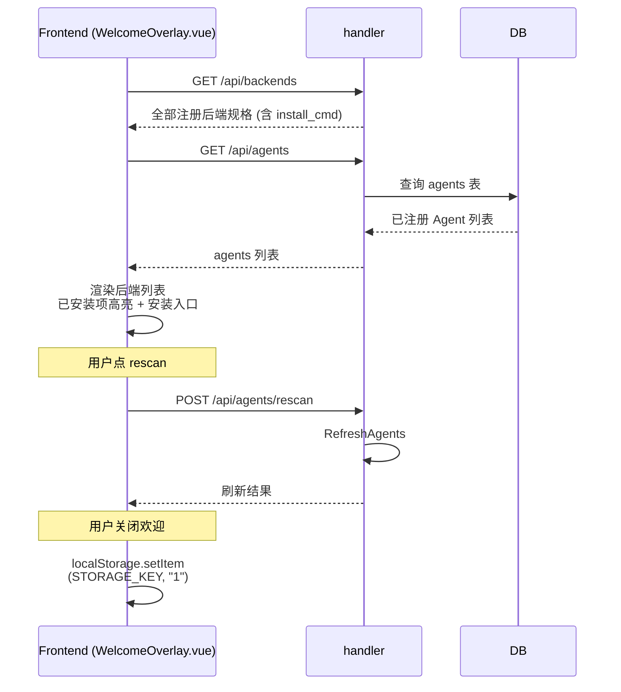
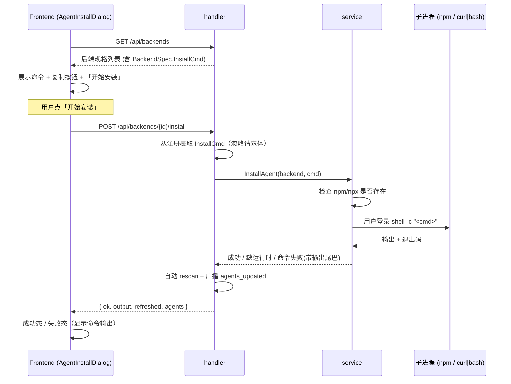

# 首次访问欢迎面板（WelcomeOverlay）

当前首次访问界面是 `WelcomeOverlay`：它展示已安装后端及安装入口，不是分步设置向导。Agent 通过自动发现、一键安装或手动定义写入数据库 `agents` 表。

## 概述

`WelcomeOverlay` 是首次访问 ClawBench 时显示的欢迎遮罩，提供后端安装状态总览和安装入口：

- **触发条件**：用户首次访问（`localStorage 'clawbench_welcome_dismissed'` 未设置）或通过 `clawbench-show-welcome` 自定义事件触发（`web/src/components/settings/SettingsCategory.vue`）
- **关闭机制**：用户点击关闭后写入 `STORAGE_KEY`，之后不再显示
- **数据源**：实时拉取 `GET /api/backends`（全部注册后端规格）和 `GET /api/agents`（已注册 Agent）

## 流程图

### WelcomeOverlay 数据流

### AgentInstallDialog 安装流程

## 功能与设计要点

### 功能清单

- **后端检测面板**：显示 `model.GetBackendRegistry()` 里的 21 个注册后端，每项标注：
  - 后端名称 + 描述
  - 是否已检测到 CLI（来自 `agents` 表）
  - 安装命令（`BackendSpec.InstallCmd`，如 `"npm install -g @anthropic-ai/claude-code"`）
  - ACP 能力（是否支持 `Transport: "acp-stdio"`）
- **检测期间显示加载指示器**：`GET /api/backends` 未返回前，面板显示加载态而不是空白（否则用户看到的是一个空框，会以为面板坏了）。每项也带一个小的状态 spinner，直到该后端的检测结果落定
- **手动刷新**：`POST /api/agents/rescan` 触发 `model.RefreshAgents`（`internal/model/refresh.go`）重新扫描 PATH 中的 CLI
- **安装对话框**：`AgentInstallDialog` 同时提供两条路——「开始安装」直接在本机执行，以及命令 + 复制按钮供手动执行
- **持久化关闭状态**：用户关闭后写入 `localStorage['clawbench_welcome_dismissed']`，下次不再自动显示
- **事件触发重显**：`clawbench-show-welcome` 自定义事件允许设置页主动重新打开欢迎面板

### 一键安装（`POST /api/backends/{id}/install`）

- **命令只能来自服务端注册表**。请求体被完全忽略——否则这个已鉴权端点就是任意远程执行。这也是设置页与欢迎面板永远跑同一条命令的原因（都读 `BackendSpec.InstallCmd`）。
- **源在安装时才定**。展示的命令是 `BackendSpec.InstallCmd` 原文，不带 `--registry`：源要靠探测才知道，写死在展示里就是猜。真正安装时按 `source.Npm()` 逐个 `npm view <包名> version --registry=<源>` 探测（每个 3 秒），第一个答应的源胜出并追加 `--registry`；401/403 停在该源不绕过，404/网络失败换下一个，全部失败用第一个源让 npm 报真实错误。对话框对 `npm install` 开头的命令提示"安装时自动选源"，装完在结果里显示实际执行的命令（与展示不同时）。`npm i`、`npx`、`curl | bash` 不改写。
- **执行位置是运行 ClawBench 的机器**。远端服务器或容器里装的是那台机器，不是打开界面的设备；对话框里明写了这一点，避免「提示装好了但我电脑上没有」。
- **走用户登录 shell**：部分后端是 `curl -fsSL … | bash` 管道，直接 exec 只能覆盖 `npm install -g` 那一半。独立进程组 + `WaitDelay`，取消时整组回收（同 `RunTaskScript` 的处理）。
- **缺 Node 就顺手装上**：命令首 token 是 `npm`/`npx` 时先 `LookPath`；没有（或系统 Node 低于 20）就下载一份私有 Node.js LTS 再执行，而不是让用户自己解决。放在 `$CLAWBENCH_HOME/node`（与一键安装脚本同一目录，`~/.local/share/clawbench` 或 `%LOCALAPPDATA%\clawbench`），解压后放到本进程 PATH 最前面，后续 agent 进程和 rescan 都能用；服务启动时也会补一次（桌面图标/systemd 启动的进程看不到 rc 文件里的 PATH）。不需要 sudo，也不调用系统包管理器。下载源按 `platform.IsChinaMainland()` 选：国内先 npmmirror（`registry.npmmirror.com/-/binary/node`），失败换官方 `nodejs.org/dist`，反向同理；版本从 `index.json` 取最新 LTS，`SHASUMS256.txt` 拿得到就校验。装不上才返回 `400 NodeRuntimeMissing`，`detail.Tool` 指出缺哪个、`detail.Error` 说明自动安装为何失败。`curl | bash` 类命令不做这项检查。
- **失败必须带输出**：`npm ERR! code EACCES`、`404 Not Found`、registry 认证失败，这些只有命令自己会说。输出**只留末尾** 16 KiB（`tailBuffer`；失败原因在最后，`cappedBuffer` 那种留头部的方式在这里是反的），截断时前缀 `…` 标明被截过。命令零输出则用另一条文案，避免出现「安装失败：」后面空着。
- **单飞**：同一时刻只允许一个安装（共用全局 npm prefix，两个并发 `npm install -g` 会互相破坏）。第二个请求直接 `409 AgentInstallBusy`，不排队。
- **不跟随请求生命周期**：客户端关掉抽屉不会中止安装（那会留下半个包），只有 10 分钟超时能中止。因此前端超时设得比服务端长（11 分钟），否则会出现「客户端报失败、服务端仍在跑」的幽灵失败，诱使用户再点一次。Node.js 那一步另有 5 分钟预算（`nodeInstallTimeout`），与安装命令的预算分开计。
- **装完自动 rescan** 并广播 `agents_updated`，一次点击走完「装上 → 可用」。rescan 失败不影响安装成功的事实，用 `refreshed=false` 表达，前端提示手动重新扫描。

### 首次会话自动探测能力

ACP 智能体的模型、思考档位、模式、斜杠命令都由它自己在握手时上报，存在 `AgentCapabilityRegistry` 并落库。新装的智能体这些全是空的，所以新建会话时选择器是空的——看起来像坏了。

- **触发条件**：`POST /api/ai/sessions`（以及项目无会话时的隐式创建）创建一个 **ACP 且能力快照为空**的智能体的会话。
- **动作**：后台跑 `ai.ProbeACPState`——与手动刷新完全同一条路径（临时开会话、采集、删除），写回注册表后广播 `agents_updated`，前端 `loadAgents` 重新拉取即填充。
- **判据同源**：用 `AgentCapability.HasData()` 判断「什么都没报过」，与 GET /api/agents 决定是否展示 catalog 兜底是同一个谓词，两边不会打架。
- **不阻塞、不打扰**：响应先返回；失败静默记日志。探测会真起一个进程，未登录/无网络/冷启动慢都是常见失败，而第一条消息本来就会握手补齐——为一件用户没主动要求、也做不了什么的事弹错误框是错的。
- **按智能体单飞去重**：连续创建三个会话不会为同一个智能体起三个进程。

### 设计要点

- **WelcomeOverlay 不是向导**：当前没有"分步创建 Agent"流程——Agent 创建走 `WelcomeOverlay`（检测/一键安装）→ 自动发现的链路
- **接口边界**：安装命令直接包含在 `GET /api/backends` 的返回值中；`GET /api/agents` 的每个 agent 也带 `installCmd`（同一个 `backendInstallCmd` 实现，两处不会漂移），供设置页的「安装」按钮使用。以下 setup 端点不存在：
  - `GET /api/setup/status`
  - `POST /api/setup/models`
  - `POST /api/setup/verify`
  - `POST /api/setup/complete`
- **不存在的文件澄清**：以下概念在当前代码中**不存在**：
  - `PiConfig` 类型（Agent 配置走 SQL `agents` 表）
  - `auth.json` / `models.json` 文件
  - 内嵌 Pi 二进制检测
- **Agent 创建时机**：当前 Agent 创建有三种路径：
  1. 自动发现：`model.RefreshAgents` 扫描 PATH 中的 CLI（启动时 + `rescan` 时）
  2. 一键安装：`POST /api/backends/{id}/install` 执行内置安装命令后自动 rescan
  3. 手动安装：用户自行在终端执行 `InstallCmd`，然后 `rescan` 触发发现
