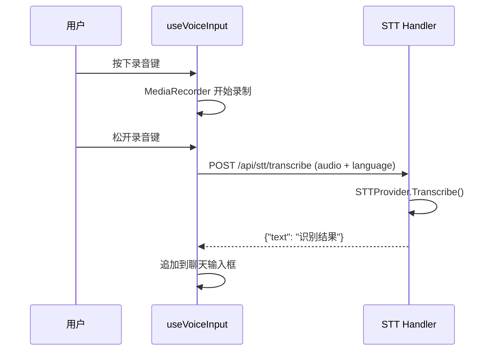
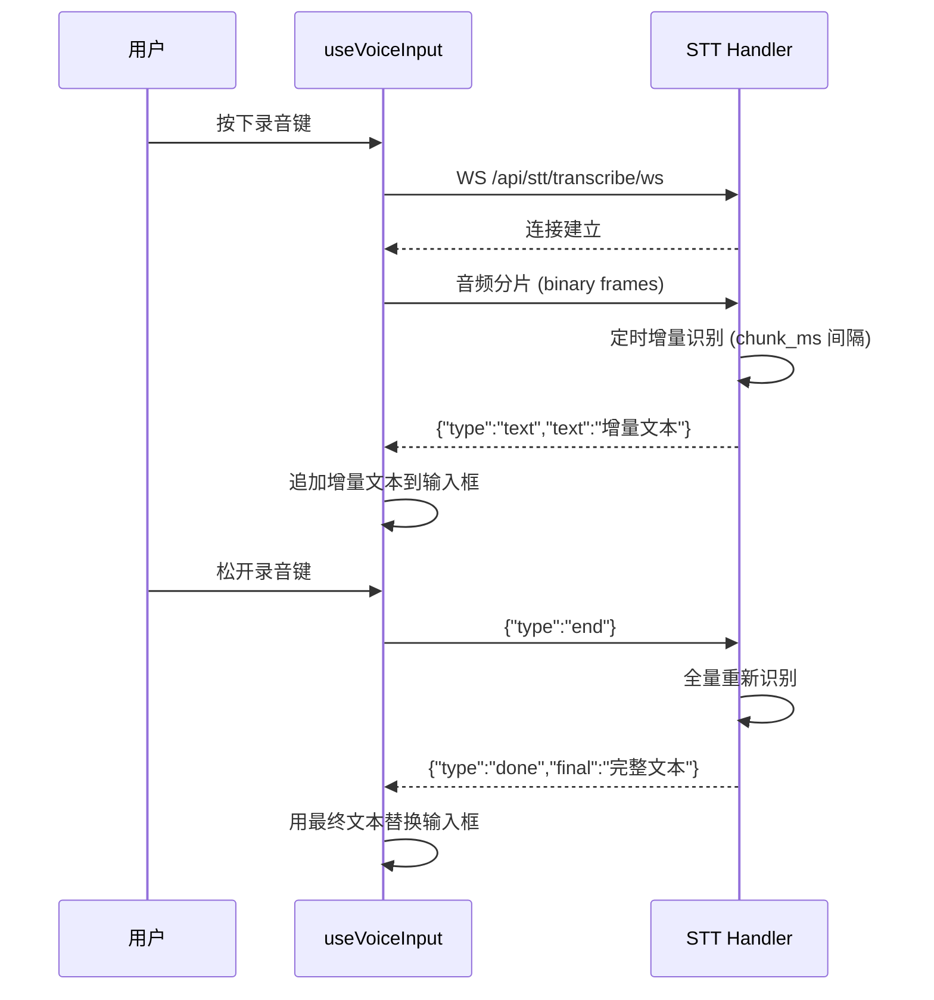

# 语音输入（STT）

ClawBench 的语音输入功能让用户通过麦克风录制语音，由后端 ASR 引擎实时转录为文字并填入聊天输入框。支持流式和非流式两种模式：流式模式下音频分片通过 WebSocket 持续发送，增量识别结果实时显示；非流式模式下录音完成后一次性提交，等待完整识别结果。语音输入降低了移动端打字的交互成本，是移动端适配场景下的核心输入方式。

## 流程图

### 非流式语音识别

非流式模式适合短语音，录音结束后一次性识别。用户按住录音键说话，松开后提交音频，识别结果填入输入框。

### 流式语音识别

流式模式下，前端按 `chunk_ms` 间隔将音频分片通过 WebSocket 发送，后端每收到新分片就增量识别新增部分并发送增量文本。用户停止录音后发送 `end` 控制帧，后端对完整音频做一次全量识别，返回最终结果替换之前累积的增量文本。

## 功能清单

- **语音输入（非流式）**：录音完成后通过 POST 提交音频文件，后端识别后返回完整文本。适合短语音，实现简单，延迟可控
- **语音输入（流式）**：通过 WebSocket 实时发送音频分片，后端按 `chunk_ms` 间隔增量识别，前端实时显示部分结果。用户停止后后端对全量音频重新识别，最终结果替换增量文本。适合长语音，用户可以边说边看到识别进展
- **安全上下文检测**：语音输入需要 HTTPS 或 localhost 环境才能访问麦克风（`navigator.mediaDevices` API 要求安全上下文）。非安全上下文时弹出提示，用户知道为什么无法使用
- **快捷键触发**：可配置快捷键（默认 F9）切换录音状态，无需点击按钮
- **多语言支持**：通过 `language` 参数指定识别语言（如 `zh`、`en`），传给后端 STT 引擎（豆包引擎由模型自动识别，忽略此参数）
- **连续对话（一直听）**：麦克风一直开着，句尾说到触发词（默认「发送」「好了」「就这样」）或停顿够久（默认 3 秒）就自动发送；AI 回答期间麦克风关闭，回答朗读完再自动开麦，如此往复。回答过程中可以直接开口打断——默认一开口就停，环境嘈杂时可改成「说唤醒词才停」。进入模式时自动打开朗读，退出时按进入前的状态还原（用户中途自己关掉的不重新打开）。**触发词只在句尾算数**，否则「把文件改好了」这种正常话会被当成发送指令
- **统一的收音与静音处理**：麦克风约束、灵敏度门限、频段过滤、触发词/打断词解析、回声比对收敛在一处，聊天听写、连续对话、会议听记共用同一份配置——三处各读一份必然漂移（同一个设置在一处生效、另一处不生效）

## 设计要点

- **双模式分离**：流式和非流式使用独立的 HTTP/WS 端点，非流式走 `POST /api/stt/transcribe`，流式走 `WS /api/stt/transcribe/ws`。前端只有在 `stt.streaming` 开启**且** `stt.provider` 为 `doubao` 时才走 PCM 流式采集，其余组合（含默认的 `vllm`）仍用 MediaRecorder 走非流式端点——服务端按 provider 能力分派协议，而裸 PCM 只有豆包能解，两边不一致会把 16 kHz PCM 当成 `recording.webm` 提交给 Whisper，每次请求必然失败
- **流式增量 + 最终全量**：流式模式分两阶段——增量阶段只识别新增音频片段（低延迟、可累积误差），最终阶段对完整音频重做一次识别（高精度、替换增量结果）。兼顾了实时反馈和最终准确性
- **STTProvider 可替换**：后端通过 `STTProvider` 接口抽象识别引擎，由 `stt.provider` 选择实现，接口只做"给定音频段→返回文本"，不关心流式/非流式——流式控制由 handler 层处理。目前有两个实现：
  - `vllm`（默认）：OpenAI 兼容的 `/v1/audio/transcriptions`，配 `stt.base_url` / `stt.model` / `stt.api_key` / `stt.language`
  - `doubao`：火山引擎豆包 Seed-ASR 极速版（`/api/v3/auc/bigmodel/recognize/flash`）。鉴权头是 `X-Api-Key` + `X-Api-Resource-Id`（**不是** `Authorization: Bearer`），只需配 `stt.api_key` 与 `stt.resource_id`（默认 `volc.seedasr.sauc.duration`，按录音时长计费）；`base_url` / `model` / `language` 对它无效，语言由模型自动识别。音频以 base64 内联提交，容器格式按魔数识别（浏览器录音的 WebM/Opus 可直接识别，无需转码）
  - **流式**：豆包走真正的双向流式（`wss://.../api/v3/sauc/bigmodel_async`）。浏览器用 AudioWorklet 把麦克风混成 16 kHz 单声道 PCM 逐帧推送（MediaRecorder 只能产出 WebM/Opus，而流式接口只收裸音频帧）；服务端把引擎返回的**累积文本**以 `{"type":"partial"}` 下发，前端整段替换而非拼接——流式识别会不断修正前文，追加会产生重复；引擎的错误帧（消息类型 `0xF`，含 code/message）转成 `{"type":"error","message":...}` 下发并结束会话，不能当作正常结束返回空文本。vLLM 没有流式能力，仍走「缓存音频 + 定时重识别」的兜底路径（`{"type":"text"}` 增量追加）
  - **判定可用性看响应体而非 HTTP 状态**：豆包对无效 Key / 未授权资源同样返回 HTTP 200，真正结果在 `header.code`（`20000000` 成功；`45000010` Key 无效；`45000030` Key 有效但该资源未授权；`45000006` 音频不可下载）。设置页的连通性测试因此会真的上传一段"你好"语音并要求返回非空文本，而不是只探测端点存活
- **音频大小限制**：非流式请求 10MB 上限，流式连接 20MB 上限，防止内存溢出
- **回声必须当回声丢掉，不能当输入**：连续对话在朗读期间靠临时开麦判断打断，麦克风收到的是喇叭外放的声音。判据是识别结果与正在朗读的文本大量重合——不做这一步，AI 会自己打断自己（每念一句就触发一次打断），循环永远推进不下去。这是"打断"这个能力必须付出的代价：想让它随时可打断，就得先能区分谁在说话
- **「说完了」这件事引擎不告诉你，只能自己定**：流式引擎没有句末标记，只会不停重发当前这句的全文，因此判"这句结束"必须由客户端/服务端的计时与稳定窗口决定（停顿阈值、"稳定多久没有新修订"、单行最长强制收口）。把"引擎返回了一次结果"当成"用户说完了"，会让长句被切成碎片
