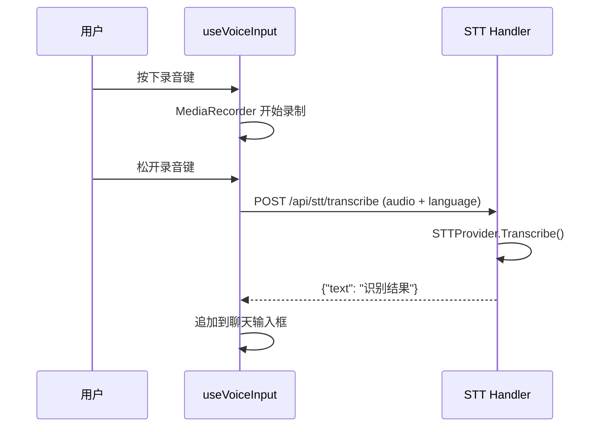
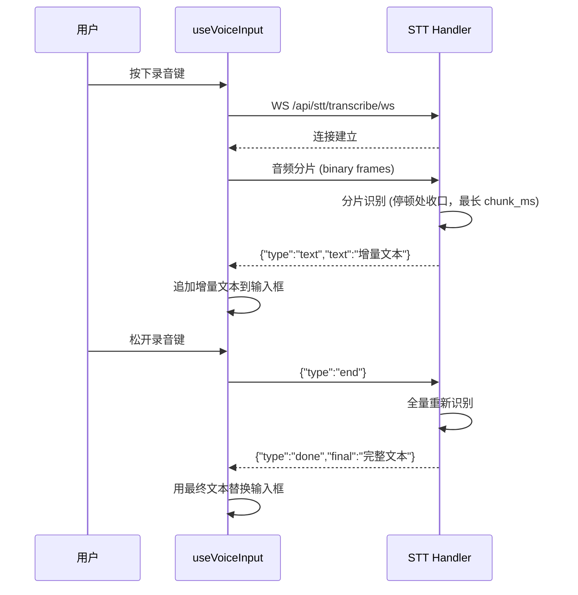

# 语音输入（STT）

ClawBench 的语音输入功能让用户通过麦克风录制语音，由后端 ASR 引擎实时转录为文字并填入聊天输入框。支持流式和非流式两种模式：流式模式下音频分片通过 WebSocket 持续发送，增量识别结果实时显示；非流式模式下录音完成后一次性提交，等待完整识别结果。语音输入降低了移动端打字的交互成本，是移动端适配场景下的核心输入方式。

## 流程图

### 非流式语音识别

非流式模式适合短语音，录音结束后一次性识别。用户按住录音键说话，松开后提交音频，识别结果填入输入框。

### 流式语音识别

流式模式下，音频以 16 kHz 单声道 PCM 分片经 WebSocket 推送，服务端按引擎能力分派：流式引擎边收边出累积文本，缓冲引擎在停顿处（或达到 `chunk_ms`）把这一片包成 WAV 提交并下发增量文本。用户停止录音后发送 `end` 控制帧；此时只有 `stt.final_recheck` 开启（默认关闭）才对完整音频再做一次全量识别、返回最终结果替换之前累积的增量文本，关闭时 `done` 不带 `final`，前端保留已累积的文本。

## 功能清单

- **语音输入（非流式）**：录音完成后通过 POST 提交音频文件，后端识别后返回完整文本。适合短语音，实现简单，延迟可控
- **语音输入（流式）**：通过 WebSocket 实时发送音频分片，后端在停顿处（最长 `chunk_ms`）分片识别，前端实时显示部分结果。开启 `stt.final_recheck` 时用户停止后还会对全量音频重新识别一次、用它的结果替换增量文本（默认关闭：整段音频被识别两次，只为一个更连贯的收尾）。适合长语音，用户可以边说边看到识别进展
- **安全上下文检测**：语音输入需要 HTTPS 或 localhost 环境才能访问麦克风（`navigator.mediaDevices` API 要求安全上下文）。非安全上下文时弹出提示，用户知道为什么无法使用
- **快捷键触发**：可配置快捷键（默认 F9）切换录音状态，无需点击按钮
- **多语言支持**：通过 `language` 参数指定识别语言（如 `zh`、`en`），传给后端 STT 引擎（豆包引擎由模型自动识别、忽略此参数；阿里云用它作语种提示）
- **连续对话（一直听）**：麦克风一直开着，句尾说到触发词（默认「发送」「好了」「就这样」）或停顿够久（默认 3 秒）就自动发送；发送前会先向引擎要这句的**定稿**（见下方「发送前先要定稿」），否则最后几个字会丢；AI 回答期间麦克风关闭，回答朗读完再自动开麦，如此往复。回答过程中可以直接开口打断——默认一开口就停，环境嘈杂时可改成「说唤醒词才停」。进入模式时自动打开朗读，退出时按进入前的状态还原（用户中途自己关掉的不重新打开）。**触发词只在句尾算数**，否则「把文件改好了」这种正常话会被当成发送指令。**自动发送与退出各有一声提示音**（上扬＝已发送、下沉＝已退出），不读屏也能确认状态。**朗读不能只依赖终态事件**：自动朗读平时由回合的 `done` 触发，而 WS 在回合中途重连（手机网络抖一下就会，屏幕可以一直亮着、App 也一直在前台）时 hub 找不到订阅者，会把 `done` 直接丢掉，这一轮改由会话状态更新/历史重载收尾——所以回合结束、什么都没在播时，循环会再问一次「这一轮回复读过没有」，没读过就补读（已读过的按消息 id 记着，不会重复念）。**两种引擎都能用**：豆包走真流式，OpenAI 兼容引擎由服务端按停顿切片识别（见下方设计要点），触发词、停顿发送、打断对两者一视同仁
- **统一的收音与静音处理**：麦克风约束、灵敏度门限、频段过滤、触发词/打断词解析、回声比对收敛在一处，聊天听写、连续对话、会议听记共用同一份配置——三处各读一份必然漂移（同一个设置在一处生效、另一处不生效）

## 设计要点

- **双模式分离**：流式和非流式使用独立的 HTTP/WS 端点，非流式走 `POST /api/stt/transcribe`，流式走 `WS /api/stt/transcribe/ws`。听写（聊天输入框）只有在**所选引擎自己的** `streaming` 开启（`stt.vllm.streaming` / `stt.doubao.streaming` / `stt.alibaba.streaming`）**且**该引擎能解裸 PCM（`doubao` / `alibaba`）时才走 PCM 流式采集，其余组合（含默认的 `vllm`）仍用 MediaRecorder 走非流式端点——一次完整录音只做一次识别，比分片识别的结果干净。WS 本身对引擎无关：服务端按 provider 能力分派，豆包/阿里云直接吃裸 PCM 帧，其余引擎由服务端把累积的 PCM 包成 WAV 再提交（**不能把裸 PCM 当 `recording.webm` 提交**，Whisper 解不出来，表现为「说完什么都没有」）
- **流式增量 + 可选的最终全量**：增量阶段只识别新增音频片段（低延迟，但每片之间没有上下文，跨片的词会识别错）。`stt.vllm.final_recheck` 开启时收尾再对完整音频重做一次识别（高精度、替换增量结果），代价是整段音频被识别两次，因此默认关闭——关掉时前端保留增量文本，收尾不再多花一遍。另外，只有客户端发 `end` 才可能有这一遍（连续对话现在也会发，见下方「发送前先要定稿」）
- **STTProvider 可替换**：后端通过 `STTProvider` 接口抽象识别引擎，由 `stt.provider` 选择实现，接口只做"给定音频段→返回文本"，不关心流式/非流式——流式控制由 handler 层处理。目前有三个实现：
  - `vllm`（默认）：OpenAI 兼容的 `/v1/audio/transcriptions`，配 `stt.vllm.base_url` / `stt.vllm.model` / `stt.vllm.api_key` / `stt.vllm.language`
  - `doubao`：火山引擎豆包 Seed-ASR 极速版（`/api/v3/auc/bigmodel/recognize/flash`）。鉴权头是 `X-Api-Key` + `X-Api-Resource-Id`（**不是** `Authorization: Bearer`），只需配 `stt.doubao.api_key` 与 `stt.doubao.resource_id`（默认 `volc.seedasr.sauc.duration`，按录音时长计费）；`base_url` / `model` / `language` 对它无效，语言由模型自动识别。音频以 base64 内联提交，容器格式按魔数识别（浏览器录音的 WebM/Opus 可直接识别，无需转码）
  - `alibaba`：阿里云百炼（Model Studio / DashScope）。**两条完全不同的 API 共用一份凭据**：整段上传走 OpenAI 兼容的 `POST {base}/compatible-mode/v1/chat/completions`（模型固定 `qwen3-asr-flash`，音频以 `data:<mime>;base64,...` 内联，单文件约 7 MB 上限——base64 会把请求放大 4/3），实时识别走 `wss://.../api-ws/v1/inference`（模型默认 `paraformer-realtime-v2`，可用 `stt.alibaba.model` 改）。`stt.alibaba.base_url` 与 `stt.vllm.base_url` **分开存**：vLLM 的默认值（localhost）会被供应商切换继承下来，静默指向一个不存在的服务；国际站是 `https://dashscope-intl.aliyuncs.com`，企业工作空间则是 `{WorkspaceId}.cn-beijing.maas.aliyuncs.com`。语种由 `language_hints` 提示（空则自动识别；不在实时模型支持列表里的语种一律不发提示，而不是发一个会被拒的值），ITN / 标点 / 顺滑分别映射到 `inverse_text_normalization_enabled` / `punctuation_prediction_enabled` / `disfluency_removal_enabled`
  - **流式（阿里云）**：协议是「先 `run-task`，收到 `task-started` 才能发音频，最后 `finish-task`，收到 `task-finished` 才算结束」。`OpenStream` 因此**阻塞到 `task-started`** 才返回——调用方拿到 session 就会立刻写音频，提前写会被服务端拒绝。返回的是**逐句**结果（`sentence_end=false` 中间态、`true` 定稿），而 `StreamResult.Text` 契约要求「到目前为止的全文」，所以 session 自己把已定稿句子拼成前缀、再接上正在修订的当前句；`heartbeat=true` 的结果是保活包，必须丢掉。`heartbeat` 参数置 true，否则会议里长时间没人说话会被服务端断开
  - **流式（豆包）**：豆包走真正的双向流式（`wss://.../api/v3/sauc/bigmodel_async`）。浏览器用 AudioWorklet 把麦克风混成 16 kHz 单声道 PCM 逐帧推送（MediaRecorder 只能产出 WebM/Opus，而流式接口只收裸音频帧）；服务端把引擎返回的**累积文本**以 `{"type":"partial"}` 下发，前端整段替换而非拼接——流式识别会不断修正前文，追加会产生重复；引擎的错误帧（消息类型 `0xF`，含 code/message）转成 `{"type":"error","message":...}` 下发并结束会话，不能当作正常结束返回空文本。vLLM 没有流式能力，走「缓存音频 + 分片重识别」的兜底路径：**分片在停顿处收口**（安静 800 ms；一直说不停时才强制切一刀，切点取 `chunk_ms`，但不小于 0.8 秒、也不晚于「停顿发送秒数 − 0.5 秒」），因为缓冲引擎是「给一个文件、识别这个文件」，按固定时钟切会切在字中间，而这条路径的文本是**追加**的、后面不会修正；切得太晚又会赶不上客户端的停顿发送计时（那个计时每收到一段文本就重置，超时就直接发消息并关掉这条 socket，尾音就丢了）。每片先包 WAV 头再提交，低于静音门限的片段直接丢弃（Whisper 会给静音编出「谢谢观看」，在连续对话里那就是一条被发出去的消息）。这条路径的 socket 会跨整段静音一直开着，**空转的 tick 不能当成流结束**
  - **判定可用性看响应体而非 HTTP 状态**：豆包对无效 Key / 未授权资源同样返回 HTTP 200，真正结果在 `header.code`（`20000000` 成功；`45000010` Key 无效；`45000030` Key 有效但该资源未授权；`45000006` 音频不可下载）。设置页的连通性测试因此会真的上传一段"你好"语音并要求返回非空文本，而不是只探测端点存活
- **每个引擎一套独立配置，不共用字段**：三家引擎的凭据、端点和识别选项分别存在 `stt.vllm` / `stt.doubao` / `stt.alibaba` 三个小节里。共用一个 `stt.api_key` 的后果是**切换引擎就把上一个引擎的配置写没了**——配好自建 Whisper 再切到豆包，切回来时地址和密钥已经是豆包的。真正全局只有一件事的选择才留在 `stt` 顶层：选哪个引擎、录音快捷键、麦克风处理、静音门限、连续对话。旧的扁平 `stt.*` 键在启动时按当时的 `stt.provider` 迁进对应小节（`internal/model/stt_migrate.go`），歧义字段（`api_key` / `streaming`）只交给当时选中的那个引擎，不会凭空给另外两家造出一份凭据；写回配置文件时旧键会被删掉，否则手改一个没人读的键会看起来生效
- **音频大小限制**：非流式请求 10MB 上限，流式连接 20MB 上限，防止内存溢出
- **回声必须当回声丢掉，不能当输入**：连续对话在朗读期间靠临时开麦判断打断，麦克风收到的是喇叭外放的声音。判据是识别结果与正在朗读的文本大量重合——不做这一步，AI 会自己打断自己（每念一句就触发一次打断），循环永远推进不下去。这是"打断"这个能力必须付出的代价：想让它随时可打断，就得先能区分谁在说话
- **「说完了」这件事引擎不告诉你，只能自己定**：流式引擎没有句末标记，只会不停重发当前这句的全文，因此判"这句结束"必须由客户端/服务端的计时与稳定窗口决定（停顿阈值、"稳定多久没有新修订"、单行最长强制收口）。把"引擎返回了一次结果"当成"用户说完了"，会让长句被切成碎片
- **发送前先要定稿，别拿"修订中"的文本发车**：连续对话里看到的文本是**修订态**，不是最终答案。流式引擎要看到足够长的静音才收句（阿里云 `max_sentence_silence` 默认 800 ms），而客户端的收音门限在最后一个响帧之后 600 ms 就停止送音频——门限比断句阈值短，引擎永远等不到收句，手上那句就缺最后几个字；过去这条路径还直接 `close()` 而不发 `end`，服务端没有机会 flush，缺的字就永久丢了（听写模式一直会发 `end`，所以只有连续对话有这个毛病）。现在「停顿够了 / 说到触发词」只是**决定要发**，真正发之前先发 `{"type":"end"}`、停止送音频、等引擎回 `done` 里的 `final` 定稿再发车；1 秒等不到就用手上已有的文本兜底（缓冲引擎 `final_recheck` 关闭时 `final` 为空，同样走兜底，行为与以前一致）。触发词要在定稿后**再剥一次**——引擎不知道触发词是我们自己的协议，`final` 里它还挂在句尾；`done` 到达后也不能再跑一遍触发词判断，否则同一句会发两次
