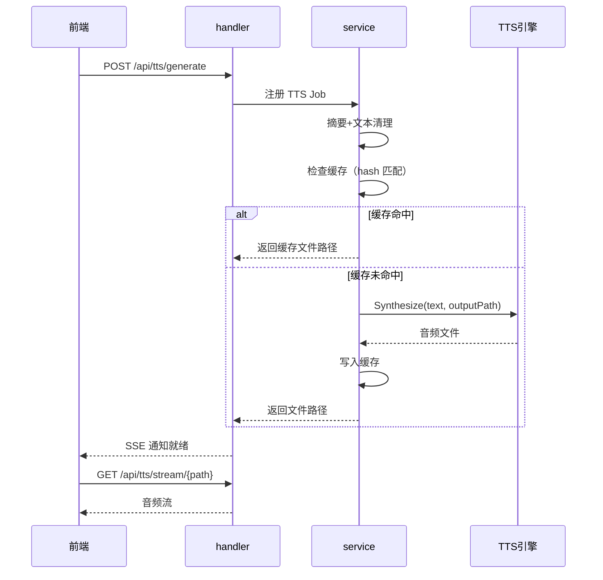

# 语音合成（TTS）

语音合成让用户不用盯着屏幕也能"听"AI 的回复——在移动场景下尤其有用，比如走路时听代码审查结果。系统支持云引擎（Edge TTS）和本地引擎（Piper、Kokoro、MOSS-Nano），通过统一的 `SpeechProvider` 接口切换，TTS 前由 summarizer 将长文本压缩为适合朗读的短文本。

## 流程图

### TTS 请求到播放

## 功能与设计要点

### 功能清单

- **多引擎 TTS**：支持 Edge TTS（云，微软语音）、Piper（本地 ONNX）、Kokoro（本地 ONNX）、MOSS-Nano（本地），用户按需选择引擎。云引擎声音自然但需要网络，本地引擎离线可用但声音质量有限
- **总结后端三选一**：长文本先经 summarizer 压缩再合成语音。后端可选 `simple`（纯文本清洗，零延迟零成本）、`api`（LLM 二次压缩，复用 `ai_summary` 配置）或 `auto`（**按内容自动分流**：剥离出的"杂质"占比 ≥ `summarize.auto_junk_ratio`（默认 0.5），或清洗后文本超过 simple 的截断上限时走 LLM，否则直接朗读清洗文本）。短文本（< 300 字符）跳过摘要直接合成。`auto` 在未配置 `ai_summary` 时降级为 `simple`，不像 `api` 那样硬失败
- **文本清理**：合成前自动剥离 Markdown 格式、工具调用输出、thinking block 等不适合朗读的内容，保留可读的纯文本。清理**刻意保守**——保留 `snake_case` 标识符、乘号、时间、端口、Windows 路径、`C#` 等会因过度清洗而被静默篡改的技术文本；公式、代码围栏、链接等才真正删除。`StripMarkdownStats` 回报删除/保留 rune 数，正是 `auto` 分流的判据来源
- **群聊轮流朗读**：群聊里每位成员**各自发言结束**即触发朗读，而不是等整轮结束只念最后一条。前端按发言者逐一触发并带上发言人名，播放走 FIFO 队列，多位成员并发发言时**按顺序轮流播放**、互不抢占；某位失败即推进下一位，不阻塞整轮。后端 `POST /api/tts/generate` 接收 `speakerName`，在摘要之后、合成之前拼上「`xxx`说：」前缀——**只作用于音频**，不进摘要、不写摘要缓存；缓存键并入发言人名，避免不同成员说同样的话共用音频
- **文件缓存**：合成结果按文本 hash 缓存为音频文件，相同内容不重复合成。缓存上限 100 个文件，自动淘汰最旧的——避免存储空间无限增长
- **TTS Job 管理**：每个 TTS 请求注册为 Job，支持取消和完成通知。防止重复合成相同内容

### 设计要点

- **CLISpeechProvider 是通用包装器**：所有 CLI 类 TTS 引擎共享统一的 CLI 调用模式（构建参数 → 管道文本 → 读取输出文件），差异仅在 CLI 名称和参数格式——新增引擎只需配置命令行参数
- **摘要与 TTS 共享 summarizer 接口**：TTS 摘要和任务摘要使用同一个 `Summarizer` 接口，但配置不同——TTS 摘要剥离 Markdown（朗读不需要格式），任务摘要保留 Markdown（记录需要格式）
- **`auto` 是"内容感知"而非"配置感知"**：`simple` 与 `api` 的取舍是固定的（要么总是清洗、要么总是调 LLM），用户得为整份会话选一种。`auto` 把决策下移到单条消息——大多数回复是干净散文，清洗即可朗读，不该为它付 LLM 延迟与费用；只有代码/表格/公式占比高、清洗后成了断句碎片时，才值得让 LLM 重新组织。它用 `StripMarkdownStats` 的删除比例作为判据，复用清理阶段已有的产物，不额外解析文本
- **清理的"保守"是被真实缺陷逼出来的**：早期版本无差别删除 `\ # * ~ \`` 等残留字符，把 `user_id`、`C:\Users\...`、`12:30:45`、`host:8080` 等技术文本改得面目全非——朗读出来是错的，却没有任何报错。现在按"是否真有 Markdown 语义"逐类判定，宁可少剥也不篡改
- **缓存键是文本内容的 hash**：相同文本无论请求多少次只合成一次。但模型/语速/语言的变化会产生不同的 hash，保证不同配置的合成结果不会混淆；群聊的发言人名也并入键，避免"不同人说同样的话"共用同一段音频
