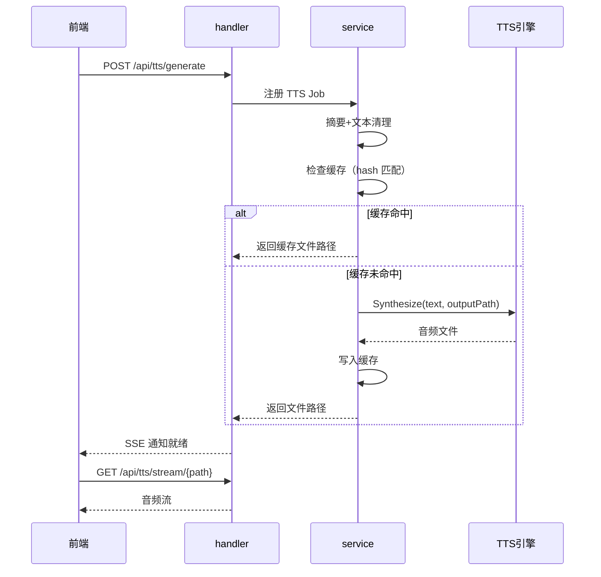

# 语音合成（TTS）

语音合成让用户不用盯着屏幕也能"听"AI 的回复——在移动场景下尤其有用，比如走路时听代码审查结果。系统支持 Edge TTS 与 OpenAI 兼容 TTS 两种引擎，通过统一的 `SpeechProvider` 接口切换，TTS 前由 summarizer 将长文本压缩为适合朗读的短文本。

## 流程图

### TTS 请求到播放

## 功能与设计要点

### 功能清单

- **六种引擎**：支持 Edge TTS（微软语音）、OpenAI 兼容 TTS（`/v1/audio/speech`）、阿里云百炼（DashScope）、腾讯云语音合成、火山引擎（豆包）与 MiniMax，用户按需选择引擎。Edge 开箱即用，其余可接入对应厂商的账号
- **总结后端三选一**：长文本先经 summarizer 压缩再合成语音。后端可选 `simple`（纯文本清洗，零延迟零成本）、`api`（LLM 二次压缩，复用 `ai_summary` 配置）或 `auto`（**按内容自动分流**：剥离出的"杂质"占比 ≥ `summarize.auto_junk_ratio`（默认 0.5），或清洗后文本超过 simple 的截断上限时走 LLM，否则直接朗读清洗文本）。短文本（< 300 字符）跳过摘要直接合成。`auto` 在未配置 `ai_summary` 时降级为 `simple`，不像 `api` 那样硬失败
- **文本清理**：合成前自动剥离 Markdown 格式、工具调用输出、thinking block 等不适合朗读的内容，保留可读的纯文本。清理**刻意保守**——保留 `snake_case` 标识符、乘号、时间、端口、Windows 路径、`C#` 等会因过度清洗而被静默篡改的技术文本；公式、代码围栏、链接等才真正删除。`StripMarkdownStats` 回报删除/保留 rune 数，正是 `auto` 分流的判据来源
- **群聊轮流朗读**：群聊里每位成员**各自发言结束**即触发朗读，而不是等整轮结束只念最后一条。前端按发言者逐一触发并带上发言人名，播放走 FIFO 队列，多位成员并发发言时**按顺序轮流播放**、互不抢占；某位失败即推进下一位，不阻塞整轮。后端 `POST /api/tts/generate` 接收 `speakerName`，在摘要之后、合成之前拼上「`xxx`说：」前缀——**只作用于音频**，不进摘要、不写摘要缓存；缓存键并入发言人名，避免不同成员说同样的话共用音频
- **文件缓存**：合成结果按「文本 + 发言人 + 合成配置」hash 缓存为音频文件，相同内容不重复合成。缓存上限 100 个文件，自动淘汰最旧的——避免存储空间无限增长
- **一体化语音 WS（嵌入式设备，唯一入口）**：`WS /api/voice/turn/ws` 把「录音 → 识别 → 跑一轮 → 摘要 → 合成 → 推送 PCM」收进一条连接。设备只发 16 kHz 单声道 PCM 与 `listen` / `end` 控制帧，依次收到 `final`（识别结果）、`phase`、`summary`（摘要**单独一帧先发**，设备可以先显示文字再等声音）、音频格式帧与二进制 PCM；`{"type":"replay","messageId"}` 重播已有消息，`{"type":"say","sessionId","text"}` 跳过识别直接跑一轮。**一条连接可连续跑多轮**——设备在第一条连接刚关闭时常常申请不到第二份加密上下文（`MBEDTLS_SSL_SETUP_FAILED`），故每轮只做一次 TLS 握手。推送按实时速度做，避免把设备的播放缓冲压爆导致结尾丢字，发送结束后等 300 毫秒再关连接。**每个回合与网页发消息共用同一套会话占用与终态**：跑之前先占用会话（忙时最多等 30 秒，仍忙则回 `session busy`），用户消息当场落库并广播，结束后发 `done` 与完成推送；群聊会话直接拒绝（群由编排器驱动，一条语音回合只对应一个发言人）
- **TTS Job 管理**：每个 TTS 请求注册为 Job，支持取消和完成通知。防止重复合成相同内容

### 设计要点

- **两个引擎都是纯 HTTP 客户端**：Edge TTS 走 WebSocket 流式合成，OpenAI 兼容引擎走 `/v1/audio/speech`，两者都不依赖本地可执行文件
- **国内三家的实现约束**（阿里云 / 腾讯云 / 火山引擎）：
  - **必须输出 MP3**。整条链路只认 MP3——缓存文件名是 `.mp3`、浏览器按 `audio/mpeg` 播放、设备侧用 go-mp3 解码。因此阿里云走的是 `/api/v1/services/audio/tts/SpeechSynthesizer`（`input.format` 可指定 mp3），**不支持只出 WAV 的 `qwen3-tts-flash`**；三家 provider 共用 `audioSink`，在写入前嗅探前 16 字节，服务端换了格式会立刻报「不是 mp3」而不是缓存一个放不出来的文件
  - **单请求长度都有限**，长回复按句切段后写进同一个文件（与 Edge 同一套 `splitSpeechSegments`）：阿里云 500 rune、火山 500 rune、腾讯 120 rune（接口上限 150 汉字）
  - **鉴权各不相同**：阿里云是 Bearer API Key；腾讯云是每次请求 TC3-HMAC-SHA256 签名（SecretId/SecretKey 不上线）；火山引擎是 `X-Api-Key` + 资源 ID 两个头（资源 ID 要与音色类型匹配）
  - **只有火山是流式的**（v3 单向流式返回逐行 JSON，每行一段 base64 音频），因此只有它实现 `StreamingSpeechProvider`；阿里云（返回文件 URL 或整段 base64）、腾讯云（整段 base64）与 MiniMax（整段 hex）走非流式，播放在合成完成后开始
  - **MiniMax 的音频是十六进制字符串不是 base64**（`output_format: "hex"`），且错误放在 200 响应的 `base_resp.status_code` 里；GroupId 只有老账号需要，故作为可选查询参数
  - **失败必须点名**：三家都把厂商的原始 code/message 带进错误里（腾讯云是 200 响应里的 `Response.Error`，火山是行内 `code`，阿里云是 200 响应里的 `code`/`status_code`），否则「音色填错」会表现成一句无信息量的失败
- **OpenAI 兼容引擎双形态流式**：`/v1/audio/speech` 的 `stream_format` 有两种取值。`sse` 每块音频是一个 `speech.audio.delta` 事件（base64），由 `speech.audio.done` 收尾，**只有新模型（`gpt-4o-mini-tts` 系）支持**；`audio` 是原始音频字节流（HTTP chunked），所有模型都支持。因此 provider **先请求 `sse`，收到 400 才回退 `audio`**——这样新模型拿到逐块事件、老模型（`tts-1` / `tts-1-hd`）仍然能流式播放而不会硬失败。判断实际返回的是哪种形态**看 `Content-Type` 而不是请求参数**：兼容服务器可能直接忽略 `stream_format` 并回原始音频，按请求参数判断会解析错。两条路径共用同一个 chunk 通道，因此前端 MSE 播放路径无需改动。**`tts.openai.stream_mode` 可手动覆盖**（`auto` 默认按模型名判断 / `sse` 强制逐块 / `audio` 强制整体）——当兼容服务的模型名无法判断是否支持 SSE 时给用户一条出路；该字段也折进 `CacheIdentity`（改变请求形状即改变音频来源）
- **音色按引擎分开存，语速共用**：`tts.voice` 是 Edge 的音色，OpenAI 兼容引擎用自己的 `tts.openai.voice`，两者互不覆盖。这条以前是反的——共用一个 `tts.voice` 还不够糟，设置页在**切换引擎时还会主动把音色重置成新引擎的第一个**，于是「试一下另一个引擎」就等于把原来选的音色清掉，切回来也找不回。语速相反，它是「我想听多快」这一个偏好，两个引擎都按它执行，共有一份
- **模型名与音色由用户填写，不设默认**：兼容服务器接受哪些模型/音色不受 OpenAI 文档列表约束（自定义音色以 `{"id":"voice_xxx"}` 引用），猜一个默认值只会在请求时得到一条难懂的上游错误。空值时 provider 在 `validate()` 阶段就报错并指名缺失的配置路径
- **摘要与 TTS 共享 summarizer 接口**：TTS 摘要和任务摘要使用同一个 `Summarizer` 接口，但配置不同——TTS 摘要剥离 Markdown（朗读不需要格式），任务摘要保留 Markdown（记录需要格式）
- **`auto` 是"内容感知"而非"配置感知"**：`simple` 与 `api` 的取舍是固定的（要么总是清洗、要么总是调 LLM），用户得为整份会话选一种。`auto` 把决策下移到单条消息——大多数回复是干净散文，清洗即可朗读，不该为它付 LLM 延迟与费用；只有代码/表格/公式占比高、清洗后成了断句碎片时，才值得让 LLM 重新组织。它用 `StripMarkdownStats` 的删除比例作为判据，复用清理阶段已有的产物，不额外解析文本
- **清理的"保守"是被真实缺陷逼出来的**：早期版本无差别删除 `\ # * ~ \`` 等残留字符，把 `user_id`、`C:\Users\...`、`12:30:45`、`host:8080` 等技术文本改得面目全非——朗读出来是错的，却没有任何报错。现在按"是否真有 Markdown 语义"逐类判定，宁可少剥也不篡改
- **缓存键必须并入合成配置**：缓存键早期只哈希文本，于是改音色/模型后仍会命中旧音频——用户听到的是上一套配置的声音，且**与"设置没生效"无法区分**。现在实现 `CacheIdentityProvider` 的 provider 会把自己的配置（引擎 / 音色 / 模型 / 速率）折进键里，改配置即产生新缓存项。群聊的发言人名并入键是同一道理（"不同人说同样的话"不能共用音频）。**API key 绝不入键**——它不影响音频，而这个字符串会被哈希成磁盘文件名
- **Edge TTS 的 `Sec-MS-GEC` 是"会过期的鉴权算法"，不是固定常量**：微软用它拦截非 Edge 客户端，并在 2025-10 把 v1（纯 SHA-256 摘要）换成了 v2（`<CS64 8字节>-<自定义 SHA-256>`，配合 `Sec-MS-GEC-Version: 2-<ver>`）。旧 token 现在**在 WebSocket 握手阶段就被 403 拒绝**——不是超时、不是解析错误，而是一次快速失败。v2 的哈希是被刻意混淆的（非标准初始状态 + 改动过的消息扩展表 + CS64 混合），所以 `edge_tts_drm.go` 的常量必须与参考实现（Python `edge-tts` 的 `drm.py`）逐字节一致；`edge_tts_drm_test.go` 用固定时间戳向量钉住它。**当 Edge 合成开始 403 时，正确反应是照最新 `edge-tts` 重新移植算法，而不是排查网络或重试**
- **不向引擎直接索取 PCM，而是在服务端解码 MP3**：Edge TTS 的消费端只接受 MP3 与 WebM/Opus，`raw-16khz-16bit-mono-pcm`、`raw-24khz-16bit-mono-pcm`、`riff-24khz-16bit-mono-pcm`、`audio-24khz-16bit-mono-pcm` 都会被服务端以 `Unsupported Edge output format` 拒绝（2026-11 实测）。因此 PCM 接口先走既有链路合成并缓存 MP3（与网页端共用同一份缓存），再用纯 Go 解码器（`github.com/hajimehoshi/go-mp3`）转成 PCM。解码器固定输出 16-bit 立体声，故下混为单声道；**不做重采样**，采样率跟随源音频（Edge 为 24 kHz），设备按 `Content-Type` 里的 `rate` 打开 codec 即可。PCM 缓存文件名内嵌采样参数（`<key>-r24000-c1-b16.pcm`），命中时无需重新解码
- **一体化接口存在的理由是"每轮只做一次握手"，不是功能划分**：识别与朗读曾各用一条 WebSocket，嵌入式端在第一条刚关闭时经常申请不到第二份加密上下文（报 `MBEDTLS_SSL_SETUP_FAILED`），表现为随机失败。把整轮收进一条连接、并让这条连接**长期保持跑多轮**（每轮只交换控制帧与音频），设备侧才不必反复建立 TLS。因此不要为了"关注点分离"再把它们拆回两条——拆回去等于把那个偶发失败重新引入
- **TTS 失败必须"可见"**：这套链路有三处会让失败退化成"永久转圈"，都已针对性修掉——① 任务 goroutine 提前返回（如摘要失败）若不关 `AudioCh`，WS 主协程会永久阻塞在 `range` 上；② 终态帧（done/error）的转发是异步的，而 `job.Done` 在任务返回时立即关闭，若据此关连接会**丢掉终态帧**，客户端收不到错误（WS 处理器改为等待转发协程写完再关闭）；③ 前端 `ws.onclose` 若只清理引用而不重置状态，连接在无终态帧时关闭会让 UI 永远停在"合成中"（现在会兜底报错并回到 idle，但**已开始播放音频时不干预**，那种收尾交给播放结束定时器）
