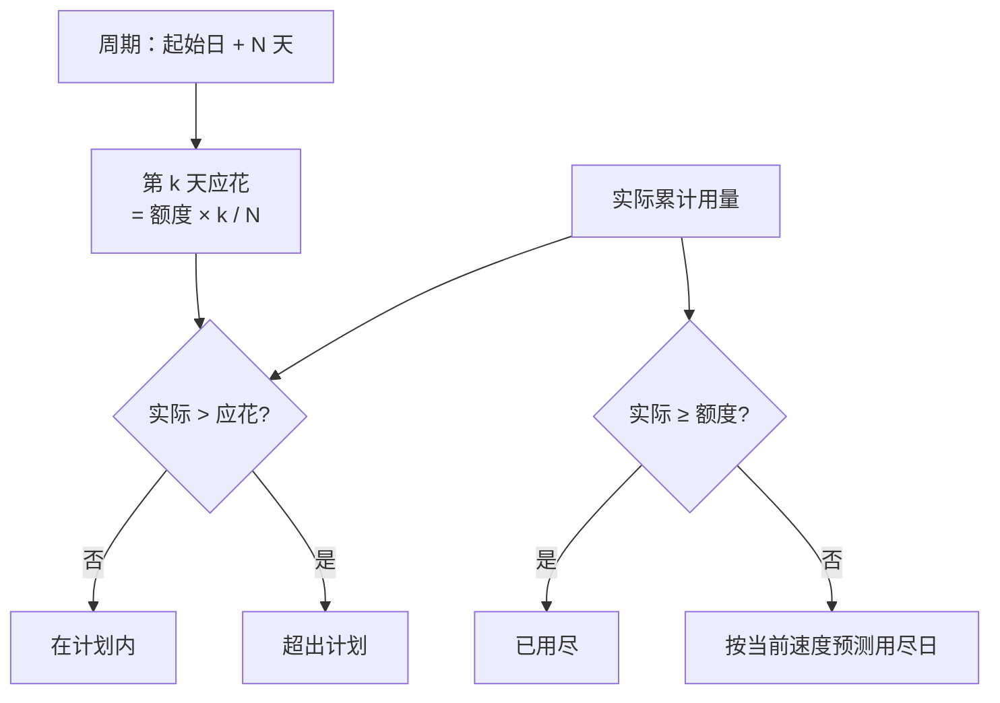
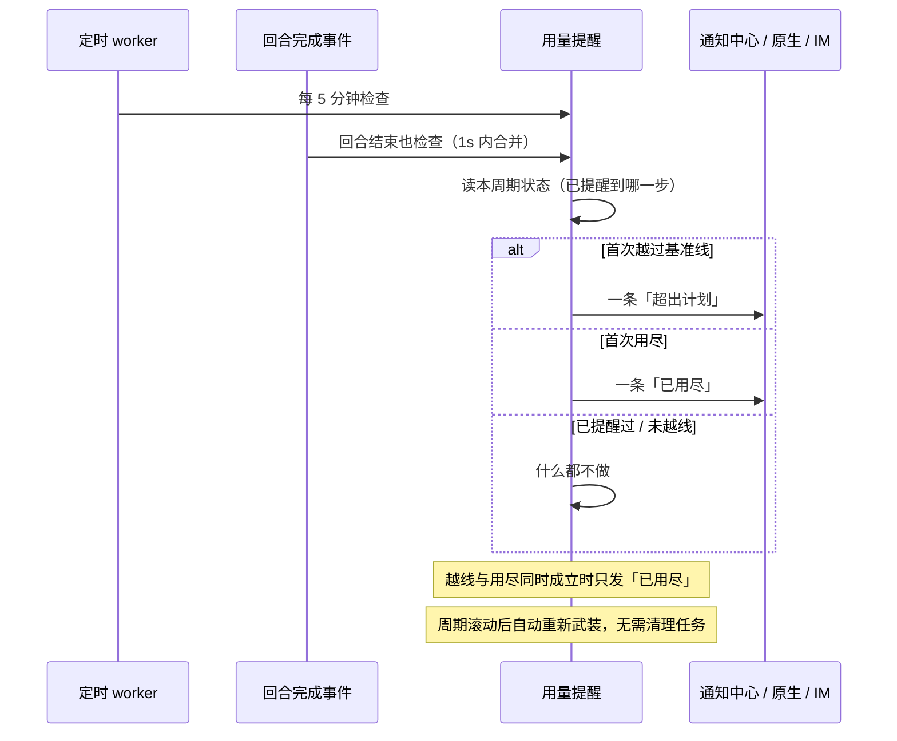

# 用量提醒（Usage Meter）

ClawBench 已经有完整的用量台账和统计面板，但两者都是**事后查看**：用户必须先想到去翻统计，才知道这个周期花了多少。用量提醒把这件事变成一眼可见的信号——设一个周期额度，系统按时间进度算出「此刻最多该用多少」，与实际用量对比，越过基准线时提醒一次。

它解决的是「钱在不知不觉中烧掉」：用户不需要预测精确消耗，只需要知道「我现在跑得比计划快」。

## 流程图

### 基准线是怎么算出来的

基准线是**线性匀速**、按**整天**向下取整的：周期第 1 天就有 1 天额度（不会一开局就误报），最后一天等于总额度。曲线本身不预测趋势（那会让「今天用得多」被解释成「以后都会这么多」而误报），预测用尽日只是给用户一个参考数字。

### 提醒只发两次，且不拦截

## 功能与设计要点

### 功能清单

- **一条全局规则**：周期起始时间 + 周期天数 + 指标（Token / Credit / 费用）+ 额度。**额度为空或 0 即关闭**，没有独立开关——留空就是「不设预算」，多一个开关只会多一种自相矛盾的状态。统计范围是**全部项目合计**，与当前停在哪个项目无关：预算花在哪个仓库上都是花掉。
  - **起始时间可精确到时分秒**：`usage_meter.anchor_date` 接受 `YYYY-MM-DD`（等价于当天 00:00）与 `YYYY-MM-DDTHH:MM[:SS]` 两种形态。日期形态是既有安装的存量值，语义不变、无需迁移；带时间形态让周期在任意时刻滚动（比如账单周期从月中开始，或希望在自己清醒时看到滚动）。**不接受时区后缀**——起始值是「服务端本地时区的墙钟读数」，与 cron 表达式同一约定；允许偏移会让同一个周期边界随服务端 TZ 变化。解析与格式化各有唯一实现（`model.ParseUsageMeterAnchor` / `model.FormatUsageMeterAnchor`），PATCH 校验与 service 计算共用，避免「设置页接受的」与「计量实际用的」漂移。午夜写回短形态，保证未改动的规则在 config.yaml 里逐字节不变。
  - **未配置时显示占位入口**：胶囊位置（移动端为资源面板末行）不渲染空胶囊，而是一个提示「设置用量提醒」的虚线占位按钮，点击直达设置页的用量提醒项。理由是此处**没有任何可报的数字**——周期、应花、剩余、预测全部由额度派生，画成 0% 会读成「你的额度是零」，与「你没设过额度」正好相反。后端在此状态下返回 `{"enabled": false}` 加五个全为 0 的数值字段（`dayInCycle` / `actual` / `expected` / `remainingDays` / `projectedExhaustDay`），**不返回** `metric` / `periodDays` / `cycleStart` / `cycleEnd` / `series`——不额外做 30 天聚合，也没有窗口可报。
- **header 上的用量胶囊**：图标 + 文字 + 进度条 + 「已用 / 额度」，进度条上有一个**基准线刻度**——读数相对刻度的位置才是这个功能的重点，光看百分比看不出「跑快了没有」。仅宽屏显示。
- **浮层里的对比与预测**：点胶囊展开，展示第几天 / 共几天、周期起止、实际 vs 应花 vs 额度的三条同轴对比条、剩余额度与剩余每日可用、按当前速度的用尽日，以及累计曲线与匀速基准的对比图。
- **移动端在资源面板末尾**：手机 header 放不下胶囊，同样的数字挂在系统资源面板的最后一行，点一下直接跳到设置里的用量提醒项。
- **越线 / 用尽各提醒一次**：走通知中心 + 原生通知 + IM 三条通道。**只提醒，不拦截**——AI 照常运行，用户要的是「知道自己花快了」，不是「被拦住」。
- **规则变更即重新武装**：改额度、改周期、改指标都视为新规则，清除已提醒状态。切换指标还会清空额度，因为 token、credit 与美元的量纲不同，不能互相换算。

### 设计要点

- **不做硬拦截**：一旦引入拦截，就要回答「拦截时怎么给用户放行」「任务、群聊、排队消息怎么算」——这些问题与「让用户知道花快了」这个目标无关，却会把一个提醒功能变成一套配额系统。
- **只支持一条规则**：header 只放得下一个胶囊，多条规则必须点开看列表，通知还得说明「是哪条超了」。绝大多数用户只有一种货币、一种主要消耗方式。真有多规则需求时，配置从对象改成数组是向后兼容的演进。
- **触发状态存在配置里，靠周期起点自动重置**：记「上次提醒属于哪个周期起点」+「提醒到哪一步（越线 / 用尽，单调不回退）」。周期一滚动，起点变了，状态自然失效——不需要任何清理任务。这也是为什么这两个字段是内部状态、**不接受客户端 PATCH**：它们由服务层在配置写锁内维护。
- **「数字动了」与「该提醒了」必须是两个事件**：前者只刷新胶囊，后者才产生通知。合成一个事件会让每轮对话结束都弹一次系统通知——而实际上一整个周期最多只该有两条。
- **服务端不判断前台，客户端沿用既有规则**：服务端一律记录 + 推送；是否弹系统通知由客户端既有的「页面可见且有焦点就不弹」规则决定。这样通知中心与 IM 永远拿得到记录，不会因为「用户当时正好看着屏幕」而在日志里留下空洞。
- **检查要节流并串行**：定时 worker（5 分钟一轮，规则改完会被立刻叫醒一次）与回合完成可能在同一瞬间触发，不串行会让两者读到同一份「尚未提醒」状态、写出两条一模一样的通知；而一次回合密集执行会带来一串完成事件，一秒一次的节流已经足够——用量提醒是粗信号，不是实时仪表。
