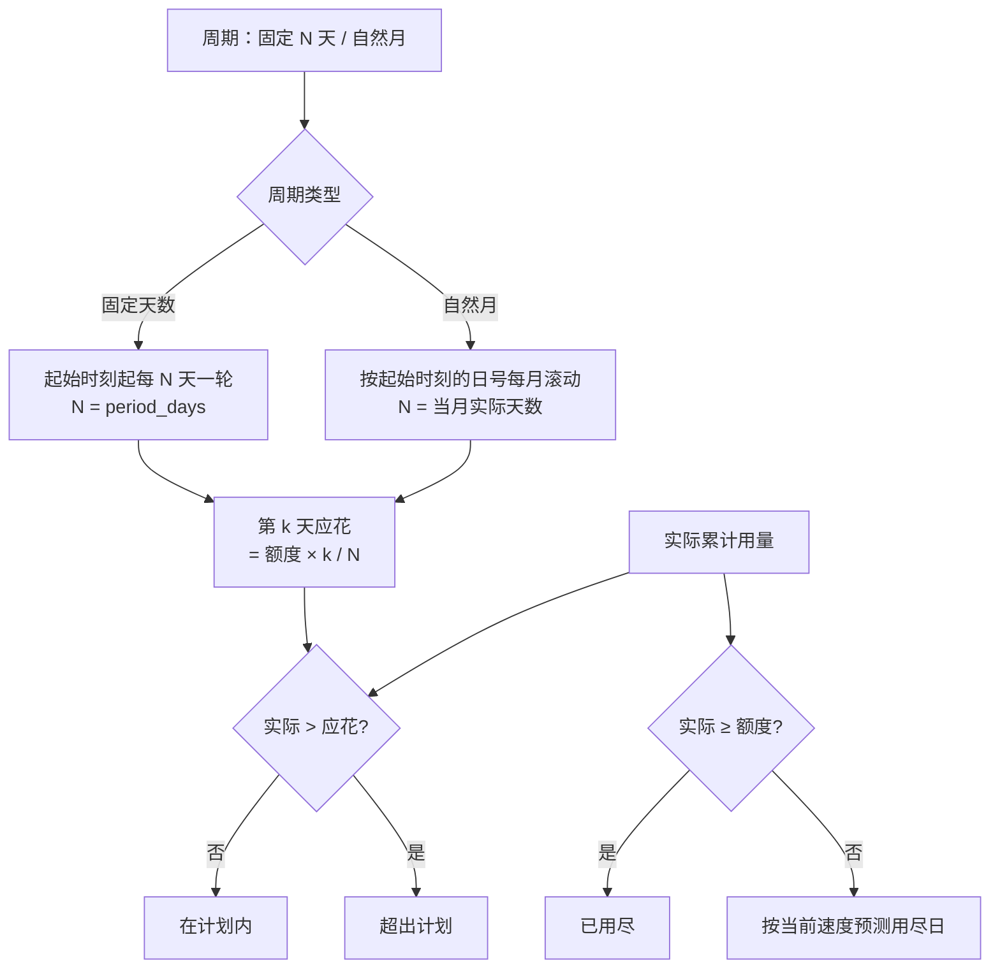
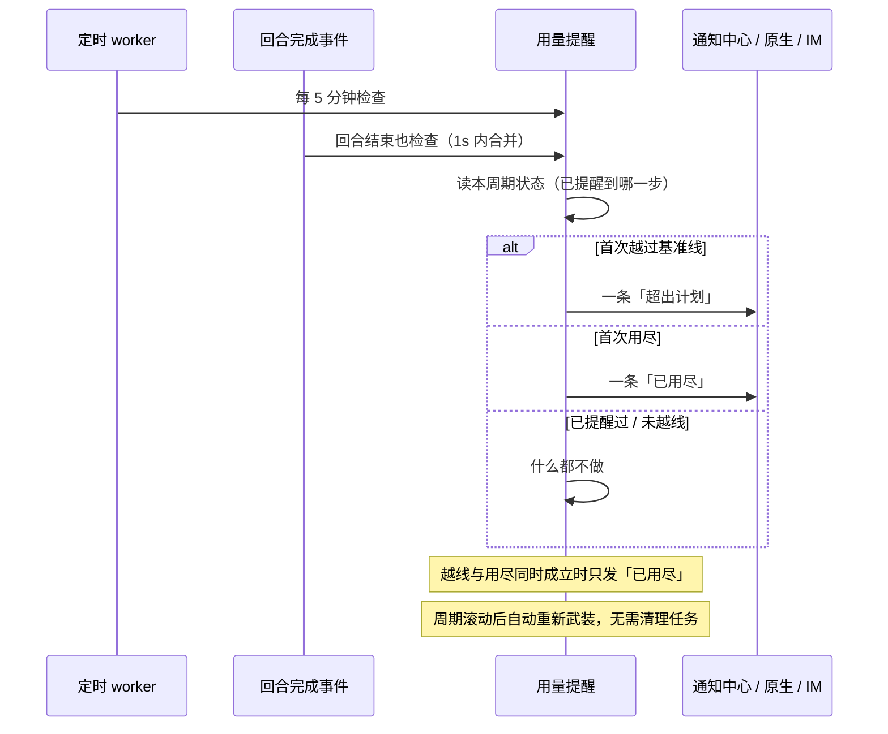

# 用量提醒（Usage Meter）

ClawBench 已经有完整的用量台账和统计面板，但两者都是**事后查看**：用户必须先想到去翻统计，才知道这个周期花了多少。用量提醒把这件事变成一眼可见的信号——配置起始时间 / 周期 / 额度，系统按时间进度算出「此刻最多该用多少」，与实际用量对比，越过基准线时提醒一次。

它解决的是「钱在不知不觉中烧掉」：用户不需要预测精确消耗，只需要知道「我现在跑得比计划快」。

**每一项都是可选的**：只填起始时间就得到「从那时起到现在用了多少」；再加周期就按周期统计；再加额度才有基准线、剩余与用尽预测。服务端按已配置的内容做**最大程度展示**，缺一项只是读数变小，不是错误。唯一的开关是独立的「启用」按钮。

## 流程图

### 基准线是怎么算出来的

基准线是**线性匀速**、按**整天**向下取整的：周期第 1 天就有 1 天额度（不会一开局就误报），最后一天等于总额度。分母 N 是**本周期**的天数——自然月下随月份在 28–31 之间变化，不能拿配置里的 `period_days` 顶替。曲线本身不预测趋势（那会让「今天用得多」被解释成「以后都会这么多」而误报），预测用尽日只是给用户一个参考数字。

### 提醒只发两次，且不拦截

## 功能与设计要点

### 功能清单

- **一条全局规则**：启用开关 + 周期类型 + 周期起始时间 + 周期天数（仅固定周期）+ 指标（Token / Credit / 费用）+ 额度。统计范围是**全部项目合计**，与当前停在哪个项目无关：预算花在哪个仓库上都是花掉。
  - **独立启用开关**（`usage_meter.enabled`）：唯一的开/关。此前额度兼任开关，导致「我只想看从某天起花了多少」必须瞎编一个预算才能打开。存量安装的 config.yaml 没有这个键，`ApplyDefaults` 按 presence map 判断——缺键且有配置就视为启用，**升级不会把任何人的用量提醒关掉**；显式写入的 false 则被尊重。
  - **没有周期 ≠ 30 天**：`period_days` 为 0 表示窗口不滚动，累计值永不归零。早期版本在「有额度无周期」时补 30 天，会让用户的累计值每月静默归零，已改掉。
  - **没有额度 ≠ 关闭**：仍然返回实际用量与曲线，只是 `expected` / `remaining` / `projectedExhaustDay` 全为 0（没有可摊的基准）。此时不产生任何越线通知——「超出计划」是关于基准的陈述，而基准不存在。
  - **两种周期二选一**：`usage_meter.cycle_mode` 取 `fixed`（固定天数，缺省值）或 `monthly`（自然月）。固定天数从起始时间起每 `period_days` 天一轮；自然月按日历月滚动，**边界落在起始时间的日号与时刻上**——所以 `2026-10-01T00:00` 就是自然月，`2026-10-05T09:00` 表示每月 5 日 09:00 换周期，不需要再加一个「每月几号」的配置项。周期长度取当月实际天数（28–31），按**日历日期**计天数（固定周期按 24 小时跨度计），因此夏令时切换不会把一天算成 0 天或 2 天。日号 31 在小月钳到月末（2 月 28/29 日），但下一个边界仍按 31 推算，**不会在一次 2 月之后永久漂到 28 日**。缺省值为 `fixed` 是本字段出现前所有安装的存量语义，无需迁移；设置页在自然月模式下**隐藏「周期天数」**，服务端则始终把该值保持在合法范围，以便切回固定周期时不会落到 0。
  - **起始时间可精确到时分秒**：`usage_meter.anchor_date` 接受 `YYYY-MM-DD`（等价于当天 00:00）与 `YYYY-MM-DDTHH:MM[:SS]` 两种形态。日期形态是既有安装的存量值，语义不变、无需迁移；带时间形态让周期在任意时刻滚动（比如账单周期从月中开始，或希望在自己清醒时看到滚动）。**不接受时区后缀**——起始值是「服务端本地时区的墙钟读数」，与 cron 表达式同一约定；允许偏移会让同一个周期边界随服务端 TZ 变化。解析与格式化各有唯一实现（`model.ParseUsageMeterAnchor` / `model.FormatUsageMeterAnchor`），PATCH 校验与 service 计算共用，避免「设置页接受的」与「计量实际用的」漂移。午夜写回短形态，保证未改动的规则在 config.yaml 里逐字节不变。
  - **未启用时显示占位入口**：胶囊位置（移动端为资源面板末行）不渲染空胶囊，而是一个提示「设置用量提醒」的虚线占位按钮，点击直达设置页的用量提醒项。后端在此状态下返回 `{"enabled": false}` 加五个全为 0 的数值字段（`dayInCycle` / `actual` / `expected` / `remainingDays` / `projectedExhaustDay`），**不返回** `metric` / `periodDays` / `cycleStart` / `cycleEnd` / `series`——不额外做 30 天聚合，也没有窗口可报。
  - **未设置的项按「无限」展示，而不是隐藏**：没设额度 → 额度、剩余、剩余每日显示 `∞`；没设周期 → 「第 N / ∞ 天」、剩余天数显示 `∞`；没设额度时「按当前速度」显示「本周期不会用尽」（无限预算永远用不完，这比空白更准确）。只保留真正无从计算的进度条与基准线：进度条需要额度才有意义（∞ 的百分比不存在），基准线需要额度**且**周期。徽章也随之改口——没有额度是「仅统计用量」，有额度无周期是「未设周期」，都不说「在计划内」（那是对不存在基准的判断）。
- **header 上的用量胶囊**：图标 + 文字 + 进度条 + 「已用 / 额度」，进度条上有一个**基准线刻度**——读数相对刻度的位置才是这个功能的重点，光看百分比看不出「跑快了没有」。仅宽屏显示。没有额度时额度位置显示 `∞` 并省略进度条：形状不变，只是没有可填的轨道。
- **浮层里的对比与预测**：点胶囊展开，展示窗口描述（有周期时是「第几天 / 共几天 · 起止」，无周期时是「第 N / ∞ 天 · 自某日起」，没有起始时间则是「全部历史累计」）、实际 vs 应花 vs 额度的三条同轴对比条（未设置的显示 `∞`）、剩余额度与剩余每日可用、按当前速度的用尽日，以及累计曲线与匀速基准的对比图。没有额度/周期时曲线仍画，只是没有基准线与预测线。
- **移动端在资源面板末尾**：手机 header 放不下胶囊，同样的数字挂在系统资源面板的最后一行，点一下直接跳到设置里的用量提醒项。
- **越线 / 用尽各提醒一次**：走通知中心 + 原生通知 + IM 三条通道。**只提醒，不拦截**——AI 照常运行，用户要的是「知道自己花快了」，不是「被拦住」。
- **规则变更即重新武装**：改启用状态、改额度、改周期类型、改周期天数、改指标都视为新规则，清除已提醒状态。切换指标还会清空额度，因为 token、credit 与美元的量纲不同，不能互相换算。
- **设置页把开关放在面板顶部的启用行**：它决定下面所有行是否生效，所以关闭时**禁用而不隐藏**——存好的规则要能看见、能改，重新打开时不用重填。

### 设计要点

- **不做硬拦截**：一旦引入拦截，就要回答「拦截时怎么给用户放行」「任务、群聊、排队消息怎么算」——这些问题与「让用户知道花快了」这个目标无关，却会把一个提醒功能变成一套配额系统。
- **只支持一条规则**：header 只放得下一个胶囊，多条规则必须点开看列表，通知还得说明「是哪条超了」。绝大多数用户只有一种货币、一种主要消耗方式。真有多规则需求时，配置从对象改成数组是向后兼容的演进。
- **触发状态存在配置里，靠周期起点自动重置**：记「上次提醒属于哪个周期起点」+「提醒到哪一步（越线 / 用尽，单调不回退）」。周期一滚动，起点变了，状态自然失效——不需要任何清理任务。这也是为什么这两个字段是内部状态、**不接受客户端 PATCH**：它们由服务层在配置写锁内维护。
- **「数字动了」与「该提醒了」必须是两个事件**：前者只刷新胶囊，后者才产生通知。合成一个事件会让每轮对话结束都弹一次系统通知——而实际上一整个周期最多只该有两条。
- **服务端不判断前台，客户端沿用既有规则**：服务端一律记录 + 推送；是否弹系统通知由客户端既有的「页面可见且有焦点就不弹」规则决定。这样通知中心与 IM 永远拿得到记录，不会因为「用户当时正好看着屏幕」而在日志里留下空洞。
- **检查要节流并串行**：定时 worker（5 分钟一轮，规则改完会被立刻叫醒一次）与回合完成可能在同一瞬间触发，不串行会让两者读到同一份「尚未提醒」状态、写出两条一模一样的通知；而一次回合密集执行会带来一串完成事件，一秒一次的节流已经足够——用量提醒是粗信号，不是实时仪表。
