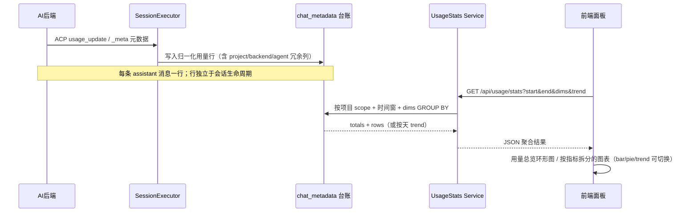
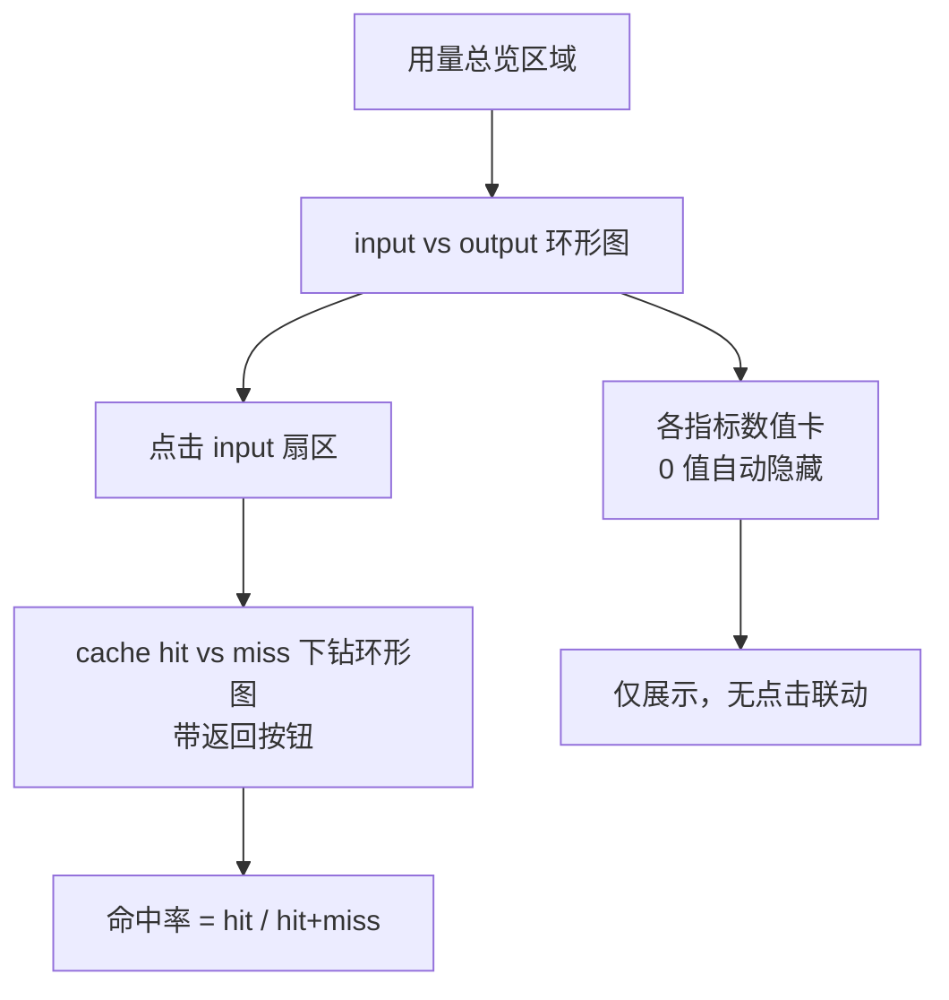

# 智能体用量统计

数据统计（Usage Stats）让用户按项目查看所有 Agent 会话的 token/成本消耗：哪些模型占用了多少输入/输出 token、缓存命中率如何、趋势是升是降。它解决"用量散落在各会话上下文面板里、无法全局把握"的问题——把 ACP `_meta` 归一化后写入 `chat_metadata` 的逐条用量行，在服务端按维度聚合，前端用饼图/趋势/直方图呈现。入口是宽屏 Dock 的「数据统计」页签，该页签下再分三个子页：**用量统计**（本文件）、**代码存量**与**代码增量**（见[Git 管理](git-management.md)的代码量统计）。

## 流程图

### 用量行到统计面板的链路

用量数据在每条 assistant 消息完成时由后端归一化后落库，统计端点只是对既有行的只读聚合——展示的价值在于把分散的逐条数据变成可读的全局视图。用量行是**独立台账**：写入时冗余 `project_id`/`backend`/`agent_id`/`clawbench_session_id`，不再依赖外键回连会话表，因此会话被删除、消息被回溯截断或 ACP 重放都不会销毁已消耗的真实用量。项目 id 经 `LEFT JOIN projects` 解析出展示用路径（见[项目 id 化注册表](../infra/config-and-discovery.md)）。

### 用量总览的下钻交互

## 功能与设计要点

### 功能清单

- **用量总览**：面板顶部展示时间范围内的总量——input vs output 环形图直观反映读写比例，点击 input 扇区下钻为该输入量的缓存命中 vs 未命中构成；旁边的数值卡列出 input/output/total/cacheHit/credit/cost 六项总量（0 值自动隐藏，避免空卡占位），附缓存命中率。让用户一眼看到"这个项目这段时间烧了多少 token、缓存命中高不高"
- **按指标拆分的图表**：为每个选中指标（metric，默认 `total`）各渲染一张图，类目是所选维度的组合（多个维度用 ` × ` 拼成单一标签，如 `glm-5.1 × codebuddy`），横向比较各实体在该指标下的消耗。图表类型可切换 **bar（直方图）/ pie（饼图）/ trend（时间趋势）** 三种——bar/pie 基于明细行，trend 基于按天聚合（默认保留 top-10 组合，避免组合爆炸）。帮助定位"哪个模型/后端/Agent 是消耗大户"，并观察"升级模型后用量是否回落"
- **时间范围与维度筛选**：24h / 7d / 30d / 自定义（≤370 天，UTC 时基、按天分桶）；维度可选 model/backend/agent 的组合（1-3 个；跨项目模式下还可选 project，见下文），配合 sort/order 排序与 top/limit 截断。筛选卡独立于总览区，体现"总览不随维度筛选改变"的设计
- **明细表排序**：筛选后的明细行可点击表头按各指标排序，快速找出 top 消耗者；`limit` 上限 200 行防止超大结果集拖垮渲染
- **费用两位小数统一**：所有费用展示（用量统计、上下文面板、消息详情弹窗）统一保留两位小数、大额带千分位，sub-cent 归零显示 `$0.00`。pi/opencode 等后端单次成本常在 0.0001 以下，此前各界面精度不一（6 位 / 4 位 / 特殊显示 `$0.0001`）会让界面出现一长串小数；原始精度仍保留在 DB 与 API 中未截断
- **移动端适配**：窄容器（<460px）下总览区由并排改为纵向堆叠（donut 在上、数值卡在下），chip 组自动换行、窄屏隐藏图表数值轴刻度。保证小屏设备也能完成"看总量 → 钻取 → 筛选"的主流程

### 设计要点

- **用量行是独立台账而非会话的从属数据**：`chat_metadata` 的 `message_id` 外键曾级联删除，删会话/回溯/ACP 重放时把真实消耗一并销毁，导致统计长期少计。改为去掉级联外键、写入时冗余项目与维度列、统计查询不回连会话表——"花掉的 token 是既成事实，不该随对话被清理而消失"。代价是 fork/续接/重放需刻意**不**复制用量行（否则双计），backfill 也要排除复制来源会话
- **聚合发生在服务端而非前端**：前端只请求自己需要的窗口和维度，`GROUP BY` 在 SQLite 完成。原因一是聊天消息可能未全部加载到前端，二是避免把数千条原始行拉到浏览器再算——统计是读多写少的分析场景，服务端聚合是天然的分层
- **单行必须内部自洽才能 SUM**：`chat_metadata` 的 input/output/total 来自**同一次上报**整体写入——早期曾逐字段拼接多次 usage_update 通知，把不同请求的 counter 缝进同一行，导致 total 达 input 十倍、SUM 聚合失去意义
- **但「一轮 = 一次上报」是错的：一轮有多次模型调用，必须逐次累加**。CodeBuddy 每次模型调用发一条 `usage_update`，只带**那一次**的 counter（原始线路实测：一个 4 条命令的回合产生 prompt_tokens 38229/38328/38427/38526/38625，共享一个 `requestId`、`messageId` 各不相同）。旧实现"取最新快照"，于是只留下最后一次——实测全库少记 **30.9×**（678 个会话：存 1.19B，实际 36.8B）。现在按 `codebuddy.ai/messageId` 去重后逐次求和；同一 `messageId` 的重投不会重复计费，新的 `messageId` 一定计入。**重放通知必须整块丢弃 usage**（不是只丢 trace）：累加语义下放行一条上轮的重放，等于把上一整轮的调用又计一遍。Claude/Codex 的 per-model counter 本身就是回合聚合值，仍取最新快照，不参与累加
- **累计值必须在写入侧归一化，聚合才能是 `SUM`**：ACP 的 `usage_update.cost` 规范定义是**会话累计成本**（`acp-go-sdk` 的 `Cost.Amount` 注释："Total cumulative cost for session"）。早期把它当作本轮成本逐条落库，于是 `SUM(cost_usd)` 等于把运行总额按消息数重复累加——实测 Claude 面板 $113.19 vs 实际 $36.46（3.1×）、OpenCode $3.05 vs $1.53（2.0×）。现在 `SaveMetadata` 写入 `cost_usd` = 本轮增量，`cost_session_total` 保留原始累计值供下一轮做差。三条规则缺一不可：①基准取**该会话上一条记录了累计值的台账行**（跳过 agent 没报 cost 的裸通知，否则会把整段运行总额再算一遍）；②不是历史最大值——切换模型会让 agent 重启计数器（实测 claude-sonnet-4-6 → MiniMax 时从 0.47 掉到 0.21）；③**按 agent 连接分区**，不是按时间线——群聊里每个成员各有独立 ACP 连接、各有独立计数器，却共用一条群时间线，按时间线做差会拿 A 的总额减 B 的总额。CLI 侧报的是真实每轮成本（pi、claude `--output-format stream-json` 的 `total_cost_usd`），不带累计标记，原样落库。**同一份增量还要写回消息 content JSON**：详情弹窗读的是那份副本，否则单条消息会显示成整个会话的累计费用
- **旧版 CLI 的 `input_tokens` 也是累计值**：2026-09 之前的 CodeBuddy CLI 解析器把会话累计 prompt 大小写进 `input_tokens`（实测一个会话 10 轮里从 73k 爬到 31.0M，而窗口只有 200k），逐行求和把总量放大 74%（2.21B 存储 vs 1.27B 实际）。迁移按同样的增量规则重建；这些行的判据是 `total_tokens = 0`（该列当时还不存在），因此重建必须**先于**补 total 的步骤，否则判据被抹掉
- **`total_tokens` 有下界不变量**：`total ≥ input+output`。OpenCode/Pi/Hermes/CommandCode 的解析器曾丢弃上游 total，行里是 0——而面板默认指标就是 `total`，这些行会被 `filteredRows` 整行过滤掉（表格里看不到），却又计入顶部总览，自相矛盾。写入侧补下界，聚合侧再兜一层 `CASE WHEN total_tokens > 0 THEN total_tokens ELSE input+output END`，兼容旧二进制写的行
- **「单轮 token 超过上下文窗口」不是异常**：一个 agentic 回合会发起几十次模型调用（每轮工具调用一次），上报的 counter 是它们的**总和**——实测 200k 窗口的会话出现 6.5M 的回合，来自约 30 次 ~217k 的调用。任何"超窗口即丢弃"的守卫都会删掉真实用量，不要加
- **群聊用量归发言者，不归主持人**：`chat_history.session_id` 在群聊里是**群会话 id**（其 `agent_id` 是主持人），真正发言的成员在 `chat_history.agent_id`（成员行 id）。早期只读会话的 agent，导致群里 25% 的 token 全部记到主持人头上。现在优先用 `chat_history.agent_id` 解析出真实 agent，成员行已删除时才回落到会话 agent（避免台账里留一个匹配不到任何 agent 的悬空行 id）
- **模型名回落到「实际响应的模型」**：Claude/Codex 常不报 `_meta.model`，但 `response_model_id` 一定有值。不回落会让这些行落进 model 维度的 `(empty)` 桶——实测占 Claude 流量的 27%
- **缓存口径统一为 OpenAI/CodeBuddy 形状**：`input_tokens` 含缓存部分，`cache_hit/miss` 单独拆出。Claude/Codex 的桥接把缓存计数报在 `inputTokens` **之外**（满足 `total = input + output + cacheRead + cacheWrite`），旧实现原样存储，于是它们的 `cache_hit/miss` 恒为 0、命中率只统计 CodeBuddy（混合库里显示 98.3%）。现在按上述恒等式校验后再归一化，恒等式不成立（如 agent 把缓存算进 input）则保持原值而不是猜
- **以 assistant 消息完成时间为准**：时间基准是 `chat_metadata.created_at`，取自消息自己的 `completed_at`（回落到 `created_at`）。`INSERT OR REPLACE` 早期不写这一列，导致每次重存都被 SQLite 重新盖戳——内容→台账 backfill 把一个月前的消息搬进了今天的窗口（实测 32 行、>1 天偏差，其中 7 行 2.6M token 落在 30 天窗口里）。配合 `chat_metadata.project_id` 归属校验做项目作用域
- **范围与维度解耦**：总览展示的是窗口内全部数据（不随维度筛选变化），维度只作用于明细表与图表——"总览是快照、明细是切片"，避免用户困惑"为什么选了 agent 后总览数字也变了"
- **渲染层与数据层分离**：`useUsageStats` 单例 composable 管理请求状态（300ms 防抖 + AbortController + 项目切换时重置），图表构建（`statsChart.ts`）与 ECharts 封装（`UsageChart`）解耦，使响应式窗口变化和主题切换只影响渲染层，不触发重新取数

### 跨项目用量（scope=all）

`/api/usage/stats` 的 `scope` 参数有两个取值，默认 `project`：

| scope | 项目范围 | 项目 Cookie | 谁能用 |
|-------|---------|------------|--------|
| `project`（默认） | 单个项目 | 必填 | 浏览器面板 + AI |
| `all` | 实例内全部项目 | **忽略（不合并）** | 任何已鉴权调用方 |

- **为什么不是 AI 专属**：面板的跨项目开关与 `/cb-usage` 命令共用这个 scope。门控是 `middleware.IsAuthenticated`（会话 Cookie **或** 本地 AI 令牌），不是 `IsLocalhost`——回环地址本身不证明任何身份。已登录的浏览器本来就能逐个项目读到同样的数据，实例级聚合没有授予它新能力；未鉴权的调用方一律拒绝。
- **`project` 维度**：`dims` 新增 `project`，让跨项目查询能按项目分组排名（"哪个项目烧得最多"）。它在单项目范围内没有区分度，所以只在 `scope=all` 下有意义。维度上限随之从 3 提到 4。
- **空项目 id 的语义**：`scope=all` 是**移除**项目谓词，而不是传空值匹配。遗留台账行可能带 `project_id=0`（无法归属），若用 `project_id = 0` 过滤，会把这些行和所有真实项目一起筛掉——恰是全局合计最不该发生的事。
- **项目 Cookie 被忽略而不是报错**：浏览器每次请求都会自动带上项目 Cookie，切到"全部项目"时它仍然存在。报 400 会让这个开关不可用，所以 handler 显式把路径置空、查询整条丢掉项目谓词——过期的 Cookie 永远不会悄悄收窄一个实例级请求。
- **索引**：`scope=all` 只按 `created_at` 过滤，走 `idx_chat_metadata_created`；单项目仍走 `idx_chat_metadata_project_created`。
