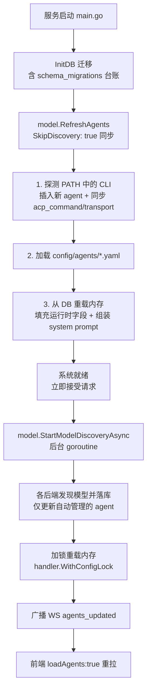
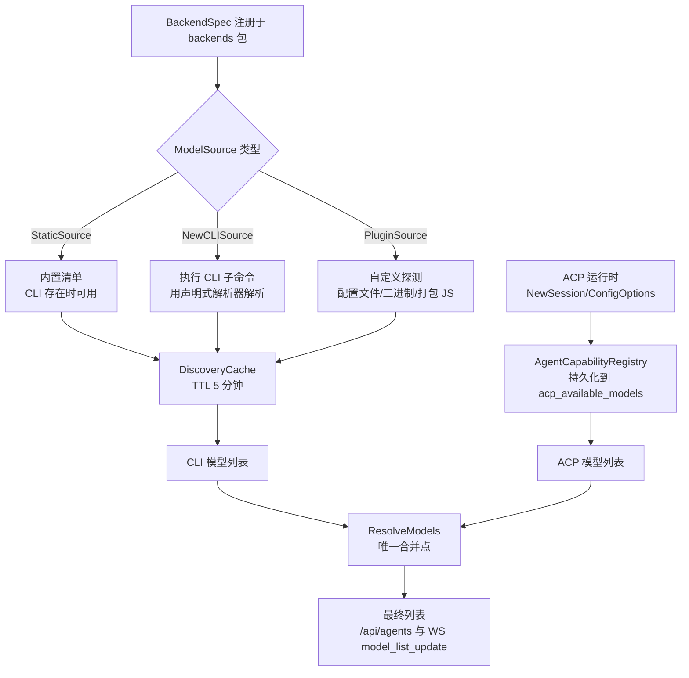

# 配置与自动发现

ClawBench 支持零配置启动：安装 CLI 工具后直接运行 `./clawbench`，系统自动发现可用的 AI 后端和模型并应用默认配置。首次访问时[欢迎面板](../features/setup-wizard.md)展示检测结果和安装入口。手动配置是可选增强；Agent 以数据库存储为主，YAML 用于手动定义的特殊 Agent。

## 流程图

### 启动时自动发现流程

`RefreshAgents`（`internal/model/refresh.go`）是**同步**入口：只做 CLI 探测、
YAML 加载与内存重载（约 0.1s，CLI 探测已并行），启动与
`POST /api/agents/rescan` 都调用它。模型探测会 fork 各家 CLI（antigravity
未登录时挂满超时，串行合计约 18s），因此被拆到
`StartModelDiscoveryAsync`（同一文件）在后台执行：探测 → 落库 → 加锁重载内存
→ 回调，由 `cmd/server/main.go` 在回调里广播 WS 事件 `agents_updated`。
启动必须先同步加载 agent，因为默认 agent 选择与
`scheduler.LoadTasksFromDB`（其会校验 `task.AgentID` 是否存在，未知 agent
会静默跳过 cron 注册）都依赖 `model.Agent` 已就绪。

这套双入口取代了原先的五步串行流程
（`SyncDiscoverAgentsDB` → `LoadYamlAgents` → `SyncDiscoverModels` →
`MergeDiscoveredDataDB` → `AsyncRefreshModelCache`）：
那套流程每一步都各自查库、各自重载内存，同一批发现探测在一次启动中跑两遍，
且"加载 agent 到内存并组装 prompt"有两份独立实现。历史遗留的
`AsyncRefreshModelCache` 当初因"同步与异步各探一遍且都不缓存"被移除；现在
`DiscoveryCache`（TTL 5 分钟）已去重，该反对理由不再成立。

### 模型来源与解析

## 功能与设计要点

### 功能清单

- **零配置启动**：没有 `config.yaml` 也能运行，系统自动填充所有默认值（端口、密码、TTS 引擎等）。`config.yaml` 是可选的增强，不是必须的前置步骤
- **首次访问欢迎面板**：用户首次访问时显示 `WelcomeOverlay`（不是分步向导）。[WelcomeOverlay 详情](../features/setup-wizard.md)。Agent 创建通过自动发现或 `AgentInstallDialog` 完成，不存在 `/api/setup/*` 端点
- **Agent 自动发现**：启动时检测 PATH 中是否存在 AI CLI 工具，为新发现的工具自动在数据库中创建 Agent（含 ACP 命令检测，即检查后端规格中的 `AcpCommand` 字段）。用户安装新 CLI 后重启即自动识别
- **双传输支持**：Agent 的 `Transport` 字段（"cli" / "acp-stdio"）决定使用哪种传输模式。ACP 支持的 Agent 自动设置 `acp_command`，用户可以在会话中切换传输方式
- **Model 自动发现**：每个后端在自己的包内注册一个 `model.ModelSource`（`RegisterModelSource`），共三种形态：
  - `StaticSource` —— 内置清单，仅在该 CLI 存在时可用（copilot / kimi / mimo）
  - `NewCLISource` —— 执行 CLI 子命令并用共享解析器解析（antigravity / deepseek / grok / opencode / pi）
  - `PluginSource` —— 自定义探测，应对单一命令无法覆盖的布局（codebuddy 读 product JSON 与运行时缓存、codex 读缓存并扫描二进制字符串、claude 扫描二进制 + 读取 settings.json 覆盖、vecli 扫描打包 JS、qoder 读本地缓存）

  纯 ACP 后端（zcode / dsh / hermes / cursor / commandcode）不注册 `ModelSource`：它们的模型清单只来自 ACP 的 `configOptions` / `session/new` 的 `models`（`ResolveModels` 的 ACP 独有分支），因此没有 CLI 侧的「刷新模型」入口。

  发现结果由 `DiscoveryCache` 按后端缓存 5 分钟；显式刷新（`refresh-models` / `rescan`）会先失效缓存再重新探测。内置清单集中在 `internal/model/catalogs.go`，更新清单是单文件改动
- **模型列表由服务端合并**：`ResolveModels`（`internal/model/modelcatalog.go`）是唯一的合并点。规则：
  - **具体 ACP 列表在存在时对成员资格有权威性** —— agent 最清楚自己能跑哪些模型；CLI 列表可能过时（端点被重定向、模型在服务端下线），ACP 未上报的 CLI 模型会被剔除
  - **档位别名（tier alias）不参与成员资格判定**。claude 经 ACP 上报的是 `opus`/`sonnet`/`haiku` 这类**档位** ID，其显示名携带被重定向后的真实模型；CLI 发现的是 `claude-sonnet-4-6` 这类具体 ID，两者 ID 永不相等。若把别名列表也当作成员资格依据，会剔掉全部 CLI 模型、只留若干条显示同名真实模型的别名条目（这正是历史上 Issue #404 的问题）。因此别名改为**对齐到对应的 CLI 骨架条目**：保留具体 ID（CLI 仍能识别），仅取其显示名。CLI 骨架无法代表的别名仍会追加，避免用户可选档位静默丢失；元档位 `default` 是回退标记而非模型，始终跳过
  - **CLI 列表提供顺序与名称**；同名 ID 时 ACP 的显示名优先
  - ACP 独有的具体模型按 ACP 顺序追加
  - 恰好一个模型是默认：会话当前模型 > CLI 默认标记 > 列表首项

  前端不再做任何合并，只渲染后端给出的 `resolvedModels`。未经合并的纯 CLI 列表通过 `cliModels` 一并下发，供切换到 CLI 传输时直接渲染。

- **ACP 传输下、ACP 未确认时不展示 CLI 猜测列表**：`transport == "acp-stdio"` 且该 agent 的 ACP 运行时**从未上报过**模型（`ai.HasConfirmedACPModels` 为假，数据源是 `AgentCapabilityRegistry`，经 `agents.acp_available_models` 持久化）时，`GET /api/agents` 与 `POST /api/agents/{id}/refresh-models` 的 `models` 返回**空数组**（`cliModels` 照常返回，发现结果照常落库）。判据用**有效传输**而非「有无 `acp_command`」，故 `transport == "cli"` 的双传输 agent 不受影响。
  - **理由**：ACP 协议没有「客户端默认模型」的概念——模型是 `category: "model"` 的会话配置项，agent 在 `session/new` 自带 `currentValue`，客户端只需显示、可选地改。在 agent 开口之前，CLI 发现的列表只是猜测；把它当可运行模型展示，会让前端推导出一个「默认模型」并在首条消息里作为 `modelId` 发回，触发一次 `session/set_config_option`，可能选中 agent 无法运行的模型（新装用户在首次 ACP 会话前必然踩到）。
  - **发送侧同步门控**：`service.BuildChatRequest` 的 `resolveAgentConfig` 在该状态下**跳过** `agent.DefaultModelID()` 兜底（`DefaultModelID` 含 `PreferredModel`，故一并覆盖），使 `ai.ChatRequest.Model` 保持空 —— `applyModelSelection` 对空值直接返回，不发任何模型 RPC，由 agent 用自己的默认。**显式选择一律尊重**（请求参数 / `chat_sessions.model` 持久值 / `preferredModel` 均不受影响）——那是用户意图，不是猜测。
  - **前端**：列表为空时模型 chip 显示占位（`chat.sessionInfo.default`），发送路径的 `modelId: currentModelId.value || undefined` 自然不发。两个基线共用 `agent.models` 一个字段，故传输切换/会话切换的复位必须按当前传输选择（`resetModelViewForTransport`）：ACP 侧要么应用 ACP 列表、要么清空，绝不回落到 CLI 基线（否则切换 ACP→CLI→ACP 会把 CLI 列表带回 ACP 视图）。
  - **不在范围**：定时任务（`scheduler.go` 直接构造 `ai.ChatRequest`，不走 `BuildChatRequest`）与设置页的 preferred-model 选择器保持现状。

  **三条下发通道同构**（`internal/ai/acp_events.go` 的 `EnrichModelList` 是唯一实现）：
  - `GET /api/agents` → `agents[].models` / `agents[].cliModels`，以及 `acpStates[].modelListState.{resolvedModels,cliModels}`
  - `GET /api/ai/chat` → `modelListState.{models,resolvedModels,cliModels}`（新建会话从不与 ACP 通信，其模型列表只能来自这里，由 agent 级能力注册表解析；CLI 会话不返回该字段）
  - WS `model_list_update` → 同一组字段
  - `POST /api/agents/{id}/refresh-models` → `{ models, cliModels }`（`models` 为与已缓存 ACP 列表合并后的结果；无 ACP 的 agent 直接返回发现结果）

  四者形状必须一致：此前 `/api/ai/chat` 只返回原始 ACP 列表，任何只消费 `models` 的客户端都会丢掉全部 CLI 模型。当 agent 没有 CLI 列表可合并时，`resolvedModels` 为空但 `models` 仍返回——整条列表丢失比未合并且更糟。`refresh-models` 曾只返回原始 CLI 发现结果，于是在 ACP 传输下点一次刷新就会把「agent 实际能跑的模型」替换成 CLI 骨架（含运行时不支持的条目）。
- **ACP 模型持久化**：ACP 上报的模型列表写入 `agents.acp_available_models`，因此重启后仍然可见。此前它只存在于内存，导致同一 agent 的模型列表在重启前后跳变（首个 ACP 会话前是 CLI 列表，之后是 ACP 列表）
- **后台模型刷新**：模型探测在启动后台执行（`model.StartModelDiscoveryAsync`，`internal/model/refresh.go`）。完成后服务端广播 WS 事件 `agents_updated`，前端 `useAgents` 收到后强制重拉 `GET /api/agents`。手动刷新仍走 `POST /api/agents/rescan`（失效缓存、重跑完整发现）或单个 agent 的 `POST /api/agents/{id}/refresh-models`（只重探该 agent 的模型）
- **用户配置优先**：用户手动定义的模型列表不会被自动发现覆盖（`models_auto_detected = 0` 且列表非空即受保护）；自动管理的 agent 保持其自动管理状态，该标记不是单向闩锁
- **智能体生命周期管理（计数 / 禁用 / 删除守卫）**：`agents` 表新增 `disabled` 列，配合删除前的用量守卫。
  - **计数**：`GET /api/agents` 为每个 agent 附 `sessionCount` / `taskCount`（派生字段，不进 `model.Agent` 持久化模型）。会话数 = 1:1 聊天（`session_type='chat'`，含归档）+ 该 agent 的**活跃群成员关系**（`session_type='group_member'` 且 `archived=0`）——群聊的时间线行只记录主持人，普通成员若按 `group` 行统计会永远是 0，故必须按成员行统计。任务执行自动产生的 `scheduled` 会话**不计入**：删任务只归档其会话、用户又没有单条清理入口，计入会让计数永不清零。列表用 `GetAllAgentUsage` 三条 GROUP BY 查询一次性取回（而非 per-agent N+1，读池只有 2 连接）
  - **删除守卫**：`DELETE /api/agents` 在关闭 ACP 连接**之前**校验会话/任务/成员关系是否为空，非空则 409 `AgentInUse` 并带三项计数。守卫顺序不能颠倒——否则被拒绝的删除会误杀健康连接。会话「归档」只是软删除、行仍在，故用户须走 `destroy`（UI 文案「移除」）才能清零
  - **禁用开关**：`PATCH /api/agents` 支持 `disabled`（默认智能体禁止禁用，`CannotDisableDefaultAgent`）。禁用后从所有**新建**入口隐藏（前端 `useAgents.selectableAgents` 统一过滤，`AgentSelectorDrawer` 改用它渲染，覆盖新建会话/任务/群成员/fork 四处），服务端在建会话、建任务、加群成员三处**兜底拒绝**（`AgentDisabled`）。**已存在的会话与任务不受影响**（继续发消息/执行不拦，否则禁用会打死在跑的任务且用户无法清理）。`DuplicateAgent` 刻意**不**复制 `disabled`——副本应是可用智能体
  - **项目作用域（「仅当前项目」）**：`agents.project_id` 可空列（`NULL`=全局，值=`projects.id`）让一个智能体只在**某一个项目**里可见。作用域**只约束新建入口与设置列表**，不追溯已有会话/任务——否则给智能体加作用域会当场打死正在跑的会话。判定收敛在两个 helper：`visibleAgentsInProject`（列表过滤，`GET /api/agents` 与 `rescan` 共用，`ProjectIDByPath` 只读解析、未知项目只见全局智能体）与 `agentVisibleInProject`（新建闸门，解析失败 fail-closed）。三个入口分别兜底拒绝：建会话/fork、建任务、建群/加成员（`AgentNotInProject`）。**默认智能体必须可见**：配置的默认若被限到别的项目，`visibleDefaultAgent` 回退到列表首个可见且未禁用的智能体，否则该项目的「不指定智能体」路径会选中一个它看不见的智能体；设置侧**护栏双向**——默认智能体不能被限定项目（`CannotScopeDefaultAgent`，未选项目时开启作用域返回 `NoProjectSelected`），项目级智能体也不能被设为默认（`default_agent` 校验拒绝）。删除项目时一并删除该项目下的项目级智能体并重载内存表
  - **拖拽排序**：设置 → 智能体列表可用拖拽手柄调整顺序，`PUT /api/agents/reorder` 以请求体里的**可见顺序**（`{ids:[...]}`）为准，第 i 个 id 的 `sort_order` 记为 i（单事务，崩溃不会留下半编号）。**顺序是全局的**——`model.SortAgentsByOrder`（`sort_order` 升序、`id` 升序稳定决胜）是 DB 加载路径与 reorder handler 的**同一规则**，因此内存顺序恒等于重载后的顺序。handler 在 `configMutex` 下同时改写各 agent 的 `SortOrder` 字段并重排内存列表，本进程立即生效；只改切片顺序而漏改字段会让下次 `GET`（按 `sortOrder` 排序）把拖拽结果弹回去。全为 0 时二级键 `id` 保证初始顺序不变（升级无回归）
- **运行时连通性与升级**：前端 `useConnectivityTest` 检查服务连通性；`useUpgrade` 调用 `/api/upgrade/check`、`/api/upgrade/start` 和 `/api/upgrade/status` 完成版本检查、启动升级和进度查询，三个端点均要求认证；`useSystemResources` 经 WS 的 `system_resources` 推送获取 CPU、内存、磁盘、网络和负载指标（用 `metrics_preference` 声明速率，服务端按需采样），用于设置页资源监控（详见[系统资源监控](../features/system-resources.md)）
- **供应商注册表**：内置 27 个 LLM 供应商规格（含 minimax / minimax-cn）。供应商规格 `ProviderSpec` 只描述 Chat/Models 端点与 API 格式，不含模型清单；Agent 的模型列表由后端通过 `RegisterModelSource()` 动态发现，或由用户手动定义。运行时可通过 `POST /api/agents/rescan` 重新扫描 PATH
- **API 密钥加密存储**：LLM 供应商的 API 密钥使用 AES-256-GCM 加密后存储，加密密钥由登录密码经 HKDF-SHA256 派生。`agent_api_keys` 表和 `crypto.go` 已移除，API Key 加密功能保留用于自定义 Agent 的密钥管理
- **绿色便携部署**：所有运行时数据在 `.clawbench/` 目录下，删除即干净卸载，拷贝二进制目录即可多实例部署。不需要系统级安装
- **TLS 证书自动发现**：HTTPS 启用方式从手动配置 `enabled`/`cert_file`/`key_file` 改为自动发现证书目录（`tls.cert_dir`，默认 `<DataDir>/config/tls`）。`ResolveTLSCerts` 扫描目录中的证书文件，按优先级匹配：Let's Encrypt 风格（`fullchain.pem` + `privkey.pem`）→ 通用（`cert.pem` + `key.pem`）→ 合并文件（`combined.pem`）。找到有效证书对即启用 HTTPS，否则回退 HTTP。旧配置 `tls.enabled`/`tls.cert_file`/`tls.key_file` 仍可读取并自动迁移到 `cert_dir`
- **配置连通性测试**：`POST /api/config/test` 端点对设置表单中的各服务做即时连通性验证。支持 7 个类别：文本摘要、语音摘要、RAG、钉钉、飞书、端口映射、TTS。测试使用表单当前值（可能未保存），无需先保存配置即可验证连接性——降低配置试错成本
- **多实例 Cookie 隔离**：`ScopedCookieName()`（`internal/model/config.go`）为非默认端口实例的 Cookie 名添加前缀——端口 20300 的 `clawbench_session` 变为 `cb20300_clawbench_session`。默认端口 20000 保持原名称（向后兼容）。前端 `scopedCookieKey()`（`web/src/i18n/index.ts`）镜像相同逻辑。不同端口实例可安全共存于同一浏览器
- **项目 id 化注册表**：每个项目在 `projects` 表里有一个稳定的整数 id（`path` 唯一、按 `NormalizeProjectPath` 规范化存储，绝对路径 + 解析软链 + 清理），所有项目作用域表（`chat_history`、`chat_sessions`、`scheduled_tasks`、`queued_messages`、`session_tags`、`project_forges`、`file_shares`、`chat_metadata`、RAG chunks 等）存 `project_id` 而非项目路径。重命名或移动项目目录因此只是对 `projects` 表的一条 UPDATE，而不是重写约 15 张表——此前没有任何代码做这件事，改名会静默让所有行变成孤儿。`project_id = 0` 是保留哨兵（全局会话标签、无法归属的文件分享），因此其他表**不声明外键**（真实 FK 需要一行 id=0 的合成项目行）。原 `project_meta` 表并入 `projects`（其 `next_session_number` 是死列，已删）
- **项目注册表的管理面**：`projects` 表既是身份来源，也是「设置 → 项目」列出的项目清单。`service.ListAllProjects`（列表）对每行只做一次 `os.Stat` 判目录是否存在，不遍历目录、不读 git——因此即便注册了很多项目也保持轻量；`service.GetProjectDetail`（详情）在此之上补 `DetectRepoLayout` 得出的仓库类型（主仓库 / 工作树 / 子目录 / 普通目录）。**删除项目**（`service.DeleteProjectData`）在同一事务里清理约 15 张项目作用域表及其子表，刻意保留全局哨兵（`project_id=0`）的数据；拒绝删除当前项目与有运行中会话的项目。两个顺序陷阱：运行中会话守卫必须在取写锁**之后**判（否则窗口期起 run 会让删除清掉活 runner），而 `rag.DeleteProjectData` 必须在事务提交**之后**调（RAG 自有连接池与 service 共用同一把非可重入写锁，持锁调用会自死锁）；删除成功后调 `store.ForgetProjectPath` 逐出 path→id 缓存，否则重新注册同一目录会解析到悬空 id
- **Schema 迁移双机制**：加列 / 建索引类迁移采用列检测模式（`internal/service/database.go`）——每条迁移通过 `pragma_table_info('table')` 或 `sqlite_master` 查询是否已存在，不存在才执行 `ALTER TABLE` / `CREATE INDEX`。此方式天然幂等，无需台账。`InitDB()` 先用 `CREATE TABLE IF NOT EXISTS` 创建最新表结构，再依次运行增量迁移（如 `summary` 列、`transport` 列、`custom_system_prompt` 列、`avatar` 列、ACP 相关列含 `acp_available_models`、`indexed` 列用于 RAG 索引进度跟踪等）。**项目路径→id 转换（`migrateProjectsToIDs`）也是列探针迁移**：只要任一项目作用域表仍带 `project_path` 列即触发，全新安装建表即带 `project_id` 故整体跳过；它必须跑在 `createTables` 之前，因为后者的 `CREATE INDEX` 已改名 `project_id`，在老库上会因列不存在而中止整个 Exec。**数据转换类**迁移（`MigrateMetadataFromContent`、`MigrateTaskExecutionSummaries`、`MigrateToolCallsFromContent`、`MigrateThinkingFromContent`）无法用列探针判断是否完成，改由 `schema_migrations` 台账按名记账（详见下节）
- **覆盖率门禁**：两层强制执行，每次 PR/push 到 main 分支触发（`scripts/check-go-coverage.sh`、`scripts/check-frontend-coverage.sh`、`scripts/check-android-coverage.sh`）：
  - **Tier 1 项目门禁**：当前包覆盖率 `>= 基线% - 1.5%`（`TIER1_TOLERANCE = 1.5`）
  - **Tier 2 Diff 覆盖率**：变更行覆盖率 `>= 80%`（`DIFF_THRESHOLD = 80.0`）
  - 基线从 CI artifact 下载；`--update` 标志自动更新基线文件。豁免文件列表排除无法单元测试的文件。本地 pre-push 检查集成（`scripts/pre-push-checks.sh`）

### 设计要点

- **Agent 存储以 DB 为主**：Agent 配置存储在数据库（`agents` 表），YAML 用于手动定义的特殊 Agent（如 E2E 测试使用的 acp-mock）。DB 优先；自动发现只更新基础设施字段（`acp_command`、`transport`），用户自定义的 `name`、`command` 不被覆盖
- **可见性规则只拦「新建」，不追溯历史**：项目作用域与禁用开关共用这一取向——两者都只影响**接下来要创建**的入口与设置列表，对已存在的会话/任务一律放行。这不是遗漏而是刻意取舍：若可见性变化追溯性地作废在跑的会话/任务，用户改一个开关就会打断正在执行的工作，且被隐藏的会话反而更难清理。代价是「全局时建的会话在智能体被限到别的项目后仍在本项目跑」，这是可接受的（用户能继续使用，也能主动清理）
- **作用域判定在服务端兜底、前端只做过滤**：前端 `selectableAgents` 过滤是体验优化，真正的门在服务端三个新建入口（老客户端或竞态不能把项目级智能体塞进别的项目）。前端过滤用的是同一份可见性数据，因此两侧不会给出不同的候选集
- **发现与重载的两条入口**：`RefreshAgents` 是同步路径，按固定顺序执行探测 CLI → 加载 YAML →（可选）发现模型 → 重载内存，顺序本身承载语义（例如必须先探测才能给新装的后端发现模型）。启动时传 `SkipDiscovery: true` 只跑同步那一半（约 0.1s），`StartModelDiscoveryAsync` 随后在后台补上模型探测、落库与加锁重载。`service.LoadAgentsIntoMemory` 委托给 `model.LoadAgentsIntoMemoryFromDB`，因此"加载并组装 prompt"只有一份实现
- **默认项目持久化**：`recent_projects.is_default` 标记服务端默认项目（表按 `project_id` 记录，见「项目 id 化注册表」）。读取时依次回退到显式默认项目、最近访问项目、用户主目录和首个可用根路径，确保首次启动和旧数据均可用
- **ACP 能力持久化**：Agent 的 ACP 相关属性（`transport`、`acp_command`、可用模式、思考深度、命令、模型等）持久化在 `agents` 表中，重启后无需重新发现——这些信息在首次连接时从 ACP Initialize 握手中提取并缓存
- **供应商模型注册**：模型列表通过各后端的 `RegisterModelSource()` 在 `init()` 注册，`model.DiscoverModels` 只走这张注册表（没有静态声明的已知模型字段）。运行时可通过 `POST /api/agents/rescan` 重新触发 PATH 扫描；模型数据不依赖 `<dataDir>/provider_models.json` 或生成脚本
- **API 密钥与密码联动**：加密密钥由登录密码派生。`agent_api_keys` 表和 `crypto.go` 已移除，密码修改不再触发 API Key 加密轮换
- **发现结果缓存**：`DiscoveryCache` 按后端缓存探测结果（含失败结果）5 分钟。探测要执行 CLI 或读取数 MB 的二进制，缓存让启动路径与手动刷新共用同一次工作。显式刷新会先失效缓存
- **ACP 运行时模型验证**：设置 preferred_model 时，验证范围包含 CLI 发现的模型和 ACP 运行时返回的模型（`GetModelListState`），ACP-only 模型（如 Kimi kimi-k3）不再因 CLI 模型列表中不存在而报 `InvalidModelForAgent`
- **部分后端无 CLI 模型列表**：VeCLI、Qoder 等后端没有 `--list-models` 类命令，其发现函数只能返回内置默认清单或读取本地缓存，也可由用户手动提供模型。ACP 后端优先使用 ACP 提供的模型列表（覆盖 CLI 发现结果）——ACP 模型列表更准确
- **发现失败的原因随返回值传递**：`ModelSource.Discover` 返回 `(models, detail)`，detail 说明探测了哪些位置。此前 codebuddy 用进程级全局变量记录失败原因，并发刷新会互相串台；现在原因随调用返回，不会误归因
- **默认值只用 presence 判定，不用零值比较**：新增的 `chat.auto_continue_max_retries` 中 `-1`（不限）与 `0`（不重试）**都有意义**，因此"未设置时回退到默认值"不能写成 `if v <= 0 { v = default }`——那会把用户显式选择的 0 冲成 3。凡是有多个合法特殊值的数值配置项都必须区分"字段缺省"与"显式零值"
- **Codex 的多级发现**：Codex 无列模型命令且发布的是 stripped Rust 二进制，因此按可信度依次尝试——先读 CLI 缓存的完整模型目录（`~/.codex/models_cache.json`，含账号可用清单），再扫描二进制字符串，最后落到 `internal/model/catalogs.go` 中的内置清单。原先的 state SQLite 分支是死代码（定位到文件后无条件 `return nil`），已删除
- **CLI 模型输出会随版本漂移，解析必须 header 感知**：CodeWhale 0.10.0 的 `models` 输出改为本地化（中/英）、只列 active provider、行内不再带 provider 标签，旧正则两个方向都失配（模型列表刷新后解析为 0 条）。因此解析器同时兼容中英 header 与有无标签两种行格式、尾部锚定挡住 banner/footer，并新增 `scopedProvider`：**无标签的行只在 header 为空或等于目标 provider 时才接受**——否则未 scope 的 fallback 输出会把别的 provider 的模型误标成本 provider。命令链也随版本分叉（0.10.0 无 `--provider` 时只打印 active provider 的模型，故显式 scope；旧版二进制拒绝该 flag 会 exit 2，自动回退到无 scope 调用）。教训：解析第三方 CLI 的文本输出不是稳定契约，需对"标签缺失/本地化/多 provider"三种漂移同时设防

## 迁移台账（schema_migrations）

加列 / 建索引类迁移的守卫（列是否存在）天然只会为真一次，因此它们继续用列探针，
不进台账——探针比台账更能反映真实 schema（例如用户手工 `DROP` 过列）。台账只服务
**数据转换类**迁移：这类迁移的守卫是「LIKE 扫描 `chat_history.content` + `NOT EXISTS`」，
而某些行按设计永远无法转换（例如一个 `tool_use` 块的 `input` 本就已经是 slim/null），
守卫因此**永远不会变成假**，于是每次启动都重扫一遍 `chat_history`。实测：2026-09-29
连续 10 次重启，`tool_use` 每次都被报告为 443 行待转换，即每次都重扫了全表。

实现（`internal/service/database.go`）：

- `schema_migrations(name TEXT PRIMARY KEY, applied_at DATETIME)` —— 按名字记录已完成的迁移。
  名字里带日期只为可读；**一旦发布不得再改**，改了等于让所有已升级的库重跑一次全表扫描。
- `ensureSchemaMigrationsTable()` —— 幂等建表，必须在任何 `runOnce` 之前调用。
- `isMigrationApplied(name)` —— 查台账；**读失败按「未应用」处理**，宁可重跑一次（迁移幂等、
  无副作用），也不要因一次读错误永久跳过迁移。
- `markMigrationApplied(name)` —— `INSERT OR IGNORE`，并发/重复调用安全。
- `runOnce(name, fn)` —— 未记账时才执行 `fn`。`fn` 返回 `true` 表示「本轮已完成」，涵盖
  「没有需要转换的行」与「扫描正常跑完、按设计留下了无法转换的行」两种情况，随后记账；
  返回 `false` 表示硬失败（查询/事务错误），**不记账**，下次启动重试并打 warn 日志。

被台账门控的四个迁移：

| 迁移 | 转换内容 |
|---|---|
| `MigrateMetadataFromContent` | `chat_history.content` 中的 metadata → `chat_metadata` 表 |
| `MigrateTaskExecutionSummaries` | `task_execution` 摘要 → `chat_message` 形式的摘要 |
| `MigrateToolCallsFromContent` | `tool_use` 的 input/output → `chat_tool_calls`，content 改写为 slim 格式 |
| `MigrateThinkingFromContent` | thinking 文本 → `chat_thinking`，content 改写为 slim 格式（只留 `think_id`） |

顺序上有一处硬约束：建索引类迁移 `migrateChatThinkingSeq()`（给 `chat_thinking` 加
`seq` 列）必须先于 `MigrateThinkingFromContent`，后者的插入要匹配前者建立的约束。该约束由
`runOnce` 的调用顺序承载，与台账无关。`ResetSchemaMigrationsForTest()` 清空台账，供测试
重走迁移路径。
