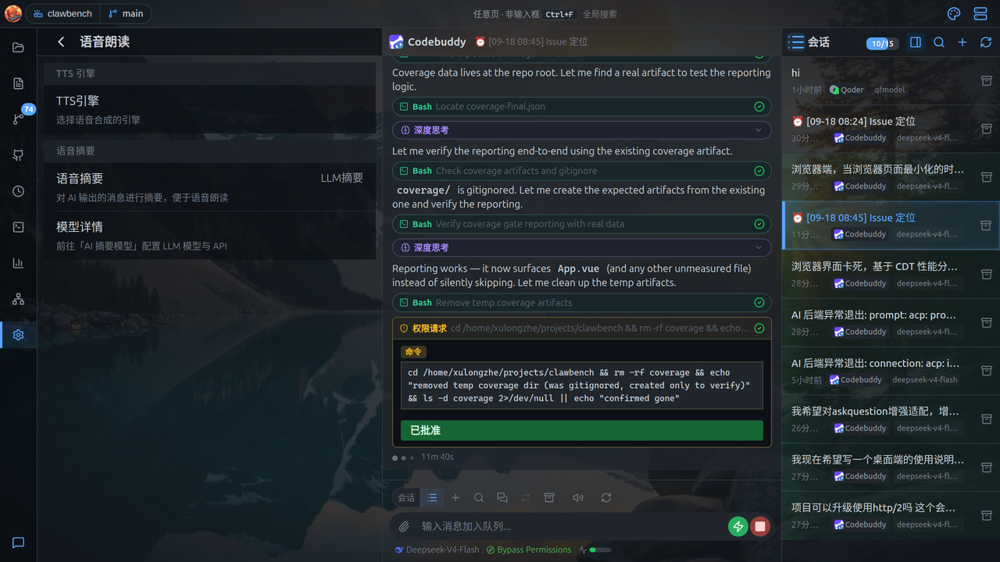

# TTS 语音合成部署指南

ClawBench 支持 TTS 语音合成，自动将 AI 回复总结后朗读。需要配置 **TTS 引擎** 和 **总结后端**。

## 在界面中使用

配置入口在 **设置 → 语音朗读**，配置把文字读出来的 TTS 引擎、音色与缓存。



- **TTS 引擎入口**：进入引擎子页配置
- **朗读摘要后端**：simple / api / auto

引擎子页可选 Edge / OpenAI 兼容 / 阿里云百炼 / 腾讯云 / 火山引擎 / MiniMax，并配置音色、语速、缓存上限；不同引擎有各自的专属字段（各引擎的字段见下方章节）。

朗读的触发方式：

- 每条助手消息下方的**「朗读」按钮**：语音朗读这条回复（需先在设置里配置语音）。
- **自动朗读**（设置 → 聊天）：开启后 AI 回复完成即自动朗读。
- **群聊轮流朗读**：群聊里每位成员**发言结束即朗读**（不等整轮跑完只念最后一条），多位成员并发发言时**按顺序轮流播放**、互不抢占，每段音频前会念一句「`xxx`说：」；某位朗读失败会自动跳到下一位，不影响整轮。
- 移动端：语音朗读的 TTS 引擎与音色即消息「朗读」按钮所用配置。

> **TTS 缓存策略**：已朗读过的内容会将音频缓存到本地磁盘，下次播放同一内容时直接读缓存，不消耗 TTS API 额度。缓存上限为 100 个文件，超出后按 LRU（最近最少使用）驱逐策略自动清理旧缓存。缓存目录为 `{data-dir}/tts-cache/`，可直接查看或手动清理。

## TTS 引擎

| 引擎 | 说明 | 网络要求 |
|------|------|---------|
| `edge` | 微软 Edge TTS，免费无限制（默认） | 需要网络 |
| `openai` | 任意 OpenAI 兼容的 `/v1/audio/speech` 端点 | 需要网络 |
| `alibaba` | 阿里云百炼（DashScope）语音合成，模型如 `cosyvoice-v3-flash` | 需要网络 + API Key |
| `tencent` | 腾讯云语音合成（TextToVoice） | 需要网络 + SecretId/SecretKey |
| `volcano` | 火山引擎（豆包）大模型语音合成 | 需要网络 + API Key |
| `minimax` | MiniMax 语音合成（T2A v2） | 需要网络 + API Key |

## 总结后端

长文本朗读前会自动总结，由 `summarize.tts_backend` 控制：

| 后端 | 说明 | 网络要求 |
|------|------|---------|
| `simple` | 纯文本清洗（默认），零延迟 | 无 |
| `api` | 远程 AI API（OpenAI/Anthropic 格式），模型配置复用 `ai_summary` | 需配置 URL 和 API Key |
| `auto` | 按内容自动分流：杂质（代码/表格/公式/链接等）占比 ≥ `summarize.auto_junk_ratio`（默认 0.5）或清洗后文本过长时走 `api`，否则直接朗读清洗文本 | 未配置 `ai_summary` 时自动降级为 `simple` |

> **云端引擎说明**：`edge` 与 `openai` 都需要网络。`openai` 走的是标准 `/v1/audio/speech` 接口，因此除官方 OpenAI 外，任何实现了该接口的服务（自建网关、代理、其他厂商的兼容端点）都可以直接填进来。需要云端大模型参与**文本总结**时，走的是**总结后端**（`api` / `auto`）而非 TTS 引擎——它把长文总结成短句后再交给 TTS 朗读，配置见下方「API 总结后端」。

## 文本处理参数

| 参数 | 默认值 | 说明 |
|------|--------|------|
| `inline_code_max_len` | 100 | 行内代码保留的最大字符数（rune）；超出则整段删除 |
| `max_summarize_runes` | 10000 | 总结输入的最大字符数；超出则截取尾部（simple 模式: 1000） |
| `auto_junk_ratio` | 0.5 | `auto` 后端的杂质比例阈值（0~1）：占比 ≥ 该值或清洗后文本过长时走 LLM，否则直接朗读 |

---

## Edge TTS（免费，需网络）

微软 Edge TTS 引擎，免费无限制，支持数百种音色。

```yaml
tts:
  engine: "edge"
  voice: "zh-CN-XiaoxiaoNeural"   # 音色ID
  speed: 1                         # 语速倍率（自动转为百分比速率，如 1.2 → +20%）
```

**常用中文音色**：`zh-CN-XiaoxiaoNeural`、`zh-CN-YunxiNeural`、`zh-CN-YunjianNeural`
**常用英文音色**：`en-US-JennyNeural`、`en-US-GuyNeural`
**完整列表**：https://speech.microsoft.com/portal/voicegallery

无需额外安装，开箱即用。

---

## OpenAI 兼容 TTS（需网络）

调用任意 OpenAI 兼容的 `POST /v1/audio/speech` 端点。除官方 OpenAI 外，自建网关 / 代理 / 其他厂商的兼容端点均可使用。

```yaml
tts:
  engine: "openai"
  speed: 1
  openai:
    base_url: "https://api.openai.com/v1"   # 根地址，自动补全为 …/v1/audio/speech
    api_key: "sk-..."                       # Bearer 令牌；本地服务可留空
    model: "gpt-4o-mini-tts"                # 由你填写
    voice: "alloy"                          # 由你填写
    stream_mode: "auto"                     # auto（默认）/ sse / audio
```

**模型与音色由你填写，没有默认值**：

- 模型名不在 OpenAI 文档列表内、或填了服务端不支持的模型时，会在合成时报上游错误。设置页的「测试连通性」会发一次真实合成请求（而不是查模型列表），因此能提前发现模型名或音色写错。
- 音色既可以是内置名（`alloy` / `ash` / `ballad` / `coral` / `echo` / `fable` / `onyx` / `nova` / `sage` / `shimmer` / `verse` / `marin` / `cedar`），也可以是自定义音色 ID（如 `voice_1234`）——兼容服务端接受哪些值不受官方列表约束。

**流式行为**：引擎优先请求 `stream_format: "sse"`（逐块事件，边合成边播放）。该形态**只有新模型支持**；若服务端返回 400（例如 `tts-1` / `tts-1-hd`），会自动回退为 `stream_format: "audio"`（原始音频字节流，所有模型都支持），播放体验仍然是边下边播，无需手动配置。设置页的 **`stream_mode`** 可手动覆盖这个自动判断：`auto`（默认，按模型名判断）/ `sse`（强制逐块流式）/ `audio`（强制整体音频）——当兼容服务的模型名无法判断是否支持 SSE 时，可手动指定。

> 改动音色 / 模型 / 端点后，缓存键会随之变化，因此不会复用上一套配置生成的音频。

---

## 阿里云百炼（DashScope，需网络）

支持百炼的两类合成模型，统一输出 MP3：

- **CosyVoice 系列**（默认 `cosyvoice-v3-flash`）：走 HTTP 接口 `/api/v1/services/audio/tts/SpeechSynthesizer`。
- **Sambert 系列**（如 `sambert-zhide-v1`）：这类模型只认 WebSocket（HTTP 调用会回 `current user api does not support http call`），本程序对 `sambert-` 开头的模型自动改走 `wss://.../api-ws/v1/inference`。**音色由模型名决定**，此时 `voice` 字段不生效；语速也不下发（该接口没有这个参数）。

> **免费额度按模型发**：控制台的「每月 3 万字符、每月 1 号重置」只发给 sambert 各音色（每个音色各 3 万，汉字按 2 字符算，约 1.5 万汉字/月/音色）；CosyVoice 的 `v3-flash` / `v3-plus` / `v2` 没有任何免费额度，`v3.5-flash` / `v3.5-plus` 才有 1 万字符。

```yaml
tts:
  engine: "alibaba"
  speed: 1
  alibaba:
    api_key: "sk-..."                                  # 百炼 API Key
    base_url: "https://dashscope.aliyuncs.com"         # 默认值；业务空间专属域名填这里
    model: "cosyvoice-v3-flash"                        # 默认值；填 sambert-xxx-v1 则自动走 WebSocket
    voice: "longanyang"                                # 默认值，可换系统音色 / 复刻音色 ID（sambert 忽略此项）
```

- 北京与新加坡是**两套独立的域名和密钥**，不能混用。用业务空间专属域名时填 `https://<业务空间ID>.cn-beijing.maas.aliyuncs.com`。
- 默认模型是 CosyVoice 系列（支持 MP3）。**`qwen3-tts-flash` 与 `qwen-audio-3.1-tts-*` 不在支持范围内**——它们走另一条接口且只输出 WAV（或请求格式完全不同），与本程序的播放链路不兼容。
- 语速会被限制在接口允许的 0.5～2.0 倍之间。

---

## 腾讯云语音合成（需网络）

调用腾讯云 `TextToVoice` 接口，鉴权是**每次请求签名**（不是 Bearer 令牌），所以需要一对 SecretId / SecretKey。

```yaml
tts:
  engine: "tencent"
  speed: 1
  tencent:
    secret_id: "AKID..."    # 访问管理 → API 密钥管理
    secret_key: "..."       # 只保存在本机
    voice_type: 101001      # 数字音色编号，默认 101001（智瑜）
```

- 单次请求最多 150 个汉字，长回复会自动按句切成多段合成，听感上仍是连贯的一整段。
- 不同音色的单价不同，选之前先在腾讯云控制台确认已开通该音色。
- 语速会换算成腾讯云的 `-2～6` 档位（0 表示正常语速）。

---

## 火山引擎（豆包，需网络）

调用火山引擎 v3 单向流式接口，边合成边播放。

```yaml
tts:
  engine: "volcano"
  speed: 1
  volcano:
    api_key: "..."                                # 语音技术控制台的 API Key
    resource_id: "seed-tts-2.0"                   # 默认值，要和音色类型匹配
    voice: "zh_female_vv_uranus_bigtts"           # 默认发音人
```

- 需要先在火山引擎语音技术控制台开通「语音合成大模型」并拿到 API Key。
- `resource_id` 要和音色类型对应：官方 2.0 音色用 `seed-tts-2.0`，声音复刻音色用 `seed-icl-2.0`。
- 音色名（发音人 ID）以控制台的音色列表为准；填错时「测试连通性」会直接报出服务端的原因。

---

## MiniMax（需网络）

调用 MiniMax 的语音合成接口（`/v1/t2a_v2`），整段合成后播放。

```yaml
tts:
  engine: "minimax"
  speed: 1
  minimax:
    api_key: "..."                                # 开放平台的接口密钥
    group_id: ""                                  # 可选，老账号才需要
    base_url: "https://api.minimax.chat"          # 国内站；国际站换成对应域名
    model: "speech-02-hd"                         # 默认值；低延迟可用 speech-02-turbo
    voice: "female-shaonv"                        # 默认值（少女音）
```

- 国内站和国际站的域名、密钥都不通用，用哪边就把 `base_url` 和密钥换成哪边的。
- 音色 ID 以控制台的「音色管理」为准，例如 `female-shaonv`、`female-yujie`、`male-qn-qingse`。
- 语速会被限制在接口允许的 0.5～2.0 倍之间。

---

## API 总结后端（远程 AI API，支持 OpenAI/Anthropic 格式）

通过 HTTP API 调用远程 AI 服务进行文本总结，支持 OpenAI Chat Completions 和 Anthropic Messages 两种格式。适用于 OpenAI、DeepSeek、Groq、OpenRouter、Ollama（OpenAI 兼容端点）等任何兼容 API。

### OpenAI 格式（兼容 DeepSeek、Groq、Ollama 等）

```yaml
tts:
  engine: "edge"                    # 任意 TTS 引擎
  voice: "zh-CN-XiaoxiaoNeural"
  speed: 1

summarize:
  tts_backend: "api"                # 语音摘要类型（""/simple/api/auto）

# 共享的 AI 模型配置（语音摘要 + 推荐回复共用）
ai_summary:
  model: "gpt-4o-mini"
  format: "openai"                  # openai / anthropic（留空自动识别）
  api:
    base_url: "https://api.openai.com/v1/chat/completions"  # 完整端点 URL
    key: "sk-xxx"                                             # API Key
```

### Anthropic 格式

```yaml
tts:
  engine: "edge"
  voice: "zh-CN-XiaoxiaoNeural"
  speed: 1

summarize:
  tts_backend: "api"

ai_summary:
  model: "claude-3-5-haiku-latest"
  format: "anthropic"
  api:
    base_url: "https://api.anthropic.com/v1/messages"
    key: "sk-ant-xxx"
```

### Ollama 本地推理（通过 API 后端）

> 💡 原 `ollama` 总结后端已废弃，请迁移到 `api` 后端 + `format: "openai"`。

Ollama 提供了 OpenAI 兼容端点 `/v1/chat/completions`，无需云 API，适合离线或隐私敏感场景。

```yaml
tts:
  engine: "edge"
  voice: "zh-CN-XiaoxiaoNeural"
  speed: 1

summarize:
  tts_backend: "api"

ai_summary:
  model: "gemma3:270m"
  format: "openai"
  api:
    base_url: "http://localhost:11434/v1/chat/completions"  # Ollama 的 OpenAI 兼容端点
```

> 💡 `gemma3:270m` 模型仅 291MB，适合快速总结。如需更好质量，可换 `qwen3:0.6b` 或更大模型，只需修改 `model` 即可。

#### 安装步骤

```bash
# 1. 安装 Ollama：https://ollama.com/download
# 2. 拉取模型（推荐国内镜像）
OLLAMA_REGISTRY=https://ollama.ai-mirror.cn ollama pull gemma3:270m
# 3. 启动 Ollama 服务
ollama serve
```
