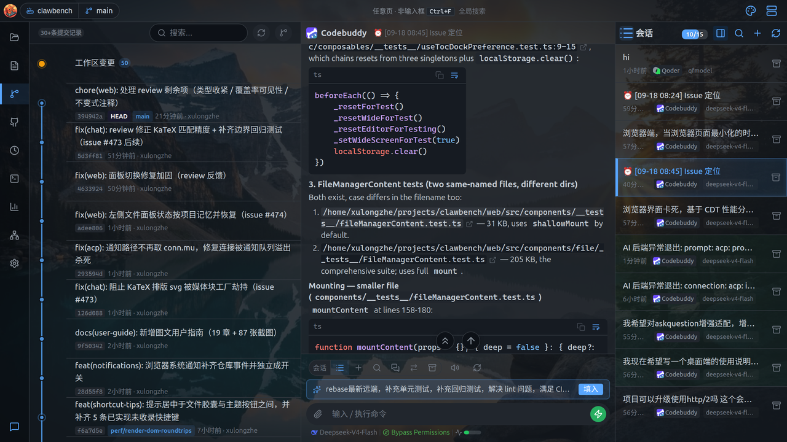
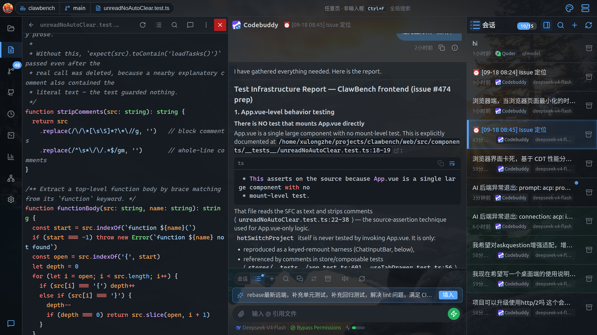
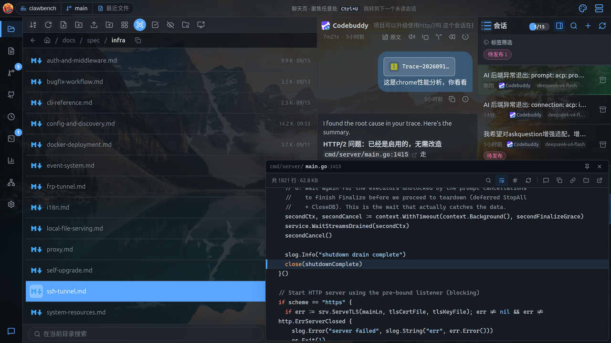
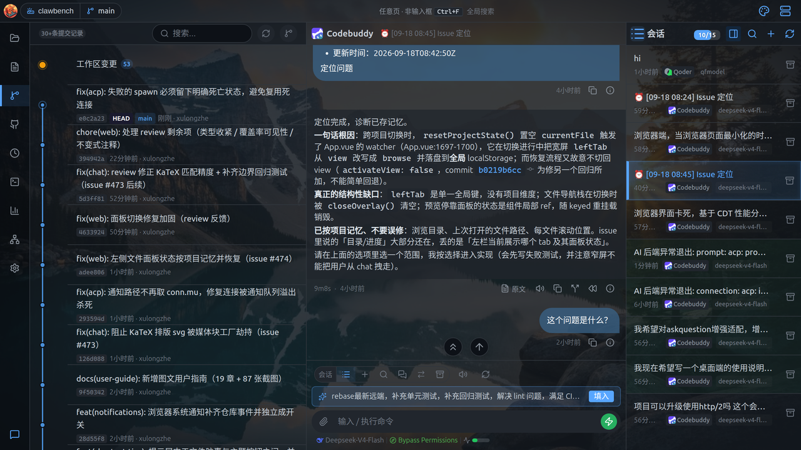
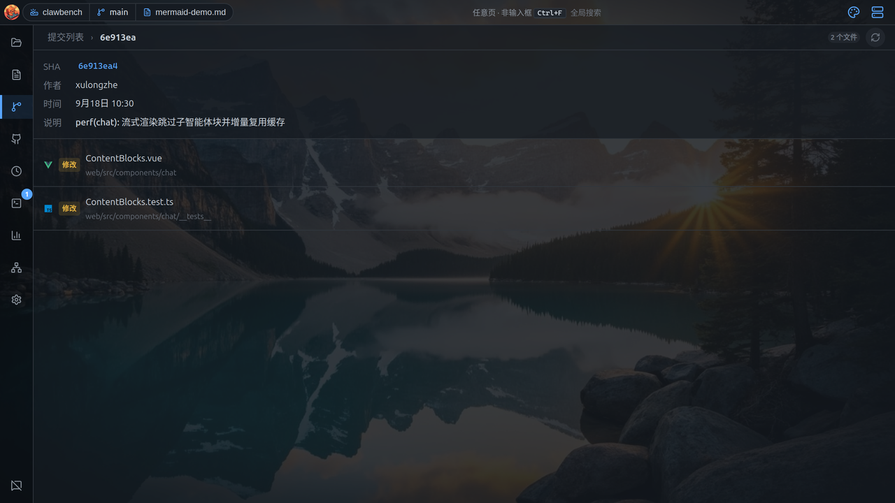

# 标注与跳转系统

> 本文同时适用于桌面端与移动端；两端差异处用 **桌面端** / **移动端** 标注。

自动把聊天里出现的路径、commit、端口变成可点击的链接，点一下就跳过去。

ClawBench 会自动识别聊天与文档里的**技术引用**（文件路径、目录、裸域名、commit hash、worktree 路径、localhost 地址），把它们变成可点击的标注。点一下就能跳到对应位置，不必手动复制路径再去找。

## 标注类型总览

一张表列出能被识别的几类引用，以及点击后会发生什么。

| 类型 | 外观 | 点击后 |
|---|---|---|
| **文件路径** | 蓝色等宽文字，悬停下划线 | 打开文件查看器并定位到该行 |
| **目录路径**（以 `/` 结尾） | 同上 | 在文件管理器中打开该目录 |
| **代码链接预览** | 同上，但在**预览模式**下 | 弹出代码切片浮层，不离开当前页面 |
| **失效路径** | 变灰的等宽 chip，鼠标为手型 | 按文件名在项目内搜索匹配文件（见下） |
| **Commit hash** | 短 SHA + 打开图标 | 切到项目历史并定位到该提交详情 |
| **Worktree 路径** | 蓝色等宽文字 + 图标 | 打开该工作树下的文件 |
| **localhost 地址** | 地址 + 打开图标 | 建立端口映射并打开 WebView |
| **裸域名** | 与其它外链同款（可选中文本 + 点状下划线） | 点击先确认完整 URL，确认后交给系统浏览器打开（无需 `https://` 前缀） |

标注是**基于 DOM 遍历**生成的（不是简单正则替换），因此会先验证路径真实存在再标注。**验证失败的路径不会静默变回纯文本**——它保留为变灰的 chip，点击可按文件名在项目内搜索（见下方「失效路径」）。

## 文件路径标注

聊天里出现的文件路径会变成可点文字，点击打开文件并定位到对应行。

聊天里出现的文件路径会自动变成可点击标注：



标注支持 `路径` 与 `路径:行号` 两种形式（如 `cmd/server/main.go:1415`）。

**点击后**打开文件查看器并**直接定位到对应行**：



**双候选路径解析**：同一个相对路径可能相对于「当前文件所在目录」或「项目根目录」，ClawBench 会两个候选都试，哪个存在用哪个。所以文档里写 `../images/a.png` 和 `web/src/app.ts` 都能正确解析。

**目录也能点**：AI 回复里经常列目录（树形图尤其），**以 `/` 结尾的目录引用**（如 `internal/service/`、`web/src/composables/`）同样会变成可点标注——点开在文件管理器里浏览该目录。目录标注要求**至少两段**（挡掉 `A/B`、`N/A`、`and/or`、`100MB/s` 这类散文里的斜杠），且**必须带尾部 `/`**（否则 `cover/cover.png` 会被截成 `cover/`）。行内代码、URL 尾巴（`https://host/a/b/`）不会被误判为目录。

**不会误报的几种写法**：`ftp:/example.com/a/b` 里的 `p:` 不会被当成 Windows 盘符（盘符分支要求左边不是连续字词字符），裸分隔符 `/`、`\`、`./`、`../` 不当作文件，裸的 `file://`（后面没路径）也不标注。

## 代码链接预览

在预览模式下点路径不跳走，而是在当前页弹一个小浮层看代码。

在**预览模式**下（文件管理器工具栏开启「预览模式」），点击路径不再跳转，而是弹出**代码切片浮层**：



浮层包含：

| 元素 | 说明 |
|---|---|
| **标题栏** | 文件名 + 行号引用（如 `cmd/server/main.go:1415`） |
| **目录** | 文件所在目录（长路径跑马灯滚动） |
| **代码区** | 目标行上下文的代码切片，带语法高亮与行号 |
| **展开条** | 向上/向下加载更多上下文行 |
| **操作按钮** | 固定卡片、关闭、复制路径、在完整查看器中打开 |
| **渲染 / 源码** | 目标是 Markdown 或 HTML 时出现：默认进**渲染预览**，点眼睛图标切**源码**。HTML 渲染态同样走沙箱 iframe（相对引用如 CSS/JS/图片能正确解析），显示完整文件、不做行过滤 |

浮层是**临时卡片**（transient）：点卡片外部会关闭；点「固定」按钮则常驻，方便边看代码边对话。

> **提示**：若点击路径直接跳转了查看器而不是弹浮层，说明**预览模式未开启**。开启后即为浮层模式。

> **为何有时不弹浮层直接跳转到查看器？**：这是因为「预览模式」未开启。代码链接预览浮层依赖预览模式开关——开启时点击路径弹浮层，关闭时点击路径直接跳转到完整查看器。如需使用浮层预览，请先在文件管理器工具栏开启「预览模式」。

## 失效路径

AI 猜错目录前缀、或文件已改名/删除时，路径点开是空的。ClawBench 不把它变回纯文本，而是保留成变灰的 chip，点一下帮你找。

标注只校验**两个**候选位置（相对当前文件所在目录、相对项目根，见上文「双候选路径解析」），两者都不中即判为**失效**。失效路径有两种形态：

- **验证失效**（路径看起来像文件，但两处都不存在）：chip 变灰、鼠标为手型，**点击后按文件名在项目内搜索**——取路径的 **basename**（文件名本身）做全项目递归精确搜索，列出匹配文件供你点选，选中后打开。AI 常只是猜错了目录前缀，文件其实还在项目里。原路径上的**行号会保留**，点选候选后会落到原意图行。
- **通配符模式**（如 `src/*.go`、`**/*.ts`）：这不是具体文件，而是模式。chip 变灰、鼠标为问号（纯提示，不可点），悬停提示「这是通配符模式，不是文件路径」。

> 失效 chip 与正常路径 chip 外观接近但**刻意不同**：失效态的背景、光标、下划线都经过强化，确保不会与可点路径混淆。分享页（只读）中失效路径不触发搜索（搜索接口需要登录）。

## Commit hash 标注

聊天里的短 commit id 可以点击，直接跳到该提交的详情页。

聊天里出现的短 commit hash 会附带一个打开图标：



**点击后**切到「项目历史」并**直接定位到该提交的详情页**：



详情页显示 SHA、作者、时间、提交说明与变更文件列表，可继续查看 diff。SHA 本身也可点击复制。

## Worktree 路径标注

多工作树环境下，聊天里的 worktree 路径也能点击打开。

在多工作树（worktree）环境下，聊天里出现的 worktree 路径会被识别并标注。worktree 标注**优先于**文件路径标注——避免 worktree 路径被当作普通相对路径二次匹配。

## 裸域名链接

不带协议头的域名也能直接点开，比如 AI 回复里写 `github.com/foo/bar`。

`https://…` 这类完整地址本来就由 Markdown 渲染器自动链接化；**没有协议头**的域名（`github.com/foo/bar`）此前是纯文本，而且其中的点号会被文件路径标注器当成路径分隔符，渲染出一个永远点不开的死 chip `com/foo/bar`。现在这类裸域名会在**文件路径标注之前**先包成链接，既可直接点开，也自动退出了路径识别。

判据是「域名 + 至少一段路径」：`sh`、`app`、`com` 既是顶级域名又是常见文件后缀，只按 `name.tld` 匹配会把 `build.sh`、`useSessionIdentity.app` 这类真实标识符变成链接。所以 `build.sh` 依然是文件，`github.com/foo/bar` 才是链接。

## 外链的点击行为

聊天里的外链（Markdown 链接、裸域名、`localhost` 地址）现在统一渲染成**可选中的文本**，而不是 `<a>` 链接，点一下会**先弹确认框显示完整 URL**，确认后才离开应用。（`localhost` 地址旁边那个打开图标按钮不受影响，仍按原路建隧道、在应用内打开。）

这么设计有两个原因：手机上长按 `<a>` 会触发 WebView 自己的链接手势，系统上下文菜单不出现，URL 就没法用常规长按流程复制；而改成普通文本后字符可选中，长按就是系统菜单。代价是点击需要自己处理，所以顺带加了一层确认——聊天里误触一下就把人拽进浏览器，代价比多点一次高。

**保留为真链接的例外**：媒体地址（`.mp3` / `.mp4` 等，内联播放器依赖 `<a href>` 来识别）、相对路径与 `#锚点`（文件标注与页内跳转需要读 `href`）。

## localhost 地址标注

聊天里的 `localhost:端口` 可以点击，自动建隧道并打开页面。

聊天里出现的 `localhost:PORT` 或 `127.0.0.1:PORT` 会附带一个打开图标。点击后 ClawBench 会：

1. 为该端口建立 SSH 隧道（端口映射）
2. 在内置 WebView 中打开该地址

这让「AI 说服务跑在 localhost:3000」到「我直接看到页面」变成一次点击。

## 标注管道的处理顺序

几类标注按固定顺序处理，且**已标注的元素不会被后续标注重复匹配**：

```
裸域名 → Worktree 标注 → 文件路径标注 → commit hash 标注 → localhost 标注
```

这个顺序有实际意义：裸域名必须先于文件路径（否则 `github.com/foo/bar` 的尾巴会被当成本地路径）；worktree 路径本身就是文件路径，必须先识别为 worktree 才不会被子路径标注误处理。

## 流式期间的行为

AI 还在输出时不做标注，等这一轮结束、内容稳定后再做。

**流式输出进行中，标注管线不运行**——此时只做纯 Markdown 渲染。等这一轮回复结束、内容稳定后，才启动完整管线（含路径验证与标注）。

这样做的原因：流式期间内容不完整，路径可能只写了一半，此时标注会产出大量无效结果并造成闪烁。
