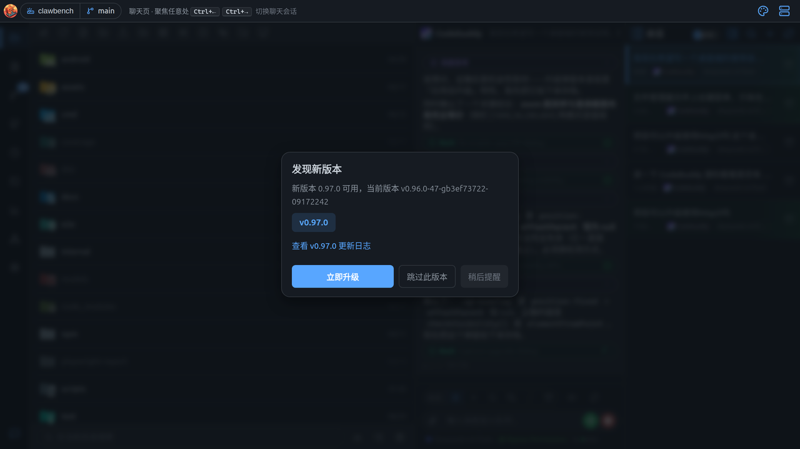
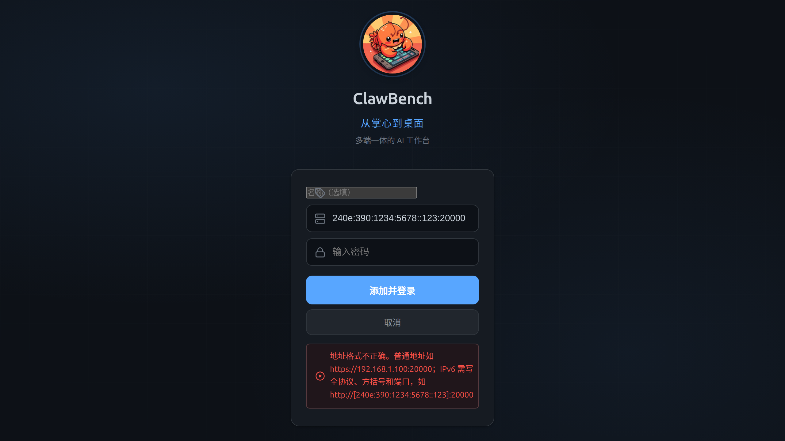

# 桌面客户端（Windows / macOS / Linux）

> 本文适用于 **桌面客户端**（Electron 壳）。浏览器用户可跳过本章。

ClawBench 桌面客户端是**纯「壳」**：它复用服务器与 Web 前端的全部业务逻辑，只补上浏览器做不到的桌面能力——**窗口最小化/隐藏时仍能弹系统通知**、原生窗口控制、自升级等。装了它，你的服务器与所有数据都不变，只是换一个更原生的入口。

> 界面与浏览器版完全一致（同一套前端），差异只在原生能力；本章不重复截图，桌面专属能力以文字说明为主。

> **与手机 App 模式的区别**：两者都经原生桥被识别为「原生环境」，但省电策略相反——Android 退到后台会被系统挂起，故隐藏时主动断开 WebSocket；桌面窗口只是最小化、进程仍在跑，断开 WS 等于自断通知来源。因此桌面端**窗口最小化时仍保持连接**，通知照常到达。

## 下载与安装

### 从哪里下载

两种入口，拿到的是同一个安装包：

- **设置 → 关于 → 下载桌面版**（仅当服务器是打了标签的正式发布、且你正在桌面浏览器里访问时出现）
- 仓库的 GitHub **Releases** 页面

> 服务器是**开发/未打标签**构建时，下载入口会自动隐藏——此时没有对应的发布包可下。

### 支持平台

| 平台 | 产物 |
|---|---|
| **Windows**（x64） | zip 免安装目录 |
| **macOS**（Apple Silicon / Intel） | zip（`.app`） |
| **Linux**（x64 / arm64） | zip 免安装目录 |

下载的是 **zip 压缩包**，解压后直接运行其中的可执行文件即可，无需安装程序。国内网络下服务器会优先给出**镜像地址**，直连 github.com 作为兜底。

## 窗口控制

Windows / Linux 上是**无边框窗口**，标题栏右侧自绘三个控制按钮（最小化 / 最大化 / 关闭）；macOS 保留系统原生交通灯。标题栏空白处可拖动窗口。

**窗口的位置、大小与最大化状态会被记住**，下次启动回到原样。如果上次是在外接显示器上、而这次那块屏不在（拔了线 / 换了位置），窗口不会傻乎乎恢复到看不见的地方——它会退回默认位置，保证你总能找到它。

窗口的**最小化/隐藏**是桌面端最重要的能力：它是「系统通知是否弹出」的判据——**窗口在屏幕上（可见且未最小化）时抑制系统通知**（你开着应用，通知只会重复应用内完成卡片），只有最小化 / 隐藏时才弹。

> **判据是「窗口是否可见」而非「是否有焦点」**：窗口摆在第二显示器、或被你正开着的其他程序盖住，都算「应用开着」，此时不该弹通知；否则你点一下别的窗口，通知就会突然开始弹。这个判断必须在主进程做——渲染层的 `document.hasFocus()` 在最小化/隐藏窗口里仍可能为真。

## 原生通知

会话完成、任务完成、需要审批、仓库事件发生时，若窗口不在屏幕上，桌面端会弹出**系统通知**（与浏览器通知不同，它在窗口最小化/隐藏时也能触发）。**点击通知**会直接把窗口带到前台并跳到对应位置：

- 会话完成 → 打开该会话
- 任务完成 → 打开该任务执行详情
- 仓库事件 → 打开「代码托管集成」页签（图标跟随该项目绑定的平台）

窗口被最小化时，点击通知会先**还原并显示窗口**再跳转（只 `focus()` 对最小化窗口是无效的）。

## 关闭窗口时：退出还是收到托盘

点右上角的 **关闭**（或按 Alt+F4、任务栏右键「关闭」、窗口的 X）时，ClawBench 会问一次：

- **最小化到托盘**（默认选中）——窗口消失，程序继续在后台跑，正在执行的会话和任务不会中断；任务栏右下角的托盘图标就是回来的入口（单击它显示窗口）
- **退出程序**——真正结束进程
- **取消**——什么都不做（按 Esc 也是这个）

勾上「**记住我的选择**」后就不再询问。想改回来：**设置 → 消息推送 → 桌面与系统 → 关闭主窗口时**，三个选项（每次询问 / 最小化到托盘 / 退出程序）随时可切。

> 这个设置只在 Windows / Linux 的桌面端有意义：macOS 的红灯本来就只是关窗口、不退出程序，所以那边不显示这一项。

## 桌面悬浮状态胶囊

设置 → 消息推送 →「桌面与系统」里的 **悬浮状态窗** 开关在桌面上同样有效（和手机 App 是**同一个开关**）。打开后桌面上会出现一颗**始终置顶**的小胶囊，显示三类数字：**执行中 / 待审批 / 未读**；同时在系统托盘放一个图标。

- **点一下胶囊**显示主窗口（窗口已被收起到任务栏/最小化时还原并聚焦；窗口正开着时这一下会把它**收起**，胶囊留在原地当回来的入口）；**拖动**可以把它挪到屏幕任意位置（可以跨显示器停放，但拖不出可见范围），位置会记住
- 与手机不同，它**不会因为空闲而自动消失**——它由开关与托盘控制；托盘图标的提示文字与胶囊共用同一份数字，所以胶囊被拖到看不见的地方时，鼠标悬停托盘仍然知道有没有活要处理
- 数字由桌面端**自己**向服务器查询（和手机端同一套口径），所以两端的计数不会打架；托盘菜单里可以直接**显示/隐藏胶囊**、也可以**隐藏主窗口**（把窗口收起，胶囊留在桌面上）。关掉设置里的开关后托盘一并收起——除非「关闭主窗口时」选的是**最小化到托盘**，那时托盘要留着当回来的入口，菜单里只剩打开/隐藏主界面与退出

> 它与手机的悬浮窗是同一件事的两种画法：手机上是桌面上的气泡，桌面上是置顶胶囊 + 托盘图标。

## 会议与屏幕共享

桌面端可以把**屏幕 / 某个窗口**（可选叠加**系统声音**与**麦克风**）共享出去，生成一个链接；任何拿到链接的人在浏览器里打开就能看、能听，**无需登录**。入口是左栏 Dock 的 **视频会议** 页签——不是顶栏按钮，五个视图（记录列表 / 创建 / 加入 / 会议中 / 记录详情）都在这个页签里。完整操作见 **[会议与 AI 听记](meeting.md)**。

桌面端特有的部分：

- **选择共享内容**：创建会议时点「共享屏幕」，先选一块屏幕或一个窗口（带缩略图）；会议中可随时**切换源**或**停止共享**，观众不需要重连
- **系统声音只在 Windows 上可用**——这是 Electron 的能力边界，不是开关藏起来了；macOS / Linux 上该项会说明不可用，画面照常共享
- **观众上限 8 人**，且**只在同一局域网内可用**（点对点直连，不经服务器中转，也没有 TURN）。跨网段、公网、或路由器开了「客户端隔离」时连不上；人数更多或要跨网段就在创建会议时勾**中继服务**（地址与密钥在「设置 → 视频会议」配一次，先测通再保存）
- **观众可以发言**：默认值来自「设置 → 视频会议」的**新会议默认值**（出厂为开）。会议中打开「允许发言」后，观众自己开麦即可说话，**其他观众也能听到**；你随时可以**静音某个人**或**全部静音**
- **成员可以反向共享屏幕**：打开「允许成员共享屏幕」（默认值同样取自「设置 → 视频会议」，出厂为开）后，观众里的**电脑浏览器**就能把自己的屏幕共享给所有人。**一次只允许一个人**（第二个人会被告知「有人正在共享」），共享者本人不会收到自己画面的回传（否则会延迟一拍变成回声）。你随时可以关掉开关（连带停掉正在共享的人）或只停某一个人。**成员端必须用 HTTPS 打开分享页**——浏览器只在安全上下文提供屏幕采集，会议页上的「生成证书并重启」就够用；手机浏览器不能共享屏幕
- **被观众远程控制**：Windows 上可注入键鼠（观众端需你逐个批准），macOS / Linux 与浏览器发布时不支持
- **标注只在独立窗口**：点「标注」会开一个置顶的透明画板窗口（或文档画中画窗口），打不开时会明确提示，**不会悄悄退回主窗口**——把笔迹画在主窗口上既盖住界面，也送不进观众画面
- **HTTP 下也能开**：客户端会把自己的页面提升成安全上下文，所以本机照样能采集；但发出去的链接在别人浏览器里仍要 HTTPS。创建页与会议列表顶部会挂一条横幅，一键生成证书并重启，随后客户端自动把服务器地址换成 https
- **建议戴耳机**：外放时对方会听到自己延迟后的声音

> 听记只发生在**发布端**：默认的点对点共享里，服务端一个音频包都收不到（中继模式媒体也只经过 LiveKit，不经过本服务），而发布端本来就握着全部音源。这也是唯一还能区分「谁在说话」的位置。

> 链接的规则与其他分享一致——**token 即凭证**，谁拿到谁能进。散会（或服务重启）后这条链接不能用来入会；是否继续作为这场会的**只读记录页**（纪要 / 转写 / 校对 / 聊天，无需登录）由你在会议详情的**资源**页签决定——默认不共享，点「共享会议资料」确认后长期有效到记录被删除，点「停止共享」随时收回；录音与资源页不在分享页里。

## 版本一致性门禁

桌面客户端与 Web 界面分工是「薄壳 + 服务端下发」：真正需要两端对得上的只有**一小撮契约**（原生桥方法集、启动与升级接口、登录握手）。所以门禁比的是**协议号**，不是版本字符串：

- **协议号相等就放行**，两端版本号差多少都不管——大多数发布只改了 Web 界面，壳一个字都没变，此时硬拦一次升级纯属打扰
- **协议号不等才弹阻断遮罩**，提示当前客户端版本与服务器版本，并给出**下载对应版本**的入口
- **客户端较旧**（落后于服务器）时，下载是「升级」；**客户端较新**（超前于服务器）时，下载是「**降级**」——文案会区分这两种方向，不会把降级说成升级
- 在遮罩里点下载后，会按服务端版本执行一次自升级；升级完成或你选择稍后重启，遮罩都会关闭
- **老客户端连新服务器**（任一侧还没有协议号）会**退回版本比较**，行为与以前完全一致——这也是老客户端的单向升级路径
- **开发/未打标签的服务器不触发门禁**（没有对应的发布版本可比对）

## 自升级（侧装 + 指针）

桌面端的升级采用**「侧装 + 指针」**而不是原地替换——因为运行中的进程无法覆盖自身（Windows 上尤其如此）：

1. 新版本被下载并**校验 `SHA256SUMS` 清单**，通过后解压到 `~/.clawbench-desktop/app-<版本>/` 这个**独立目录**
2. 改写一个**指针文件** `~/.clawbench-desktop/current` 指向新目录
3. 重启后，**应用自己**在启动最前面读指针，决定运行哪个版本

这样做的收益是**失败可回滚、旧版本保留**：指针缺失、目标目录不存在、或指向自身时，应用会清掉指针并继续用当前版本启动——**被删坏或写坏的升级永远不会让应用打不开**。

- 每次升级都下载**完整安装包**，下载完成后先校验 `SHA256SUMS` 清单再安装——校验不通过不会动你正在用的版本

> **「检查更新」在哪**：**设置 → 关于 → 检查更新**。发现新版本会弹出升级卡片，可选「立即升级 / 跳过此版本 / 稍后提醒」。

**整合包（客户端自带服务端，Windows / macOS / Linux 都有）走另一条路**：它不能只换客户端、也不能只换服务端，所以「立即升级」会下载并安装**整个整合包**（客户端和服务端一起更新，约 150MB），装好后由你决定何时重启。装过一次带这个能力的版本之后，以后都能在应用内直接升级；更早的版本仍然需要手动下载一次新版整合包。**macOS 解压后请让 `ClawBench.app` 和 `server` 文件夹待在一起**（`server` 放在 bundle 外面是为了不破坏签名）；只把 App 拖到「应用程序」而留下 `server`，它会退化成只能连其他服务器的瘦客户端。

**整合包与独立版共用 `~/.clawbench` 数据目录**：桌面端能直接看到你独立版的会话和项目。同一个数据目录只能跑一个服务端——如果你已经用命令行开着一个，桌面端会直接接管它，不会另起一个；旧版整合包的数据会在第一次启动时自动迁过来。独立版设过密码时，桌面端不会知道那串密码，会直接显示服务端的登录页，输入一次就能进。

**退出桌面后本机服务会继续运行**：关掉窗口或退出程序都不会停掉它，手机、浏览器和其他设备还能接着连。下次打开桌面端会自动接管同一个服务端；只有桌面端升级过、版本对不上时，才会停掉旧的换新的。想彻底停掉它有三个入口：关闭对话框里的「退出并停止本机服务」、托盘菜单的「停止本机服务」、登录页「本机服务」那一行的「停止」按钮。

## 多服务器与登录

桌面端支持**保存多个服务器**，每个服务端的密码**分别加密存储**（用系统安全存储 safeStorage），在多个实例之间来回切换都能自动登录：

- 登录页可添加、切换、删除已保存的服务器
- 认证失败、网络不通、该服务端没存过密码这三种情况会**分别给出提示**，不会静默退回登录页
- 服务器地址、凭据与主题/语言偏好都持久化在本地
- **装好后默认连的就是本机**：整合包（安装包内自带服务端）的本机会单列成「本机服务」一块，只显示运行状态和停止按钮，不能改名或删除——它不是你自己保存的一条服务器记录。连过别的机器后，重启仍然打开那一台，不会被拉回本机
- **本机服务的端口是固定的**：它不会再把自己上次的地址当成「要避开的端口」而每次往后挪，登录状态、主题与面板布局也就不会看起来被重置

### 添加服务器时地址怎么写

「添加其他服务端」的表单只校验地址格式，写错会立刻标红，不会等到连不上才报错。

- **普通地址**：`https://192.168.1.100:20000` —— 协议、IP、端口都要写全
- **IPv6 地址**：必须写成 `http://[240e:390:1234:5678::123]:20000` —— **协议 + 方括号 + 端口**，三项缺一不可。方括号是 IPv6 与大写字母端口的分界，少了它解析器无法判断 `::` 后面哪一段是端口；只写到一半（如 `240e:390:1234:5678::123`）会被明确拒绝

> 客户端里只管「能不能连上这台机器」，跟 IPv6 相关的服务器侧配置（家里宽带有没有公网 v6、防火墙放不放行）见 [公网访问指南](PUBLIC_ACCESS.md)。

### 自签名证书（「信任并继续」）

如果你的服务器用的是**自签名证书**（HTTPS），桌面端连接时 Chromium 会默认拒绝。此时会弹出**原生对话框**，你可以选择**「信任并继续」**放行，或**「取消连接」**。

**信任会按「服务器地址 + 证书指纹」记住**：下次连同一台服务器不再询问。指纹变了（重装、轮换证书，或真有中间人）仍然会重新问——「记住」不会退化成「以后不校验这台机器」。想撤销可在 **设置 → 安全 → 已信任的证书** 里一键清除（仅桌面端显示）。连到本机隧道（证书必然与域名不匹配）时自动信任、不再询问。Android 端保持每次连接都询问。

## 原生右键菜单与外部链接

- **右键菜单**用系统原生菜单（剪切 / 复制 / 粘贴走系统角色，按语言本地化），图片上可「复制图片」、链接上可「复制链接」
- **外部链接**交给系统默认浏览器打开，不会在应用窗口里顶掉界面
- 窗口内的 `Ctrl+滚轮` / `Ctrl+=` / `Ctrl+-` 缩放整个界面（详见[快捷键与手势](shortcuts.md)）

## 与浏览器的差异一览

| 能力 | 浏览器 | 桌面客户端 |
|---|---|---|
| 窗口最小化时收通知 | ❌（标签被冻结时页面内通知不触发） | ✅ 系统通知 |
| 原生窗口控制 / 无边框 | ❌ | ✅ |
| 桌面悬浮状态胶囊 + 托盘 | ❌ | ✅（与手机同一开关） |
| 发起屏幕 / 声音共享 | ✅（桌面浏览器，需 HTTPS；无源列表，由系统选择器决定） | ✅（可选屏幕或窗口，系统声音仅 Windows，可被观众远程控制） |
| 自升级 | ❌（刷新即可） | ✅ 侧装 + 指针 |
| 版本一致性门禁 | ❌ | ✅ |
| 多服务器保存 | 部分（App 模式） | ✅ 加密保存 |
| 端口映射传输 | 能改服务端线路，但浏览器只能手动 `ssh -L`（无 h2 流式请求体） | ✅ 按服务端线路自动建隧道（SSH / HTTP/2） |

> **桌面端不是「手机 App 模式」**：它**不会**因为窗口最小化就断开 WebSocket——否则通知就失去了来源。前端用 `isDesktopApp` 区分两者，门控写成 `isAppMode && !isDesktopApp`。
