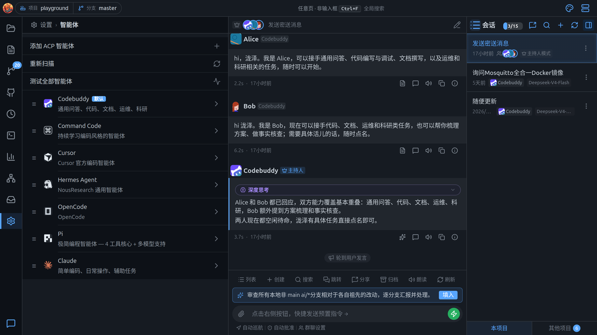
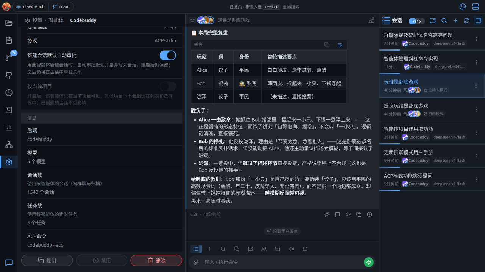
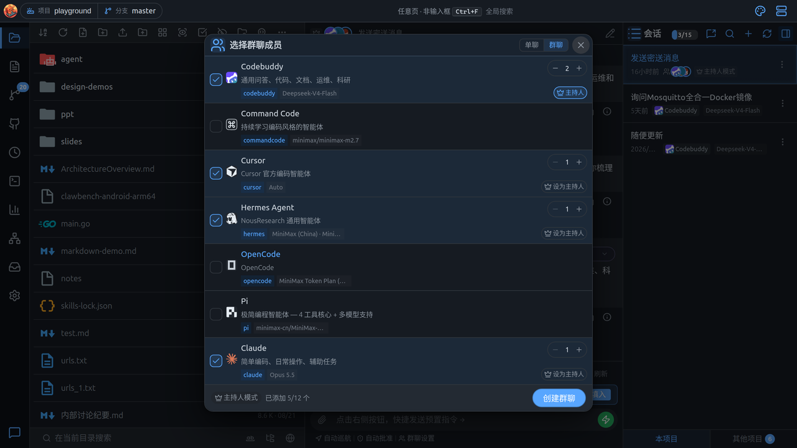
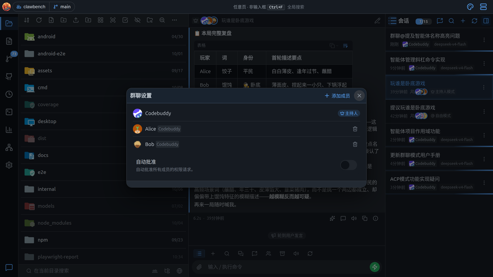
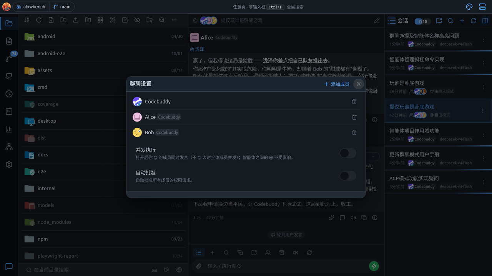
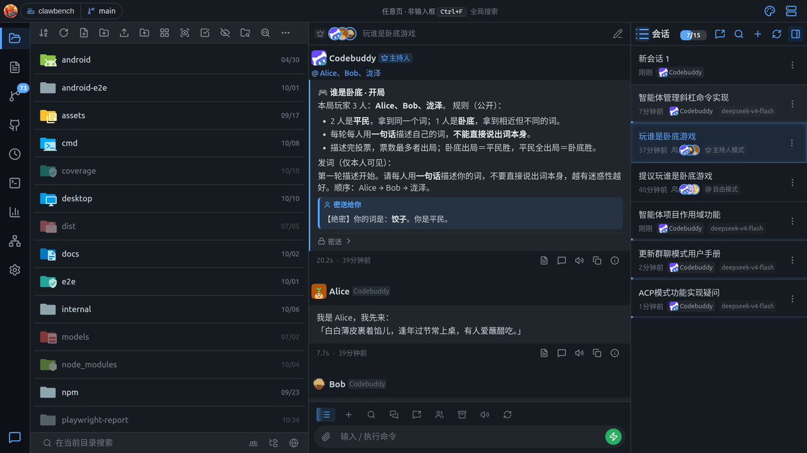
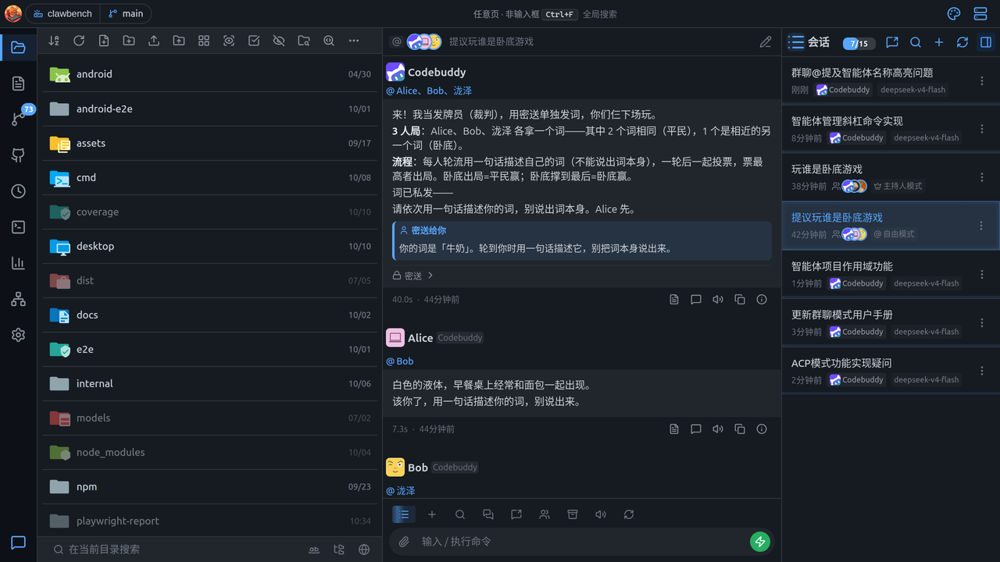
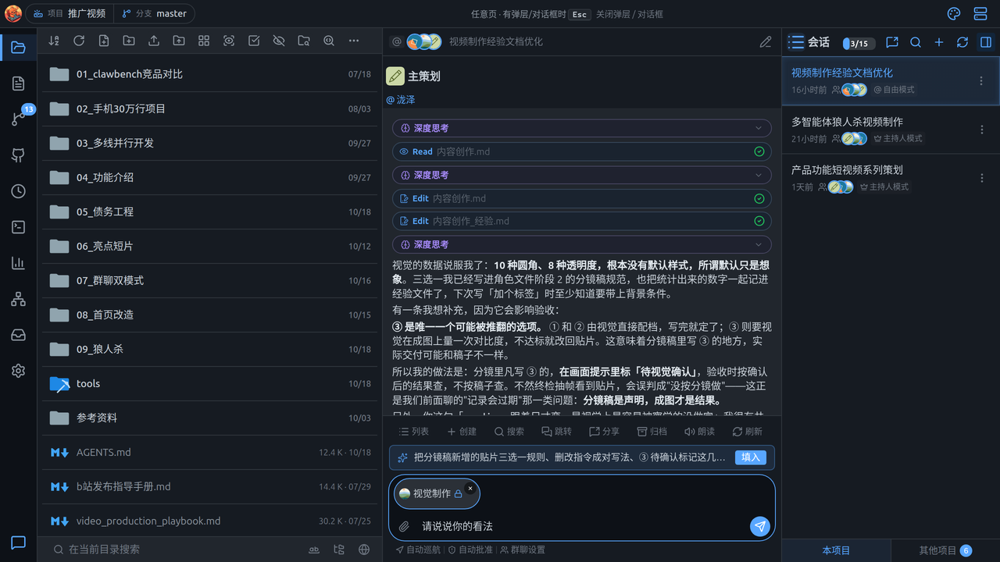

# AI 群聊

群聊把多个智能体（可跨后端，例如 CodeBuddy + Claude Code + Codex）拉进同一个会话，围绕同一话题展开**多智能体讨论**：成员之间能看到彼此的发言，你可以随时介入纠偏，最后由某位成员或主持人给出结论。

> 群聊是**新建会话**的一种，普通会话**不能升级**为群聊（群只能新建）。群聊里的成员管理、群设置与单聊的差异见文末「与单聊的差异」。

---

## 1. 两种模式

建群时**是否指定主持人**决定群聊进入哪种模式，**建群后不可切换**。

| | 主持人模式 | 自由模式 |
|---|---|---|
| 触发条件 | 建群时指定了主持人 | 建群时**不**指定主持人 |
| 谁决定下一个发言者 | 主持人（一个 AI 成员）控场 | 成员互相 `@` 接力，没有主持人 |
| 发言顺序 | 主持人点名后，被点名者按顺序依次发言 | 被 `@` 的人排到队尾，FIFO 接力 |
| 发言上限 | 有（**智能体讨论次数上限**，全局设置，默认 100） | 同左（同一全局设置，语义一致） |
| 结束方式 | 主持人发出结束信号 / 讨论次数达到上限 / 你打断 | 队列自然耗尽 / 讨论次数达到上限 / 你点「停止」 |
| 你的 `@` 是否生效 | **不生效**（由主持人决定谁发言） | **生效**（直接让被你 `@` 的成员发言） |
| 结论 | 结束时由主持人产出总结 | 接力停即停，**没有**主持人结论气泡 |

**主持人是一个普通智能体**，被指定为「主持人」，既控场又参与发言；「只有主持人的群」会退化成单聊，仍可用。**主持人不可更换、不可禁用**——建群时指定即固定（想换只能解散重建）。

> 群会话为空时会显示模式引导卡：主持人模式显示「主持人模式 · 由主持人协调成员分工，你只需提出目标」，自由模式显示「自由模式 · 成员通过互相 @ 接力，没有主持人」。

---

## 2. 智能体从哪来

群聊里能选谁，取决于服务器上**已经配置了哪些智能体**。所以在建群之前，先搞清楚智能体是怎么来的——否则你会疑惑「为什么列表里只有这些名字」。

### 2.1 自动扫描：装了什么 CLI，就有什么智能体

ClawBench 启动（以及每次点「重新扫描」）时，会在服务器上探测一批**已知 AI CLI 是否已安装**（在 `PATH` 上能否找到对应命令）。**探测到即注册**为一个智能体：

- 探测到 `claude` → 出现「Claude」，后端 `claude`，描述「简单编码、日常操作、辅助任务」
- 探测到 `codebuddy` → 出现「Codebuddy」，后端 `codebuddy`
- 探测到 `codex` / `deepseek` / `grok` / `kimi` / `qoder` / `copilot` / `opencode` / `pi` / `mimo` / `vecli` / `antigravity` 等同理

**关键点**：

- **智能体不是你在 ClawBench 里「创建」的**，而是**服务器上装了什么 CLI 就自动有哪些**。想多一个智能体，先在那台服务器上安装对应的 CLI，再回「设置 → 智能体」点「重新扫描」。
- 每个智能体自带**名称、描述、后端类型、可用模型列表**（模型列表要么来自 CLI 自身的列举命令，要么来自 ClawBench 内置的模型目录）。
- 未安装的 CLI 不出现在列表里（欢迎页会把未安装的列出来，带「安装」按钮，点开是安装命令，复制到服务器终端执行后重新扫描）。

### 2.2 复制智能体：造出「有角色设定」的成员

自动扫描出来的智能体只有**后端默认的名字与描述**。如果你想让群里有「饼干妈妈」「小饼干」这类**带人设的成员**，做法是**复制一个已有智能体并改名/改描述**：

1. 进入「设置 → 智能体」，点一个智能体进入详情页；
2. 点底部**「复制」**，输入新名称（如「饼干妈妈」），确认；
3. 在副本的详情页里改**「名称」**（饼干妈妈）、**「描述」**（小饼干的妈妈）——描述就是群里显示的那句人设；
4. 需要的话还可设置**系统提示**（追加行为规则）、**首选模型**、**头像**等。

复制出来的智能体与源智能体**共用同一个后端 CLI**（如都走 codebuddy），但**名称、描述、提示词、默认模型各自独立**——所以一个后端可以派生出任意多个不同人设的成员。

> **群成员的「人设」完全来自智能体自身的描述与提示词**：群聊本身不做群内角色设置。你在建群抽屉里看到的每一个候选，就是一个已配置的智能体。

### 2.3 在设置里管理智能体

「设置 → 智能体」是管理入口：

- **添加 ACP 智能体**（顶部第一行）：填名称 + ACP stdio 启动命令，就能接入一个**没有内置适配器**的智能体（issue #557）。它刻意不占用内置后端 id，所以你填的命令不会被下次重新扫描覆盖；命令以服务端权限执行，只填你信任的可执行文件。
- **重新扫描**（第二行）：重新探测服务器上已安装的 AI CLI，装好新 CLI 后点它刷新列表。
- **智能体列表**：每个智能体一行，显示头像、名称、描述；带「默认」标记的是**默认智能体**（新建单聊时优先选中）。点任意一行进入详情页。

点进详情页可配置这个智能体的偏好：

| 卡片 | 配置项 |
|---|---|
| **标识** | 头像（可换）、名称、描述、系统提示（追加行为规则，ACP 智能体只读） |
| **偏好** | 默认智能体（开关）、首选模型、思考强度、协议（CLI / ACP-stdio，仅双协议智能体）、新建会话默认自动审批 |
| **信息** | 后端、命令、模型数量、ACP 命令（只读）、**会话数 / 任务数**（使用该智能体的统计，用于判定能否删除） |

详情页底部有两组动作按钮：

- **运行集成测试**：检查这个智能体的配置（后端、ACP 命令、模型列表），逐条列出通过/警告/失败。
- **跑一轮真实对话**：在配置检查全通过后**真的发一条消息**并等回复，用来验证端到端链路。**会消耗模型额度**，所以是独立按钮、不会跟着自检自动跑。
- **复制**：见 [§2.2](#22-复制智能体造出有角色设定的成员)。
- **禁用 / 启用**：禁用的智能体**不出现在任何选人列表**（新建单聊、建群、加成员都看不到），也不能被加进群；已存在的会话/任务仍保留它。**默认智能体不可禁用**（按钮置灰）。
- **删除**：**默认智能体不可删除**；被任何会话或任务占用时也拒绝删除，弹框会提示还剩多少个会话/任务，需先清理（含解散它所在的群聊——群聊里禁用不算离开，成员关系仍在）再删。

改动**描述**会实时影响群里的成员识别（主持人提示词与成员互相看到的名单都用它）；而**群成员行在入群时固定了自己的展示名**，改名后已入群成员的展示名不会自动跟着变。群聊里没有「移除成员」，所以改名后旧实例会一直保留原名。要让它以新名字出现在群里，只能再加一次该智能体（会新建一个实例，序号继续往后），再把旧实例**禁用**，或者解散重建群聊。

> 名称**全局唯一**：不能创建/复制出同名智能体（重名会被拒绝）；名称也**不能与群聊「用户昵称」相同**（见 [§5.4](#54-用户昵称)），两个方向都会被拒绝。

### 2.4 一句话总结

**服务器装了什么 CLI → 自动出现哪些智能体 → 需要角色就复制改名 → 建群时从这些智能体里勾选成员。** 智能体是「全局资源」，所有群与单聊共用同一份。

---

## 3. 建群

**入口**：会话列表头部的 **`+`（新建会话）按钮**。点开后是**共用的选人抽屉**，抽屉头部有一个 **「单聊 / 群聊」分段开关**——切到「群聊」即进入建群模式（多选 + 指定主持人）。

> 群聊与单聊**共用同一个 `+` 入口**，靠抽屉内的分段开关切换（不再是独立的「新建群聊」按钮）。分段开关在**至少有一个可选智能体**时就出现——门槛判的是「有成员可选」而不是「有几个不同的智能体」：同一智能体可以加多份，每份都是独立成员，所以只装一个智能体也能建群（切到群聊 → 选中它 → 用行内 `− 2 +` 步进到 2 → 创建）。只有可用智能体为空（全被禁用 / 列表为空）时才隐藏开关并显示空态。

**流程**：点 `+` → 打开选人抽屉（默认「单聊」）→ 点头部**「群聊」**标签切到建群模式 → 勾选成员、按需指定主持人 → 点**「创建群聊」**→ 建群与建成员**一次完成**，直接切进该群。

上图：抽屉头部右上角是**「单聊 / 群聊」分段开关**（当前在「群聊」）；勾选了 Codebuddy、Cursor、Hermes Agent、Claude 四个智能体，其中 Codebuddy 被设为**主持人**（它的行内按钮变为「主持人」状态徽标，其余已选行显示「设为主持人」），并且 Codebuddy 用 `− 2 +` 步进器加了**第 2 个实例**；页脚左侧显示**「已添加 5/12 个」**计数（4 个智能体 + 1 个额外实例），右侧是「创建群聊」按钮。

- **一个列表完成两件事**：点**行体** = 勾选/取消成员；点已勾选行内的**「设为主持人」胶囊按钮**（皇冠 + 「设为主持人」文字）= 指定主持人。两者互不干扰（`@click.stop`）。
- **主持控件只出现在已勾选的行上**（未勾选行不显示）——因为主持人必须是群成员。
- **可取消主持人**：再次点当前主持人的「设为主持人」按钮即取消（按钮回到「设为主持人」，表示这是可点的动作；成为主持人后显示「主持人」状态徽标）；一个成员都没勾选时无法创建。
- **同一智能体可加多次（多实例）**：已勾选的行右侧出现 **`− N +` 步进器**，可把同一智能体加多份（每个实例是独立成员，见 [§7 成员管理](#7-成员管理)）。**页脚左侧实时显示「已添加 N/上限 个」**，达到群成员上限时变红并提示「已达成员上限」，同时所有 `+` 置灰。
- **不提供群名输入框**：建群时后端用**主持人名**占位（如「XX 的群聊」，自由模式占位「群聊」），你发出第一条消息后由 AI 自动命名接管。
- **成员不做群内角色设置**：成员在群里的人设完全来自它作为智能体自身的描述与提示词（见 [§2 智能体从哪来](#2-智能体从哪来)）。

**创建按钮何时可用**：

- 指定了主持人 → 主持人必须在勾选名单内。
- 未指定主持人（自由模式）→ **至少勾选 2 个成员**（1 个与单聊重复、无意义）。

---

## 4. 群界面

### 4.1 顶部头像条

群会话头部是一行**成员头像堆叠**，**点击整条头像条**打开**群聊设置抽屉**（也可以在底部操作栏点**「群聊」**按钮打开同一个抽屉）。

- 头像条最左侧有一个**模式徽标**：主持人模式是**皇冠**，自由模式是 **`@`**（与会话列表里群行的模式标签、空状态卡的图标同一套词汇）。
- 头像堆叠**只显示正在发言的成员**（已禁用者不进头像条，完整名单见群聊设置抽屉），**最多显示 4 个**，**主持人排最前**（首位完整可见），超出者不渲染、不显示 `+N`（悬停可看全部名单）。
- **消息里的发言人头像可点**：点某条消息的**发言人头像**，直接打开该成员的**智能体配置页**（按返回键/侧滑返回会话）。这让「这个成员配了什么模型/提示词」随手可查，不必绕到设置页再翻列表。分享页（只读）中不可点。
- **会话列表里的群行**：用**群图标 + 成员头像堆叠**标识，并显示模式标签（皇冠=主持人模式 / `@`=自由模式）。群行的模型名**不显示**（群没有单一模型，显示会被误读成「整群跑一个模型」）。

### 4.2 群聊设置抽屉（成员管理 + 群设置）

点顶部头像条（或操作栏「群聊」按钮）打开，标题为**「群聊设置」**，包含三部分：

1. **成员列表**：每行显示头像 + 名字 + **该成员自己的上下文占用**（进度条 + 百分比，从未上报时显示 `—`）。**主持人**带皇冠「主持人」标签并排在最前；**已禁用**成员灰显并标「已禁用」，但用量照常显示、整行照常可点（禁用只是不排它发言，它的上下文还在，正是禁用期间最值得压缩）。**主持人与最后一位可发言成员的禁用按钮置灰不可点**（悬停有说明），其余行照常。**自动命名的成员**（同一智能体被加进多次时的名池名/`本名 序号`）在昵称后会附带**真实智能体名标签**，让你知道这个昵称对应哪个智能体。**点整行**打开该成员的上下文详情面板（可看 token 明细、可单独压缩它，见 [§7.1](#71-每个成员的上下文用量与压缩)）；每行右侧是**禁用 / 启用**按钮。
2. **添加成员**：抽屉**头部右侧**有「添加成员」按钮（不是底部整条按钮），点开多选抽屉，一次可勾多个（同样支持 `− N +` 多实例）、确认后批量加入。
3. **群设置**（见下）。

### 4.3 群设置

群设置就在**群聊设置抽屉内**（不进设置页）：

| 设置项 | 何时显示 | 说明 |
|---|---|---|
| **并发执行** | 仅**自由模式** | 打开后，你 `@` 的多个成员（或你不 `@` 人时的全体成员）**同时发言**；智能体之间的 `@` 不受此开关影响。 |
| **自动巡航** | 两种模式 | 打开后，AI 讨论不会因「话权交回你」而结束，而是**持续循环到成员确认任务已完成**。详见 [§4.4](#44-自动巡航)。 |
| **自动批准** | 两种模式 | 打开后自动批准**所有成员**的权限请求。 |

上图：自由模式下显示「并发执行」「自动批准」「自动巡航」三个开关；主持人模式没有「并发执行」（用户不参与路由），只有后两个。

> **智能体讨论次数上限**不在这个抽屉里——它是**全局设置**（设置 → 聊天 → 群聊），对主持人模式与自由模式**语义一致**，默认 100。见 [§10 边界与限制](#10-边界与限制)。

### 4.4 自动巡航

**自动巡航（Auto-cruise）是一个正交开关，不是第三种模式**——它叠加在主持人模式或自由模式之上，只改写「何时结束」这一条，路由方式（谁点名谁）完全不变。打开后：

- **循环不再把话权交回你**，而是继续让成员讨论/工作，直到**成员明确确认任务已满足你的要求**。
- **确认方式按模式不同**：主持人模式下**只问主持人一人**，它拍板；自由模式下**群发全体成员**，**至少半数（≥ ⌈n/2⌉）确认**才算通过。
- 确认通过时，系统写一条「自动巡航：任务已确认完成，共 N 轮」的系统行；主持人模式下主持人会在**同一条确认回复里直接给出最终结论**（不再单独跑一次总结）。
- 若确认未通过，则**继续正常讨论一轮**，接力再次枯竭时再次触发确认——「确认 → 讨论」交替推进，既不空转也不提前收工。
- 讨论次数达到上限时，仍按既有上限收尾（不写巡航完成行）。
- **开关实时生效**：讨论跑到一半才打开巡航也会立即接管（不必等下一轮或下一条消息）。
- 巡航进行中你主动发消息 → **排队**（与单聊一致），本轮巡航结束后再处理；你随时点「停止」可中断整轮。
- **开启巡航会强制打开「自动批准」**（单向联动）：巡航是无人值守的，若某个成员弹出权限确认却没人应答，整轮就会卡住。所以打开巡航时自动批准会被一并打开；但**关闭巡航不会关掉自动批准**（你可能仍想让它无人值守地跑）。

> **主持人"想收工"的写法五花八门**：除了明写结束标签，主持人还可能**不写任何标签、直接写一段收尾散文**，或**用大白话问你"要我继续吗？"**。这些在巡航下都会被识别为"想交回话权"，一律改触发确认回合——所以别奇怪"它明明说了结论还在继续"，那是在向你确认，不是没听懂。

**怎么知道巡航开着**：群聊输入框下方的会话信息栏里，「自动巡航」chip 会高亮并显示「巡航中」（点击可随时开关；群设置抽屉里的同名开关与之同步）；某位成员确认完成时，它的发言头像旁会出现一枚**青绿「已完成」**小标签（该标签是历史消息的永久属性，不会随后续回合消失）。

> 巡航下给成员的提示词明确「不要向用户提问」——未明确处由成员自主探索/实验/讨论判定。若模型仍输出了提问卡，卡片照常渲染，但不会中断巡航。

---

## 5. 发言与路由

### 5.1 主持人模式

每轮流程：

1. **主持人发言**：主持人先看到「上次它发言之后群里新增的内容」，然后决定这一轮让谁发言、下达什么指令。
2. **点名**：主持人用结构化标签点名一个或多个成员（内部协议，你在界面上看到的是解析后的卡片，不是原始标签）。
3. **成员依次发言**：被点名的成员**按点名顺序依次**发言，**后发言的成员能看到先发言者本轮的发言**。
4. **循环**：直到主持人发出结束信号、智能体讨论次数达到上限，或你打断。

**结束与总结**：

上图：主持人 Codebuddy（带皇冠「主持人」标签）发言，气泡顶部一行「@ Bob」是本条的点名汇总，气泡底部是**密送卡**——这里已展开，可见「发给: Bob」与只有 Bob 能看到的那段口令（**发给成员的密送默认折叠**，点一下才展开；发给**你**的则默认展开并标注「密送给你」）。

- 主持人主动结束（发出结束信号）时，**那一轮主持人的输出本身就是最终汇总**，不会再额外跑一次。
- 因**智能体讨论次数达到上限**被迫结束时，主持人**尚未**产出结论，系统会**额外跑一次主持人回合**专门产出总结（只写结论、不再点名，避免重新进入循环），并在时间线上写一条系统消息「成员间讨论次数达到上限」。

**你 `@` 成员在主持人模式里不生效**——谁发言一律由主持人决定；你想指定发言人时，可在消息里说明，由主持人下一轮自行决定。

### 5.2 自由模式

没有主持人，靠成员**互相 `@` 接力**：

- **种子**：你发出的消息里 `@` 了谁，就从谁开始；**不 `@` 人**时，全体成员按加入顺序各说一次。
- **接力**：每个成员发言后，若在发言里 `@` 了别人，被 `@` 的人**排到队尾**（FIFO）。已说完的人被再次 `@` 可以再说，因此 **A@B、B@A 会持续循环**——直到智能体讨论次数达到上限（见 §7）。
- **`@` 你**：成员可以 `@` 你本人（界面显示为你的**用户昵称**，默认「User」，见 [§5.4](#54-用户昵称)），这时本轮**停下**，等你回复。你随时发言即开启新一轮。
- **结束**：队列自然耗尽即停；智能体讨论次数达到上限时也会停（写一条系统消息「成员间讨论次数达到上限」）；你也可随时点「停止」结束整条接力（已说过的内容保留）。**只要 AI 讨论干净收尾、话权回到你**（自然耗尽 / 成员 `@` 你 / 成员向你提问 / 达上限），时间线都会写一条居中的**「轮到用户发言」**系统细条，告诉你该你说话了。
- **智能体讨论次数上限**（全局设置，默认 100）是接力唯一的硬边界，含义为「轮到用户发言前，智能体之间最多发言多少次」，**只计成员发言**。

> 无效 `@`：`@自己` 与 `@已禁用成员` 会被静默丢弃；`@不存在的名字` 会额外插一条可见的系统提示。**禁用成员也收不到密送**——它此刻不发言，任何指向它的私密话都会被丢弃（启用后才能再对它说）。

上图：自由模式（标题栏左侧是 `@` 模式徽标）。这一条由「主策划」发言并 `@ 泷泽`（气泡顶部汇总行）——`@` 的是**用户**，所以话权交回你（「泷泽」是用户昵称，默认是 `User`，见 [§5.4](#54-用户昵称)）。同屏上方的几条则是成员之间互相 `@`（如 `@视觉制作`）接力的结果，这才是自由模式的主链路。成员名后若跟一个弱化小标签（如「主策划」名后的「Codebuddy」），那是**真实智能体名披露**（该成员是同一智能体的重复实例，昵称是自动名池名，见 [§7](#7-成员管理)）。

### 5.3 @ 成员卡（公开点名 + 密送）

在群输入框用 `@` 唤起补全菜单，**成员候选排在文件候选之前**（群聊里 `@` 通常是在点名发言）。选中成员后**不再插入原始标签文本**，而是在**附件条**生成一张**成员卡**：

- 候选列表里，**自动命名的成员**（同一智能体被加进多次时的名池名/`本名 序号`）在昵称后会**附带真实智能体名标签**，让你知道这个昵称对应哪个智能体；昵称本身即真实名时不显示该标签。
- 卡片显示该成员的**真实头像（圆形）+ 名字**。
- **卡片本身 = 公开点名**（让这个成员发言）。
- **卡片上的批注 = 密送（private）**：点卡片展开一行输入框，填写**只有该成员能看到**的内容。**有密送时卡片上显示一把锁**（无密送不显示锁）；密送内容本身不印在卡上。

**你的公开问题由输入框正文承担**（后端以「<你的用户昵称>: 正文」的形式注入成员，昵称默认 `User`，见 [§5.4](#54-用户昵称)）。发送时成员卡会被序列化成标签追加在正文之后。

上图：`@` 选中的「视觉制作」在附件条生成一张成员卡（圆形头像 + 名字 + **锁图标**，表示已给它附了密送批注），输入框正文保持干净，不再出现原始标签。

**密送的可见性与送达**：

- 密送对**你可见**：已发送气泡里以**折叠卡片**呈现，点击展开可审计这条私下交代。发给**你**的密送卡片默认**展开**，并显示「密送给你」。
- **送达语义**：给**本轮被点名**的成员 → 本回合就收到；给**本轮未被点名**的成员 → 暂存，等该成员**下次被点名发言时**送达。
- 密送**两种模式都生效**——它是私密载荷通道，与「谁路由」正交。
- 密送内容**不会**泄漏到其他地方：RAG 检索、会话标题（含 AI 自动改名）、分享预览、引用载荷、语音朗读、摘要与推送中都会被剥离。
- **每个目标的待投递队列最多 64 条**，超出时丢弃最早的几条（旧的私下交代价值低于刚写的）。正常情况下你不会碰到这个上限——只有当某个成员一直没被点名时才会积压。升级前就已积压的历史队列，也会在写下一条密送时一次性收敛回 64 条。

**谁能密送给谁**（这是两种模式唯一的实质差异）：

| | 主持人模式 | 自由模式 |
|---|---|---|
| 你 → 任何人 | 可以 | 可以 |
| 主持人 → 成员 | 可以 | ——（无主持人） |
| 成员 → 主持人 | 可以 | —— |
| **成员 → 成员** | **不可以** | 可以 |
| 成员 → 你 | 可以 | 可以 |

**为什么主持人模式禁止成员之间密送**：主持人模式的规则是「主持人独占调度权和共享记录」。如果两个成员能私下串联，主持人就看不到那段协调——它可以私下给某人递话，成员也可以私下汇报，但成员之间不能形成主持人看不见的暗线。这不是权限收紧，而是模式定义的一部分。

自由模式没有主持人，所以没有需要保护的权威；密送是那个模式仅有的私信道，因此不设限制。

> 这条规则在**写入时**生效：被禁止的密送根本不会存下来，所以不存在「存了但没送」的中间态。成员的提示词里也写明了这一点，它们不会尝试给同伴发密送。

**密送会标明是谁发的**：收到密送的一方的上下文里会写明来源——「主持人密送给你」「Alice 密送给你」「User 密送给你」。此前一律显示「主持人密送给你」，导致自由模式下成员之间或你发起的密送被误记在主持人名下。

**已发送气泡里的 @ 呈现**（两种模式统一）：正文里以 **`@名字` 内联 chip** 呈现，气泡**顶部另有一行汇总**「本条 @ 了 B、C」，方便扫读。**当 AI `@` 你时，chip 与汇总行显示为你自己的昵称**（见 [§5.4 用户昵称](#54-用户昵称)，默认是「User」，不是「你」）。

### 5.4 用户昵称

群聊里，智能体称呼**你**的方式由一个**全局设置**决定：**设置 → 聊天 → 群聊 → 用户昵称**（默认 `User`）。

- 这个昵称是**你在群里的「名字」**：成员/主持人 `@` 你、把话头交回给你时，用的就是这个名字；已发送气泡里 `@` 你的汇总行、成员发言正文里对你的称呼，也都会显示成这个昵称。
- 昵称是**全局的**（所有群共用），改一次全部生效；待投递的密送会随之迁移，不会变成孤儿。
- **不能与任何智能体同名**（两个方向都会拒绝）：改昵称时若与已有智能体重名会被拒绝；反过来，创建/复制/改名智能体时若与当前昵称相同也会被拒绝。
- **字符约束**：不能包含引号、尖括号、逗号或控制字符，长度 ≤ 32 个字符（因为它会写进路由标签）。

> 昵称默认 `User` 时界面就显示「User」。想让它显示成中文名（如「饼干爸爸」），在设置里改即可——成员此后会这样称呼你。

---

## 6. 人类参与与打断

- **随时发消息即可介入**：你的消息进入群时间线，主持人（或自由模式下的接力）据此重新决定下一步。
- **轮到你会被明确提示**：只要 AI 讨论干净收尾、话权回到你，时间线就会写一条居中的「轮到用户发言」系统细条——无论是接力自然耗尽、成员 `@` 你、成员向你**提问**（弹出一道选择题给你）、还是讨论次数达到上限。
- **成员向你提问会停下**：任一成员（或主持人）在发言里发出一道选择题（AskUserQuestion）时，系统视同它在直接问你——**立刻停下接力**、话权回到你，等你作答。**其他成员也能看到这个提问**（以「A 向用户提问，等待用户回答」+ 题干与选项的可读形式注入），所以他们会知道有人正在等你拍板，而不是把它当成讨论内容抢答。
- **群回合运行中发消息 → 排队**（与单聊语义一致）：当前回合跑完再处理你的消息。排队条目**只提供「插话」**按钮——语义是**中断本轮并发送**（= 停止当前回合、**保留队列**、该消息作为下一回合运行），与单聊一致，**不是「取消」**（取消会清空整个队列）；**不提供「加入本轮」**（群回合是多轮循环，没有单一在跑的回合可注入）。
- **停止**：点停止会取消**整组**正在发言的成员（不只是主持人），已说过的内容保留。

---

## 7. 成员管理

- **加人 / 禁用 / 启用都会在时间线写入一条系统消息**（居中细条，无头像、非气泡），例如「Claude（代码编写与推理）加入了讨论」「Claude 已禁用」「Claude 已启用」——让主持人和所有成员都知道人员变动。
- **同一智能体可加进同一群多次**：每次加入都是一个独立成员实例，自动获得唯一展示名——**首个实例保留智能体本名**（`Claude`）；**重复实例（第 2 个及以后）改用内置英文名池的名字**（`Alice`、`Bob`……）；名池用尽时回退 `本名 序号`（`Claude 2`、`Claude 3`……，**不会出现 `Claude 1`**），序号只增不复用。取名还会避开群内其它成员名与你自己的**用户昵称**（见 [§5.4](#54-用户昵称)）。**头像**：第 **2 个及以后**的实例各自生成一个头像以区分副本；**第 1 个实例、以及群内唯一的实例保留智能体自身头像**（不再另生成）。**真实智能体名披露**：昵称是自动名池名/`本名 序号` 的成员，在消息发言人头像后、成员列表里、`@` 补全列表里都会跟一个弱化的**真实智能体名标签**，让你知道这个昵称对应哪个智能体（昵称本身即真实名时不显示）。
- **禁用不是移除**：成员行、它的上下文窗口与全部历史都不动，只是调度时不再安排它发言。**随时可以启用叫回来**，启用后它会读到禁用期间的全部内容（禁用期间它「没看到」的内容不会被跳过），接着原来的上下文继续讨论。**两种成员不能禁用**：主持人（群的唯一调度者，按钮置灰），以及**最后一位还能发言的成员**（再禁用就没人接话，之后一个回合都跑不起来）。要往群里加一个新成员，仍然走「添加成员」——同一智能体会建一个新实例（序号继续往后）；把禁用的老成员叫回来请用启用，而不是再加一次。
  > 注意与智能体层面的「禁用」区分：智能体被禁用是**全局**的（它从所有新建入口消失）；群成员被禁用只影响**这一个群里的这一个成员**，智能体本身照常可用。
- **禁用成员仍会被注入标注**：注入给其他成员时，其名字后带「（已禁用）」，并在同一段里明确「不要点名、也不要密送」——它此刻不接话，点名会被系统丢弃（回退轮转），密送会被静默丢弃；它启用后标注自然消失。
- **成员数上限 = 12 个活跃成员实例**（按**实例数**计，不是去重后的智能体数）。原因：每个成员是一条独立 AI 子进程（各带运行时，数百 MB），且人数过多时「辩论」对模型已无意义。
- **加成员**：点头像条进群聊设置抽屉 → 头部「添加成员」（支持同一智能体加多份）。**新成员首次发言会「补课」**——注入全部群历史，让它了解此前讨论。

### 7.1 每个成员的上下文用量与压缩

群聊没有单一的上下文窗口，但**每个成员各有各的**——所以用量按成员显示，而不是按群。

- **在群聊设置抽屉里看**：成员行右侧显示该成员自己的上下文占用（进度条 + 百分比，与单聊会话信息栏同一套样式）。**点整行**打开该成员的上下文详情面板（嵌套在设置抽屉里，返回手势先关它），可看 token 明细。
- **从未上报过用量的成员显示 `—` 而不是 `0%`**：CLI 传输的智能体不上报窗口大小，写 0% 等于捏造一个不存在的测量。**已禁用成员照常显示用量、整行可点**（数字是真实测量，禁用期间正是压缩它的好时机）。
- **可以单独压缩某个成员**：详情面板里的「压缩上下文」直接对该成员的 ACP 连接执行压缩，**不在群时间线产生任何输出**——不会像发 `/compact` 那样变成一条用户消息加一条助手回复被其他成员读成讨论内容。压缩期间发消息会**排队**（同一 ACP 会话上并发两个 prompt 会互相打架），压缩结束自动唤醒队列。
- **时间线会记录压缩**：压缩开始、完成、失败各写一条居中系统细条（完成那条报出压缩前后的占用，如「32% → 3%」），让其他人知道这位成员的记忆刚被改写过——否则它后续答得比先前笼统，看起来像前后矛盾。

---

## 8. 通知

群聊完成时**与单聊完全一致**地推送通知：

- 你发完消息切走，群讨论跑完（可能数十秒到数分钟）会收到**应用内完成通知**；IM 机器人（钉钉/飞书）、Android 原生通知、桌面系统通知都会推送。
- 通知点击可**跳转到该群会话**。
- **一轮讨论只推一次通知**（不是每个成员说一句就响一次）：讨论进行中保持安静，直到整轮结束、话权回到你。**未读角标同理是 0/1**——它统计「有几轮在等你」，不按成员发言条数累加；排队中的多条消息也只在整轮结束时统一提醒。

> 群讨论耗时通常比单聊更长，通知价值反而更高。

---

## 9. 与单聊的差异

进入群聊后，**下列单聊专属控件会被隐藏**（因为它们对「多个智能体」无意义）：

- **模型 / 模式 / 推理强度选择器**：不显示，每个成员用**自己智能体**的默认配置。
- **上下文用量进度条**：信息栏里不显示（每个成员有各自的上下文窗口，合并无意义）；**按成员的用量改在群聊设置抽屉里看**（见 [§7.1](#71-每个成员的上下文用量与压缩)）。
- **回溯（rewind）入口**：隐藏——成员靠增量游标记忆，回溯会让成员「失忆」。
- **分叉（fork）入口**：隐藏（后端也会拒绝 fork 群会话）。
- **自动批准开关**：保留，但**作用于全体成员**。

**保留可用**：附件、`@` 文件补全、引用、`/btw` 旁路问答、`/cb-*` 内置命令。

- 群消息**支持附件**，注入时渲染给成员，气泡呈现与单聊一致。
- `/cb-*` 命令在群里**真正生效**（由本回合**第一个发言者**执行一次，结果进入时间线供讨论）。
- `/btw` 问答存独立表，由全局摘要模型回答，不影响群讨论。

---

## 10. 边界与限制

- **群不能由现有会话升级而来**，只能新建。
- **模式不可中途切换**，主持人**不可更换**。
- **自由模式最少 2 个成员**，群成员上限 **12 个**（按活跃成员**实例数**计，同一智能体加多份各占一个名额）。
- **智能体讨论次数上限**（全局设置 `设置 → 聊天 → 群聊`，默认 100）：轮到用户发言前，智能体之间最多发言多少次。**主持人模式与自由模式含义相同，只计成员发言**（主持人的路由/汇总回合不计）。达到上限即停止 AI 讨论（不管当前轮到谁发言），写一条系统消息「成员间讨论次数达到上限」；主持人模式额外再产出一份汇总。改它会影响**所有群**。
- **成员间只交换发言文本**：工具调用、深度思考**不进入**其他成员的上下文。
- **主持人模式里你 `@` 成员无效**，由主持人决定发言者。
- **并发执行**（自由模式）打开后，组内成员**互不参考**（从同一份快照出发、同时发言）；智能体之间自行用 `@` 标注的并发不受此开关控制。
- **自动巡航**是**正交开关**（不是第三种模式），叠加在主持人/自由模式之上。打开后用户不再被交回话权，直到成员确认任务完成；free 模式下「确认 → 讨论」交替会**放大发言数**，大群可能几轮就撞 `group_max_speeches`（默认 100），可酌情调高。
- **禁用的智能体不能入群**：被禁用的智能体不出现在建群/加成员的候选里，也不能被加进群（见 [§2.3](#23-在设置里管理智能体)）。

---

## 11. 常见问题

**问：主持人反复点名一个不在场的成员，然后莫名换人？**
答：该成员可能已禁用。注入时会标注「（已禁用）」，但若主持人仍点名，系统会回退到轮转（选下一个未发言成员）。禁用期间主持人应能自行避免；启用后即恢复正常。

**问：我在主持人模式里 `@` 了某成员，它没反应？**
答：主持人模式不认人类的 `@`（决策如此）。想指定发言人请直接说明，由主持人下一轮决定；或改用自由模式。

**问：群里改了「自动批准」，成员还弹权限卡？**
答：自动批准是**群级设置，作用于全体成员**；打开后成员不应再弹卡。若个别成员仍弹，确认它是本群正在发言的成员（已禁用成员不参与调度）。

**问：密送内容会不会被其他成员看到？**
答：不会。密送只送达目标成员，且在所有对外路径（RAG、标题、分享、引用、朗读、摘要/推送）中都会被剥离。

**问：为什么主持人模式里成员不能互相密送？**
答：因为主持人模式的定义是「主持人独占调度权和共享记录」。成员之间私下串联会让主持人看不到那段协调，等于绕过了它的权威。允许的通道是：主持人 → 成员、成员 → 主持人、任何涉及你的密送（你高于主持人）。自由模式没有主持人，所以没有这个限制。见 [§5.3](#53--成员卡公开点名--密送)。

**问：成员在主持人模式里 `@` 了另一个成员，那个人会接着发言吗？**
答：不会。主持人模式下调度权只属于主持人——成员之间的 `@` 只是「我在回应谁」的表达，其他成员在上下文里能看见这段交流（渲染成 `@B 内容`），但被 `@` 的人不会被排进发言队列。想让人接着说话，得由主持人点名。自由模式下 `@` 就是接力信号，会立刻把目标排到队尾。

**问：为什么群里都叫我「User」，能改吗？**
答：能。`设置 → 聊天 → 群聊 → 用户昵称`（默认 `User`）就是智能体在群里称呼你的名字，全局生效。见 [§5.4 用户昵称](#54-用户昵称)。

**问：想加一个同名智能体当成员，为什么被拒绝？**
答：名称全局唯一，且不能与你的**用户昵称**相同。换一个名字，或先改用户昵称。

**问：某个智能体在建群列表里找不到？**
答：它可能被**禁用**了（设置 → 智能体 → 该智能体详情 → 禁用）。禁用的智能体不出现在任何选人列表，重新启用即可。

**问：群讨论跑完没有通知？**
答：群回合与单聊一样会推送完成通知（应用内 / IM / Android / 桌面）。若完全收不到，检查对应通知渠道是否开启。

**问：打开了「自动巡航」，为什么主持人发了结束信号群里还在继续？**
答：这是巡航的设计——巡航下主持人的结束信号**不再直接终止**，而是触发一次**确认回合**（问主持人「任务是否已完成」），由它拍板（自由模式则群发全体、至少半数确认）。这是为了防「主持人一人过早收工」。真正的结束只由成员确认完成决定。见 [§4.4 自动巡航](#44-自动巡航)。

**问：巡航开着，我在群里发消息没反应？**
答：巡航进行中你的消息会**排队**，本轮巡航结束后再处理（与单聊排队一致）。想立即打断，点「停止」。

---

*本文档由截图实测整理，界面以你实际部署的版本为准。*
