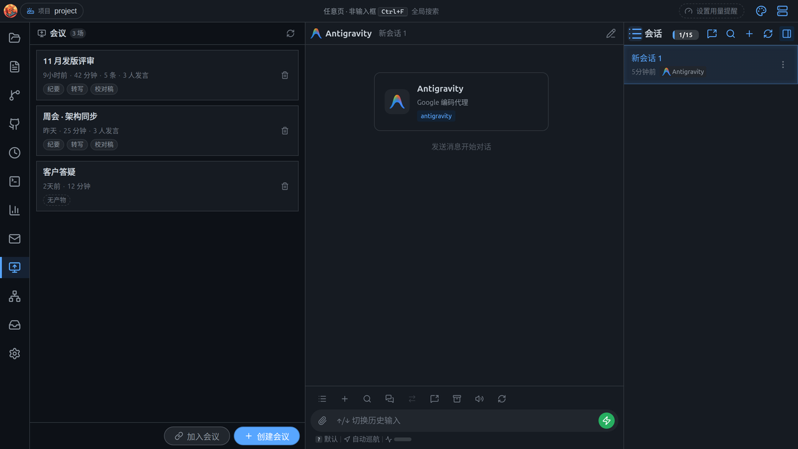
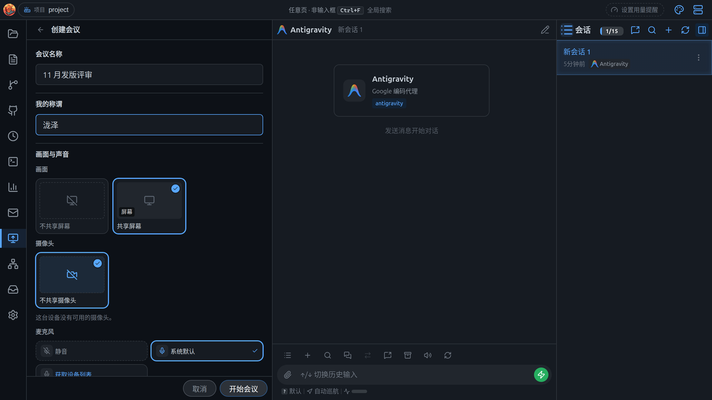
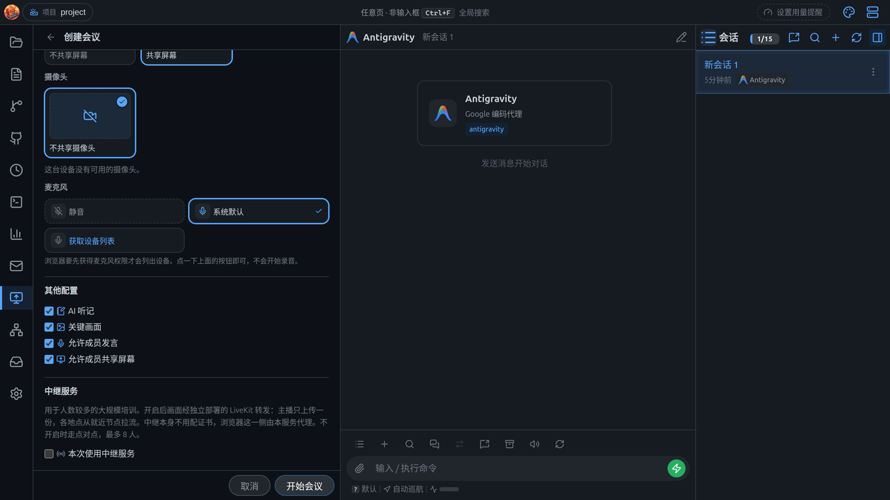
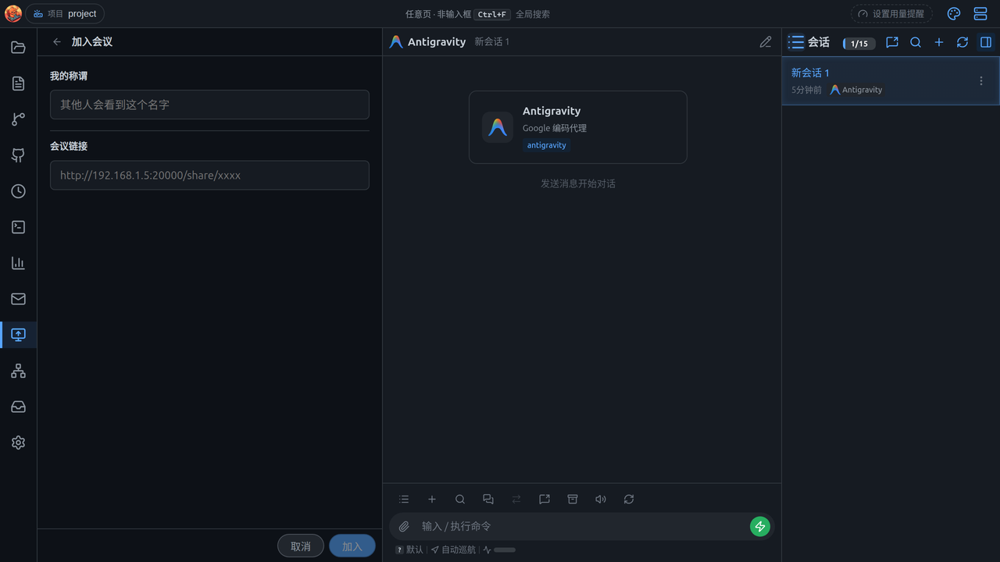
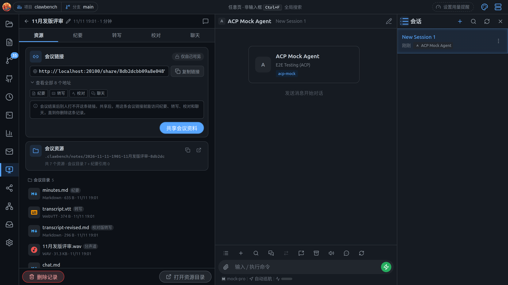
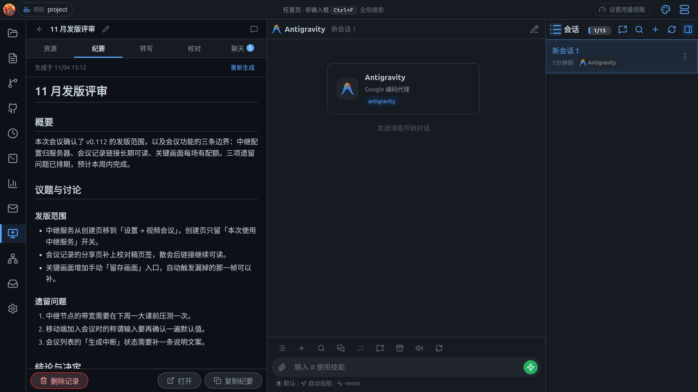
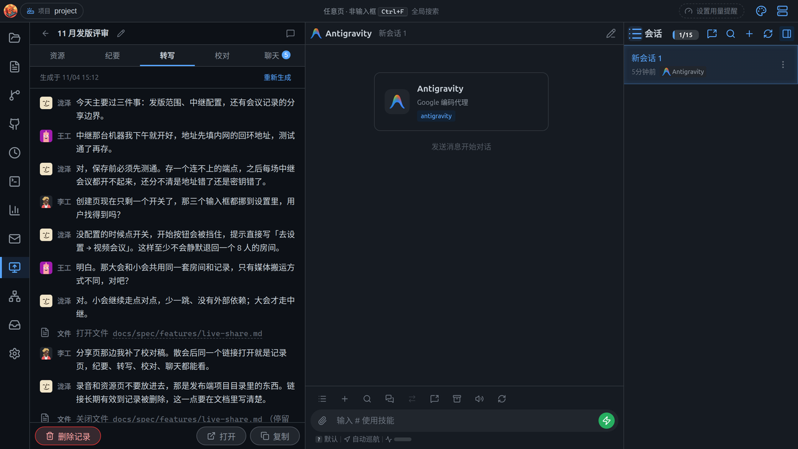
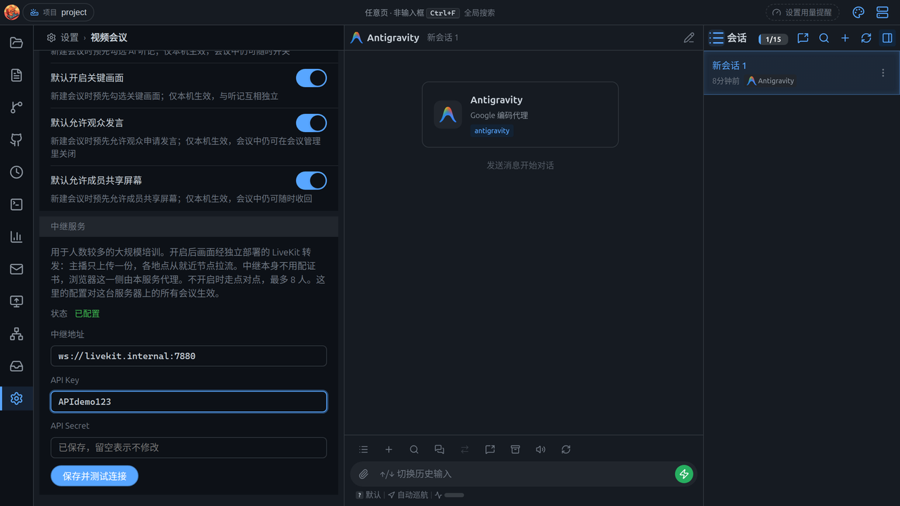

# 会议与 AI 听记

ClawBench 的「会议」不是投屏工具，也不是另一个会议软件：它把**一次协作**留成一条**永久记录**。

开一场会只需要一个链接。链接发出去，拿到的人用浏览器打开、填个称谓就进来了，不用登录、不用装客户端。你可以共享屏幕、开摄像头、开麦克风，也可以**什么都不共享**——那就是一场只有链接、观众和聊天的会。会议过程中可以随时开启或关闭画面，观众不需要重连。

会开完，这场会变成一条记录：**纪要、转写、录音、聊天**都在里面，永久保存（只有你主动删除才会消失）。这就是它存在的理由——开会时说的东西，散会之后还能查。

> 入口在**左栏 Dock 的「视频会议」页签**（面板内标题是「会议」）。桌面客户端、Android App、桌面浏览器都能发起；手机浏览器只能看画面、听声音、发聊天，不能发起、不能共享屏幕。

---

## 发起一场会议



页签底部有两个按钮：**加入会议** / **创建会议**。如果这个项目里已经有一场会正在进行，按钮会换掉——你自己开的会是 **返回会议**，别的设备开的会是 **加入进行中的会议**（同一个项目同时只允许一场会）。点「创建会议」：

| 项目 | 说明 |
|---|---|
| **会议名称** | 选填。不填就先按开始时间命名（如 `11-01 17:35`），等纪要生成后由摘要模型取一个正式标题 |
| **称谓** | 必填。发布端观众列表、聊天署名、转写说话人标签都用它。默认取「设置 → 我的身份」里的称谓；在这里改了会**写回账号**（以后智能体也这样称呼你），不是只对这一场会生效。没填时按钮不亮，并说明为什么不能开始 |
| **画面** | **屏幕**（不共享 / 整屏 / 某个窗口，画成同一种格子，点谁共享谁）+ **摄像头**（同样是一组设备卡片，第一张是「不共享摄像头」）。两个可以同时开——屏幕是主画面、摄像头在右下角；也可以只开一个，或者都不开 |
| **麦克风** | 一组设备卡片，第一张是「静音」；默认选中系统默认麦克风，所以进来就是开的。没授权时显示「获取设备列表」，不会静默失败 |
| **其他** | 四个开关：**AI 听记**、**关键画面**（见下文）、**允许成员发言**、**允许成员共享屏幕**。默认值来自「设置 → 视频会议」的新会议默认值（出厂都开），每次都能当场改 |
| **中继服务** | 只有人数多时才需要，**默认关**。打开后画面与声音改由独立部署的 LiveKit 转发：你只上传一份，每个观众从就近节点拉流，**不再有人数上限**（8 人上限只属于点对点）。地址与密钥是**这台服务器**的配置，在「设置 → 视频会议」里填（先点「保存并测试连接」，通了才存），这里只决定**这场会**用不用。还没配置时开关可以点，但「开始会议」会被挡住并提示去哪儿补。中继自己不用配证书，浏览器这一侧由本服务代理。不开则完全走点对点，行为与以前一样 |

这些选择互相独立，全不选也允许开始。点「开始会议」后进入会议中，「会议管理」页顶部会列出这台机器的全部可用地址（默认显示一条主链接，可展开看全部、点开页面），复制后发给要参会的人即可。





> **称谓**就是设置 → **我的身份**里的称谓：创建会议时改会直接写回账号，不是只对这一场会生效。它同时是智能体在对话里称呼你的名字。

### 没有 HTTPS 时

浏览器只在**安全上下文**（https 或 localhost）里提供屏幕与麦克风，所以：

- **用浏览器 + `http://` 打开**：创建页会直接换成一张「这台设备无法共享屏幕」的卡片，上面只有一个按钮——**生成证书并重启**。点完服务会生成一张自签名证书、重启并自动跳到 https，浏览器提示「不安全」时选继续访问即可。磁盘上已经有一张正式证书时不会静默覆盖，要再点一次确认
- **用桌面客户端 + `http://`**：本机照样能采集（客户端把自己的页面提升成安全上下文），所以创建页与会议列表顶部只是一条**横幅**：你发出去的链接，对方用浏览器打开时依然要 https 才能开麦、共享屏幕。按钮是同一个，重启后客户端会自己把服务器地址换成 https（原地改写那条记录，不会多出一条连不上的）
- **证书只覆盖生成时这台机器的地址**（所有网卡 IPv4 + localhost）：换网络、IP 变了要重新生成一次

---

## 会议进行中

会议界面分四个页签：**会议管理 / 参会者 / 转写 / 聊天**，底部是一条常驻动作条。

开会期间屏幕**不会自动熄灭**（系统锁屏会掐断采集与共享）；离开会议页或结束会议后恢复正常。

用中继的会议多一条硬依赖：中继连不上或中途断开，会议会直接结束并报错——媒体本来就不经过本服务，没有本地兜底。

### 会议管理

- **画面**：和创建页同一套画面格——不共享 / 整屏 / 每个窗口，点谁共享谁，会中点击立即生效（换源不重连，点「不共享」只停画面、不结束会议）
- **摄像头 / 麦克风**：各是一组设备卡片，会中也能换设备（换麦不会让观众听到断点）；摄像头有小窗自预览
- **其他**：**AI 听记**（关掉即停止采集与上传，已转写的内容仍在）、**允许成员发言**（打开后观众自己开麦就能说话，其他观众也能听到）、**允许成员共享屏幕**（打开后观众里的电脑浏览器可以把屏幕共享给所有人，一次只允许一个人）。这两个开关的初始值来自设置 → 视频会议，会中随时可改
- **全部静音**：只在有人正在说话时出现

### 参会者

主持人固定第一行，其余一人一行，显示头像、名字与徽标（**说话中 / 已静音 / 共享屏幕 / 离开**）。**页签标题与名单顶部都显示当前人数**（主持人 + 全部观众），观众端的「成员」页签同样显示，两处数字永远一致。

- 行内动作：**静音**（硬静音，之后对方再开麦会被拒绝，直到你解除）/ **解除**、**移出会议**、**停止共享屏幕**
- **远程控制申请**在这一页批准 / 拒绝 / 收回；有待批的申请时，页签上挂主题色数字角标
- 观众端没有这些管理动作，只能看自己的状态

### 转写

实时字幕，按说话人分行。说话人标签不是猜的：你的麦克风、每位观众的麦克风各录一条独立信道，所以每条字幕天然带名字——显示的就是各自入会时填的**称谓**。

**会中关掉听记不会清空已转写的内容**：页签原地保留，只加一行说明为什么不再增长；连关掉之后才加入的观众也看得到已有转写。

### 聊天

会议内聊天，观众也能发。聊天在会议进行中就落库，散会后仍在记录里。

### 成员共享屏幕时

有人把屏幕共享出来时，主持人端会自动打开**全屏画面**，可以切换成独立窗口，也可以把聊天 / 听记侧栏拉出来——和在成员端看到的是同一套布局。你随时可以停掉这个人的共享。

### 结束与返回

- 底部动作条：左边**结束会议**；右边是**留存画面**（关键画面开着、且当前有画面时才出现，自动触发漏掉的那一帧可以手动补）与**标注画面**（只在当前画面是屏幕时出现——摄像头画面没有桌面坐标可标注）
- 点「结束会议」：先确认一次（会说明成员会断开、共享与听记都会停），确认后共享停止，**直接进入这场会的记录详情**
- 点返回（或屏幕边缘内划、Android 物理返回键）：**只是退出界面，会议不会结束**。列表底部的「返回会议」点一下就回到会议中（别的设备开的会显示「加入进行中的会议」）
- **刷新或关闭页面会先确认**：按 F5 弹应用自己的确认框（「留在会议中」/「结束会议并刷新」）；关标签页走浏览器自带的离开确认，桌面客户端是原生弹窗。**Android App 没有这一层提示**，退出前请先点「结束会议」

### 会议里的通知

九件事会进通知中心并推送给你：**有人请求远程控制、成员加入、成员开始共享屏幕**，以及**纪要 / 校对稿 / 转写**三类产物各自的**生成完成与生成失败**（手动重新生成也算）。

弹不弹取决于你此刻在哪：正在看这个会议页时什么都不弹；应用在前台但在别的页签时弹**应用内提示**（点一下回到会议）；应用在后台或窗口最小化时才走**系统通知**。通知中心里那一行则永远记着，散会后仍可回溯。

---

## 加入会议

在页签底部点「加入会议」，填**称谓**（必填，其他人看到的就是这个名字）和**链接**。



- 称谓会记住，下次自动填好
- **桌面客户端**会在独立窗口里打开这场会，主窗口继续干别的
- 观众页里可以看画面、听声音、看实时字幕、发聊天；被允许时还能开麦说话、共享自己的屏幕
- **底部控制条上的声音按钮是开关，不是一次性提示**：点一下静音、再点恢复，图标与底色跟着当前状态走（开着的底色用主题强调色，不用固定的绿色）。麦克风按钮同理——两个都是「按下去要能看出来现在是什么状态」的开关
- **开麦需要 HTTPS**：用 `http://` 打开的分享页能看画面，但麦克风与屏幕采集在非安全上下文里根本不可用。要发言就用会议页上那个一键「生成证书并重启」（见上文「没有 HTTPS 时」），不用再去设置里单独找
- 手机浏览器能看画面、听声音、发聊天（开麦仍需 HTTPS），不能共享屏幕

> 链接就是这场会的**唯一凭证**：谁拿到谁能进，不需要账号。分享前请确认发给谁。散会后它也不会失效，而是变成这场会的只读记录页（见下节）。

---

## 会后：记录与产物

会议记录列表读的是数据库，**一场会一行**，与「有没有录到东西」无关——没开听记、全程静音的会同样列出来，标「无产物」。

每张卡片分三层：**名字**（以及「进行中 / 生成中 / 生成失败 / 生成中断 / 无产物」状态）、**时间与数字**（相对时间、时长、录音、聊天条数、几个人发言）、**产物胶囊**（纪要 / 转写 / 校对稿）。卡片可以直接**拖进聊天区**作为引用；列表头右侧有刷新。

点开一条记录，详情是五个页签：

| 页签 | 内容 |
|---|---|
| **资源** | 产物目录的只读视图（**默认落在这里**），顶部是会议链接；点文件用全站文件查看器打开，返回时回到这个页签 |
| **纪要** | 结构化会议纪要（概要 / 议题与讨论 / 结论与决定 / 待办事项），生成中、失败、中断都在这里表达 |
| **转写** | 完整字幕，按说话人分行；关键画面作为时间线行插在中间 |
| **校对** | 修订版转写（同一套说话人行的画法），校对还没跑完时显示生成中，失败或没开听记时给说明 |
| **聊天** | 会议内的聊天记录（读数据库，散会后仍可查） |







**改个名字**：标题右侧的铅笔，回车保存（最多 80 字）。只改显示的名字，磁盘上的会议目录保持创建时的名字——所有产物都在那里面，改名不该搬动任何文件。列表、详情、引用卡片和分享页会一起变。

右上角的**引用**按钮把这场会引用到聊天里（先预览会议 chip，填批注后提交才落卡片），正文里也可以选中文字引用。**引用会带上这场会的产物目录**，所以 AI 不只是看到你选中的那段文字，还能自己去读纪要、录音和关键画面——问「把上次评审会里关于接口的那几条整理成待办」它真能翻到原文。

**开会当中也能引用**：转写页签的任意一段、会议聊天里的任意一条，都能直接引到聊天区交给 AI，不必等散会。

**删除记录**会连同它的全部产物一起删除，不可恢复。

### 散会后，链接变成记录页

会开完（或服务重启）后，同一个链接不再进会，而是直接打开这场会的**只读记录**：**纪要 / 转写 / 校对 / 聊天**四个页签，不需要登录，手机浏览器也能看。**资源页、录音、关键画面不在分享页里**——那些是发布端项目目录里的东西。

所以链接不只是入会凭证，也是这场会的**长期读凭证**：一直有效到这条记录被删除。发给外部的人之前，请想清楚这一点。

### 产物落在哪

会议结束时，这场会落成一个目录（第一次真正要写东西时才创建）：

```
<项目>/.clawbench/notes/2026-11-01-1430-周会-a1b2c3/
    minutes.md               纪要
    transcript.vtt           原始转写（WebVTT 字幕）
    transcript-revised.md    修订版转写
    chat.md                  聊天归档
    files.md                 会议期间打开的文件时间轴
    files/                   这些文件的归档副本（同一内容只留一份）
    audio/
        meeting.webm         整场会议（听回放就听这一个）
        mic.webm             发布端麦克风
        viewer-2.webm        某个观众的麦克风
```

- **整场录音是一个文件**，不是几十个片段——录制中每信道被切成小段（最短 4 秒、最长 20 秒，通常在说话停顿处切，要能单独送去转写），散会后由服务端重封装成每信道一个文件
- **只有一个参与人时不再产出第二份**：混音轨和那一路信道本来就是同一段音频，只保留 `meeting.webm`
- `audio/.gitignore` 的内容是 `*`：录音不进 git，同目录的 Markdown 仍然可以提交
- 目录名里带 token 后缀，同一分钟、同一标题的两场会不会互相覆盖

> **录音是文件，永久留在磁盘上**。它默认被 git 忽略，但文件确实在项目目录里。共享前应当让参与者知情。

### 另外两条时间轴

转写记录的是「说了什么」，会议还会额外记下**看了什么**：

- **会议期间打开的文件**：文件管理器、聊天里的路径链接、会议资源、编辑器里打开过的文件，按停留区间记进 `files.md`，并归档副本到 `files/`（单文件超过 5 MB、一场超过 40 个、内容重复的会跳过并写明原因）。转写里也会插入「打开 / 关闭某文件」的行，纪要则单独给一节——并明确说明这些是**看过的东西，不是发言内容**。开会**之前**就打开的文件同样算：会中切到文件页签看它，从切过去那一刻开始计时，切走就结束（不足 30 秒内切回仍算同一段）
- **屏幕共享人变化**：谁在什么时候共享了屏幕、什么时候停止，同样作为时间轴进转写（用显示器图标区分）和纪要

> 只记录**在 ClawBench 里**打开的文件；浏览器/系统层面「用户在别的软件里看了什么」拿不到。

### 关键画面（自动截图）

文字记得住说了什么，记不住当时屏幕上是什么。所以会议过程中会自动留存关键画面，存成 `shots/` 里的 webp 图片，并作为时间线行插进转写——「打开 architecture.md」那一行下面就是当时的画面。

- **什么时候拍**：打开文件、切换共享源、有人开始共享、说到「看这里 / 结论 / 下一步」这类关键句、画面明显变化时；每张都会标上原因（打开文件 / 开始共享 / 切换源 / 讲解重点 / 画面变化 / 手动留存）。**不是定时全量截图**：一小时的幻灯片会议只会留几十张，不是几百张几乎一样的图
- **拍漏了可以手动补**：会议底部动作条的「留存画面」只在你正在共享画面时出现，拍下来的一帧同样进转写时间线
- **每场最多 100 张**：到上限后不再新增，不会把前面的挤掉
- **拍的永远是你正在共享的那一路**：共享单个窗口时不会为了「拍全」把整块屏幕存下来；成员共享时拍的是成员的画面
- **可以随时暂停**：会议中**转写页签**底部有一行「已留存 N 张 · 暂停截图」（有过留存之后才出现），暂停只影响本场，不改设置
- **看图与删图**：转写里点缩略图放大（复用全站图片查看器），**删除在放大视图里**——缩略图上不挂小叉，免得手滑
- **开关独立、默认开**：可以只要文字不要图，也可以只要图不要文字。中途打开从那一刻开始拍，**不补拍**之前的内容；关掉即不采集、不上传
- **不写进纪要**：纪要只描述说过的话，画面留在转写的时间线里
- **观众看不到**：画面是发布端项目里的产物，公开分享页不暴露

---

## AI 听记与纪要

听记做三件事：**实时转写 → 修订 → 纪要**。

1. **实时转写**：按停顿切段（不是按固定时钟），每段单独送 STT，所以不会在词中间切开。上传失败会退避重试，字幕可以滞后，转写不能缺口
2. **修订版转写**：原始识别专有名词基本靠猜（`ClawBench`、`ACP`、人名）。生成纪要前先拿会议本身（标题、参会人、会中打开的文件）与项目自己的文档当依据校对一遍，**只许替换词，不许改写句子**——模型只输出「原词 → 改词」的替换清单，由程序逐条应用，所以时间戳、说话人、行数不可能被改乱；人名按行首的说话人标签校正，称呼（「王总」「李工」）保留。**唯一的例外是把一行拆成两个人**：一路声音是一个麦克风，麦克风前可能不止一个人（旁边的人被转述、两人共用一台电脑），所以校对还有第二种输出「原词 ==> 新说话人」，在原词处插入一行、两行共用同一个时间戳。要同时满足三条才会拆——有明显换人迹象、新说话人在转写里**已经出现过**（不许新造名字）、换人后的第一句至少四个字且足以唯一定位；拆不动就保持原样，不会为了拆而猜
3. **纪要**：按「概要 / 议题与讨论 / 结论与决定 / 待办事项」生成；转写太长时先分段提要点再合并，避免被模型窗口截断

几个能直接看见的取舍：

- **观众能看见「听记」入口**：被记录这件事不做隐瞒。关掉开关则完全不采集、不上传
- **说话人标签就是各自填的称谓**：转写里的名字不是猜的，是入会时填的那个；纪要里指代你时也用称谓
- **不完整会明说**：停止时还有音频没转完，会提示「纪要可能缺少结尾」；修订失败则标明「纪要基于原始转写」，而不是假装完整
- **标题由纪要反推**：只有你没起名字（还是时间占位）时才会被改名，你自己填的名字不会被覆盖

### 重新生成

纪要、校对稿、转写各自都能重来。入口在文本页签**顶部那条状态条**上（滚动时吸顶，看长文也能看到进度），空页签里也有一个明确的主按钮。

| 你想改的 | 点它会发生什么 |
|---|---|
| **转写**（识别不准、模型升级、文件坏了） | **重新识别录音**：按 20 秒切片逐片重跑语音识别，全部成功才替换旧转写。没有录音时退化为「按现有分段重建」，并明确告诉你这次不会重新识别 |
| **校对稿**（专有名词还是错的） | 用转写重新校对一遍；转写缺失或过期时会先补转写 |
| **纪要**（内容不满意） | 基于最新校对稿重写；校对稿缺失或过期时会先补校对稿 |

- **不会把你已有的东西弄丢**：失败只显示错误，旧内容继续留着；成功才覆盖
- **会先告诉你计划**：只有「会覆盖已有内容」或「不止一步」时才弹确认，列出将依次执行哪几步。首次生成（空产物、单步）直接开始
- **可以顺带更新下游**：默认勾选。想「只修转写错字、先别重写纪要」就取消勾选，下游会标「待更新」，之后单独更新
- **长会议要几分钟**，期间可以离开这个页面，完成后会收到通知；转写页签上转圈表示它正在跑，状态条里有「第 12/90 片」和已用时间
- **可以取消**，取消不算失败
- **内容没变会直说**「内容没有变化」，不会假装重写了一遍

> 生成链读的是**数据库里的文本**，磁盘上的 `transcript-revised.md` 是导出副本——手工改文件不会回流到下一次生成。

---

## 各端能做什么

| 能力 | 桌面客户端 | 桌面浏览器 | Android App | 手机浏览器（观众） |
|---|---|---|---|---|
| 发起会议 | ✅ | ✅（需 HTTPS） | ✅ | ❌ |
| 系统声音 | Windows | 视共享源而定 | Android 10+ | — |
| 选择共享源 | 屏幕 / 窗口列表 | 系统选择器 | 整屏 | — |
| 被远程控制 | Windows | ❌ | ❌ | — |
| 看画面 / 听声音 / 聊天 | ✅ | ✅ | ✅ | ✅ |
| 开麦发言 | ✅ | ✅ | ✅ | 需 HTTPS |
| 共享自己的屏幕（观众） | ✅ | ✅（需 HTTPS） | ❌ | ❌ |
| AI 听记 | ✅ | ✅ | ✅ | 只能看字幕 |

**点对点模式下观众上限 8 人**，且**只在同一局域网内可用**——画面与声音是点对点直连，服务端只转发连接信息，不经手媒体，也没有 TURN 中继。跨网段、公网、路由器开了「客户端隔离」时连不上。

**人更多、或者要跨网段**就用**中继**：先在「设置 → 视频会议」把中继地址、API Key、API Secret 填好，点「保存并测试连接」（密钥只写不回显，留空表示不改），再在创建会议时勾上「本次使用中继服务」。媒体改由独立部署的 LiveKit 转发，你只上传一份，房间不再有人数上限；中继按普通 `ws://` 部署即可，不用给它配证书。真实容量取决于中继节点的带宽与 CPU——千兆网卡、4 Mbps 下大约 150 人；100 人同时看需要约 400 Mbps 的出口和靠谱的无线网络（单个 AP 给不出这个带宽）。



---

## 常见问题

**观众说连不上。**
先确认在同一局域网；再看是不是走了公网或跨网段（点对点没有中继，跨网段就用中继）。路由器开了「客户端隔离 / AP 隔离」也会连不上。中继要先去「设置 → 视频会议」配好并测通，创建会议时勾上才会用。

**人太多，第 9 个人进不来。**
点对点最多 8 人。用中继：先在「设置 → 视频会议」填地址和密钥、点「保存并测试连接」，再在创建会议时勾上「本次使用中继服务」，房间就不再有人数上限。

**观众听不到声音。**
系统声音只有 Windows 客户端采集得到；macOS / Linux、以及只共享了单个窗口时可能没有声音。你自己的麦克风是单独一路，勾了才会被听到。

**观众看不到画面。**
会议中屏幕与摄像头都可以随时开关；两个都关时观众看到的是「暂未共享画面」占位，不是故障。

**没有纪要。**
三种情况：没开听记；全程没有可转写的语音；或者生成失败/中断（详情页会写明，转写仍在，可以稍后重试）。

**录音在哪？**
详情 → **资源** 页签，或直接打开 `.clawbench/notes/<场次>/audio/`。整场会议听 `meeting.webm`。

**能删掉吗？**
能。详情页或列表卡片上的删除按钮会连同产物目录一起删除，不可恢复。

**散会后，发给别人的链接还能打开吗？**
能。同一链接会变成这场会的只读记录（纪要 / 转写 / 校对 / 聊天），不用登录，一直有效到记录被删除；录音和资源页不在分享页里。

**关键画面存在哪？**
详情 → **资源** 页签里的 `shots/`，或直接在**转写**里看图（点缩略图放大，删除也在放大视图里）。它是发布端的产物，观众看不到。

**纪要写错了 / 转写识别不准，能重做吗？**
能，见上文「重新生成」：三个产物各自都能单独重来，转写还能重跑语音识别。失败不会弄丢你已有的内容。

---

*本文档由实际界面整理，界面以你部署的版本为准。*
