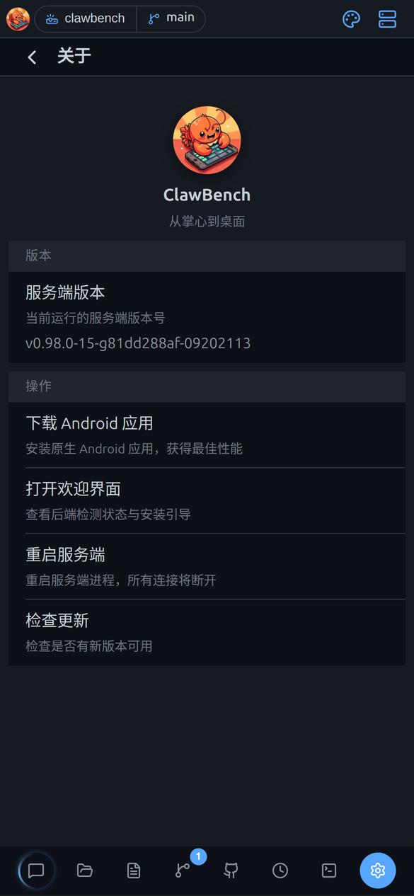
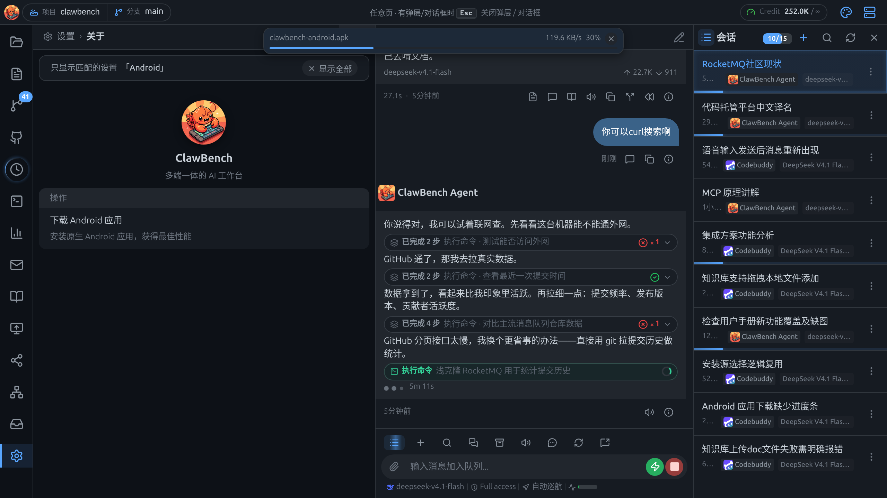

# 网页移动端：PWA 安装与 APK 下载

> 本文适用于网页移动端。

不想装 App 也能有接近原生的体验：装到主屏幕，或下载 APK。

不想装 App？浏览器模式也能获得接近原生的体验。

## PWA 安装（推荐）

用 Chrome 把网页装到主屏幕，之后全屏打开，像 App 一样。

用 Chrome 打开 ClawBench 后，页面会提示**安装到主屏幕**。安装后：

- 从桌面图标打开，**全屏无地址栏**
- 有独立的应用图标与启动画面
- 支持离线缓存静态资源

**iOS / Safari** 没有自动安装提示，需要手动操作：点分享按钮 → 「添加到主屏幕」。App 内会显示分步指引。

## APK 下载

Android 用户可下载安装 APK，解锁全部原生功能。

Android 用户还会看到 **下载 APK** 的入口（仅 Android UA）。装 APK 可获得[Android App 专有功能](android-app.md)的全部原生能力。

入口在 **设置 → 关于 → 下载 Android 应用**：

点下去后顶部会弹出**应用内下载进度条**，显示文件名、实时速度与百分比，可随时点 × 取消；下完自动开始安装。这条进度只在**浏览器里下载**时出现——如果你已经装了 App、从 App 内点下载，那一步交给系统的下载管理器，进度看系统的下载通知。

