# 设置

> 本文同时适用于桌面端与移动端；两端差异处用 **桌面端** / **移动端** 标注。

设置是所有配置项的入口，按分类排列。左侧 Dock 最后一个图标进入设置；**移动端**「设置」页签是分类首页，点任意分类进入子页。以下按分类逐项说明。

> 想知道每个配置项的**默认值、存在哪、改完什么时候生效**，以及只能在配置文件里改的那些项，见 [配置手册](configuration.md)。

> 分类按主题分组显示：**项目与外观**（项目 / 外观）、**模型能力**（**模型提供商** / **文本嵌入** / **语音朗读** / **语音识别**）、**智能体**（**身份与偏好** / **聊天** / **会话管理** / **会话索引** / 智能体 / 技能 / **MCP 服务**）、**功能模块**（**功能编排** / **文件管理** / **文件浏览** / **Git 历史** / 代码托管集成 / 任务 / 终端 / 统计 / **邮件** / **知识库** / 视频会议 / **分享中心** / 端口映射 / 通知中心 / 消息推送 / **用量监控**）、**系统**（调试 / 安全 / 关于）。

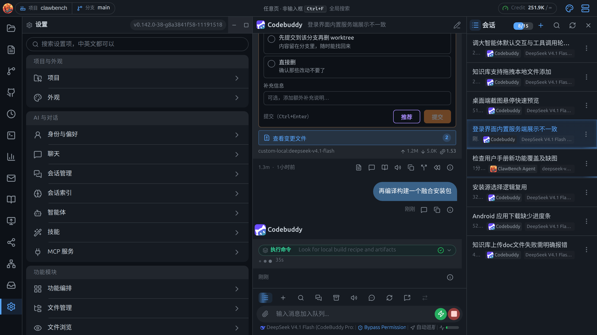

**移动端**设置分类首页：

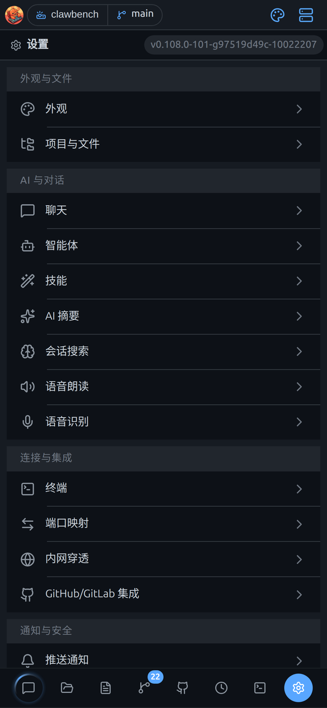

### 搜索设置项

顶部的搜索框可以按**名称和说明文字**查配置项，不用记住它归在哪个分类下。输入即搜，命中的关键词在结果里高亮：

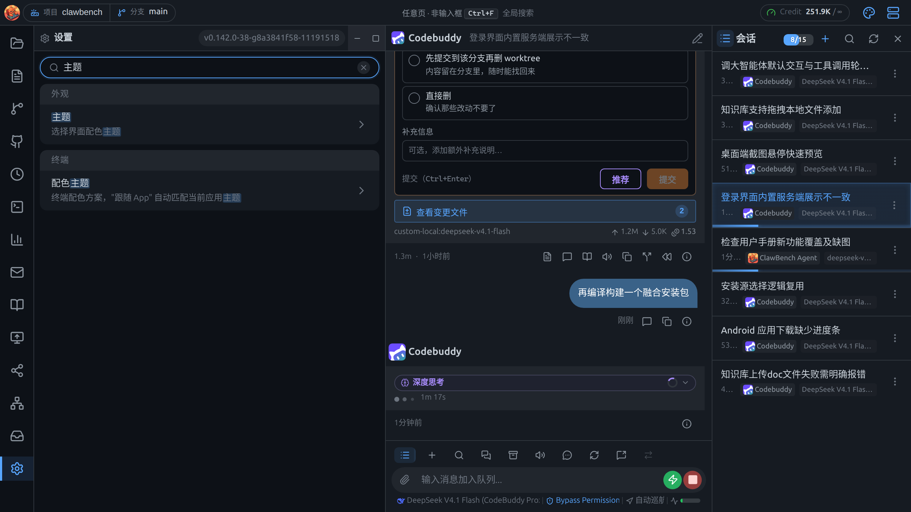

- 结果按分类分组成行（如「外观 → 主题」「终端 → 配色主题」），点任意一行直接跳到那一项
- 点进一项后，面板只在搜索结果里显示它，顶部留一条「**显示全部**」横幅——点它就回到完整列表，不会把你困在筛选状态里

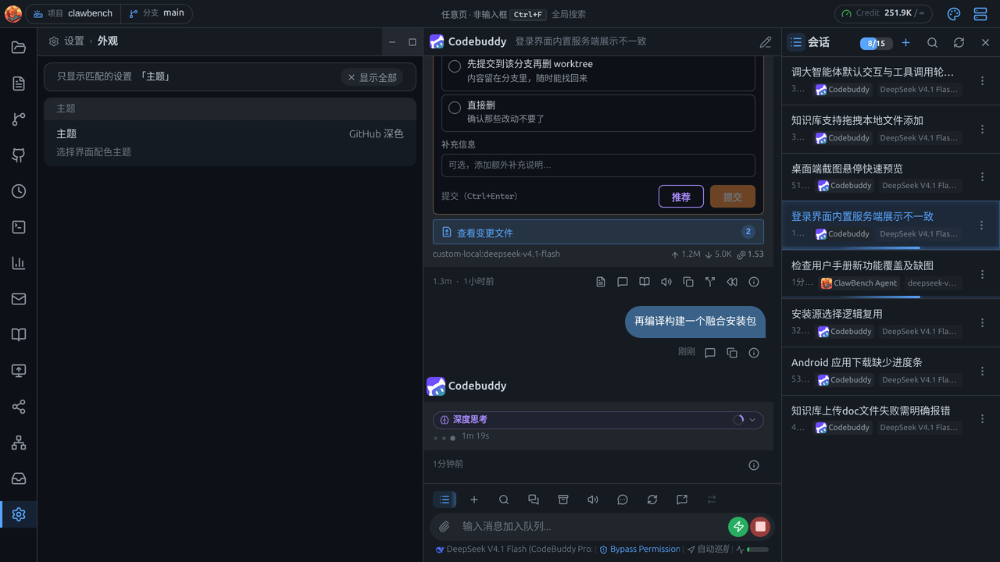

> 搜索只看**这一台服务器上已注册的配置项**；只在配置文件里才能改的项（见 [配置手册](configuration.md)）不会出现在结果里。

## 项目

管理服务器上已注册的项目：查看每个项目的会话数与最后活跃时间，进入详情切换或删除。**移动端**要点为项目列表与详情。

| 设置项 | 说明 |
|---|---|
| **最近项目数量** | 项目下拉里保留几个 |
| **项目列表** | 打开「全部项目」卡片，列出所有注册过的项目（可搜索） |

项目列表每行显示项目名、路径、会话数与最后活跃时间，左侧状态点表示目录**是否仍存在**（灰点＝目录已删除），当前项目带「当前」标记；点任意一行进入**项目详情**：

- **统计信息**：会话数、最后活跃、首次登记时间、目录状态（存在 / 已删除）、仓库类型（主仓库 / 工作树 / 子目录 / 普通目录）
- **切换到此项目**：切到该项目并回到聊天页签；当前项目时该按钮禁用
- **修改路径**：目录被移动或改名后指到新位置。只改登记、不移动磁盘，历史数据全部跟随（项目以整数 id 为身份）；目标须存在、是目录、未被其他项目占用，且有会话在运行的项目要先停下。改的是当前项目时会自动重指，不必手动切走再切回
- **删除项目**：永久删除该项目的全部数据（会话、消息、任务、标签、分享、RAG 索引等），**不触碰磁盘目录**。目录仍存在的项目需**输入项目名确认**以防误删；目录已删除的项目只需二次确认（没有「活项目」可保护）。当前项目不可删除，有会话正在运行的项目也不可删除（需先停止运行）

> **删除项目只清数据、不删目录**：这是「从 ClawBench 里移除这个项目」而不是「删掉服务器上的文件夹」。若目录还在，之后仍可重新添加为项目，但历史数据不会恢复。

## 外观

主题、语言、字体、缩放、壁纸等看得见的东西。

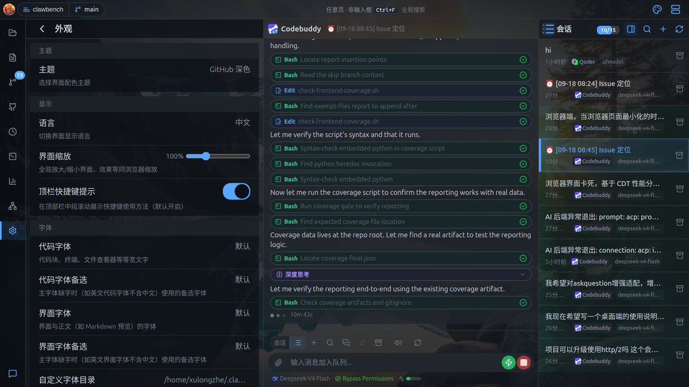

| 设置项 | 类型 | 说明 |
|---|---|---|
| **主题** | 下拉 | 36+ 种命名主题，可选「跟随系统」 |
| **语言** | 下拉 | 中文 / English |
| **自动适配** | 按钮 | 点一次，按当前屏幕分辨率算出合适的缩放并写入下方滑块（以 1080p 为基准，最高 200%；已由系统缩放过的屏幕不会二次放大）。只在点击时计算，不会自己变动。**移动端不提供此按钮**，手机/平板屏幕由系统按密度适配。另外：**启动时**若检测到屏幕明显偏大（建议缩放比当前高出 15% 以上），会弹一次确认框询问是否调整，同意后自动写入；拒绝后同一块屏幕不再询问，换到别的屏幕会重新询问。手机/平板不弹（系统已按密度缩放）；判断用屏幕短边，横竖屏结果一致 |
| **界面缩放** | 滑块 | 50%–200%，步长 1%，效果等同浏览器缩放。整套 UI（文字、间距、图标、终端字号）由根字号统一放大，所以任意倍率都不会错位。显示当前实际生效的倍率；「自动适配」的结果也会写进这里，可随时微调 |
| **顶栏快捷键提示** | 开关 | 是否在顶栏显示快捷键跑马灯 |
| **布局记忆** | 下拉 | 左右分栏比例、各面板折叠状态、会话列表与目录栏宽度等布局，是**全局共用**还是**每个项目各记一份**。想在不同项目里保持各自的工作区形态就选「按项目」；只有一个项目时两者等价。左栏当前停在哪一页签始终按项目记，不受此项影响 |
| **表格与代码块默认自动换行** | 开关 | Markdown 表格与代码块默认是否换行；关闭后默认横向滚动。每个块右上角的换行按钮仍可单独切换，互不覆盖 |
| **代码字体** | 下拉 | 代码区字体 |
| **代码字体备选** | 下拉 | 主字体缺失时的回退 |
| **界面字体** | 下拉 | UI 字体 |
| **界面字体备选** | 下拉 | 主字体缺失时的回退 |
| **自定义字体目录** | 文本 | 服务器上存放字体文件的目录 |
| **壁纸 / 面板不透明度** | 专用组件 | 自定义背景图与面板透明度 |

> **主题切换动效**：切换主题时，新主题以圆形从**右上角主题按钮**位置扩散铺满全屏（顶栏快捷主题按钮与设置页主题网格共用同一原点、效果一致）。不支持该动效的设备或开启了「减少动态效果」时自动降级为瞬间切换。

自定义壁纸支持本地上传与 Bing 每日图两种来源，并可用高斯模糊虚化背景：

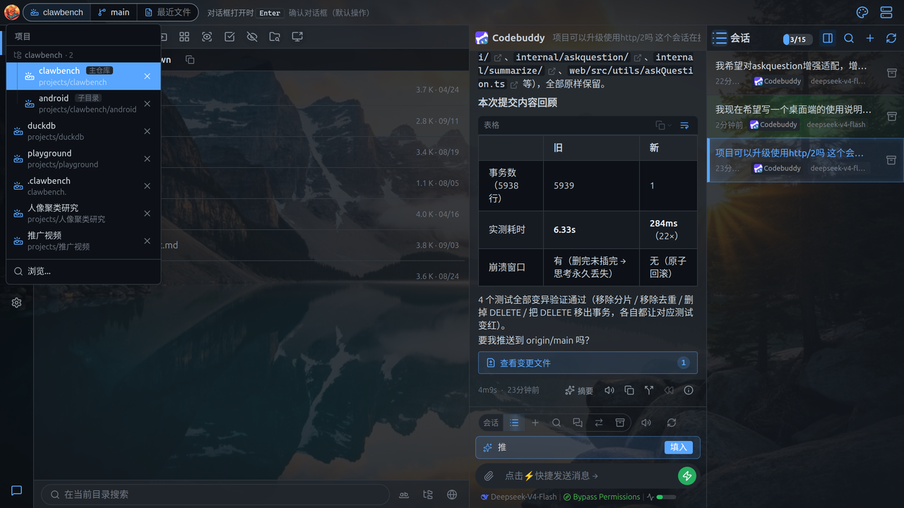

- **壁纸开关**：总开关
- **来源**：本地图片 / Bing 每日图 / 动态波浪
- **面板不透明度**：让背景半透明透出，范围可调（**每台设备各自保存**，与模糊/字体等一样属于本地显示偏好，不上传服务端——同一账号在不同设备上可以各调各的）
- **模糊强度**：对背景图做高斯模糊
- **设置为主题背景**：在文件查看器中右键图片即可快速设为壁纸

> **动态波浪**：不依赖任何图片文件的程序化动画背景，可调节播放速度（0.2×–2×，默认 1×）。适合没有合适壁纸图片、又想要一点动态效果时使用。

> **Bing 每日图**：选「Bing 每日图」后，壁纸每日自动更新为 Bing 首页当日图片。图片保存在 `{data-dir}/wallpaper/bing/` 目录，每次更新前会先删除旧图片。服务器需能访问 `www.bing.com` 才能获取当日图片。

## 功能编排

左栏 Dock 上的全部功能在这里统一管理：排成一条列表，**全部可以拖动排序**，开关决定它出不出现。聊天固定在右栏，不在这个列表里。这一页同时是**唯一的开关入口**——各功能自己的设置页只显示状态和「去功能编排」，不再放第二个开关。

| 类型 | 功能 | 开关 |
|---|---|---|
| 常驻 | 文件管理、文件浏览、设置 | 灰显，不能关（悬停提示「常驻」） |
| 有后台功能 | 代码托管集成（GitHub / GitLab / Gitea）、邮件、终端、知识库、任务、分享中心 | 关掉会**真的停掉服务端的事**，页签同时消失 |
| 只有显示 | 历史、数据统计、视频会议、端口映射、通知中心 | 只管入口，没有后台可停 |

每条都是两行：图标和名称在第一行（带分组标签），功能说明在第二行。开关旁边不印文字，它管的是什么（启用 / 只在 Dock 中显示 / 常驻）靠悬停看。

- **通知中心关掉的只是入口**：事件照常记录、系统通知照常弹，重新打开页签历史都在

- **有后台功能的开关是服务端全局的**，不是每个项目、每台设备各一份：一台服务器上的所有客户端看到同一个状态
- **环境不支持时开关灰显并写原因**：终端依赖这台机器能不能跑终端，端口映射依赖隧道能力；打开也不会出现
- **破坏性关闭会先确认**：代码托管集成（清空全部项目的仓库绑定）、终端（断开所有已打开的会话）、任务（取消运行中与排队中的任务）、分享中心（撤销所有已发出的链接）。确认框会列出后果，**单个开关和预设走同一套确认**

**预设**一次设定显示、顺序和开关三件事：

| 预设 | 做什么 |
|---|---|
| **开发** | 全部开启，按默认顺序排列 |
| **标准** | 隐藏并关掉代码托管集成 / 终端，隐藏端口映射；邮件、知识库、任务、分享中心保持开启 |
| **极简** | 只留常驻页签，关掉代码托管集成 / 终端 / 邮件 / 知识库 / 任务 / 分享中心 |

> 应用「标准」或「极简」前会先列出**会停掉什么、会撤销什么**；取消则整个预设不生效，不会留下半套状态。预设与手动调整是两件事：手动改过之后当前状态显示为「自定义」，点「恢复默认」回到开发预设。

**功能关掉之后，其他页面里做同一件事的入口也会一起禁用**（按钮隐藏或置灰，跳转被拒绝），提示统一是「功能已关闭，去功能编排打开」。历史内容仍然可读：任务卡片、邮件、会议记录都还在，只是不能再新建或跳转。**分享是例外**——关掉后旧链接直接 404。

> **「分享到其他应用」不受影响**：那是系统分享，不经过分享中心；文件管理器的批量分享按钮同样保留。

## 文件管理

文件搜索上限、列表显示与上传限制。**移动端**要点为显示隐藏文件、默认视图与上传限制。

| 设置项 | 说明 |
|---|---|
| **搜索结果数量上限** | 文件搜索最多返回多少条（10–500） |
| **显示隐藏文件** | 文件管理器默认是否显示以 `.` 开头的文件 |
| **默认视图** | 列表 / 网格 |
| **排序字段 / 方向** | 默认排序方式 |
| **上传大小上限 / 文件数** | 上传限制 |
| **上传保留** | 是否定期清理项目 `.clawbench/uploads/` 里**已过期且没有任何消息引用**的上传文件（默认关；开启后天数默认 30，被消息引用的文件永不清）。手机截图与相机照片都堆在这里，不开会无限增长 |

> 这一页管的是**列表怎么排、能不能上传**；打开文件之后的阅读体验在「文件浏览」。

## 文件浏览

打开文件之后的阅读体验：换行、行号、预览窗格与最近文件。

| 设置项 | 说明 |
|---|---|
| **最近文件数量** | 顶栏最近文件列表长度（1–50） |
| **自动换行** | 代码查看器默认换行 |
| **行号** | 代码查看器默认显示行号 |
| **粘性滚动** | 滚动时函数名吸顶 |
| **代码链接预览** | 是否启用点击路径弹出代码切片 |
| **文件预览模式** | 是否默认开启预览窗格 |
| **上传大小上限 / 文件数** | 上传限制 |
| **上传保留** | 是否定期清理项目 `.clawbench/uploads/` 里**已过期且没有任何消息引用**的上传文件（默认关；开启后天数默认 30，被消息引用的文件永不清）。手机截图与相机照片都堆在这里，不开会无限增长 |
| **draw.io 编辑器下载地址** | 打开 `.drawio` 时按需下载编辑器（约 118MB，服务端所有设备共用）。留空依次尝试内置加速镜像与 GitHub；内网 / 离线部署在这里填自己的镜像地址（普通 http 与自签 https 都支持），或直接在文件查看器里上传 `draw.war` |

## Git 历史

左栏「历史」页签的默认行为。**这四项只影响历史面板本身**，不改仓库里的任何东西。

| 设置项 | 类型 | 说明 |
|---|---|---|
| **每页提交数** | 服务端 | 一次拉取多少条提交（10–200，默认 30）。数值越大一次看到的历史越长，首次加载也越慢；改完下一次拉取就生效，不用重启 |
| **默认隐藏合并提交** | 本机 | 打开后列表默认不显示合并提交。面板顶部仍可临时切换，那一次切换不会改这里的默认值 |
| **显示提交图** | 本机 | 在提交列表左侧画分支与合并的连线图。关掉后列表更紧凑，适合窄屏 |
| **提交时间显示** | 本机 | **相对时间**（「3 小时前」）或**绝对时间**（具体日期） |

> 历史页签被隐藏时，文件管理器里的「Git 历史」按钮会一并禁用——点了也只会落到一个不存在的页签。

## 统计

左栏「数据统计」面板的默认值，三项都是**本机设置**（换台设备可以各看各的）。

| 设置项 | 说明 |
|---|---|
| **默认页签** | 打开面板时先显示哪个：**用量** / **代码量** / **Git 代码** |
| **默认时间范围** | 打开时先看多长时间的数据：24 小时 / 7 天 / 30 天 |
| **记住上次选择** | 打开时沿用上次看的页签与时间范围，而不是回到上面两个默认值（默认关） |

> 统计面板本身怎么读见 [数据统计](stats.md)。

## 身份与偏好

你对智能体的自我介绍：**称谓** + **身份与偏好**。这两项会拼成 `## About the User` 一段注入到**每个**智能体的系统提示里，所以改完**下一轮**就生效，不用重启、也不用重新建会话。

| 设置项 | 说明 |
|---|---|
| **我的称谓** | 智能体在对话里这样称呼你；**加入会议时也用它作为显示名**，转写与聊天署名同样用它。留空则用默认名 `User`——默认名视为占位，不会被注入提示词（否则每次安装都会白白多一行）。不能与任何智能体同名，也不能含引号、尖括号、逗号或控制字符 |
| **身份与偏好** | 角色、擅长领域、偏好或工作习惯，最多 4000 字。写得越具体，智能体的默认假设越贴近你 |

> 放在系统提示而不是每条消息里：它只在用户改动时才变，跟着每条消息发会为不变的信息反复付 token；而 resume 时智能体自己的会话里已经带着它，压缩后也会重新注入。

## 聊天

聊天本身的行为：朗读、锁屏、消息怎么显示、上下文预算与推荐回复。**移动端**要点为发送行为与上下文预算。

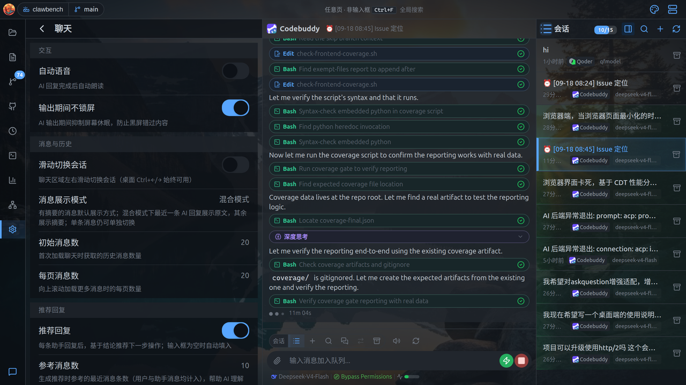

| 设置项 | 说明 |
|---|---|
| **自动朗读** | AI 回复完成后自动朗读 |
| **防止锁屏** | 执行期间阻止屏幕休眠 |
| **消息显示模式** | 混合 / 仅摘要 / 仅原文 |
| **收起工具调用** | 把连续的工具调用与思考折成一行「N 次调用 · N 次思考」，点开看细节（默认开） |
| **初始消息数 / 分页大小** | 打开会话时加载多少条 |
| **系统提示间隔** | 每隔多少条消息在上下文开头重新注入系统提示（用于刷新 AI 对项目状态/指令的感知）。间隔太短会增加 token 消耗，太长则 AI 可能遗忘重要指令。设置为 0 则只在会话开始时注入一次 |
| **分叉上下文预算** | 分叉时带多少 token 的上下文 |
| **推荐开启 / 上下文条数** | 推荐回复的开关与参考范围 |
| **跳转 AI 摘要模型** | 快捷入口，并显示摘要模型是否已配置；推荐回复、自动命名、语音摘要三处共用这一行 |
| **智能体讨论次数上限** | 群聊里「轮到用户发言前，智能体之间最多发言多少次」（默认 100，主持人模式与自由模式语义一致） |

**移动端**补充说明：

- **消息显示模式**：混合（默认，同时展示摘要卡片与原始消息）/ 仅摘要（只显示 AI 摘要卡片）/ 仅原文（只显示原始消息，无摘要）
- **分叉上下文预算**：分叉时携带的历史上下文上限（token 数），值越小会话越轻量但上下文越少
- **推荐回复上下文条数**：生成推荐回复时参考的最近消息轮数，设为 0 则关闭推荐回复

> 会话列表、会话上限、排序、归档清理与自动命名属于**会话管理**，在下一个分类里。

## 会话管理

会话作为「对象」的一面：列表怎么排、能留多少、坏了怎么续、什么时候清理，以及会话搜索的索引行为。**移动端**要点为滑动切换会话与归档留存。

| 设置项 | 说明 |
|---|---|
| **最大会话数** | 项目内最多保留多少会话 |
| **会话按最近活动排序** | 默认关：会话按创建时间排列，不会自己换位置。开启后最近发过消息的会话浮到最上面。手动拖动过的顺序始终优先 |
| **滑动切换会话** | 手势切换（**移动端**默认关，需手动开启） |
| **其他项目卡片上限 / 活跃窗口** | 会话列表底部最多显示几个其他项目的卡片，以及项目多久内用过才算「最近活跃」 |
| **其他项目会话的展示方式** | **常驻条**（跟在列表下方一起滚动）或**底部页签**（单独一格，点一下才切过去）。本机设置，每台设备可以不同 |
| **异常终止自动继续** | 会话因崩溃/无输出/后端报错意外中断时自动发「继续」，见 [AI 对话 § 异常终止自动继续](chat.md#异常终止自动继续) |
| **最大重试次数** | 自动续接的次数上限（-1 不限，0 不重试） |
| **重启恢复时间窗** | 服务重启后多久之内的中断会话仍会被自动接上（分钟） |
| **AI 自动命名会话** | 会话首次命名时改由 AI 摘要用户消息生成标题（需先配置 AI 摘要模型；未配置或失败时用本地标题）。与重命名对话框里的「自动生成」共用同一实现 |
| **跳转 AI 摘要模型** | 自动命名用的就是这一份共享摘要模型，点开选择 |
| **归档保留开关 / 天数** | 自动清理过期归档会话 |

**会话搜索与索引**（这一组决定「搜索会话」的索引怎么建、返回多少）：

| 设置项 | 说明 |
|---|---|
| **索引保留天数** | 会话索引保留多久（超过后不再可检索） |
| **搜索结果数** | 一次搜索返回多少条命中 |
| **搜索池大小** | 向量检索时先取多少候选再重排（仅在启用文本嵌入时生效） |
| **批大小** | 索引器每轮处理多少条消息 |

> **嵌入服务不在这里配**：地址、模型与密钥在 [文本嵌入](#文本嵌入) 页，那份配置**知识库共用**。这一页只管「拿它来搜会话时」的行为。

> ⚠️ 归档为**单向操作**，归档后的会话无法从界面取消归档，只能删除。若需要保留会话内容，请勿归档。

## 智能体

扫描服务器上装了哪些 AI CLI，并配置它们的默认模型。**移动端**同为扫描/配置 AI CLI 与默认模型。

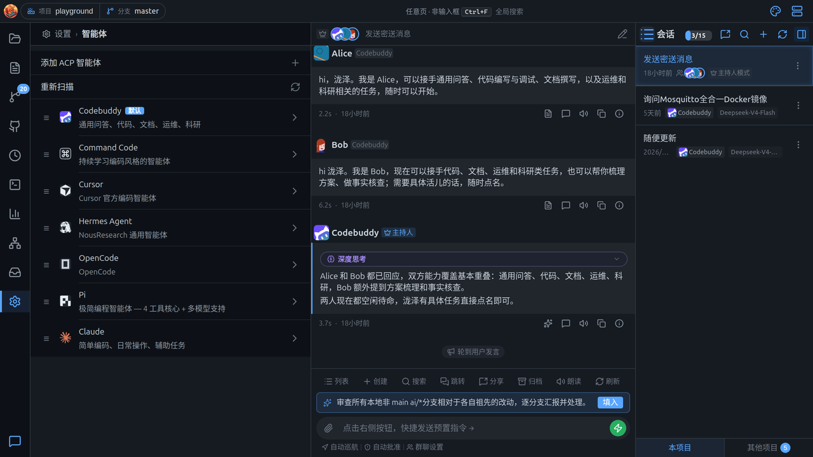

- **添加 ACP 智能体**：接入内置列表之外的工具，见下一节
- **重新扫描**：重新探测服务器上已安装的 AI CLI
- 智能体列表：每个智能体可进入详情页，查看配置、复制、删除
- **拖拽排序**：按住每行左侧的拖拽手柄上下拖动即可调整顺序，松手即保存。顺序是**全局的**——新建会话、新建任务、群聊加成员等所有智能体选择入口都按这个顺序列出

### 添加内置列表之外的智能体（自定义 ACP）

如果某个 AI 工具**没有内置适配器**，但它支持以 **stdio 方式说 ACP**，可以直接接入，不必等 ClawBench 为它写后端：点列表顶部的「**添加 ACP 智能体**」，填两项即可——

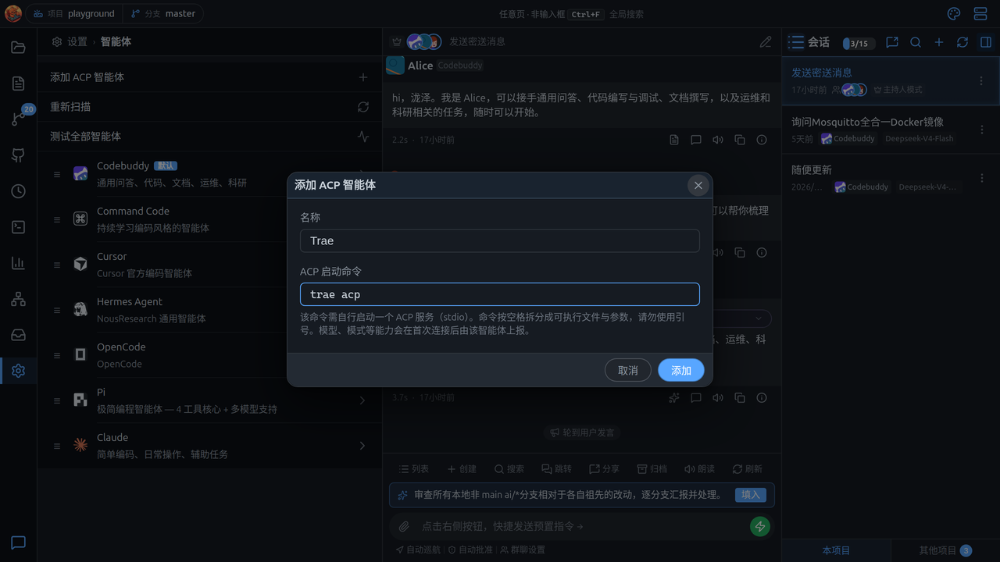

| 字段 | 说明 |
|---|---|
| **名称** | 在会话、任务、群聊里显示的名字。**全局唯一**：与已有智能体重名会被拒绝，与群聊「用户称谓」相同也会被拒绝 |
| **ACP 启动命令** | 启动该工具 ACP 服务的命令，例如 `trae acp`。**按空格拆分成可执行文件 + 参数，不支持引号**，所以带空格的参数无法表达；上限 4096 字节 |

> ⚠️ **命令会以服务端进程的权限执行**。只填你信任的可执行文件——这与终端 API 给你的权限本来就是一回事，但别从不可信来源复制命令。

新建后传输固定为 **ACP**，模型、模式、斜杠命令、思考档位都由该工具在首次连接时自行上报。因此**刚建好时模型列表是空的，这是正常现象**（界面显示「默认」，发送时不指定模型，由它自己决定），不是配置错误——跑一次配置自检会看到对应项是「警告」而非「失败」。

**命令写错了不用删掉重建**：进详情页改「ACP 命令」那一行即可（改完会重启该智能体的 ACP 连接，新命令下一轮生效）。只有**内置后端**的命令是只读的——它由自动扫描维护，手改会在下次「重新扫描」或重启时被改回去，所以界面直接不让你改。

### 集成测试（自检）

自检在**智能体详情页**按需对单个智能体运行，分两级：

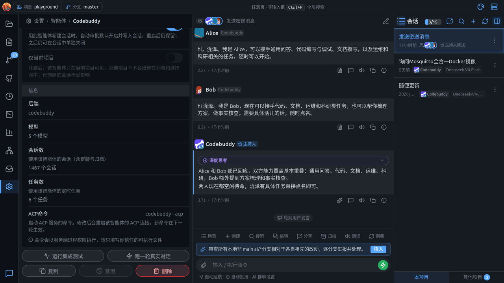

上图：信息组的「ACP 命令」行（内置后端为只读，并注明命令由自动扫描维护）；下方是「运行集成测试」与「跑一轮真实对话」两个按钮，再往下是复制 / 禁用 / 删除。

- **运行集成测试**（免费、秒级）：只读配置与文件系统，**不启动进程、不消耗额度**。逐项检查后端是否可识别、传输与命令是否自洽、可执行文件是否存在、模型与首选模式是否有效、ACP 能力缓存等，结果分 `通过` / `警告` / `失败`。
  - **「警告」不等于坏了**——它表示「降级但可用」，例如新加的自定义 ACP 智能体在首轮之前还没有上报模型。
- **跑一轮真实对话**（**会消耗模型额度**）：真正发一条消息并等回复，报告模型原文、**实际使用的传输方式**与结束原因——这些取自落库的回合记录，是事实而不是配置。配置自检有「失败」项时它不会执行（避免白等一个回合）。

> 判断「智能体能不能用」不能只看创建成功：一个起不来的智能体在自检之前和正常的一模一样。这也是为什么 `/cb-agent` 被要求创建后必须跑一遍自检。

点智能体进入详情页可配置默认模型等偏好：

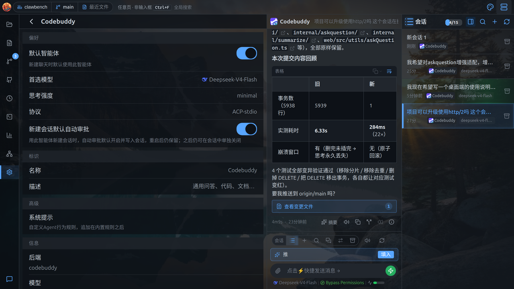

详情页按模型来源分组列出可选模型，选中后点保存。此处设置的默认模型会影响该智能体新建会话时的初始模型。

**系统提示的改动不一定对进行中的会话立即生效**：系统提示是唯一一个「改了未必马上传到已在跑的会话」的字段——部分后端只在会话开始、或上下文压缩之后才重新注入它（见[聊天 § 系统提示间隔](#聊天)）。改完系统提示后，若当前会话行为没变，重启会话（或等它下次压缩上下文）即可生效。详情页的系统提示行有一句常驻提示说明这一点。模型、传输方式、名称、头像等改动则对下一轮即生效。

详情页顶部还有一行**头像**：默认用该智能体的内置图标，点「更换头像」打开自定义选择器，一次性铺开全部 40 款 DiceBear 风格，改**种子**时所有预览整体刷新，点格子即选中；头像随智能体保存，会显示在会话列表、消息气泡等所有出现该智能体的位置。

**信息组**还会显示该智能体的**会话数（含归档）**与**任务数**：会话数统计 1:1 聊天 + 它作为活跃成员参与的群聊（任务执行自动产生的会话不计入，避免「删任务只归档其会话、计数永远清不掉」的死锁）。

**会话列表**就在信息组下方（标题「使用该智能体的会话」），把「这个智能体到底出现在哪些对话里」摊开——1:1 聊天、它当主持人的群、它当成员的群，**跨项目、含已归档**，因此每一行都标出**参与方式**（单聊 / 主持人 / 群成员 · 该群里的称谓）、**所属项目**与**已归档**标记。范围刻意与上面的会话数一致（同一个口径），所以列表条数不会和那个数字对不上；列表分页加载，滚动到底自动续。

点一行即可打开：**跨项目**的行会先切到那个项目；**已归档**的行会先问一句「需要先恢复才能打开，现在恢复吗」。群成员行打开的是**群时间线**——成员行本身没有独立对话；若该成员所在的群已被解散，这一行仍会列出（它还在计数里），但标注「会话已不存在」且不可点。

**禁用 / 启用**：详情页可把智能体**禁用**（默认智能体不可禁用）。禁用后它从**所有新建入口**消失——新建会话、新建任务、群聊添加成员都看不到它；但**已存在的会话与任务不受影响**（仍可继续对话/执行，成员花名册与历史头像也照常显示），以便你逐步清理。再次点同一按钮即**启用**。

**仅当前项目**：详情页可把智能体**限定到当前项目**——开启后它只在当前项目可见，切到其他项目时不会出现在设置列表与任何新建入口（新建会话/任务/群聊加成员）。适合"某个智能体只服务于这个仓库"的场景。**只影响新建**：已创建的会话与任务不受影响（照常继续跑），因此开启作用域不会打断正在进行的对话。**默认智能体不能限定项目**（它的回退逻辑在每个项目都要用），被限定项目的智能体也不能再被设为默认。关闭开关即恢复全局可见。

**删除即接管**：删除智能体**不再因为「还有会话 / 任务 / 群成员」而被拒绝**——它名下的会话、任务与群行会全部转交给**默认智能体**，确认框会告诉你各自有多少条。唯一的拒绝是**它还有会话正在运行**（含它作为成员正在发言的群回合），先停下再删。转交时：同后端的会话沿用原生会话直接续上（不重建），跨后端则强制重开一轮并把历史渲染成背景注入；`chat_history` 一条不删，群成员的称谓与头像保留，群时间线归属不变；每个受影响的会话会收到一条系统提示说明接管。**归档不是清空**，但也不影响删除——归档会话同样会被接管。

## 任务

任务调度器的行为。**总开关不在这里**——它属于「有后台功能」的功能开关，在[功能编排](#功能编排)里；这一页只显示它的状态，其余各行描述「开着的时候怎么跑」。

| 设置项 | 说明 |
|---|---|
| **功能状态** | 显示「已启用 / 已停用」，点「去功能编排」改开关 |
| **自动清理执行记录** | 执行记录到期后自动删除（默认关）。关掉时记录一直保留，需要手动清理 |
| **保留天数** | 执行记录保留多少天，到期后自动删除 |
| **完成时通知 / 失败时通知** | 任务跑完（成功 / 失败）时是否生成一条通知，默认都开。关掉失败通知后，失败只能自己去翻执行记录 |
| **默认时区** | cron 表达式按哪个时区执行，写成 IANA 名称（如 `Asia/Shanghai`）。**留空用服务器本地时区** |
| **任务列表默认筛选** | 打开任务页时先显示：全部 / 启用 / 暂停。本机设置 |

> **关掉任务开关的后果**：调度器停止，**运行中与排队中的任务会被取消**，恢复后**不会补跑**；手动运行也会被拒绝。任务卡片与历史执行记录仍然可读，只是跳转与新建被禁用。预设（标准/极简）与单个开关走同一套确认框。

## 技能

跨智能体共享的技能库：把装在某个智能体下的技能也提供给其他智能体使用。这是设置首页的一个**独立分类**（图标为魔杖）。

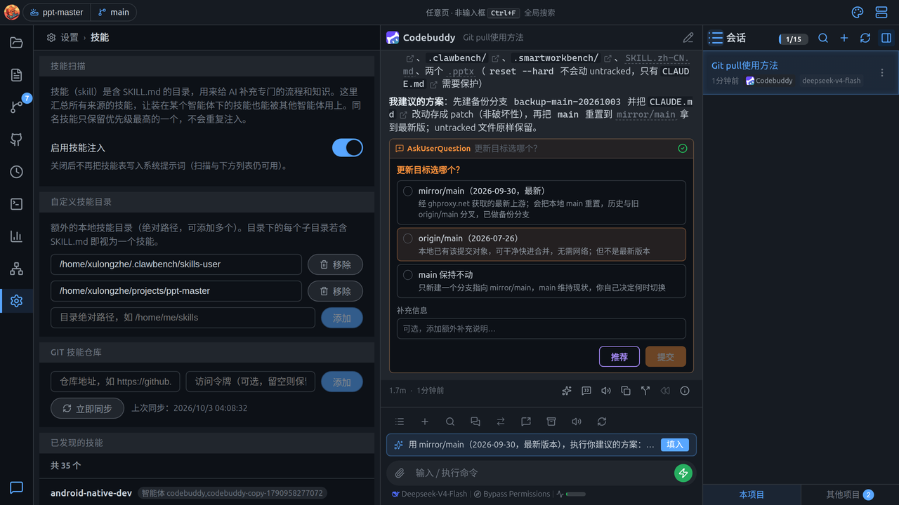

ClawBench 会把所有来源的技能（含 `SKILL.md` 的目录）汇总起来，同名技能只保留优先级最高的一个，不会重复注入。这一页分两张卡：

- **跨智能体技能**：总开关（启用技能注入，**默认关**）、**项目技能自动注入**（默认关，见下）、自定义技能目录（绝对路径，可加多个）、Git 技能仓库（clone/pull 后自动发现）。点「立即同步」拉取 Git 远程并重扫
- **已发现的技能**：列出全部技能的名称、来源、路径与状态。顶部有**按名称过滤框**与**重新扫描**按钮（只重扫本地文件系统、不联网，适合手动往目录里放入技能后刷新）；每行右侧有一个开关，可以**单独**把某个技能排除出自动注入（不影响 `#技能名` 引用）。标「通用」的是跨工具共享目录（如 `.agents/skills`）。原生技能在名称下方按 **AI 后端**列出图标+名称（独立一行、超宽折行；不是智能体名）。若技能的 `name` 与所在目录名不一致，会给出提示（仍会注入提示词，但不进斜杠命令菜单）。同名技能会列出多行，被压过的那些会淡显并标「被覆盖」——只有不淡的那行是 `#技能名` 实际会用的。点路径可直接在文件管理器中定位。列表底部还有一块折叠的「未加载的技能」，列出有 `SKILL.md` 但加载失败的目录及原因（缺 description、YAML 写坏等）

**技能来源与优先级**：技能有五种来源，同名时按「本智能体原生 > 用户目录 > 项目自带 > Git 仓库 > 其他智能体原生」的顺序保留优先级最高的一个（即越靠前越优先）。**用户目录排在项目之前是刻意的**：项目里的技能跟着仓库走，可能是你还没读过的代码，不能把你自己的同名技能顶掉。发现列表里会标注每个技能的来源类型。**项目自带**指当前项目根下的 `.agents/skills`（qoder / codewhale 等工具在项目目录里运行时也会自己读取），只对**该项目下的会话**可见。

> **项目技能默认不自动注入**：项目里的技能描述会原文进入每一轮系统提示，而仓库可能是你没读过的，所以「项目技能自动注入」默认关。关着的时候列表照常显示、`#技能名` 也照常能引用；确认项目可信后再打开。

> **自动注入默认关闭（opt-in）**：注入每个已发现的技能都会消耗每一轮的上下文，因此**总开关默认关**——关闭时不会自动写入系统提示词，但扫描与列表照常工作，且你在输入框用 **`#技能名`** 手动引用仍可用（那是你的直接指令，不算自动注入）。需要让智能体自动用上技能时，打开「跨智能体技能」总开关。

**Git 技能仓库**：每个仓库可单独配置一个**访问令牌**（用于私有仓库），令牌只写不读——界面上永远显示为空，填入即表示替换已存的令牌；留空则保留原令牌。仓库列表会显示最近同步时间，以及每个仓库的同步错误（如克隆失败、认证失败）。**技能仓库的同步只拉取 Git 远程，本地目录不需要同步。**

> **技能注入发生在两个地方**：普通会话与**定时/事件任务**都会注入技能提示词，因此任务里也能用上技能，不必额外配置。

**已发现技能的「通用」标签**：跨工具共享目录（如 `.agents/skills`）里的技能对所有智能体可见，因此标为「通用」。

## MCP 服务

给 AI 智能体接上外部工具服务（搜索、数据库、内部系统）。**在 ClawBench 里配一次，所有走 ACP 的智能体默认都能用**，不必再去改每个 CLI 自己的配置文件。

| 字段 | 说明 |
|---|---|
| **名称** | 唯一标识，也是发给智能体的服务名。只能含字母、数字、`_`、`-`。**改名会让所有引用旧名的智能体策略失效**，改名前请先确认 |
| **传输方式** | `stdio`（本地进程）/ `http` / `sse` |
| **命令 / 参数 / 环境变量** | 仅 `stdio`：命令必须在服务器 `PATH` 里（保存时会校验，找不到直接报错） |
| **地址 / 请求头** | 仅 `http` / `sse`：地址必须是 http(s) |

每条服务右侧有「**测试**」按钮：它会真的连上去完成 MCP 握手并列出工具。**能保存不代表能用**——命令能启动但说错协议、地址返回 200 却是一张网页、服务接了连接却永不回应，这些只有真连一次才能发现。

> **只对 ACP 传输生效**：CLI 传输没有这个参数，它读自己的配置文件。CLI 智能体配了也不会生效。

> **密钥明文显示**：环境变量与请求头的值与语音、知识库的 API Key 一致，界面上是明文（设置页不区分两种行为）。

**按智能体启用**：智能体详情页多一节「MCP 服务」，三选一——**全部启用**（默认）/ **全部禁用** / **只选这几个**。默认给「全部启用」是因为全局列表为空时它什么也不做，加完服务不必再逐个智能体去打勾。改完**不需要重启，也不打断正在跑的回合**，从下一条消息生效。

> **有几种组合会明确被挡**：`dsh` / `deepseek` / `pi` 三个后端实测会接受配置然后完全忽略（工具永远不出现），因此对它们整个功能被禁用并给出提示；`codex` / `commandcode` 不支持 `sse`，这类服务在它们的清单里会标灰且不可勾选。**hermes** 异步挂载 MCP，首次对话可能还拿不到工具，再发一次即可。

**也可以用对话配置**：输入 `/cb-mcp 帮我加一个搜索服务，只给某个智能体用`，AI 会通过本地接口读写同一份配置。

## 知识库

知识库的索引状态与检索参数。**总开关不在这里**——它属于「有后台功能」的功能开关，在[功能编排](#功能编排)里；关掉会停索引器并关闭知识库，**已索引的数据保留**。

| 设置项 | 说明 |
|---|---|
| **功能状态** | 显示「已启用 / 已停用」，点「去功能编排」改开关 |
| **索引状态** | 集合数、文档数、已就绪 / 失败 / 待处理、分块数、已向量化、占用空间；下面是两段进度条（解析文档、文本嵌入），索引中会自动刷新；可手动刷新，也可一键**重建全部索引** |
| **自动注入知识库内容** | 每轮对话前把检索到的片段拼到你的消息前面。默认关；打开后单个知识库还可以单独关掉 |
| **每次注入几段 / 注入总字数上限** | 一轮最多注入几个片段（默认 4）、所有片段合计最多多少字（默认 2000），超出按相关度截断 |
| **相似度下限** | 只对向量检索生效：低于这个相似度的命中会被丢掉（默认 0.35）。关键词命中不设阈值 |
| **单个文件大小上限 / 单篇文档保留文本上限** | 超过大小上限的文件会被拒绝加入（默认 50MB）；抽出的文字超过文本上限会被截断并标记（默认 20MB） |
| **索引轮询间隔** | 后台索引器多久检查一次待处理文档，写成 Go 时长（如 `2s`、`500ms`，默认 `2s`）。新增与重建会立刻唤醒它 |
| **向量化批大小** | 每次请求嵌入服务送多少段文本（默认 16，最大 128） |

> **嵌入地址、模型与密钥在 [文本嵌入](#文本嵌入) 页**：知识库不单独保存一份，两边调用同一个嵌入服务。集合、文件与搜索本身在左栏「知识库」面板里管理，索引进度也在那个面板里实时显示。

## 视频会议

会议纪要的生成策略、**新会议默认值**，以及这台服务器共用的中继端点。这里只放三类东西：全局默认值、所有会议共用的能力、会改变产物成本或隐私的策略。**每场会议能改的开关仍在创建页与「会议管理」里**，这里只是它的初始值——同一个开关有两份事实源，用户会以为设置没生效。

| 设置项 | 默认 | 说明 |
|---|---|---|
| **纪要模型** | 共享摘要模型 | 与语音摘要、推荐回复、自动命名共用；改这里会一起变 |
| **会议结束后自动生成纪要** | 开 | 由主持人客户端在会议结束时发起；关掉仍可在详情页手动生成。主持人直接退出应用时不会生成 |
| **生成前先校对转写** | 开 | 先校正错字与同音词再生成纪要；关掉省一次模型调用，但纪要质量会下降 |
| **纪要输出语言** | 跟随转写 | 只影响纪要，不影响转写 |
| **读取会议中打开的文件内容** | 开 | 最多 5 个文件、每个约 1500 字。关掉后仍保留文件时间线，但不发送内容 |
| **纪要输出上限** | 3000 tokens | 1500 偏简洁、3000 标准、6000 偏详细。调得过低会导致「超出上限」而生成失败（详情页会提示调大并给出跳转） |
| **新会议默认值** | 听记 / 关键画面 / 允许观众发言 / 允许成员共享屏幕都开 | 只作为创建页的初始值，仅本机生效，会议中仍可改 |
| **中继服务** | 未配置 | 中继地址 + API Key + API Secret，**这台服务器上的所有会议共用**。填完点「保存并测试连接」，通过才存（存一个连不上的端点会让之后每场中继会议都开不起来）；Secret 只写不回显，留空表示不改。中继本身不用配证书——浏览器这侧由本服务代理信令 |

> **用不用中继是每场会议的决定**：这里只提供端点，创建会议时勾选「本次使用中继服务」才走中继。配置在开会那一刻就被快照下来，之后改这里不影响正在进行的会议。

## 摘要模型（共用配置）

「AI 摘要」不再是一个独立分类。摘要模型是**一份共享配置**，出现在它真正被用到的地方：

- **聊天 → 推荐回复**：回复完成后生成下一步建议
- **会话管理 → 自动命名**：首条消息后给会话起标题
- **语音朗读 → 语音摘要**：朗读前压缩长回复
- **会议**：生成会议纪要、校对转写稿、给未命名的会议取标题

每处那一行点开是同一个选择器：先选**模型提供商**，再选它下面的模型（也可以在这里直接新增提供商）。旁边有「已配置 / 未配置」状态。未配置时相关功能只是不启用，不影响对话本身。

## 模型提供商

把**自建 / 第三方端点**登记成一条可复用的「端点 + 凭据」，智能体与摘要模型直接引用它，而不是各自抄一份地址和密钥。这是设置首页的独立分类（图标为方块堆叠）。

| 设置项 | 说明 |
|---|---|
| **名称 / 预设** | 从内置品牌预设挑一个（自动填好协议与地址），或自己起名手填 |
| **协议** | `openai` / `anthropic` / `gemini`；决定环境变量怎么注入、探测走哪个端点。**Codex 只接受 openai 协议**，另有一个「调用方式」（Responses API / chat completions） |
| **自有服务账号** | 不在通用表单里，而是 CodeBuddy / Cursor / Command Code / Antigravity **各有一个页签**：只填该后端自己的账号 Token，不填端点、不选认证方式、不列模型。保存时记住这条凭据属于哪个后端，绑到别的后端会被拦下；CodeBuddy 还能选**服务版本**（公有云 / 中国版 / iOA 版 / 专享版 / 私有化部署），后两种要填企业域名 |
| **Base URL / API Key** | 端点地址与密钥。**密钥只写不回显**：保存后再打开只显示掩码，留空表示不改 |
| **模型清单** | 这个提供商下你打算用的模型 id（可从权威目录挑，也可手填）；另可指定默认模型 |
| **连通性测试** | 对整个提供商探活（拉一次 `/models`）；也可以**针对单个模型真实发一次最小对话**，返回状态码、耗时与模型回话——密钥错、模型不存在、协议不匹配都会在这一步暴露 |

- 配好后在智能体详情里选「模型提供商」，或直接选它下面的模型即可；列表里的自有服务账号点开直接跳到它对应的那个页签
- **摘要模型也走它**：推荐回复、自动命名、语音摘要共用同一个摘要模型配置，选的是一个提供商下的模型
- **删除前要先解除引用**：还有智能体（或摘要模型）绑着它时会被拒绝，避免智能体静默失去模型来源
- 提供商是**全局**配置：切项目不会变，也不会随项目复制

## 会话索引

聊天消息的全文索引与向量索引**运行状态**。这里只统计聊天消息；知识库有自己的一条队列，进度在[知识库](#知识库)页和左栏「知识库」面板里看。

- **搜索模式**：混合（向量+全文）/ 仅全文 / 未启用
- **全文索引进度 / 向量嵌入进度**：已处理与总消息数，带进度条
- **索引体积**：FTS 与向量索引各占多少磁盘
- **底部重建按钮**：重建 FTS 索引 / 重建向量索引 / 全量重建

> **嵌入服务不在这里配**：地址、模型、密钥和分块参数在[文本嵌入](#文本嵌入)页，会话索引和知识库共用那一份。

> **会话检索行为不在这里**：索引保留天数、搜索结果数、搜索池大小、批大小在[会话管理](#会话管理)页——它们决定的是「拿这份索引搜会话时」返回什么，而这一页决定的是「索引本身建得怎么样」。

> 全量重建耗时较长（需重新分词），会在后台异步执行。

## 文本嵌入

会话索引与知识库共用的嵌入服务。**只在这里配一次**，两边都调它；关掉后两边都退回关键词检索。

| 设置项 | 说明 |
|---|---|
| **启用文本嵌入** | 总开关。关闭后不生成向量，只保留全文检索 |
| **服务状态** | 嵌入服务当前是否可用 |
| **嵌入接口地址 / 模型 / API Key** | OpenAI 兼容端点、模型名与密钥（密钥只写不回显） |
| **分块大小 / 分块重叠** | 切块时每块多少 token、相邻块重叠多少；会话索引和知识库都用这套 |
| **连通性测试** | 用当前填写值真实请求一次嵌入服务 |

## 语音朗读

配置把文字读出来的 TTS 引擎、音色与缓存。**移动端**消息的「朗读」按钮用它。

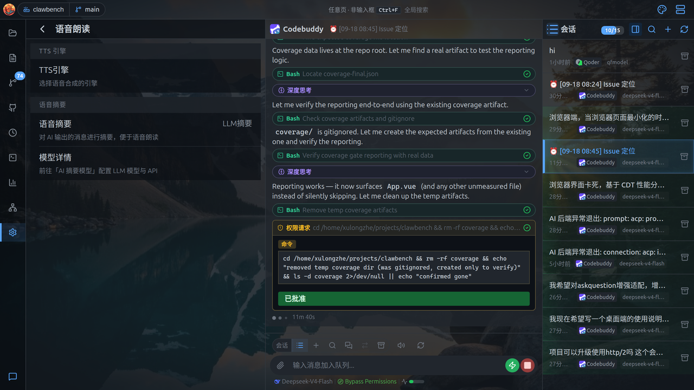

- **TTS 引擎入口**：进入引擎子页配置。可选 **Edge**（免密钥、开箱可用，音色从下拉里选）、**OpenAI 兼容**（填端点、密钥、模型与音色，后两者无默认值）、**阿里云百炼**、**腾讯云语音合成**、**火山引擎（豆包）** 与 **MiniMax**，以及 **手机系统朗读（仅本机）**。**各家的音色各存一份**：切到另一个引擎再切回来，原来的音色还在；语速是所有引擎共用的一项（「我想听多快」只有一个答案）
- **手机系统朗读只在这台手机上生效**：它不写服务端的 `tts.engine`，只在本机记一个开关，所以同一服务器的其他设备仍用服务端引擎。选中时会先检查本机有没有可用的语音引擎和中文语音，缺了就当场提示（不会开了却永远没声音）。**失败时不偷偷换服务端合成**——你选的是手机的声音，混着两种声音根本分不清刚才是谁在念；失败会带上引擎回报的原因（如「手机朗读失败（speak_failed）」），改回别的引擎需要你自己再选一次。手机引擎单段上限约 120 字，长回复按句切段排队播；测试按钮会真的念一句样例。和这个面板的其他字段一样，选完要点**保存**才生效
- **朗读摘要后端**：simple / api / **auto**。simple 直接读原文；api 先让摘要模型压缩再读；auto 按内容的「杂质比例」自动分流（阈值可调），代码块、表格、日志多的回复走 simple，自然语言多的走 api
- **摘要模型**：语音摘要与推荐回复、自动命名**共用同一个摘要模型配置**，点这一行选模型（选的是某个模型提供商下的模型）

> **TTS 缓存策略**：已朗读过的内容会将音频缓存到本地磁盘，下次播放同一内容时直接读缓存，不消耗 TTS API 额度。缓存上限为 100 个文件，超出后按 LRU（最近最少使用）驱逐策略自动清理旧缓存。缓存目录为 `{data-dir}/tts-cache/`，可直接查看或手动清理。缓存键包含引擎、音色、模型与语速——换了任何一个都不会读到旧音频。

## 语音识别

配置把语音转成文字的 STT 服务（语音输入、会议听记都用它）。**移动端**长按发送键的语音输入用它。

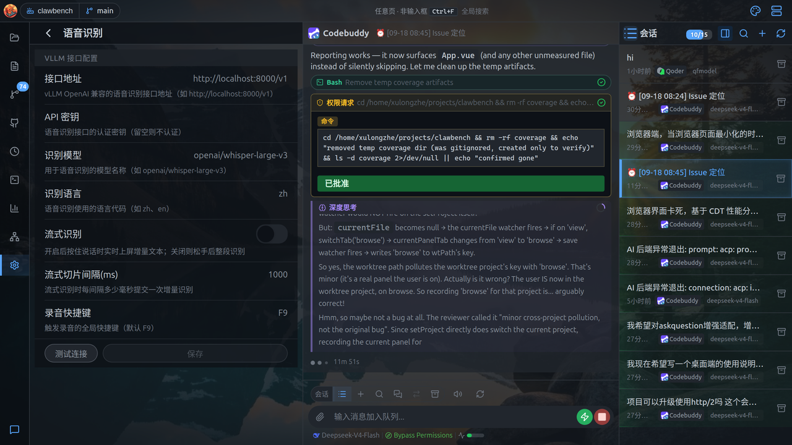

| 设置项 | 说明 |
|---|---|
| **引擎** | 默认是**未配置**（不使用语音识别，按录音键会提示先去选一个）。可选：**OpenAI 兼容接口**（如自建 vLLM Whisper）、**豆包 Seed-ASR**、**阿里云百炼**（Paraformer / Qwen-ASR）或**腾讯云语音识别**。前两者一个按 HTTP 分段上传、一个走豆包的双向 WebSocket；阿里云实时识别同样走双向 WebSocket，整段上传走 Qwen-ASR（默认 `qwen-audio-3.1-asr-flash`，这个模型每月有免费额度）；腾讯云实时识别走双向 WebSocket，整段上传走一句话识别。语音输入与会议听记共用这一个引擎设置 |
| **快捷键** | 触发语音输入的按键（四种引擎共用） |

下面这些是**每个引擎各自一套**，只显示当前选中的那个引擎的。换引擎不会改动另一个引擎已填好的内容，切回来还是原来的配置。

| 设置项 | 说明 |
|---|---|
| **接口地址 / 识别模型 / 语言 / API Key** | OpenAI 兼容引擎专有 |
| **流式识别 / 分片毫秒 / 收尾复核** | OpenAI 兼容引擎专有：边录边传、切片大小（200–10000）、松手后是否再整段复核一遍 |
| **豆包 API Key / Resource ID** | 豆包专有：控制台下发的 Key、接入点资源 id |
| **流式识别 / ITN / 标点 / DDC / 中文变体** | 豆包专有：边录边传、数字规范化、自动标点、顺滑处理（去口头语）、简繁输出 |
| **阿里云 API Key / 服务地址 / 实时识别模型 / 整段上传模型 / 识别语言** | 阿里云专有：默认 `https://dashscope.aliyuncs.com`（新加坡地域填 `https://dashscope-intl.aliyuncs.com`），实时模型默认 `paraformer-realtime-v2`，整段上传默认 `qwen-audio-3.1-asr-flash`。免费额度**按模型发**：`paraformer-realtime-v2` 每月有免费时长，`qwen-audio-3.1-asr-flash` 有一次性额度，而 `qwen3-asr-flash` 在新账号上没有额度、填它按秒计费。识别语言只作提示，留空即自动识别 |
| **流式识别 / ITN / 标点 / DDC** | 阿里云专有 |
| **腾讯云 SecretId / SecretKey / AppID** | 腾讯云专有：API 密钥对。AppID **可以留空**——服务端会用这对密钥自动查出账号 APPID（实时识别要用）；只有密钥没有读取账号信息的权限时才需要手填。密钥只保存在服务端 |
| **识别引擎 / 流式识别 / ITN / DDC / 断句静音** | 腾讯云专有：引擎型号同时决定语种（`16k_zh` 普通话、`16k_en` 英语、`16k_zh_dialect` 多方言等）。**流式识别默认开启**——关掉后录音会在浏览器里转成 WAV 再上传（体积大一些，且整段识别单次最多 60 秒） |

### 麦克风处理

| 设置项 | 说明 |
|---|---|
| **回声消除** | 把喇叭正在放的声音从麦克风里减掉，朗读时靠它。关掉后外放会把自己的话录进去 |
| **背景降噪** | 压掉空调、风扇这类持续的嗡嗡声 |
| **自动音量** | 离麦克风远近不同时自动拉平音量 |
| **高低频过滤** | 切掉 100 Hz 以下的轰隆声和 8 kHz 以上的嘶声，人声原样保留。只影响识别，不影响会议里别人听到的声音 |

回声消除、降噪、自动音量三项在开麦克风时就生效，**会议里也共用这套设置**。

### 什么时候送给识别

| 设置项 | 说明 |
|---|---|
| **安静时不送** | 没检测到人声就不往识别模型发送。省费用，也避免模型对着静音瞎猜出字 |
| **灵敏度** | 多小声才算「有人在说话」：保守 / 标准 / 激进。太激进会吞掉轻声的开头几个字 |

这一组与会议听记共用：听记判断「这段录音里有没有人说话」用的就是同一个阈值。

### 连续对话

| 设置项 | 说明 |
|---|---|
| **触发词** | 在句尾说到其中任意一个就把消息发出去（句子中间不算），多个用逗号分隔 |
| **停顿多久算说完** | 识别出新内容后，安静超过这么多秒就自动发送（默认 3 秒，单位秒）。从最后一个识别出的字开始算，填 0 表示只认触发词 |
| **多久没听到话就退出** | 连续这么久没识别出任何字就自动关闭连续对话（默认 60 秒），免得忘了关一直占着麦克风。填 0 表示不自动退出 |
| **回答时插话** | 不打断 / 一开口就停 / 说唤醒词才停。管的是 AI 回答和朗读期间能不能开口打断它 |
| **打断用的词** | 选「说唤醒词才停」时才出现 |

连续对话模式的用法见 [聊天 → 连续对话](chat.md#连续对话一直听)。

底部有「测试连通」按钮。

> **流式 vs 非流式**：开启流式识别时录音过程中实时返回文字，延迟低；关闭时需说完再返回结果，延迟高但服务端开销小。移动端语音输入强烈建议开启。

## 终端

终端的开关、主题、字号、超时、并发上限与缓冲行数。**移动端**要点为终端主题、字号、默认 shell。

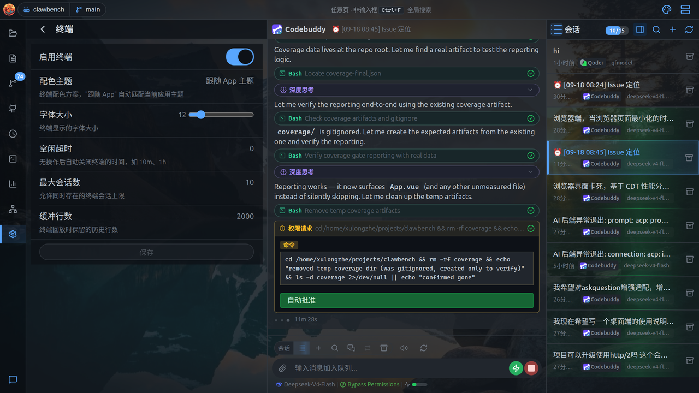

| 设置项 | 说明 |
|---|---|
| **功能状态** | 显示「已启用 / 已停用」，点「去功能编排」改开关 |
| **配色主题** | 终端默认主题 |
| **字号** | 10–24 |
| **空闲超时** | 多久无操作后回收会话 |
| **最大会话数** | 并发上限 |
| **缓冲行数** | 回放缓冲大小 |
| **选中即复制** | 默认开启。拖选/双击选词/三击选行后自动复制到剪贴板，无需再按键；开启后移动端的悬浮复制栏不再弹出 |

> **总开关在[功能编排](#功能编排)**：关掉会**断开所有已打开的终端会话**，左栏页签同时隐藏，文件管理器里的「在此打开终端」也会被禁用。

## 端口映射

把服务器上的端口转发到本地，方便直接访问。**移动端**通过隧道转发（默认 HTTP/2，线路由服务端统一决定）。

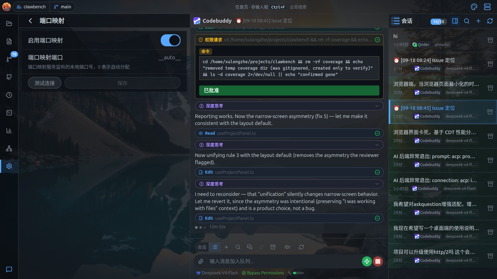

| 设置项 | 说明 |
|---|---|
| **传输方式** | SSH / HTTP/2 二选一（**服务端开关**，所有客户端跟随；默认 HTTP/2） |
| **端口** | SSH 隧道服务端监听端口（0 表示自动分配；界面会显示实际分配的端口号） |

> **没有「启用端口映射」总开关**：功能本身恒开，只剩「走哪条线缆」这一个服务端选择（见下方传输方式）。旧开关被移除是因为它无法诚实地工作——监听器在服务端，而传输选择当时在客户端本地，任何一个值都无法同时服务同一服务器上的所有客户端；现在线路也收到服务端，这个矛盾随之消失。

左侧 Dock 的「端口映射」页签是它的操作界面：

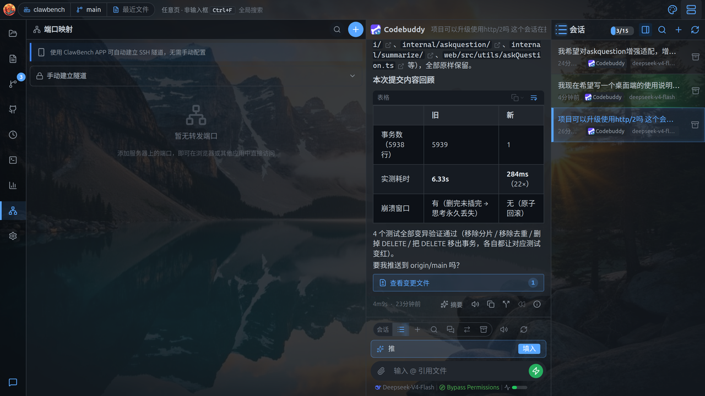

- **使用 ClawBench APP 可自动建立隧道**：移动端会自动配置，无需手动
- **手动建立隧道**：桌面端在浏览器访问时，按提示手动建立
- **转发端口列表**：添加服务器上的端口后，即可在浏览器或其他应用中直接访问
- **刷新按钮**：面板头部新增刷新按钮（带旋转 / 完成打勾反馈），一轮同时刷新端口列表、隧道判定与传输方式行；**切到该页签（含记忆面板恢复）时会自动刷新一次**，无需手动
- **扫描端口**：面板头部的扫描按钮打开「端口扫描」抽屉，列出服务器上**正在监听但尚未加入映射**的端口（含协议与占用进程名），点条目即可一键加入映射；抽屉内可重新扫描
- **打开设置**：面板头部的齿轮按钮直接跳到本页（端口映射设置）；返回（Android 物理返回键 / 边缘滑动）会回到端口映射面板

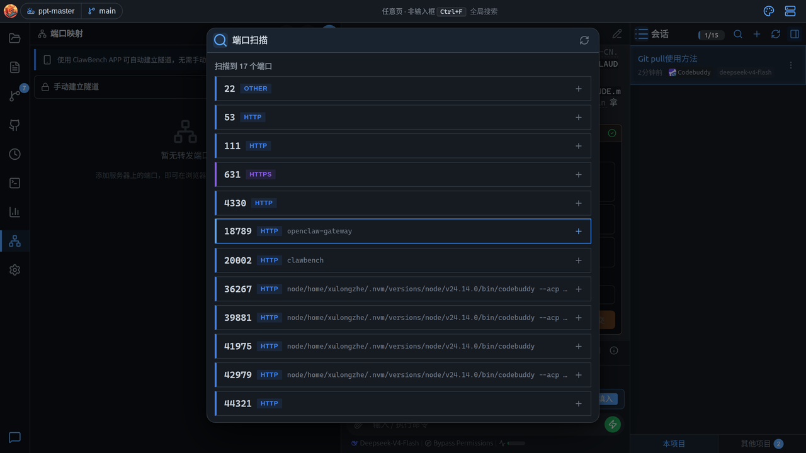

每条映射带一个**方向**，列表中用徽章区分：

| 方向 | 含义 | 典型用途 |
|---|---|---|
| **正向**（↑，ssh -L） | 服务器端口 → 你本机 | 在本地浏览器访问服务器上的服务（最常见） |
| **反向**（↓，ssh -R） | 你本机端口 → 服务器 | 让**服务器上的进程**访问你本机运行的服务（如本地的模型、调试服务） |

新建映射时可选择方向，表单里「端口 / 主机」的含义随方向切换。反向映射只在服务器的 `127.0.0.1` 上监听（不会暴露到服务器所在网段），因此条目的操作按钮是**「复制服务器侧地址」**而非「打开」——那个地址只有服务器自己能访问。

> **反向映射的限制**：不能绑定 ClawBench 自身的 HTTP 端口与 SSH 端口；端口被占用时会在分配阶段自动改选，SSH 握手阶段不会改绑。

> **本地端口被占用会自动改绑**：无论正向还是反向，本机监听端口若已被别的进程占用，会自动在请求端口之后寻找空闲端口，并把实际使用的端口回显到界面——列表里显示的端口就是真实可用的那个。若提示「端口被占用」，指的是**你本机**的端口冲突；与「隧道不可达」（服务未运行）是两种不同的问题。

**传输方式**：这是一个**服务端配置项**（网页、桌面、手机看到的是同一份），不是每台设备的本地偏好——同一条服务器上的所有客户端都跟随它。两种方式承载同样的端口映射，区别只在底层线缆：SSH 走独立的 20001 端口，HTTP/2 复用主端口 20000（只需放行一个端口，适合防火墙受限的环境）。默认 HTTP/2。

> **选 HTTP/2 时服务端根本不监听 SSH 端口**：不是"建议用 h2"，而是 20001 不会打开，`/api/tunnel/*` 则反过来在选 SSH 时返回 503。因此**网页端（浏览器）只能在选 SSH 时手动 `ssh -L`**——浏览器不支持 h2 隧道所需的流式请求体，面板里的手动隧道教程也只在 SSH 线路下出现。需要保留网页手动 ssh 的部署，把传输方式设成 SSH。
>
> **切换即时生效**：这一行和其他设置一样是**草稿**，点面板的**保存**才提交；保存后服务端会立刻启停对应监听器（不需要重启），客户端在下一次建连前读取服务端值并跟随，本地存的偏好只在读不到服务端时兜底。选 HTTP/2 时 SSH 专有字段会即时隐藏。

> **升级后会自动切到 HTTP/2**：旧配置里没有这个字段、或还留着已废弃的 `both` 的，启动时都会按 `h2` 生效——也就是说升级后 20001 不再监听。之后你手动改成 SSH 会一直保持 SSH，不会被下次启动改回来。

**移动端**端口映射页可把服务器端口转发到本地（App 模式支持自动建立隧道）：

> **自动分配端口**：设为 0 表示自动分配（主端口 + 1），界面会显示「自动（实际端口号）」；手动填入端口号则使用指定端口（需确保端口未被占用）。

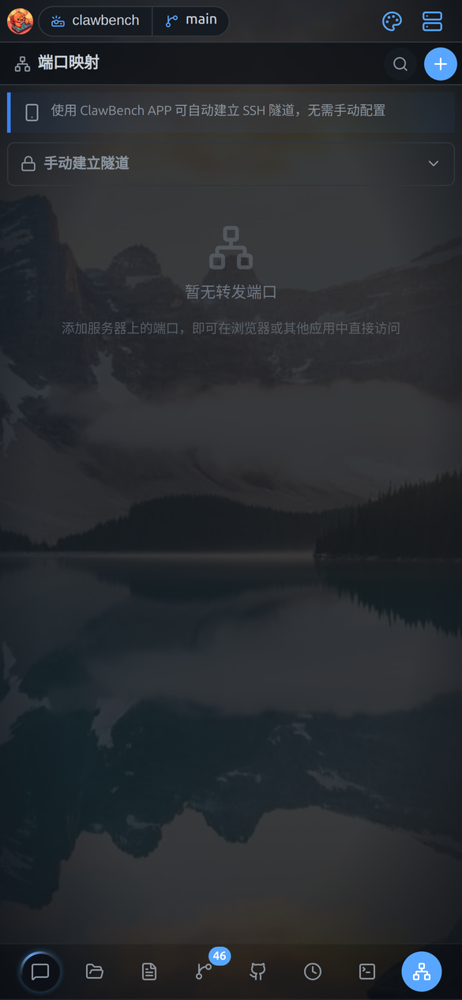

**移动端**同样有端口扫描抽屉（点面板头部的扫描图标）：

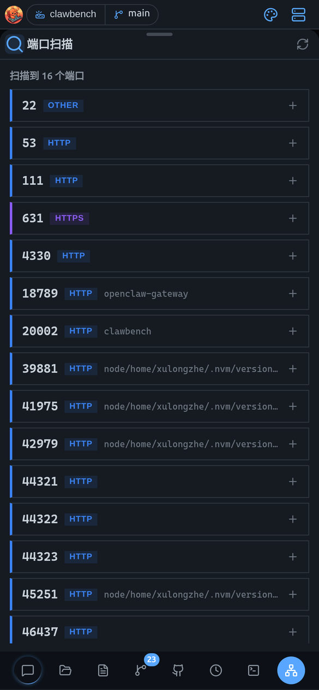

> **状态行只有一个动作按钮，它会随场景换名字**：有启用的转发端口时是**「重新检测」**（刷新隧道与端口存活）；**一个端口都没有时变成「测试链路」**——此时隧道服务本来就停着，「重新检测」只能回答「未连接」，测不出所选线路到底通不通。测试会临时建一条映射、本地监听就绪即判定成功、随即删掉（不写进端口列表，用完即走）；传输方式还没保存时按钮叫**「保存并测试」**，先落盘再测，避免测的是旧线路却给出与选择器相反的结论。
>
> 有端口时仍然**没有「测试连通」按钮**：端口映射面板用**状态行**作为唯一的就绪信号——它同时反映服务端监听、客户端隧道与每条端口的存活情况。服务端内部的连通测试无法观测到「客户端是否真的连上」，两行回答重叠的问题，因此已合并掉。

## 内网穿透

> **已移除**：FRP 反向代理功能已于本版本移除。公网访问配置请见 [公网访问指南](PUBLIC_ACCESS.md)。

## 邮件

内置邮件客户端的账号与功能状态。**移动端**同样是这几项。

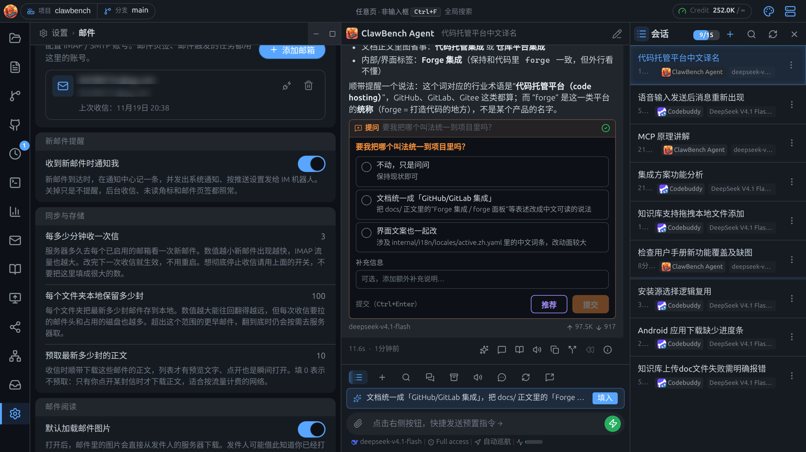

| 设置项 | 说明 |
|---|---|
| **功能状态** | 显示「已启用 / 已停用」，点「去功能编排」改开关。关掉即停后台收信与邮件触发的任务，账号与已收邮件都保留；左栏「邮件」页签同时隐藏，「用邮件发送」等入口也会被禁用 |
| **邮箱账号** | 添加 IMAP + SMTP 账号（邮箱地址、密码 / 授权码、收信与发信服务器及端口），可编辑、删除、测试 |
| **新邮件提醒** | 服务端设置，默认**开**。新邮件进收件箱时在通知中心记一条、弹系统通知、并按推送设置发给 IM 机器人；一轮同步到了多封时合成「收到 N 封新邮件」一条。关掉只是静音提醒，后台收信、未读角标和邮件页签照常 |
| **默认加载邮件图片** | 本机设置，默认**开**。打开后邮件正文的图片直接向发件人服务器下载，排版与真实邮件一致；关掉则恢复拦截，顶部出现「外部图片已拦截」，需要时点「显示图片」临时加载这一封 |

- **第一次加账号不会补弹历史邮件**，只有之后新到、且尚未被其它设备标为已读的收件箱邮件才提醒；别的文件夹（归档 / 标签 / 已发送）不提醒
- **图片开关只影响这台设备怎么画邮件**，不动服务端收信；改完对已打开的邮件立即生效
- **介意追踪像素就关掉**：发件人可以借此知道你已经打开了这封信（阅读回执），也会看到你的 IP 地址。关掉后单封「显示图片」只给那一封放行，不会解除全局拦截

- **QQ / 163 用「授权码」，不是登录密码**；Gmail / Outlook / iCloud 要先开两步验证再生成「应用专用密码」
- **账号属于这台服务器**：同一服务器的所有客户端共用一份，换设备不用重配；在功能编排里关掉邮件不会删账号，重新打开即从原处继续
- 密码明文存在服务器数据库里（与模型提供商的密钥同一取舍），接口默认只回「已设置」，只有编辑表单会回填

> 邮件面板本身的用法见 [邮件客户端](mail.md)。

## 分享中心

分享链接的规则。**总开关不在这里**——它在[功能编排](#功能编排)里，关掉会**撤销所有已经发出去的链接**，旧链接直接 404；重新打开也不会恢复，需要重新生成。

| 设置项 | 说明 |
|---|---|
| **功能状态** | 显示「已启用 / 已停用」，点「去功能编排」改开关 |
| **允许分享文件 / 会话 / 会议** | 三类分别开关。关掉哪一类，新建该类分享就会被拒绝，对应入口也一并禁用 |
| **文件分享允许下载** | 关闭后，文件分享页只能在线预览、不能下载原文件；已发出的链接同样立即生效。对会话与会议分享没有影响 |
| **分享链接默认有效期（天）** | 新生成的链接多少天后失效，**0 表示永久**。已经发出去的链接不受影响，仍按生成时的有效期 |
| **分享页显示来源项目名** | 关闭后分享页不显示内容来自哪个项目（链接预览里也不显示） |

> **关闭分享后受影响的入口**：文件管理器与文件预览的「分享链接」、聊天的「分享会话」、会话列表的「分享会话」、会议详情与资源页的「发布分享 / 停止分享」，以及会话列表里的「已分享」徽标（会被清空）。**「分享到其他应用」是系统分享，仍然可用**；文件管理器的批量分享按钮也保留。

## 代码托管集成

入口名为「代码托管集成」，支持 **GitHub、GitLab（含自建实例）与 Gitea / Forgejo**。保存各仓库平台的访问令牌，并控制哪些事件要通知。**移动端**同为绑定仓库、令牌。

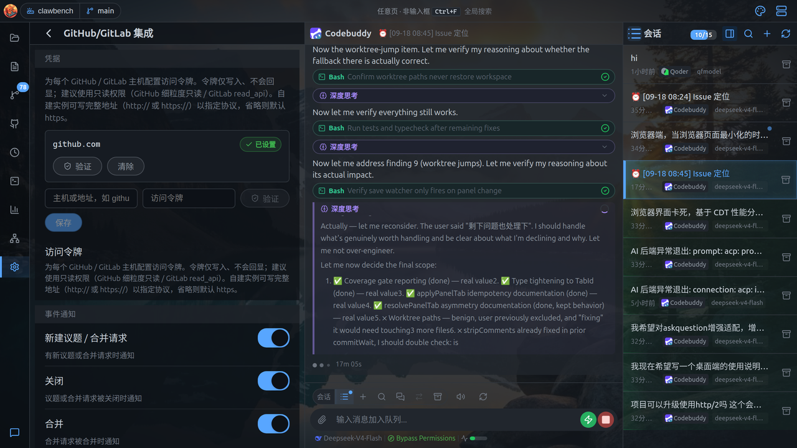

- **功能状态**：只显示「已启用 / 已停用」并提供「去功能编排」入口。**开关在功能编排里**——关掉即**真正停用**整个集成（不是只隐藏入口）：轮询停止、forge 页签不可达，并**解除全部项目的仓库绑定**；重新打开不会自动恢复这些关联。关闭前会弹确认框
- **凭据区**：按 host 分别保存访问令牌，可验证 / 清除 / 添加。每行还显示这台主机被当成哪个平台，并在添加时可选平台（自动识别 / GitHub / GitLab / Gitea·Forgejo）——**自建 Gitea 必须选**，否则按 GitLab 对待
- **通知开关**：新建议题、关闭、合并、重新打开、评论、流水线完成
- **跳过 TLS 校验**：自建实例用自签证书时开启
- **暂停事件任务**：临时停止所有事件触发的任务

## 消息推送

决定完成、审批、仓库动态等提醒通过哪些渠道发给你。**移动端**含应用内通知、系统通知、IM 推送，以及 App 专有开关。

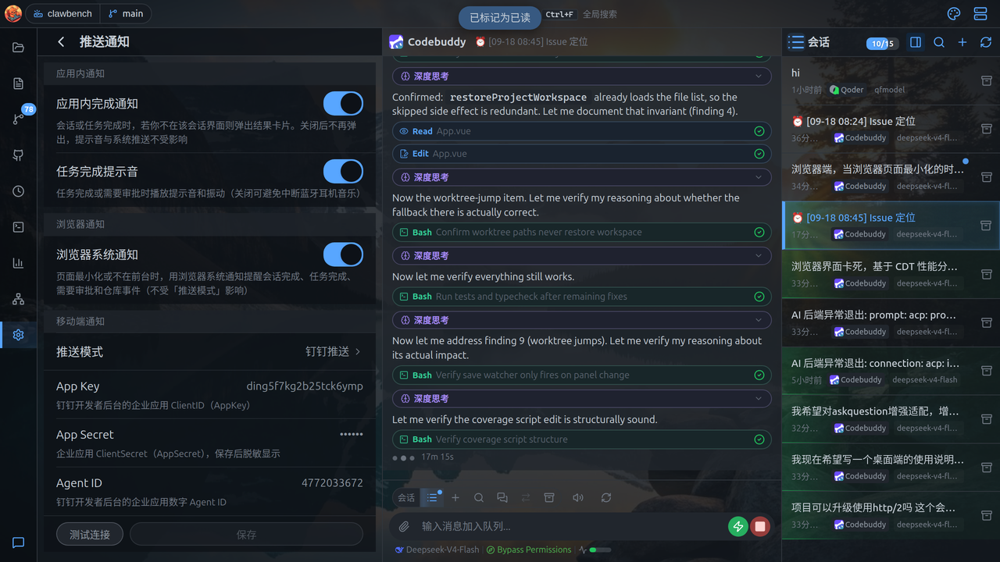

| 设置项 | 说明 |
|---|---|
| **应用内完成通知** | 会话/任务完成时弹出卡片 |
| **任务完成提示音** | 通知音效（关掉可避免蓝牙耳机中断） |
| **浏览器系统通知** | 窗口最小化或不在前台时，用操作系统通知提醒会话完成、任务完成、需要审批和仓库事件。浏览器与 App 模式都可用；桌面端走原生通知最可靠 |
| **悬浮状态窗** | App 模式专属 |
| **实时更新** | App 模式专属 |
| **推送方式** | 原生 / 钉钉 / 飞书 / 微信 / 关闭；钉钉与飞书各自有 app_key、app_secret 等字段，**微信没有密钥可填**——选它会出现扫码登录面板（详见 [微信推送](WECHAT_PUSH.md)） |

底部有「测试连通」按钮。

> **「推送方式」与「浏览器系统通知」互不影响。** 「推送方式」选的是**手机与 IM** 通道（原生推送 / 钉钉 / 飞书 / 微信），设成「关闭」只表示不再往手机和 IM 发消息；只要「浏览器系统通知」开着，网页端最小化时仍会弹系统通知。反过来，关掉「浏览器系统通知」也不影响手机推送。若想彻底静音，两处都要关。

App 模式下，**设置 → 消息推送**里会多出一组「桌面与系统」卡片，这是浏览器模式没有的：

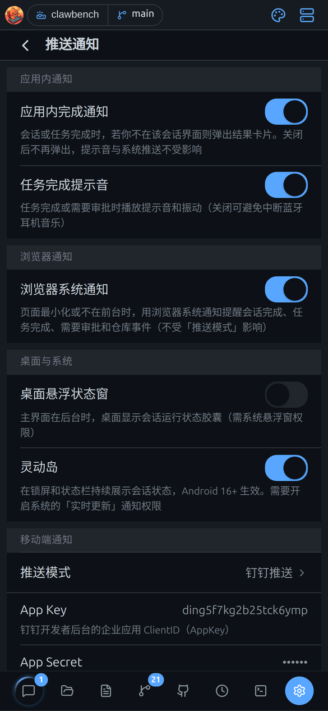

## 用量监控

统计用量，并可选地设一个周期额度：系统按时间进度算出「此刻最多该用多少」，与实际用量对比，跑快了就提醒你一次。**与「消息推送」并列而不是嵌在它里面**——它的配置主体是周期/指标/额度，不是又一条推送通道。

| 设置项 | 说明 |
|---|---|
| **启用用量统计** | 面板顶部的独立开关，是唯一的开/关。关掉时下面的行**禁用而不隐藏**——存好的规则还看得见、能改，重新打开不用重填 |
| **监控指标** | Token / Credit / 费用（USD）三选一。**切换会清空额度**——三者量纲不同，不能换算 |
| **周期类型** | **固定天数**（从起始时间起每 N 天一轮）或**自然月**（按日历月滚动），二选一 |
| **起始时间** | 从这个时刻开始统计（按**服务端本地时区**，与 cron 一致）。**留空即统计全部历史**；填上时分秒可让周期在指定时刻滚动。**选自然月时，这里的日号就是每月换周期的那一天**（1 号即自然月） |
| **周期** | 仅固定天数模式显示：每 N 天一轮（1–366），到点自动滚动到下一轮。**留 0 表示不设周期**，累计值永不归零（不会偷偷按月清零） |
| **额度** | 一个周期的预算。**留 0 或留空表示不设预算**——只统计用量，不做超额提醒 |

**每一项都是可选的**，系统按已配置的内容做最大程度展示：只填起始时间 → 「从那时起到现在用了多少」；再加周期 → 按周期统计并算出应花；再加额度 → 才有基准线、剩余与用尽预测。缺一项只是读数变小，不是错误。

- 统计范围是**全部项目合计**，与你当前停在哪个项目无关
- 基准线是**线性匀速、按整天取整**：周期第 1 天就有 1 天额度（不会一开局就误报），最后一天等于总额度。进度条上那根刻度就是它——读数相对刻度的位置才是重点
- **自然月的周期长度跟着月份走**：2 月 28/29 天、其余月份 30 或 31 天，所以「第 10 天该花多少」每月不同。日号 31 遇到小月自动落到月末，下个月仍按 31 推算，不会永久漂到 28 日
- **只提醒，不拦截**：超出后 AI 照常运行。**越过基准线提醒一次，用尽再提醒一次**，一整个周期最多两条；两者同时成立时只发「已用尽」。**没有额度或没有周期就不发**——「超出计划」是关于基准的陈述，基准不存在时不编造
- 改启用状态 / 额度 / 周期类型 / 起始时间 / 周期天数 / 指标视为新规则，会清除已提醒状态（可以再提醒一次）

> **在哪儿看**：宽屏 header 右侧的**用量胶囊**（图标 + 用量 + 进度条 + 基准线刻度），点开有实际/应花/额度三对比条、剩余每日可用与用尽预测。没设的项按**无限**显示（额度、剩余、剩余每日显示 `∞`，没周期时显示「第 N / ∞ 天」、「按当前速度」显示「本周期不会用尽」），只有真正无从计算的进度条与基准线才省略；徽章相应分为「在计划内 / 仅统计用量 / 未设周期」。**未启用时**胶囊位置是一个「设置用量提醒」的虚线占位按钮，点击直达本页。**移动端**没有胶囊，同样的数字在系统资源面板末尾一行，点它直接跳到这一页。

## 安全

配置 HTTPS 证书与修改访问密码。

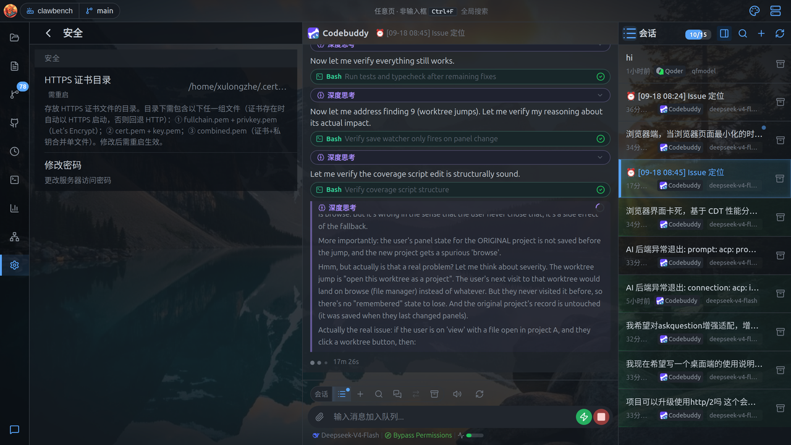

| 设置项 | 说明 |
|---|---|
| **HTTPS 证书** | 查看当前状态、一键生成自签名证书，或删除证书回到 HTTP（见下） |
| **HTTPS 证书目录** | 存放证书文件的目录（修改后需重启） |
| **修改密码** | 打开改密弹窗 |

> **文件分享 Token 安全模型**：分享链接中的 token 即为访问凭证——任何人拿到链接即可只读访问对应文件，无需额外认证，且链接在关闭分享前持续有效。敏感文件请勿生成分享链接，或生成后尽快手动关闭分享。

### HTTPS 证书

「HTTPS 证书」面板把「怎么开 HTTPS」这件事从改配置文件变成点一个按钮：

- **当前状态**：未配置（HTTP）/ 已启用（自签名）/ 已启用（CA 签发），并列出证书**覆盖的地址**与**到期时间**
- **生成自签名证书**：一次覆盖**本机所有网卡地址（IPv4）+ localhost**。换网络后 IP 变了要重新生成一次——面板列出的地址就是证书认的地址，不在其中的地址浏览器会报错
- **额外地址**：给当前没配在网卡上的固定 IP 或域名（如办公室固定 IP、内网域名），逗号分隔
- **已启用 CA 证书时**：不会静默覆盖——点「重新生成」后先出现提示「现有证书不是自签名证书，覆盖后无法恢复」，再点一次**「仍要覆盖」**才真正写入
- **删除证书**：二次确认后清掉证书目录里全部已知的证书与私钥文件，下次启动回到 HTTP。删除后同样给「立即重启」按钮，但不再列 https 地址——重启后就没有 HTTPS 了
- **写完要重启**：监听器在启动时创建，面板会直接给一个**「立即重启」**按钮，并在下方列出重启后该用的 HTTPS 地址

> **什么时候需要 HTTPS**：成员共享屏幕、观众开麦这些能力浏览器**只在安全上下文提供**（`navigator.mediaDevices` 在 `http://192.168.x.x` 下直接不存在）。自己用不共享可以不配。
>
> **不想开界面**：命令行 `./clawbench --gen-cert` 生成同样的证书后退出，下次启动即生效。

> **目录自动发现**：`cert_dir` 下放好证书就会自动以 HTTPS 启动，无需额外开关。识别三组文件名：`fullchain.pem` + `privkey.pem`（Let's Encrypt）、`cert.pem` + `key.pem`、或合并单文件 `combined.pem`；找不到有效证书对则回退 HTTP。

## 调试

打开日志回传排查问题，以及查看 WebSocket 投递统计。**移动端**含日志捕获、重配服务器（App 专有）。

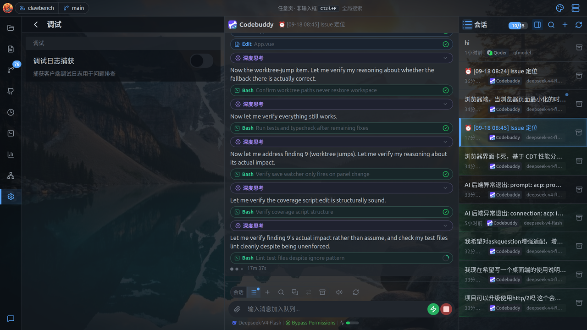

| 设置项 | 说明 |
|---|---|
| **调试日志捕获** | 把前端与 App 日志回传到服务器（默认关闭） |
| **智能体环境** | 是否把用户 shell 启动文件（`.bashrc` / `.zshrc`）里的变量交给智能体（默认关闭，见下） |
| **重新配置服务器** | App 模式专属 |

开启日志捕获后，日志写入 `{data-dir}/logs/client.log`，可用 `tail -f` 查看。

> **智能体环境默认关闭的原因**：要拿到 `.bashrc` 里的变量就必须真的执行它，而这些变量里常有代理、令牌等敏感内容，会一并交给每个 AI 进程。需要让智能体走代理或读某个环境变量时再打开；改完下一个启动的智能体进程生效，不必重启服务。

> **WS 投递统计**：调试页底部显示 WebSocket 投递统计（`GET /api/ws/delivery-stats`），记录按原因的投递丢弃计数（网络慢/缓冲区满/客户端离线等）。如发现投递丢弃数持续增长，说明 WebSocket 通道存在瓶颈，可据此判断是否网络问题或服务端积压。

## 关于

版本信息、PWA/APK 入口、重启服务端与检查更新。**移动端**为版本信息、更新检查。

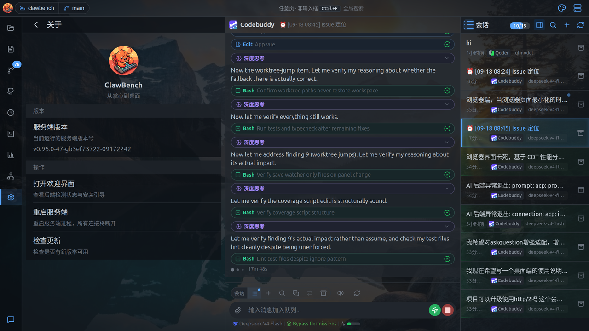

| 设置项 | 说明 |
|---|---|
| **服务端版本 / 应用版本** | 当前版本号 |
| **项目主页** | 在系统浏览器打开项目主页（https://clawbench.pages.dev） |
| **GitHub 主页** | 在系统浏览器打开 GitHub 仓库 |
| **问题反馈** | 前往 GitHub 提交问题或建议 |
| **添加到主屏** | PWA 安装 |
| **下载桌面版** | 下载当前平台的桌面客户端（仅在该平台存在下载时显示；详见[桌面客户端](desktop.md)） |
| **下载安卓应用** | 下载 APK |
| **显示欢迎页** | 重新打开首次访问的欢迎面板 |
| **重启服务端** | 重启 ClawBench 进程（失败会在界面上明确报错，不再静默无反应；重启后页面会等到**新进程**应答才自动刷新，见下） |
| **检查更新** | 检查新版本 |

**重启后会自动等到新进程起来再刷新**：点「立即重启」后页面进入遮罩态并每 2 秒探测一次，只有确认**应答的已经是新进程**才自动刷新，所以不会出现「刷新了但还是旧版本」的错觉。三种失败都会明确告诉你，而不是一直转圈：

| 界面提示 | 含义 |
|---|---|
| 服务端没有重启（仍在运行原来的进程），请检查服务端日志 | 请求已发出，但一直是同一个进程在应答——重启实际没发生 |
| 服务器未在预期时间内恢复，请手动刷新页面 | 超过两分钟没等到应答（进程崩溃或端口被占） |
| 重启失败，服务端仍在运行旧版本 | 请求当场被拒绝（例如可执行文件不可用），旧进程完好 |

**移动端**「下载 Android 应用」入口在 **设置 → 关于 → 下载 Android 应用**（仅 Android UA 可见）：

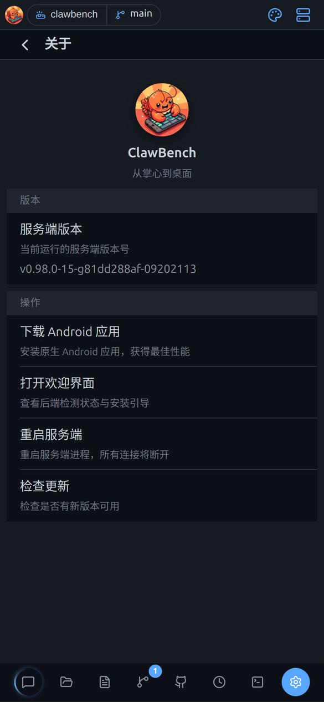
